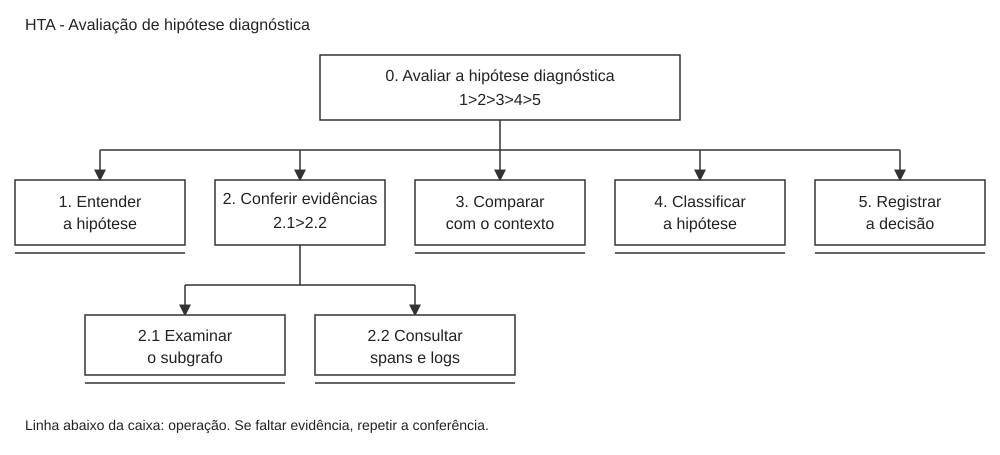

# Entrega 5 — T01: avaliar uma hipótese diagnóstica

[← Voltar à Entrega 5](../05_analise_tarefas.md) · [Matriz de rastreabilidade](../../RASTREABILIDADE.md)

**Data:** 17/09/2026

**Última revisão:** 08/10/2026

**Status:** 🟨 em andamento

**Autor(a):** Gabriel Lovato — 22.123.004-8

**Responsabilidade:** cada integrante modela uma única técnica (HTA, GOMS ou CTT) sobre uma tarefa própria, conforme orientação da disciplina. Nesta tarefa, Gabriel responde pelo **HTA**.

> **Estado da consolidação:** texto e diagrama do HTA integrados; revisão conjunta pendente. [H] O fluxo é uma proposta derivada de P02/C01 e H03, sem validação de campo.

## Objetivo da atividade

Analisar como o usuário avalia uma hipótese sobre a causa de uma falha em um sistema distribuído. O HTA mostra a divisão da tarefa em objetivos e operações e os planos que orientam sua execução.

## 1. Tarefa escolhida

| ID | Tarefa | Persona | Cenário relacionado | Autor |
|---|---|---|---|---|
| T01 | Avaliar uma hipótese diagnóstica e decidir se ela é sustentada pelas evidências | P02 — Lucas, desenvolvedor backend | C01 — Falha no checkout após um deploy | Gabriel Lovato |

O TCC utiliza um pipeline em dois estágios: primeiro seleciona evidências em um grafo de observabilidade e depois usa um modelo de linguagem (LLM) para gerar hipóteses sobre a falha. Escolhi avaliar essas hipóteses porque uma explicação pode parecer correta sem corresponder ao que aconteceu no sistema.

No cenário C01, Lucas precisa separar a falha inicial dos erros que surgiram nos outros serviços. A tarefa T01 aborda uma parte desse trabalho: conferir uma explicação recebida antes de usá-la para orientar uma correção. Ela também se relaciona com H03, da Entrega 1, sobre apresentar as hipóteses junto das evidências que as sustentam.

A tarefa começa com a hipótese e suas evidências disponíveis. Termina quando Lucas registra sua avaliação e o motivo da decisão. A geração da hipótese, o treinamento dos modelos e a implementação do pipeline não fazem parte da tarefa humana analisada aqui.

Esta é uma modelagem proposta para a interface da disciplina, baseada nas entregas anteriores. Não foi realizada uma observação de usuários para confirmar o fluxo. A frequência de uso e os critérios de avaliação ainda precisam ser investigados. A tarefa foi considerada crítica porque uma interpretação errada pode direcionar a correção ao serviço errado.

## 2. HTA — Avaliar uma hipótese diagnóstica

**Autor(a):** Gabriel Lovato — 22.123.004-8

### Descrição

Lucas lê a hipótese, confere os registros associados e compara a explicação com o contexto do incidente. Depois, decide se há suporte para a hipótese e registra uma justificativa. Se faltar informação, ele volta à conferência das evidências.

### Diagrama

*Figura 1 — HTA da avaliação de uma hipótese diagnóstica. Fonte: elaboração do autor, com notação baseada no material de aula.*

As caixas representam objetivos e operações. O plano dentro da caixa indica a ordem das etapas. A linha abaixo da caixa marca uma operação: neste modelo, a decomposição para nesse nível, embora a operação ainda possa envolver várias ações.

### Tabela detalhada

| ID | Objetivo/operação | Plano, entrada e retorno | Problema e recomendação |
|---|---|---|---|
| 0 | Avaliar a hipótese diagnóstica | **Plano:** 1 > 2 > 3 > 4 > 5. **Entrada:** hipótese e evidências do incidente. **Retorno:** avaliação registrada com justificativa. | O texto gerado pode passar uma certeza que os dados não sustentam. Manter clara a diferença entre hipótese e causa confirmada. |
| 1 | Entender a hipótese | Identificar a causa apontada, o serviço envolvido e o impacto descrito. **Entrada:** explicação produzida pelo pipeline. **Retorno:** Lucas entende o que precisa verificar. | Uma explicação genérica dificulta a conferência. Apresentar a causa provável de forma direta, sem esconder as incertezas. |
| 2 | Conferir as evidências | **Plano:** 2.1 > 2.2; repetir quando necessário. **Entrada:** subgrafo e registros relacionados. **Retorno:** evidências favoráveis, contraditórias ou insuficientes identificadas. | A explicação pode citar dados sem deixar claro onde encontrá-los. Relacionar a hipótese aos registros utilizados. |
| 2.1 | Examinar o subgrafo | Observar os serviços envolvidos e o caminho da requisição com falha. **Retorno:** identificação das dependências relevantes. | Muitas conexões podem dificultar a leitura. Destacar o caminho relacionado ao incidente. |
| 2.2 | Consultar spans e logs | Conferir horários, mensagens de erro e detalhes das chamadas. Um span representa uma operação dentro do trace de uma requisição. **Retorno:** registros que ajudam a verificar a explicação. | Dados importantes podem ficar misturados com informações sem relação com a falha. Permitir aprofundamento nos registros dos componentes selecionados. |
| 3 | Comparar com o contexto | Comparar os registros com a arquitetura, o período do incidente e as mudanças recentes. **Retorno:** avaliação da compatibilidade entre os dados e a causa apontada. | Um erro após o deploy não significa, por si só, que o deploy foi a causa. Conferir também a ordem dos eventos e as dependências. |
| 4 | Classificar a hipótese | Escolher entre sustentada, parcialmente sustentada ou não sustentada. Se faltar informação importante, retornar a 2 ou 3 antes de concluir. **Retorno:** decisão sobre a hipótese. | Uma classificação apenas de certo ou errado pode esconder que parte da explicação é útil. Permitir registrar suporte parcial e limitações. |
| 5 | Registrar a decisão | Informar a classificação, a justificativa e as dúvidas restantes. **Retorno:** decisão disponível para consulta e repasse à equipe. | Sem justificativa, outra pessoa não consegue conferir o motivo da decisão. Registrar a avaliação junto da hipótese original. |

A classificação “sustentada” indica que a hipótese é compatível com as evidências consultadas, não que a causa foi comprovada. Essas categorias são uma proposta e ainda precisam ser validadas com desenvolvedores e SREs.

## 3. Síntese da contribuição individual

A análise mostra que gerar uma explicação não encerra o diagnóstico. Lucas precisa conferir de onde ela veio e se os registros fazem sentido para o incidente. A filtragem pode reduzir o volume de dados, mas ainda é necessário conseguir consultar os detalhes e reconhecer contradições.

Para o protótipo, os pontos principais são relacionar a hipótese às evidências, permitir a consulta ao subgrafo e aos registros e registrar a decisão com uma justificativa. No teste de usabilidade, uma tarefa possível é apresentar uma hipótese com uma evidência contraditória e observar se o participante identifica o conflito antes de aceitá-la.

O HTA ajuda a organizar essa interação, mas não valida a precisão do pipeline. Também não confirma H03: ainda é necessário investigar se a apresentação das evidências realmente ajuda o usuário a avaliar a hipótese.

## Referências

- **CC8122 — HTA.** Material de aula disponibilizado na disciplina, consultado em 17/09/2026. Referência utilizada para a hierarquia, os planos e a marcação das operações.
- **BARBOSA, Simone D. J.; SILVA, Bruno S.** Interação Humano-Computador. 2010. Obra indicada nos materiais de aula.
- Documentos do projeto: [Entrega 1](../01_conhecendo_o_problema.md), [persona P02](../03_personas_contexto_jornada.md#persona-p02--lucas-o-desenvolvedor-sênior) e [cenário C01](../04_cenarios_problema/c01.md).

## Rastreabilidade e histórico da consolidação

**Cadeia:** P02 → C01 → H03 → R01 → T01 → HTA. Próximos modelos e avaliações permanecem PENDENTE.

**Origem:** Gabriel Lovato, [commit 2f91011](https://github.com/willianverenka/template-ihc2026/commit/2f910111798155f7fff82a24b6cee5eddf58fee4), de 17/09/2026. Autoria da modelagem preservada.

| Data | Alteração | Responsável |
|---|---|---|
| 08/10/2026 | Lucas foi alinhado de P01 para P02; T01 e os modelos foram preservados. Ajustados navegação, links, autoria e vínculo R01; barras do operador CTT escapadas para preservar a tabela no Markdown. Organização em arquivo individual. | Willian Verenka Oliveira Silva |
| 14/10/2026 | Aplicada a regra de uma técnica por integrante: mantido o HTA. GOMS e CTT saíram da entrega e permanecem no commit de origem 2f91011; `ctt_t01.svg` foi excluído. | Willian Verenka Oliveira Silva |
