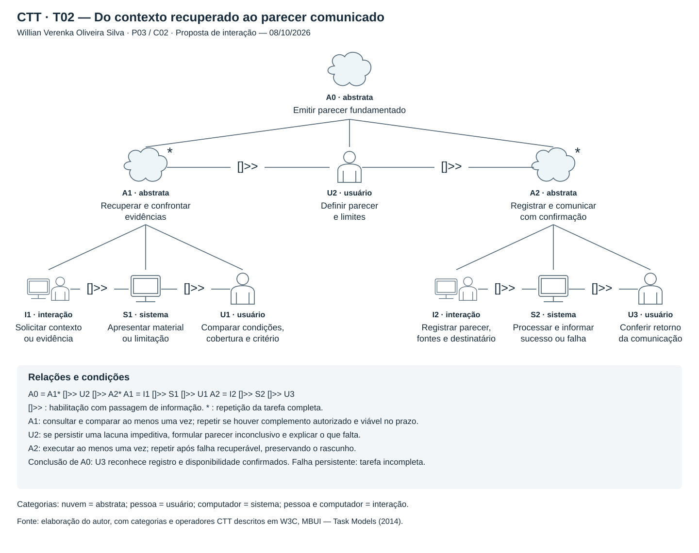

# Entrega 5 — T02: emitir um parecer sobre a verificação da correção

[← Voltar à Entrega 5](../05_analise_tarefas.md) · [Cenário C02](../04_cenarios_problema/c02.md) · [Rastreabilidade — R02](../../RASTREABILIDADE.md#3-rastreabilidade-entre-contribuição-técnica-necessidades-e-artefatos)

**Autor(a):** Willian Verenka Oliveira Silva — 22.124.081-5

**Data:** 08/10/2026

**Última revisão:** 15/10/2026

**Status:** 🟨 em andamento

**Responsabilidade:** cada integrante modela uma única técnica (HTA, GOMS ou CTT) sobre uma tarefa própria, conforme orientação da disciplina. Nesta tarefa, Willian responde pelo **CTT**.

**Escopo desta versão:** primeira modelagem individual; revisão com a orientação da aula e validação com participantes pendentes.

## 1. Objetivo e entradas

Analisar como Mariana, analista de qualidade de software (QA), recupera o contexto de um incidente, avalia o alcance das evidências disponíveis e comunica um parecer sobre a verificação de uma correção. A análise utiliza o **CTT** (*ConcurTaskTrees*), técnica que modela as tarefas, suas categorias (usuário, interação, sistema e abstrata) e as relações temporais entre elas.

| Entrada | Relação com T02 |
|---|---|
| [Entrega 1 — A03](../01_conhecendo_o_problema.md#32-quais-são-as-atividades-mais-importantes) | Classificar se os bugs foram realmente resolvidos. |
| [P03 — Mariana](../03_personas_contexto_jornada.md#persona-p03--mariana-a-analista-de-qa) | Precisa receber o contexto preservado e distinguir resultado de teste, hipótese diagnóstica e conclusão humana. |
| [C02 — O teste passou, mas a correção ainda é incerta](../04_cenarios_problema/c02.md) | Uma compra bem-sucedida em homologação não esclarece se a condição da falha intermitente foi exercitada. |
| [R02; H04, H05 e H06](../../RASTREABILIDADE.md) | Colaboração, perda de contexto no repasse e limites das evidências. |

**[F] Base documental:** A03, P03 e C02 já existem no projeto. **[H] Modelagem proposta:** os passos, critérios e respostas de interface abaixo são hipóteses de interação derivadas desses documentos, sem observação de profissionais. **[?] Lacunas:** frequência da tarefa, critérios reais de conclusão, disponibilidade de evidências e forma de comunicação devem ser investigados nas questões Q1–Q6 de C02. A modelagem não sustenta nem refuta H04, H05 ou H06.

## 2. Tarefa escolhida e limites

| Campo | Definição |
|---|---|
| ID e tarefa | **T02 — Emitir um parecer fundamentado sobre a verificação da correção de um incidente.** |
| Persona e cenário | P03 — Mariana; C02. |
| Objetivo humano | Explicar à equipe o que as evidências permitem concluir, quais limites permanecem e o que falta esclarecer. |
| Início | Mariana recebe um pedido de parecer, uma referência ao incidente e os resultados de verificações já realizadas, ainda que incompletos. |
| Conclusão | Parecer registrado e disponibilizado ao destinatário autorizado, com conclusão, evidências e limites; uma conclusão inconclusiva também pode cumprir a tarefa. |
| Contexto | Antes da liberação de uma correção; produção e homologação podem diferir; parte da telemetria pode estar indisponível. |
| Frequência e criticidade | [?] Frequência a investigar. [H] Criticidade alta pelo risco de afirmar uma correção sem suporte ou atrasar o parecer sem identificar a lacuna. |

O pipeline do TCC seleciona evidências de observabilidade e gera hipóteses diagnósticas. Mariana utiliza esse material para compreender o incidente e relacioná-lo aos resultados de verificação existentes. Registros de eventos (*logs*) e rastros de execução entre serviços (*traces*) ajudam a recuperar o contexto, mas a hipótese gerada não comprova a correção.

O recorte apoia compreensão e comunicação. Execução ou gestão de testes, alteração do código e decisão de liberar uma versão ficam fora desta tarefa. Resultados de testes são entradas externas; não se pressupõe integração automática com ferramentas de QA. P03 permanece secundária ao SRE, profissional de confiabilidade de sistemas, e esta proposta não altera o compromisso formal do TCC.

### Critérios propostos para o parecer

As categorias abaixo são decisões de design a validar com profissionais, relacionadas a H06. Servem para separar conclusões diferentes; não constituem uma regra automática de aprovação.

| Parecer | Condição para adotá-lo neste modelo |
|---|---|
| Correção sustentada no recorte verificado | Há vínculo entre incidente e verificação, condições relevantes exercitadas, critério de aceitação conhecido e evidências compatíveis com esse critério. Explicitar ambiente e alcance. |
| Falha ainda observada | Há evidência relacionável ao incidente de que o comportamento problemático persiste após a alteração. Indicar o que foi observado e em quais condições. |
| Inconclusivo | Falta vínculo, condição de reprodução, critério, cobertura ou acesso suficiente; os dados também podem ser contraditórios. Informar o que falta e quem pode esclarecer. |

O sucesso de uma compra ou a ausência de novos erros, isoladamente, não atende ao primeiro critério. Se não houver critério de aceitação documentado, Mariana registra a lacuna em vez de inventá-lo.

## 3. CTT — Dependências entre consulta, julgamento e comunicação

**Autor(a):** Willian Verenka Oliveira Silva — 22.124.081-5

O CTT separa o julgamento de Mariana das respostas automáticas da interface. Os operadores seguem a seção 3.1 e os tipos de tarefa a seção 3.2 de [MBUI — Task Models](https://www.w3.org/TR/2014/NOTE-task-models-20140408/), nota do grupo de trabalho do W3C. O desenho usa símbolos e rótulos de categoria para permitir leitura mesmo sem distinguir cores.



*Figura 1 — CTT de T02. Fonte: elaboração de Willian, 08/10/2026, revisada em 15/10/2026. SVG editável; as relações entre tarefas irmãs são indicadas pelos operadores, não por setas de navegação entre telas.*

Os IDs A, I, S e U abaixo são locais ao CTT de **T02**; por exemplo, `T02/CTT/I1` não é uma atividade da Entrega 1.

| ID | Tarefa | Tipo |
|---|---|---|
| A0 | Emitir um parecer fundamentado sobre a verificação | Abstrata |
| A1 | Recuperar e confrontar evidências | Abstrata, iterativa |
| I1 | Solicitar contexto ou evidência do incidente/verificação | Interação |
| S1 | Apresentar material solicitado ou limitação da consulta | Sistema |
| U1 | Comparar condições, cobertura e critério conhecido | Usuário |
| U2 | Definir a conclusão e explicitar os limites do parecer | Usuário |
| A2 | Registrar e comunicar com confirmação | Abstrata |
| A3 | Tentar registrar e comunicar o parecer | Abstrata, iterativa |
| I2 | Registrar parecer, referências e destinatário autorizado | Interação |
| S2 | Processar registro e disponibilização, informando sucesso ou falha | Sistema |
| U3 | Conferir o retorno da tentativa | Usuário |
| U4 | Reconhecer que o parecer ficou registrado e disponível | Usuário |

### Expressão e relações temporais

```text
A0 = (A1* [> U2) []>> A2
A1 = I1 []>> S1 []>> U1
A2 = A3* [> U4
A3 = I2 []>> S2 []>> U3
```

| Operador | Significado | Aplicação em T02 |
|---|---|---|
| `[]>>` | Habilitação com passagem de informação | O pedido de I1 define a resposta de S1, que U1 utiliza; o parecer definido em U2 é o conteúdo registrado em A2; o registro de I2 é processado por S2, cujo retorno U3 confere. |
| `[>` | Desabilitação: a tarefa à direita, ao começar, interrompe a da esquerda | U2 encerra a repetição de A1 quando Mariana passa a definir o parecer; U4 encerra as tentativas de A3 quando ela reconhece que a comunicação foi concluída. |
| `*` | Iteração: ao terminar, a tarefa recomeça | Repetir A1 para outro registro ou complemento; repetir A3 para recuperar falha de registro ou disponibilização. |

Uma tarefa iterativa recomeça sempre que termina e, por isso, não habilita sozinha a tarefa seguinte. A desabilitação encerra cada repetição. Os parênteses em A0 deixam explícito que U2 interrompe A1 e que o conjunto habilita A2, como no diagrama. O operador `[>` não indica passagem de informação: a análise feita em A1 continua disponível para U2 como condição de domínio, descrita abaixo.

**Condições de execução:** A1 ocorre ao menos uma vez. É repetida se U1 identificar uma lacuna e existir complemento autorizado viável; caso contrário, Mariana inicia U2, que interrompe A1 e pode formular um parecer inconclusivo com o material disponível. A3 também ocorre ao menos uma vez; só se repete se U3 identificar uma falha recuperável. A0 termina com sucesso apenas quando U4 reconhece que o parecer ficou registrado e disponível. Se a falha persistir, o rascunho permanece e a tarefa fica incompleta. Essas condições de domínio acompanham os operadores; não são novos símbolos CTT.

Uma consulta sem registros ou com acesso restrito continua produzindo informação sobre uma limitação em S1, que precisa ser considerada por U1. Esclarecimentos de outra pessoa são entradas externas: sua chegada não é garantida nem modelada como resposta automática do sistema. A escolha entre parecer sustentado, falha observada e inconclusivo acontece em U2, sem três formulários ou caminhos de interface obrigatórios.

Neste recorte não há necessidade de concorrência. A desabilitação aparece apenas para encerrar as repetições; a prioridade é preservar a dependência entre material consultado, interpretação e comunicação. A correspondência com a notação exigida em aula permanece para revisão.

## 4. Síntese e decisões de design

O CTT mostra que o sistema disponibiliza dados e feedback, enquanto a conclusão permanece uma atividade humana. A iteração de A1 diferencia consultar mais dados de resolver uma lacuna relevante; a iteração de A3, encerrada por U4, trata uma falha de comunicação sem alterar o mérito do parecer.

| Necessidade derivada de C02 | Decisão proposta para a interação | Como verificar no protótipo |
|---|---|---|
| Preservar contexto — H05 | Manter incidente, ambiente, período e origem das evidências associados ao parecer. | Mariana consegue apontar a qual incidente e verificação cada registro pertence. |
| Reconhecer limites — H06 | Distinguir consulta vazia, dado indisponível, acesso restrito e falha de consulta. | A pessoa identifica que ausência de registros não comprova correção. |
| Comunicar incerteza — H04/H06 | Permitir parecer inconclusivo com justificativa, pendência e interlocutor. | A pessoa comunica o que falta sem ser obrigada a confirmar a correção. |
| Concluir a comunicação — H04/H05 | Exibir confirmação de registro e disponibilidade; preservar o rascunho após falha. | A pessoa percebe uma falha de compartilhamento e consegue retomar a tentativa. |

Essas propostas serão refinadas nas Entregas 6, 9 e 10. Telas, signos, MoLIC e identificadores de tarefas de teste permanecem **PENDENTE** até sua elaboração. Não se acrescenta um módulo de gestão ou execução de testes.

### Proposta de avaliação futura

**Instrução neutra ao participante:** “Você recebeu os registros deste incidente e o resultado da verificação após a alteração. Prepare um parecer para a equipe sobre o que é possível concluir e o que ainda precisa ser esclarecido.”

**Material proposto:** incidente sintético de C02; compra concluída em homologação; evidência de atraso no pagamento em produção; ausência de registro de que o teste reproduziu esse atraso; uma referência com acesso restrito. Em uma variante, disponibilizar um complemento que resolva a lacuna. Em outra, simular falha de disponibilização do parecer. Nenhuma dessas avaliações foi realizada.

**Critérios prévios de sucesso:** relacionar incidente e verificação; reconhecer a lacuna entre as condições; justificar o parecer compatível com os dados; registrar evidências e limites; conferir se o parecer ficou disponível. Na variante de falha, reconhecer o insucesso e recuperar a tentativa sem perder o texto. Registrar sucesso, tempo, erros, assistência e satisfação; metas quantitativas ainda dependem do piloto. Os participantes finais devem representar QA e não ser integrantes da equipe.

O teste avalia compreensão e interação com o protótipo. Não mede a precisão científica do pipeline nem comprova que uma correção real funcionou.

## 5. Rastreabilidade e referências

**Cadeia:** contribuição técnica → diagnóstico e evidências compartilhados → P03 → C02 → H04/H05/H06 → R02 → T02 → CTT. Próximos modelos, telas e testes: **PENDENTE**.

- Equipe 11. [Entrega 1](../01_conhecendo_o_problema.md), [Entrega 3 — P03](../03_personas_contexto_jornada.md#persona-p03--mariana-a-analista-de-qa) e [Entrega 4 — C02](../04_cenarios_problema/c02.md). 2026. Fontes documentais do recorte; consulta em 08/10/2026.
- Equipe 11. Roteiro da Entrega 5 e [Guia de uso](../../GUIA_DE_USO.md). 2026. Critérios de apresentação e interpretação textual dos modelos; consulta em 08/10/2026.
- PATERNÒ, Fabio; SANTORO, Carmen; SPANO, Lucio Davide; RAGGETT, Dave (eds.). [MBUI — Task Models](https://www.w3.org/TR/2014/NOTE-task-models-20140408/). W3C Working Group Note, 08/04/2014, seções 3.1–3.2. Acesso em 15/10/2026.

## 6. Histórico de elaboração

| Data | Alteração | Responsável |
|---|---|---|
| 08/10/2026 | Primeira versão de T02 a partir de P03/C02; HTA, GOMS, CTT, diagramas e critérios propostos de avaliação. Mantidas as hipóteses abertas e os limites do recorte. | Willian Verenka Oliveira Silva |
| 14/10/2026 | Aplicada a regra de uma técnica por integrante: mantido o CTT. HTA e GOMS saíram da entrega e permanecem no histórico Git (commit “docs: adiciona T02 e consolida o índice da entrega 05”); `hta_t02.svg` foi excluído. | Willian Verenka Oliveira Silva |
| 15/10/2026 | Notação de iteração corrigida no CTT: as repetições de A1 e da nova tarefa A3 passam a ser encerradas por desabilitação (`[>`), com U4 reconhecendo a conclusão da comunicação. Diagrama, tabela de tarefas, expressão e condições atualizados. | Willian Verenka Oliveira Silva |
