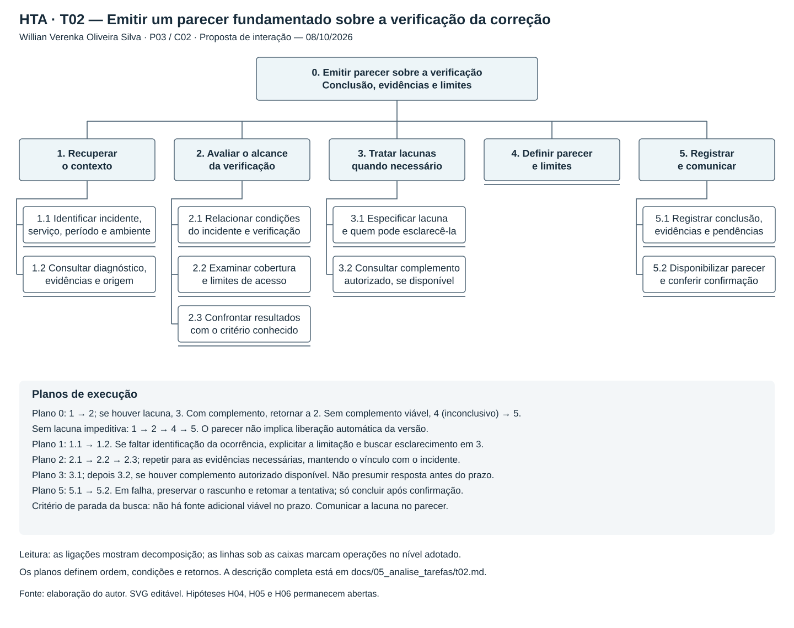

# Entrega 5 — T02: emitir um parecer sobre a verificação da correção

[← Voltar à Entrega 5](../05_analise_tarefas.md) · [Cenário C02](../04_cenarios_problema/c02.md) · [Rastreabilidade — R02](../../RASTREABILIDADE.md#3-rastreabilidade-entre-contribuição-técnica-necessidades-e-artefatos)

**Autor(a):** Willian Verenka Oliveira Silva — 22.124.081-5

**Data:** 08/10/2026

**Status:** 🟨 em andamento

**Escopo desta versão:** primeira modelagem individual, com HTA, GOMS e CTT; revisão com a orientação da aula e validação com participantes pendentes.

## 1. Objetivo e entradas

Analisar como Mariana, analista de qualidade de software (QA), recupera o contexto de um incidente, avalia o alcance das evidências disponíveis e comunica um parecer sobre a verificação de uma correção. A análise utiliza três técnicas: **HTA** (*Hierarchical Task Analysis*, análise hierárquica de tarefas), **GOMS** (*Goals, Operators, Methods and Selection Rules*, metas, operadores, métodos e regras de seleção) e **CTT** (*ConcurTaskTrees*, modelagem de tarefas e suas relações temporais).

| Entrada | Relação com T02 |
|---|---|
| [Entrega 1 — A03](../01_conhecendo_o_problema.md#32-quais-são-as-atividades-mais-importantes) | Classificar se os bugs foram realmente resolvidos. |
| [P03 — Mariana](../03_personas_contexto_jornada.md#persona-p03--mariana-a-analista-de-qa) | Precisa receber o contexto preservado e distinguir resultado de teste, hipótese diagnóstica e conclusão humana. |
| [C02 — O teste passou, mas a correção ainda é incerta](../04_cenarios_problema/c02.md) | Uma compra bem-sucedida em homologação não esclarece se a condição da falha intermitente foi exercitada. |
| [R02; H04, H05 e H06](../../RASTREABILIDADE.md) | Colaboração, perda de contexto no repasse e limites das evidências. |

**[F] Base documental:** A03, P03 e C02 já existem no projeto. **[H] Modelagem proposta:** os passos, critérios e respostas de interface abaixo são hipóteses de interação derivadas desses documentos, sem observação de profissionais. **[?] Lacunas:** frequência da tarefa, critérios reais de conclusão, disponibilidade de evidências e forma de comunicação devem ser investigados nas questões Q1–Q6 de C02. A modelagem não sustenta nem refuta H04, H05 ou H06.

## 2. Tarefa escolhida e limites

| Campo | Definição |
|---|---|
| ID e tarefa | **T02 — Emitir um parecer fundamentado sobre a verificação da correção de um incidente.** |
| Persona e cenário | P03 — Mariana; C02. |
| Objetivo humano | Explicar à equipe o que as evidências permitem concluir, quais limites permanecem e o que falta esclarecer. |
| Início | Mariana recebe um pedido de parecer, uma referência ao incidente e os resultados de verificações já realizadas, ainda que incompletos. |
| Conclusão | Parecer registrado e disponibilizado ao destinatário autorizado, com conclusão, evidências e limites; uma conclusão inconclusiva também pode cumprir a tarefa. |
| Contexto | Antes da liberação de uma correção; produção e homologação podem diferir; parte da telemetria pode estar indisponível. |
| Frequência e criticidade | [?] Frequência a investigar. [H] Criticidade alta pelo risco de afirmar uma correção sem suporte ou atrasar o parecer sem identificar a lacuna. |

O pipeline do TCC seleciona evidências de observabilidade e gera hipóteses diagnósticas. Mariana utiliza esse material para compreender o incidente e relacioná-lo aos resultados de verificação existentes. Registros de eventos (*logs*) e rastros de execução entre serviços (*traces*) ajudam a recuperar o contexto, mas a hipótese gerada não comprova a correção.

O recorte apoia compreensão e comunicação. Execução ou gestão de testes, alteração do código e decisão de liberar uma versão ficam fora desta tarefa. Resultados de testes são entradas externas; não se pressupõe integração automática com ferramentas de QA. P03 permanece secundária ao SRE, profissional de confiabilidade de sistemas, e esta proposta não altera o compromisso formal do TCC.

### Critérios propostos para o parecer

As categorias abaixo são decisões de design a validar com profissionais, relacionadas a H06. Servem para separar conclusões diferentes; não constituem uma regra automática de aprovação.

| Parecer | Condição para adotá-lo neste modelo |
|---|---|
| Correção sustentada no recorte verificado | Há vínculo entre incidente e verificação, condições relevantes exercitadas, critério de aceitação conhecido e evidências compatíveis com esse critério. Explicitar ambiente e alcance. |
| Falha ainda observada | Há evidência relacionável ao incidente de que o comportamento problemático persiste após a alteração. Indicar o que foi observado e em quais condições. |
| Inconclusivo | Falta vínculo, condição de reprodução, critério, cobertura ou acesso suficiente; os dados também podem ser contraditórios. Informar o que falta e quem pode esclarecer. |

O sucesso de uma compra ou a ausência de novos erros, isoladamente, não atende ao primeiro critério. Se não houver critério de aceitação documentado, Mariana registra a lacuna em vez de inventá-lo.

## 3. HTA — Recuperar, avaliar e comunicar

**Autor(a):** Willian Verenka Oliveira Silva — 22.124.081-5

**Objetivo 0:** emitir um parecer fundamentado sobre a verificação da correção.



*Figura 1 — HTA de T02. Fonte: elaboração de Willian, 08/10/2026. O SVG é também a fonte editável. As linhas verticais representam decomposição; os planos especificam ordem e retornos.*

| ID | Objetivo/operação | Resultado esperado |
|---|---|---|
| 1 | Recuperar o contexto do incidente | Incidente e diagnóstico de referência identificados, com lacunas explícitas. |
| 1.1 | Identificar incidente, serviço, período, ambiente e sintoma | Saber a qual ocorrência o parecer se refere. |
| 1.2 | Consultar diagnóstico, evidências e sua origem | Distinguir o que foi observado da interpretação produzida na investigação. |
| 2 | Avaliar o alcance da verificação | Identificar o que os resultados existentes permitem concluir. |
| 2.1 | Relacionar as condições do incidente às da verificação | Conferir ambiente, versão, requisição/período e condição da falha, quando disponíveis. |
| 2.2 | Examinar cobertura e limites de acesso | Distinguir dado ausente, consulta sem erro, falha de consulta e acesso restrito. |
| 2.3 | Confrontar resultados com o critério conhecido | Identificar suporte, persistência da falha ou lacuna que impede concluir. |
| 3 | Tratar lacunas relevantes | Obter complemento disponível ou delimitar por que a conclusão é inconclusiva. |
| 3.1 | Especificar a informação faltante e quem pode esclarecê-la | Evitar pedido genérico de mais dados; indicar a relação ainda desconhecida. |
| 3.2 | Consultar complemento autorizado, se disponível | Reavaliar com a nova informação; não presumir resposta antes do prazo. |
| 4 | Definir o parecer e seus limites | Escolher uma das conclusões propostas e justificar seu alcance. |
| 5 | Registrar e comunicar o parecer | Tornar a conclusão consultável pela equipe autorizada. |
| 5.1 | Registrar conclusão, evidências, critério e pendências | Preservar o vínculo com o incidente e distinguir observação de hipótese. |
| 5.2 | Disponibilizar ao destinatário e conferir confirmação | Confirmar registro e disponibilidade; reconhecer falha sem perder o rascunho. |

### Planos

- **Plano 0:** executar 1 → 2. Se houver lacuna relevante, executar 3. Com complemento disponível, retornar a 2; sem complemento viável no prazo, seguir para 4 com parecer inconclusivo. Sem lacuna impeditiva, seguir diretamente para 4. Concluir com 5.
- **Plano 1:** executar 1.1 → 1.2. Se faltar identificação do incidente, registrar essa limitação e tentar esclarecê-la em 3; não associar evidências de outra ocorrência.
- **Plano 2:** executar 2.1 → 2.2 → 2.3. Repetir para cada evidência necessária. Uma restrição de acesso não equivale a ausência da falha.
- **Plano 3:** executar 3.1; executar 3.2 somente se houver complemento autorizado disponível. Repetir a análise apenas se existir uma fonte adicional concreta e tempo para consultá-la; caso contrário, comunicar a pendência em 4 e 5.
- **Plano 5:** executar 5.1 → 5.2. Em falha de registro ou compartilhamento, preservar o rascunho, corrigir a causa indicada e tentar novamente. Falha persistente deixa a comunicação pendente, sem anunciar conclusão da tarefa.

O ponto de parada da decomposição é a ação ou decisão relevante ao projeto de interação. Não se detalham cliques nem operações internas do pipeline. O retorno de 3 para 2 trata a incerteza; o retorno em 5 trata uma falha operacional, sem alterar o mérito do parecer.

## 4. GOMS — Métodos para produzir o mesmo parecer

**Autor(a):** Willian Verenka Oliveira Silva — 22.124.081-5

**G0:** emitir e comunicar um parecer sobre a verificação da correção, fundamentado no material acessível.

**Submetas:** G1 — recuperar contexto; G2 — avaliar suficiência; G3 — explicitar lacunas; G4 — definir e registrar parecer. Os métodos abaixo atingem G0 por caminhos diferentes. A distinção entre metas, operadores, métodos e regras segue a apresentação de [Kieras](https://www.cs.cmu.edu/~bej/CognitiveModelingForUIDesign/2a_GOMS_Architectures.pdf).

### Método 1 — Partir de um repasse com referências utilizáveis

1. Abrir o incidente indicado e ler serviço, período, ambiente e sintoma (G1).
2. Abrir as evidências citadas no diagnóstico e os resultados de verificação existentes (G1).
3. Comparar as condições, a cobertura e os resultados com o critério documentado (G2).
4. Decidir se há suporte para um parecer e explicitar seu alcance; se surgir lacuna impeditiva, continuar pelo Método 2 a partir do passo 2 (G2/G3).
5. Selecionar a conclusão, escrever justificativa e relacionar evidências e limitações (G4).
6. Registrar, disponibilizar ao destinatário autorizado e conferir a confirmação (G4).

### Método 2 — Reconstruir o contexto ou concluir com lacunas

1. Ler o pedido e identificar o que já se sabe sobre incidente e verificação (G1).
2. Comparar o material acessível e especificar a informação que falta: condição, vínculo, critério, cobertura ou acesso (G2/G3).
3. Localizar uma referência alternativa autorizada ou identificar o responsável pelo esclarecimento; usar os canais de trabalho existentes se for necessário solicitar informação (G3).
4. Se houver complemento disponível no prazo, consultá-lo e repetir a comparação. Sem nova fonte viável, manter a lacuna explícita e encerrar a busca (G2/G3).
5. Definir o parecer: adotar inconclusivo se a lacuna continuar impedindo a conclusão; caso tenha sido resolvida, aplicar os critérios da seção 2 (G4).
6. Registrar conclusão, evidências, pendências e destinatário; disponibilizar e conferir a confirmação (G4).

O Método 2 alcança a mesma meta mesmo quando comunica uma conclusão inconclusiva: o objetivo é emitir um parecer honesto sobre o alcance da verificação. Não é obter necessariamente uma confirmação de correção.

### Operadores e regras de seleção

| Tipo | Operadores adotados | Exemplo |
|---|---|---|
| Perceptivo/cognitivo | Ler, identificar, comparar, decidir | Comparar o ambiente e a condição do incidente com os da verificação. |
| Interação | Abrir, selecionar, consultar, digitar, registrar, compartilhar | Associar uma evidência ao parecer e solicitar seu registro. |
| Conferência | Ler o retorno e reconhecer sucesso ou falha | Perceber que o parecer foi salvo, mas ainda não ficou disponível ao destinatário. |

- **SR1:** usar o Método 1 se o repasse contiver referências acessíveis ao incidente, ao diagnóstico e à verificação. A disponibilidade inicial não garante suficiência.
- **SR2:** usar o Método 2 se essas referências faltarem ou se a comparação revelar contradição, restrição de acesso ou lacuna impeditiva.
- **SR3:** no Método 2, continuar a busca somente enquanto houver fonte adicional concreta, acesso autorizado e tempo; do contrário, registrar o parecer inconclusivo com a pendência.
- **Recuperação comum aos métodos:** se o registro ou a disponibilização falhar, ler a causa, preservar o texto, corrigir o problema indicado e repetir a tentativa. Só considerar G0 concluída após conferir o sucesso.

O GOMS descreve procedimentos propostos de consulta e registro. O julgamento profissional não foi reduzido a um cálculo de desempenho. Não se estimam tempos pelo **KLM** (*Keystroke-Level Model*, modelo ao nível de teclas), pois a interface e a sequência de operações físicas ainda não foram definidas.

## 5. CTT — Dependências entre consulta, julgamento e comunicação

**Autor(a):** Willian Verenka Oliveira Silva — 22.124.081-5

O CTT separa o julgamento de Mariana das respostas automáticas da interface. Os tipos de tarefa e os operadores seguem as seções 3.1 e 3.2 de [MBUI — Task Models](https://www.w3.org/TR/2014/NOTE-task-models-20140408/), nota do grupo de trabalho do W3C. O desenho usa símbolos e rótulos de categoria para permitir leitura mesmo sem distinguir cores.


*Figura 2 — CTT de T02. Fonte: elaboração de Willian, 08/10/2026. SVG editável; as relações entre tarefas irmãs são indicadas pelos operadores, não por setas de navegação entre telas.*

Os IDs A, I, S e U abaixo são locais ao CTT de **T02**; por exemplo, `T02/CTT/I1` não é uma atividade da Entrega 1.

| ID | Tarefa | Tipo |
|---|---|---|
| A0 | Emitir um parecer fundamentado sobre a verificação | Abstrata |
| A1 | Recuperar e confrontar evidências | Abstrata, iterativa |
| I1 | Solicitar contexto ou evidência do incidente/verificação | Interação |
| S1 | Apresentar material solicitado ou limitação da consulta | Sistema |
| U1 | Comparar condições, cobertura e critério conhecido | Usuário |
| U2 | Definir a conclusão e explicitar os limites do parecer | Usuário |
| A2 | Registrar e comunicar com confirmação | Abstrata, iterativa em caso de falha |
| I2 | Registrar parecer, referências e destinatário autorizado | Interação |
| S2 | Processar registro e disponibilização, informando sucesso ou falha | Sistema |
| U3 | Conferir o retorno e reconhecer se a comunicação foi concluída | Usuário |

### Expressão e relações temporais

```text
A0 = A1* []>> U2 []>> A2*
A1 = I1 []>> S1 []>> U1
A2 = I2 []>> S2 []>> U3
```

| Operador | Significado | Aplicação em T02 |
|---|---|---|
| `[]>>` | Habilitação com passagem de informação | O pedido de I1 define a resposta de S1; U1 utiliza essa resposta; U2 usa a análise para definir o parecer. |
| `*` | Iteração da tarefa | Repetir A1 para outro registro ou complemento; repetir A2 para recuperar falha de registro ou disponibilização. |

**Condições de execução:** A1 ocorre ao menos uma vez. É repetida se U1 identificar uma lacuna e existir complemento autorizado viável; caso contrário, U2 pode formular um parecer inconclusivo com o material disponível. A2 também ocorre ao menos uma vez; só se repete se U3 identificar uma falha recuperável. A0 termina com sucesso apenas quando U3 reconhecer que o parecer ficou registrado e disponível. Se a falha persistir, o rascunho permanece e a tarefa fica incompleta. Essas condições de domínio acompanham os operadores; não são novos símbolos CTT.

Uma consulta sem registros ou com acesso restrito continua produzindo informação sobre uma limitação em S1, que precisa ser considerada por U1. Esclarecimentos de outra pessoa são entradas externas: sua chegada não é garantida nem modelada como resposta automática do sistema. A escolha entre parecer sustentado, falha observada e inconclusivo acontece em U2, sem três formulários ou caminhos de interface obrigatórios.

Neste recorte não há necessidade de impor concorrência ou desabilitação. A prioridade é preservar a dependência entre material consultado, interpretação e comunicação. A correspondência com a notação exigida em aula permanece para revisão.

## 6. Síntese e decisões de design

O HTA evidencia a diferença entre consultar mais dados e resolver uma lacuna relevante. O GOMS explicita quando aproveitar um repasse utilizável e quando reconstruir o contexto. O CTT mostra que o sistema disponibiliza dados e feedback, enquanto a conclusão permanece uma atividade humana.

| Necessidade derivada de C02 | Decisão proposta para a interação | Como verificar no protótipo |
|---|---|---|
| Preservar contexto — H05 | Manter incidente, ambiente, período e origem das evidências associados ao parecer. | Mariana consegue apontar a qual incidente e verificação cada registro pertence. |
| Reconhecer limites — H06 | Distinguir consulta vazia, dado indisponível, acesso restrito e falha de consulta. | A pessoa identifica que ausência de registros não comprova correção. |
| Comunicar incerteza — H04/H06 | Permitir parecer inconclusivo com justificativa, pendência e interlocutor. | A pessoa comunica o que falta sem ser obrigada a confirmar a correção. |
| Concluir a comunicação — H04/H05 | Exibir confirmação de registro e disponibilidade; preservar o rascunho após falha. | A pessoa percebe uma falha de compartilhamento e consegue retomar a tentativa. |

Essas propostas serão refinadas nas Entregas 6, 9 e 10. Telas, signos, MoLIC e identificadores de tarefas de teste permanecem **PENDENTE** até sua elaboração. Não se acrescenta um módulo de gestão ou execução de testes.

### Proposta de avaliação futura

**Instrução neutra ao participante:** “Você recebeu os registros deste incidente e o resultado da verificação após a alteração. Prepare um parecer para a equipe sobre o que é possível concluir e o que ainda precisa ser esclarecido.”

**Material proposto:** incidente sintético de C02; compra concluída em homologação; evidência de atraso no pagamento em produção; ausência de registro de que o teste reproduziu esse atraso; uma referência com acesso restrito. Em uma variante, disponibilizar um complemento que resolva a lacuna. Em outra, simular falha de disponibilização do parecer. Nenhuma dessas avaliações foi realizada.

**Critérios prévios de sucesso:** relacionar incidente e verificação; reconhecer a lacuna entre as condições; justificar o parecer compatível com os dados; registrar evidências e limites; conferir se o parecer ficou disponível. Na variante de falha, reconhecer o insucesso e recuperar a tentativa sem perder o texto. Registrar sucesso, tempo, erros, assistência e satisfação; metas quantitativas ainda dependem do piloto. Os participantes finais devem representar QA e não ser integrantes da equipe.

O teste avalia compreensão e interação com o protótipo. Não mede a precisão científica do pipeline nem comprova que uma correção real funcionou.

## 7. Rastreabilidade e referências

**Cadeia:** contribuição técnica → diagnóstico e evidências compartilhados → P03 → C02 → H04/H05/H06 → R02 → T02 → HTA/GOMS/CTT. Próximos modelos, telas e testes: **PENDENTE**.

- Equipe 11. [Entrega 1](../01_conhecendo_o_problema.md), [Entrega 3 — P03](../03_personas_contexto_jornada.md#persona-p03--mariana-a-analista-de-qa) e [Entrega 4 — C02](../04_cenarios_problema/c02.md). 2026. Fontes documentais do recorte; consulta em 08/10/2026.
- Equipe 11. Roteiro da Entrega 5 e [Guia de uso](../../GUIA_DE_USO.md). 2026. Estrutura da decomposição HTA, planos e critérios de apresentação; consulta em 08/10/2026.
- KIERAS, David E. [GOMS Models — Simplified Cognitive Architectures](https://www.cs.cmu.edu/~bej/CognitiveModelingForUIDesign/2a_GOMS_Architectures.pdf). University of Michigan, s.d., lâminas 4 e 7. Acesso em 08/10/2026.
- PATERNÒ, Fabio; SANTORO, Carmen; SPANO, Lucio Davide; RAGGETT, Dave (eds.). [MBUI — Task Models](https://www.w3.org/TR/2014/NOTE-task-models-20140408/). W3C Working Group Note, 08/04/2014, seções 3.1–3.2. Acesso em 08/10/2026.

## 8. Histórico de elaboração

| Data | Alteração | Responsável |
|---|---|---|
| 08/10/2026 | Primeira versão de T02 a partir de P03/C02; HTA, GOMS, CTT, diagramas e critérios propostos de avaliação. Mantidas as hipóteses abertas e os limites do recorte. | Willian Verenka Oliveira Silva |

## Checklist individual

- [x] Um HTA, um GOMS e um CTT para T02, com autoria e vínculo P03/C02/R02.
- [x] HTA com objetivo humano, decomposição, planos, condições de retorno e conclusão.
- [x] GOMS com métodos para a mesma meta, operadores e regras de seleção.
- [x] CTT com categorias, operadores, repetição e condições de conclusão explicadas.
- [x] Diagramas locais em SVG editável, com legenda e interpretação textual.
- [x] Fluxo contempla evidência insuficiente, acesso restrito, consulta vazia e recuperação de falha de comunicação.
- [x] Fatos documentais separados de hipóteses e lacunas; ausência de validação de campo explícita.
- [x] Rastreabilidade e limites de escopo atualizados, sem gestão ou execução de testes.
- [ ] Revisar a modelagem com Willian e conferir a notação exigida em aula.
- [ ] Investigar critérios e métodos com profissionais de QA na Entrega 7.
