# Entrega 6 — Prototipação em papel

[← Início do projeto](../README.md) · [Entrega 5 — Análise de tarefas](05_analise_tarefas.md) · [Entrega 7 — Coleta de dados](07_coleta_dados.md)

**Data:** 16/11/2026

**Status:** 🟩 concluída

**Responsabilidade:** 1 solução integrada por equipe

## Objetivo e entradas

Externalizar rapidamente ideias de interação em baixa fidelidade para explorar alternativas antes de investir em detalhes visuais. O valor da atividade está no **ciclo construir → simular → observar → revisar**, não na beleza do desenho.

O protótipo é um conjunto de folhas desenhadas à mão, uma para cada tela ou estado. Nesta entrega, os códigos P01 a P11 identificam folhas do protótipo; a persona P01 é sempre citada como persona. Um **protótipo de baixa fidelidade** mostra a disposição do conteúdo e o fluxo entre as telas, sem a aparência final. As entradas são a persona P01 da [Entrega 3](03_personas_contexto_jornada.md), o cenário C03 da [Entrega 4](04_cenarios_problema.md) e a tarefa T03 da [Entrega 5](05_analise_tarefas.md).

## 1. Escopo do protótipo

**Personas:** [P01 — Rafael Mendes](03_personas_contexto_jornada.md#persona-p01--rafael-mendes), SRE de plantão.

**Cenários/tarefas cobertos:** [C03 — Dificuldade em distinguir a causa de um incidente de seus efeitos](04_cenarios_problema/c03.md#cenário-c03--dificuldade-em-distinguir-a-causa-de-um-incidente-de-seus-efeitos) e [T03 — formular um diagnóstico inicial](05_analise_tarefas/t03.md).

**Objetivos principais:** percorrer as quatro subtarefas da [HTA de T03](05_analise_tarefas/t03.md#2-hta--formular-um-diagnóstico-inicial): delimitar o incidente; examinar os componentes e as evidências; relacionar as hipóteses às evidências; registrar e comunicar o diagnóstico.

## 1.1 Possíveis famílias de interface

O protótipo explora três das famílias sugeridas no modelo da entrega, as que T03 exige:

| Família | Folhas | Por que entra |
|---|---|---|
| Entrada/seleção de dados com validação | P01 | Rafael informa serviço, sintoma e período para delimitar o incidente (subtarefa 1). |
| Acompanhamento de execução com progresso e cancelamento | P02 | A análise tem dois estágios e pode ser cancelada antes de terminar. |
| Resultados com explicação | P03, P04, P05, P11 | Hipóteses, subgrafo e evidências são o material que Rafael examina e compara (subtarefas 2 e 3). |

As demais famílias (dashboard, configuração/parametrização, histórico, comparação entre execuções, administração, auditoria e alertas/ocorrências) não foram desenhadas: nenhuma subtarefa de T03 depende delas, e o alerta é só o ponto de partida do fluxo.

## 2. Fluxos escolhidos

| Fluxo | Tarefa/objetivo | Por que foi priorizado |
|---|---|---|
| PF01 | T03: Rafael recebe o alerta, delimita o incidente, examina componentes e evidências, relaciona as hipóteses às evidências e comunica o diagnóstico inicial a Lucas. | A Entrega 5 aponta T03 como tarefa crítica, pelo risco de orientar a investigação para o componente errado. |

## 3. Telas e estados

O protótipo tem onze folhas. As dez primeiras foram levadas à simulação; a folha P11 foi acrescentada depois dela (seção 5). Nos desenhos, a anotação "→ P02" ao lado de um controle indica a folha a que ele leva. As folhas P04, P05, P08, P09 e P11 são pedaços menores, colocados por cima de outra folha.

| Folha | Tela ou estado | Controles que mudam o estado | Subtarefa de T03 |
|---|---|---|---|
| [P01](../assets/06_prototipos/p01_delimitar.jpg) | Delimitar o incidente | "Solicitar análise" → P02 | 1 |
| [P02](../assets/06_prototipos/p02_analise.jpg) | Acompanhar a análise (processamento) | avança sozinha → P03; "Cancelar a análise" → P01 | espera entre 1 e 2 |
| [P03](../assets/06_prototipos/p03_investigacao.jpg) | Investigação: hipóteses diagnósticas, subgrafo e componente em foco | componente do subgrafo ou "Consultar" → P04 (antifraude → P05); "Diagnóstico inicial" → P06 | 2.1 e 3.1 |
| [P04](../assets/06_prototipos/p04_evidencias.jpg) | Componente em foco com dados (sobre a P03) | nenhum | 2.2 |
| [P05](../assets/06_prototipos/p05_sem_dados.jpg) | Componente em foco sem dados (sobre a P03) | nenhum | 2.2 |
| [P06](../assets/06_prototipos/p06_registro.jpg) | Registrar o diagnóstico inicial | "Escolher destinatários" → P07; "Subgrafo" → P03; depois da simulação, ícone ao lado de cada hipótese → P11 | 3.2 e 4 |
| [P07](../assets/06_prototipos/p07_destinatarios.jpg) | Enviar o diagnóstico inicial aos destinatários | "Enviar" → P08; "Voltar" → P06 | 4 |
| [P08](../assets/06_prototipos/p08_confirmar.jpg) | Confirmar os destinatários (sobre a P07) | "Confirmar" → P09 na primeira vez; "Alterar destinatários" → P07 | 4 |
| [P09](../assets/06_prototipos/p09_falha_envio.jpg) | Falha no envio (sobre a P07) | "Tentar novamente" → P10 | 4 |
| [P10](../assets/06_prototipos/p10_envio.jpg) | Diagnóstico inicial disponível | nenhum; fim do fluxo | 4 |
| [P11](../assets/06_prototipos/p11_detalhe_hipotese.jpg) | Detalhe da hipótese (sobre a P06) | "Consultar" → P04 | 3.2 |

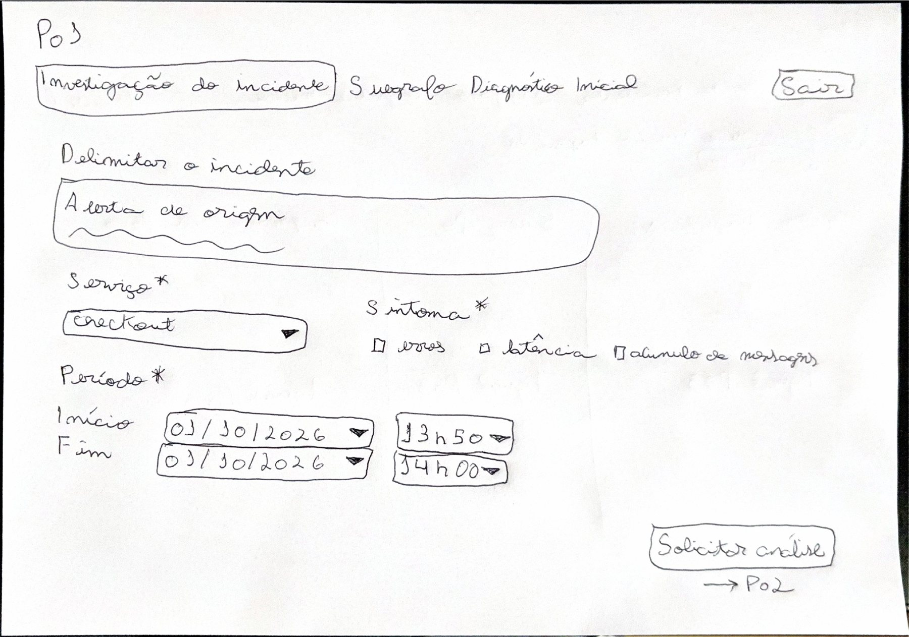

*Figura 1 — Folha P01: delimitar o incidente. Fonte: elaboração da equipe.*

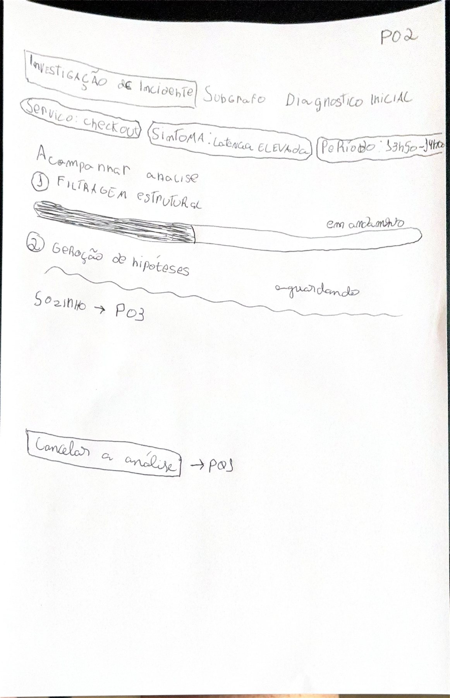

*Figura 2 — Folha P02: acompanhar a análise. Fonte: elaboração da equipe.*

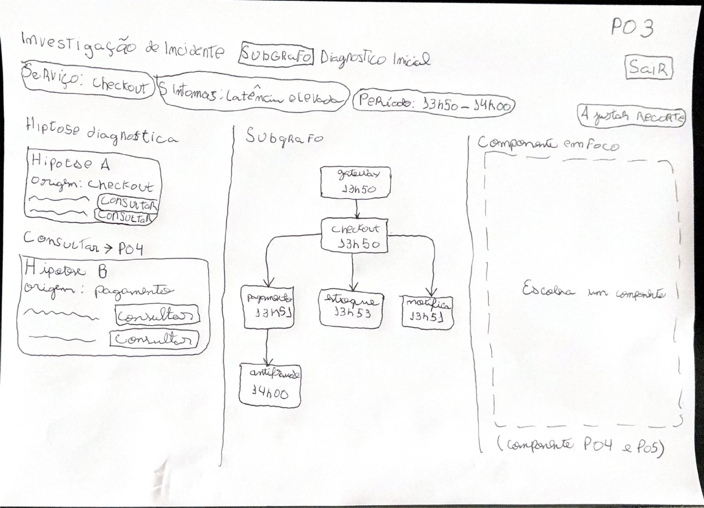

*Figura 3 — Folha P03: investigação, com hipóteses diagnósticas, subgrafo e componente em foco. Fonte: elaboração da equipe.*

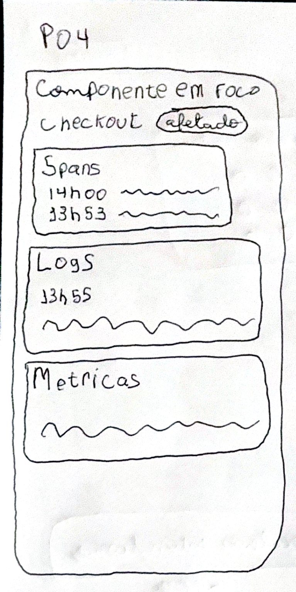

*Figura 4 — Folha P04: componente em foco com dados. Fonte: elaboração da equipe.*

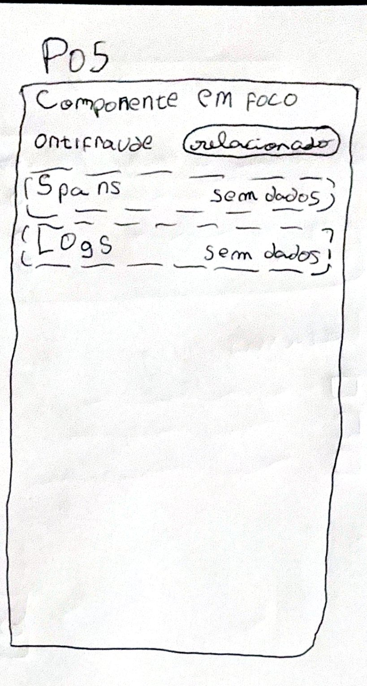

*Figura 5 — Folha P05: componente em foco sem dados. Fonte: elaboração da equipe.*

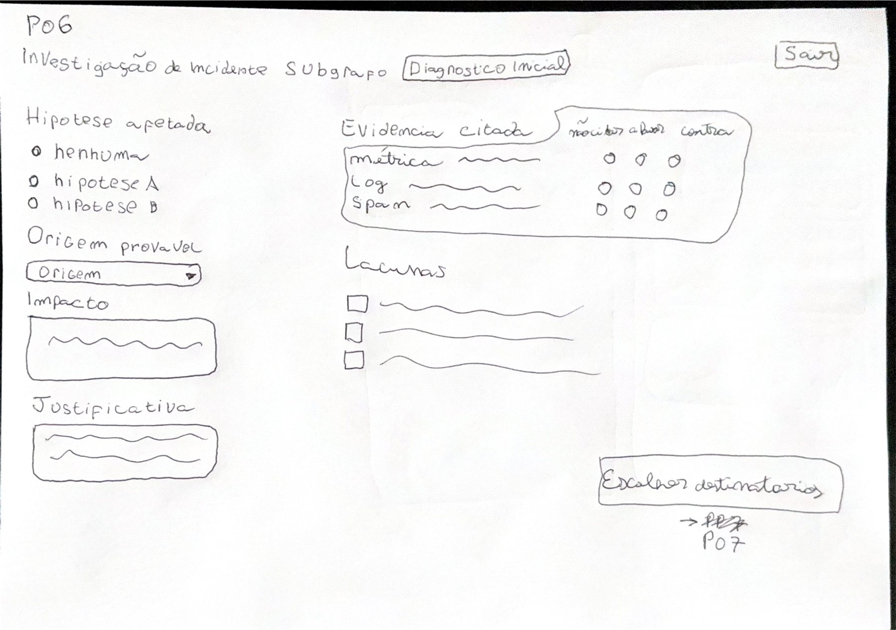

*Figura 6 — Folha P06, como foi usada na simulação: registrar o diagnóstico inicial. Fonte: elaboração da equipe.*

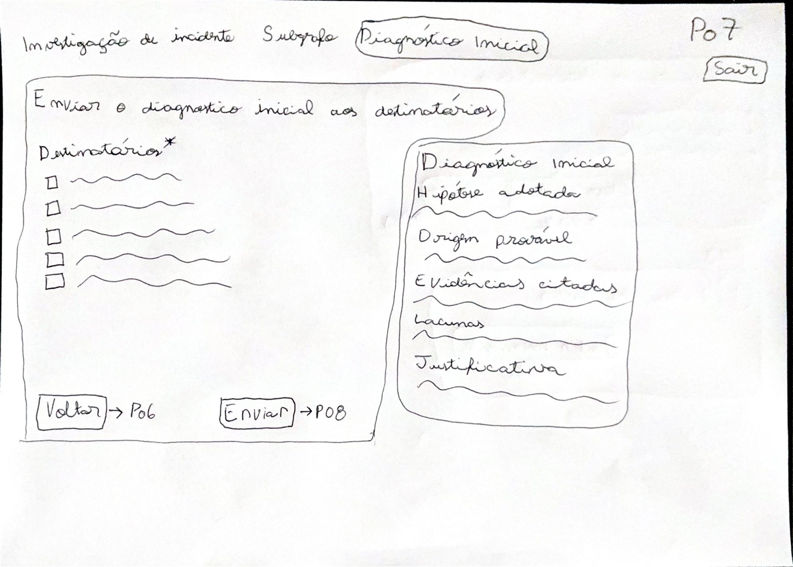

*Figura 7 — Folha P07, como foi usada na simulação: enviar o diagnóstico inicial aos destinatários. Fonte: elaboração da equipe.*

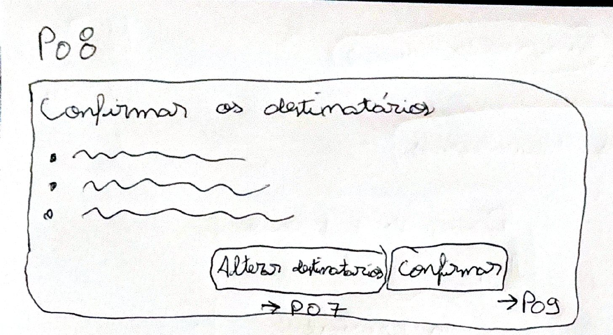

*Figura 8 — Folha P08: confirmar os destinatários. Fonte: elaboração da equipe.*

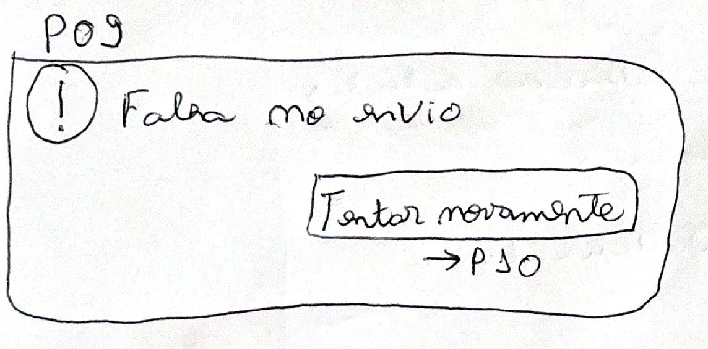

*Figura 9 — Folha P09: falha no envio. Fonte: elaboração da equipe.*

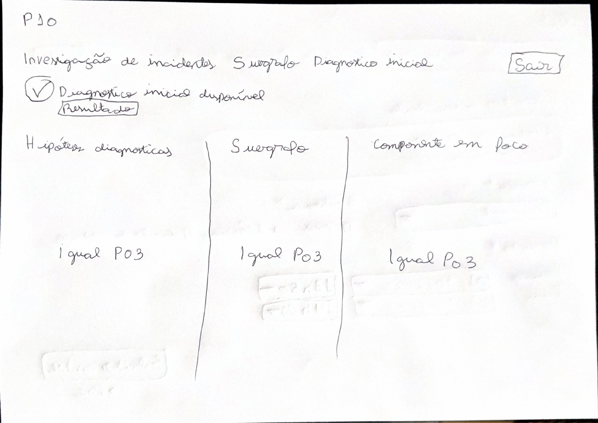

*Figura 10 — Folha P10: diagnóstico inicial disponível. Fonte: elaboração da equipe.*

## 4. Simulação / walkthrough

**Data da simulação:** 16/11/2026

**Participante:** colega de trabalho de um dos integrantes, de fora da equipe; engenheiro de software com experiência em análise de logs e observabilidade com Grafana e Application Insights.

A sessão seguiu o roteiro da equipe. A folha P01 é posta na mesa e a tarefa é lida ao participante:

> "Você é Rafael Mendes, SRE de plantão. A ferramenta de alertas acaba de disparar um alerta: o checkout está com erros e latência elevada. Investigue o incidente no sistema e comunique a Lucas, desenvolvedor do checkout, o que você conclui até agora sobre a origem e o impacto."

O participante aponta o controle que acionaria e diz o que está pensando. A cada controle apontado, a folha é trocada ou o pedaço correspondente é posto por cima, sem indicação do caminho. Campos de texto não são escritos: o participante diz o que escreveria.

| Observação | Tela/ação | Evidência | Consequência para o design |
|---|---|---|---|
| O formulário pede para escolher a hipótese, mas não mostra o que cada uma diz, logo a pessoa precisa lembrar ou voltar ao subgrafo. | Folha P06 | Disse "Não me lembro quais são as hipóteses". | Alterar o desenho da P06 para adicionar um ícone de visualização ao lado da hipótese que mostrará seu resumo, semelhante com PO4, mas um novo componente P11. |
| O formulário mostra uma lista pré-definida de usuários. | Folha P07 | Perguntou "e se o meu destinatário não estiver na lista pré definida?" | Substituir o título que antecede as caixas para marcação de "Destinatários" para "Minha equipe". |

## 5. Alterações após a simulação

| Antes | Problema | Depois | Justificativa |
|---|---|---|---|
| O formulário pede para escolher a hipótese sem descrições. | O usuário esquece o que foi apresentado na tela anterior, tem de voltar a tela para finalizar o formulário. | Cada hipótese contém um ícone de visualização à direita, ao passar o cursor no ícone, aparece os detalhes da hipótese. | Soluciona o problema pois dá a informação que o usuário precisa para finalizar aquela parte do fluxo sem depender dos outros componentes que já passaram. |
| O formulário mostra uma lista pré-definida de usuários. | O usuário pode pensar em enviar para pessoas que não estão na lista e não fazem parte do fluxo de diagnóstico. | Substitui o título de "Destinatários" para "Minha Equipe". | Para indicar ao usuário quem são as pessoas que fazem parte do fluxo de trabalho e evitar confusão. |

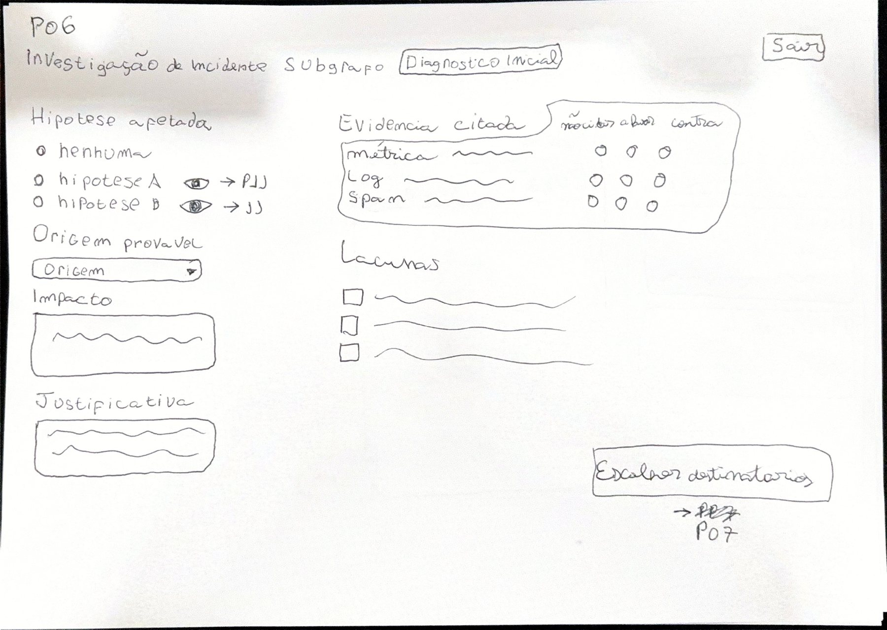

*Figura 11 — Folha P06 depois da simulação: cada hipótese ganhou um ícone que leva à folha P11. Fonte: elaboração da equipe.*

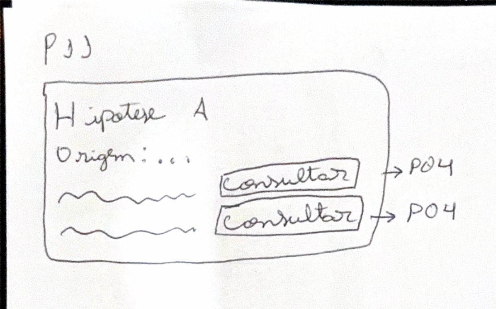

*Figura 12 — Folha P11, acrescentada depois da simulação: detalhe da hipótese, mostrado sobre a folha P06. Fonte: elaboração da equipe.*

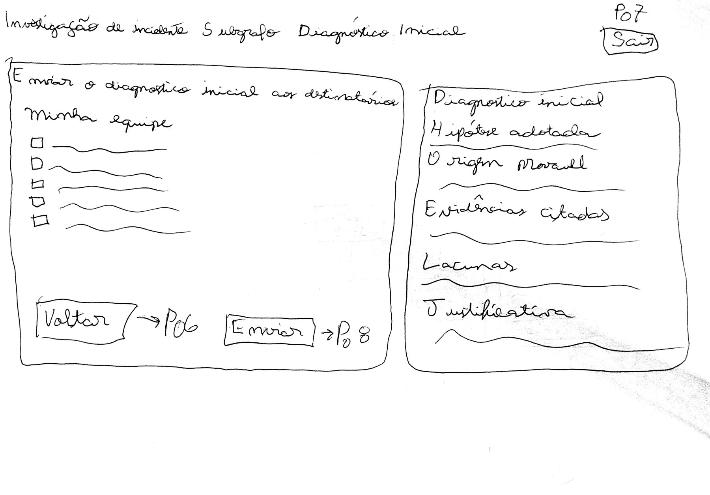

*Figura 13 — Folha P07 depois da simulação: o título "Destinatários" passou a "Minha equipe". Fonte: elaboração da equipe.*

## Checklist

- [x] O protótipo cobre tarefas relevantes da Entrega 5.
- [x] Cada tela/estado pode ser justificado por uma tarefa, decisão ou informação necessária.
- [x] O projeto não criou dashboard/CRUD/login apenas para parecer “completo”.
- [x] Telas/estados estão numerados e navegáveis na documentação.
- [x] Há pelo menos uma simulação/walkthrough documentado.
- [x] Críticas não foram apenas listadas: geraram decisão de revisão.
- [x] O protótipo continua em baixa fidelidade; detalhes visuais não mascaram problemas de fluxo.

## Referências

- **CC8122 — Protótipo de baixa fidelidade.** Material de aula disponibilizado na disciplina, baseado em Barbosa e Silva (2010), consultado em 24/11/2026. Tipos de protótipo de baixa fidelidade, processo em quatro passos, testes com papel e critérios de saída.
- BARBOSA, Simone D. J.; SILVA, Bruno S. **Interação Humano-Computador**. Rio de Janeiro: Elsevier/Campus, 2010.
- Documentos do projeto: [Entrega 3](03_personas_contexto_jornada.md), [Entrega 4](04_cenarios_problema.md) e [Entrega 5](05_analise_tarefas.md).
