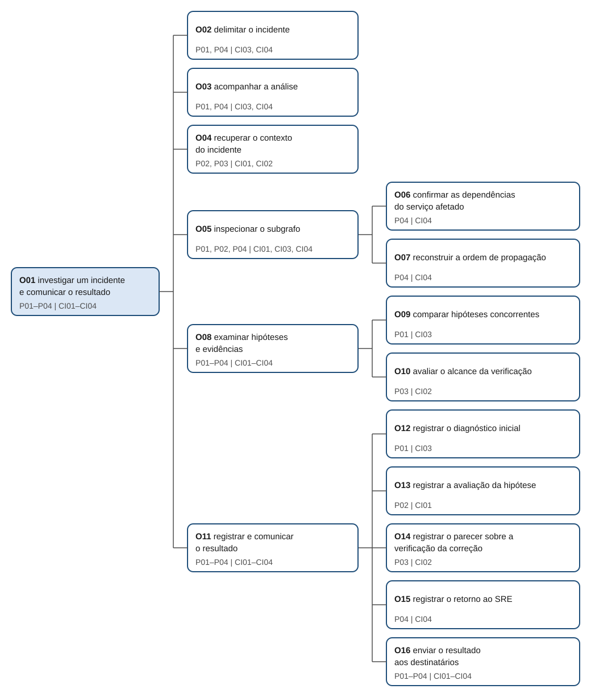

# Entrega 9 — Modelo conceitual e design centrado na comunicação

[← Início do projeto](../README.md) · [Entrega 8 — Engenharia de usabilidade](08_engenharia_usabilidade.md) · [Entrega 10 — MoLIC](10_molic.md)

**Data:** 16/11/2026

**Status:** 🟩 concluída

**Responsabilidade:** soluções individuais, com consolidação da equipe para mapa de objetivos e esquema de signos.

## Objetivo e entradas

Passar do cenário de problema para uma concepção da interação, explicitando objetivos, tópicos de conversa, falas e signos que a interface deverá comunicar/manipular.

O **cenário de interação** especifica as ações do usuário e as respostas do sistema necessárias para alcançar seus objetivos, sem detalhes da interface, como textos, rótulos e tipos de elemento. O **design centrado na comunicação**, da Engenharia Semiótica, trata a interação como uma conversa entre o usuário e o preposto do designer, que é a interface: cada conversa tem um tópico, desdobra-se em diálogos sobre subtópicos e se compõe de falas que usam **signos**, isto é, aquilo que está no lugar de um conceito para quem interage. O **mapa de objetivos** organiza os objetivos dos usuários que essas conversas atendem, e o **esquema conceitual de signos** registra significado, conteúdo, prevenção e recuperação de rupturas de cada signo.

As entradas são os cenários de problema C01–C04 da [Entrega 4](04_cenarios_problema.md), as personas P01–P04 da [Entrega 3](03_personas_contexto_jornada.md), as tarefas T01–T06 da [Entrega 5](05_analise_tarefas.md), as [recomendações RC01–RC06](02_analise_concorrencia.md#5-recomendações-derivadas) da Entrega 2 e, da [Entrega 8](08_engenharia_usabilidade.md), a delimitação do sistema interativo, o incidente simulado, as características da plataforma, os princípios e as metas MU01–MU14. Os vínculos estão nas linhas R01–R04 da [matriz de rastreabilidade](../RASTREABILIDADE.md#3-rastreabilidade-entre-contribuição-técnica-necessidades-e-artefatos).

## Transformando resultados técnicos em conceitos compreensíveis

O pipeline do TCC opera sobre traces representados como grafos e produz subgrafos e hipóteses em formato estruturado. A interface comunica esses resultados pelos conceitos do trabalho do SRE e dos papéis ligados a ele:

- Traces representados como grafo de spans → **componentes** (serviços e dependências) e **relações** (chamadas entre componentes); os spans aparecem como **evidências** do tipo span.
- Primeiro estágio do pipeline → estágio **filtragem estrutural** e signo **subgrafo**, sempre apresentado como seleção que pode excluir evidência relevante. O método de filtragem não é exposto, pois a comparação entre métodos pertence à avaliação experimental do TCC.
- Saída estruturada do segundo estágio → **hipótese diagnóstica**, com origem provável, explicação, evidências associadas, lacunas da hipótese e caminho de propagação, identificada por letra (hipótese A, hipótese B) e sem pontuação nem ordem de preferência.
- Interpretação do pipeline e conclusão da pessoa → camadas separadas: a hipótese diagnóstica é identificada como produzida pelo pipeline, e a conclusão é um **resultado** enviado por uma pessoa, com autor e horário (diagnóstico inicial, avaliação da hipótese, parecer sobre a verificação da correção ou retorno ao SRE).
- Amostragem, cobertura de instrumentação, permissões, identificadores ausentes e falhas de consulta → **lacunas**, com tipo e local, nunca apresentadas como normalidade.
- Logs, métricas e spans das fontes de observabilidade → **evidências**, com tipo, horário, ambiente, conteúdo com dados pessoais mascarados e situação da consulta.
- Mapa de serviços das ferramentas de observabilidade → **fonte da relação**; a pessoa registra a **classificação da relação** (observada, inferida ou não verificada).
- Métricas estruturais, diagnósticas e operacionais da avaliação do TCC → não são apresentadas ao usuário.

Quanto aos padrões de interface, o único equivalente a filtros no recorte é a delimitação por serviço, sintoma e período, que corresponde ao objetivo O02 e aos signos recorte, serviço, sintoma e período. Dashboard, relatório, histórico, administração e CRUD não fazem parte do sistema interativo delimitado na Entrega 8 e, por isso, não têm objetivo nem signo no modelo.

## Soluções individuais

Cada integrante produziu o cenário de interação, o design centrado na comunicação, o mapa de objetivos e o esquema de signos do seu cenário, em arquivo próprio na pasta [`09_modelo_conceitual/`](09_modelo_conceitual/).

| CI | Título | Autor(a) | Origem | Status | Entrega completa |
|---|---|---|---|---|---|
| CI01 | Avaliação da hipótese sobre a falha no checkout após um deploy | Gabriel Lovato — 22.123.004-8 | C01 · P02 · T01 | 🟩 concluída | [Abrir CI01](09_modelo_conceitual/ci01.md) |
| CI02 | Parecer sobre a verificação de uma correção incerta | Willian Verenka Oliveira Silva — 22.124.081-5 | C02 · P03 · T02 | 🟩 concluída | [Abrir CI02](09_modelo_conceitual/ci02.md) |
| CI03 | Diagnóstico inicial com hipóteses concorrentes | Théo Zago Zimmermann — 22.123.035-2 | C03 · P01 · T03 | 🟩 concluída | [Abrir CI03](09_modelo_conceitual/ci03.md) |
| CI04 | Retorno ao SRE sobre a propagação de uma falha entre microsserviços | João Sitta Giopatto — 22.123.054-3 | C04 · P04 · T04–T06 | 🟩 concluída | [Abrir CI04](09_modelo_conceitual/ci04.md) |

## 1. Cenários de interação

Cada cenário de interação parte do cenário refinado do cenário de problema correspondente, mantém atores, incidente e contexto e altera só o que a solução muda. O texto novo ou alterado está em **negrito**; o número entre colchetes indica a pergunta de refinamento respondida pelo trecho, como nos exemplos da disciplina; e a tabela "Diferenças relevantes" justifica cada alteração com artefatos das entregas anteriores.

Os quatro cenários descrevem a mesma solução: uma aplicação web para investigar um único incidente, com delimitação, acompanhamento da análise, inspeção do subgrafo, exame de hipóteses e evidências e registro e comunicação do resultado. CI01 e CI02 se passam no incidente do checkout e do pagamento, que é o incidente simulado da Entrega 8: Lucas parte do diagnóstico inicial do SRE, e Mariana, da avaliação da hipótese enviada pelo desenvolvedor. CI03 mantém a formulação genérica de C03, e CI04, o incidente de pedidos e frete de C04, cujos elementos (dependência ausente do mapa, relação sustentada só pelo mapa e instrumentação parcial) são os que a Entrega 8 previu no incidente simulado.

Cenários: [CI01](09_modelo_conceitual/ci01.md#1-cenário-de-interação) · [CI02](09_modelo_conceitual/ci02.md#1-cenário-de-interação) · [CI03](09_modelo_conceitual/ci03.md#1-cenário-de-interação) · [CI04](09_modelo_conceitual/ci04.md#1-cenário-de-interação).

## 2. Design centrado na comunicação

Cada cenário de interação tem sua tabela de conversa, com os tópicos na ordem da investigação: [CI01](09_modelo_conceitual/ci01.md#2-design-centrado-na-comunicação) · [CI02](09_modelo_conceitual/ci02.md#2-design-centrado-na-comunicação) · [CI03](09_modelo_conceitual/ci03.md#2-design-centrado-na-comunicação) · [CI04](09_modelo_conceitual/ci04.md#2-design-centrado-na-comunicação).

O tópico de cada conversa é um objetivo do mapa, com o nome do dicionário seguido do ID; os subtópicos são os diálogos em que a conversa se desdobra, e o mesmo diálogo tem o mesmo nome em todos os cenários. As falas não mencionam elementos de interface, e os signos em negrito são os do esquema da seção 4. As rupturas narradas nos cenários (acesso restrito e falha de disponibilização em CI02; sem dados e falha de consulta em CI04) aparecem como diálogos em que o preposto descreve a situação e indica a saída.

**Convenção:** `U` = usuário; `D` = preposto do designer/sistema, conforme a abordagem de Engenharia Semiótica adotada na disciplina.

## 3. Mapa de objetivos

Cada integrante apresentou o mapa dos objetivos do seu cenário ([CI01](09_modelo_conceitual/ci01.md#3-mapa-de-objetivos), [CI02](09_modelo_conceitual/ci02.md#3-mapa-de-objetivos), [CI03](09_modelo_conceitual/ci03.md#3-mapa-de-objetivos) e [CI04](09_modelo_conceitual/ci04.md#3-mapa-de-objetivos)). O mapa consolidado reúne os 16 objetivos sem duplicidade: um objetivo perseguido em mais de um cenário, como O05 (inspecionar o subgrafo) ou O16 (enviar o resultado aos destinatários), aparece uma vez, com um único nome e com as personas e os cenários de todos os mapas individuais em que está. Os quatro mapas individuais usam os mesmos identificadores e nomes do dicionário.

*Figura 1 — Mapa de objetivos consolidado. Fonte: elaboração da equipe a partir dos mapas individuais de CI01–CI04.*

Cada retângulo é um objetivo do usuário, com ID e nome; a última linha indica as personas que o perseguem e os cenários de interação que o cobrem. O retângulo preenchido é o objetivo geral do recorte. As linhas ligam um objetivo aos subobjetivos por meio dos quais ele é alcançado; a ordem de cima para baixo acompanha a investigação, sem indicar sequência obrigatória. O01 e O11 agrupam objetivos e não têm conversa própria; os demais são tópicos das tabelas de conversa.

### Dicionário de objetivos

Prioridade média: objetivos que preparam a análise (O02, O03), em correspondência à prioridade média de F01 na Entrega 1 e ao menor peso de MU03 na Entrega 8; alta: os demais, que cobrem a recuperação do contexto, o exame das evidências e o registro e o envio dos resultados de T01–T06, etapas verificadas pelas metas de eficácia e de erro da Entrega 8 (MU06–MU12).

| ID | Objetivo | Persona(s) | Cenário(s) | Prioridade |
|---|---|---|---|---|
| O01 | investigar um incidente e comunicar o resultado | P01, P02, P03, P04 | CI01, CI02, CI03, CI04 | alta |
| O02 | delimitar o incidente | P01, P04 | CI03, CI04 | média |
| O03 | acompanhar a análise | P01, P04 | CI03, CI04 | média |
| O04 | recuperar o contexto do incidente | P02, P03 | CI01, CI02 | alta |
| O05 | inspecionar o subgrafo | P01, P02, P04 | CI01, CI03, CI04 | alta |
| O06 | confirmar as dependências do serviço afetado | P04 | CI04 | alta |
| O07 | reconstruir a ordem de propagação | P04 | CI04 | alta |
| O08 | examinar hipóteses e evidências | P01, P02, P03, P04 | CI01, CI02, CI03, CI04 | alta |
| O09 | comparar hipóteses concorrentes | P01 | CI03 | alta |
| O10 | avaliar o alcance da verificação | P03 | CI02 | alta |
| O11 | registrar e comunicar o resultado | P01, P02, P03, P04 | CI01, CI02, CI03, CI04 | alta |
| O12 | registrar o diagnóstico inicial | P01 | CI03 | alta |
| O13 | registrar a avaliação da hipótese | P02 | CI01 | alta |
| O14 | registrar o parecer sobre a verificação da correção | P03 | CI02 | alta |
| O15 | registrar o retorno ao SRE | P04 | CI04 | alta |
| O16 | enviar o resultado aos destinatários | P01, P02, P03, P04 | CI01, CI02, CI03, CI04 | alta |

## 4. Esquema conceitual de signos

A tabela única reúne os signos usados nos quatro cenários de interação e os que completam a definição dos grupos (ambiente do incidente, tipo de componente, referência da hipótese diagnóstica à análise e local da lacuna); cada arquivo individual traz só as linhas dos signos que usa, com o mesmo texto desta tabela. Os signos estão organizados em grupos, como nos exemplos da disciplina: a primeira linha de cada grupo traz o nome, a letra que o identifica e a descrição; o prefixo `+` marca o signo que identifica o elemento do grupo, e `+ Nome (X)`, a referência a outro grupo. A coluna Origem indica se o conceito existe no trabalho do usuário independentemente do sistema (domínio) ou foi criado pela solução (aplicação). Na coluna Restrição, "conjunto fixo" tem valores definidos pelo projeto, e "conjunto flexível" admite novos valores.

| Grupo | Signo | Origem | Observações/semântica | Tipo de conteúdo | Restrição | Valor padrão | Prevenção | Recuperação |
|---|---|---|---|---|---|---|---|---|
| **Incidente (I)** — investigação de um único incidente, aberta a partir de um alerta | + identificador do incidente | aplicação | Produzido pelo sistema. Atribuído quando a análise é solicitada; identifica o incidente nos resultados e nos links. | texto | não editável | — | — | — |
| Incidente (I) | alerta de origem | domínio | Derivado do domínio (ferramenta de alertas). Serviço, sintoma e horário do alerta que abriu a investigação; fornece o valor padrão do recorte. | texto | não pode ser nulo | — | — | — |
| Incidente (I) | ambiente | domínio | Derivado do domínio (alerta de origem). Ambiente em que o incidente ocorreu. | seleção simples | conjunto fixo = {produção, homologação}; não editável | produção | — | — |
| Incidente (I) | recorte | aplicação | Fornecido pela pessoa. Conjunto de serviço, sintoma e período que define o que a análise considera; visível durante toda a investigação e incluído em cada resultado e no link do resultado. | composto (serviço, sintoma, período) | — | proposto a partir do alerta de origem | AL: ajustar o recorte depois de uma análise pede confirmação, pois inicia nova análise e substitui subgrafo e hipóteses; o rascunho é preservado | — |
| Incidente (I) | serviço | domínio | Fornecido pela pessoa. Serviço em que o sintoma foi observado; ponto de partida da análise. | seleção simples | conjunto flexível: serviços com telemetria no ambiente | serviço do alerta de origem | PA: só serviços com telemetria podem ser escolhidos | — |
| Incidente (I) | sintoma | domínio | Fornecido pela pessoa. Manifestação que caracteriza o incidente. | seleção múltipla | conjunto flexível: inicialmente = {erros, latência elevada, acúmulo de mensagens}; ao menos um | sintoma do alerta de origem | PA: ao menos um sintoma permanece selecionado | — |
| Incidente (I) | período | domínio | Fornecido pela pessoa. Intervalo de tempo analisado. | intervalo de data e hora | início anterior ao fim; fim não posterior ao momento atual; duração entre 5 min e 24 h | de 30 min antes do horário do alerta de origem até o momento da solicitação | PP+PA: formato e duração indicados; datas futuras e início posterior ao fim não podem ser informados | — |
| Incidente (I) | hipótese em foco | aplicação | Fornecido pela pessoa. Hipótese diagnóstica cuja origem provável e caminho de propagação aparecem destacados no subgrafo; preservada no link do resultado. | referência (H) | uma por vez | hipótese A | — | — |
| Incidente (I) | componente em foco | aplicação | Fornecido pela pessoa. Componente ou relação cujas evidências estão sendo consultadas; preservado no link do resultado. | referência (C ou R) | um por vez | — | — | — |
| Incidente (I) | resultados do incidente | aplicação | Produzido pelo sistema. Resultados já disponíveis para o incidente, visíveis a quem tem acesso a ele. | referência (RE), seleção múltipla | só resultados com estado do envio "disponível" | — | — | — |
| **Análise (A)** — execução do pipeline sobre o recorte, em dois estágios | + Incidente (I) | aplicação | Produzido pelo sistema. A é solicitada para o recorte de I; uma nova análise substitui a anterior. | referência (I) | — | — | — | — |
| Análise (A) | estágio | aplicação | Produzido pelo sistema. "filtragem estrutural": seleciona o subgrafo; "geração de hipóteses": produz as hipóteses diagnósticas a partir do subgrafo. | seleção simples | conjunto fixo = {filtragem estrutural, geração de hipóteses}, nessa ordem | — | PP: cada estágio é descrito em uma frase | — |
| Análise (A) | estado do estágio | aplicação | Produzido pelo sistema. Situação de cada estágio; o subgrafo fica disponível quando a filtragem estrutural termina, mesmo com a geração de hipóteses em andamento. | seleção simples | conjunto fixo = {aguardando, em andamento, concluído, cancelado, falha} | aguardando | PP: indica o estágio em andamento e de qual estágio vem cada resultado | RA: em "falha", descreve a causa e permite repetir a análise sem perder o recorte |
| Análise (A) | subgrafo | aplicação | Produzido pelo sistema (pipeline). Seleção de componentes e relações que a filtragem estrutural considerou relevantes para o recorte; pode excluir evidência relevante. | referência (C, R), seleção múltipla | — | — | PP: informa que o subgrafo é uma seleção e que componentes fora dele podem ser mostrados | — |
| **Componente (C)** — serviço ou dependência (banco de dados, fila, serviço externo) que aparece no subgrafo | + nome do componente | domínio | Derivado do domínio. Nome usado pelas equipes para o serviço ou a dependência. | texto | não pode ser nulo | — | — | — |
| Componente (C) | tipo de componente | domínio | Derivado do domínio. | seleção simples | conjunto flexível: inicialmente = {serviço, banco de dados, fila, serviço externo} | serviço | — | — |
| Componente (C) | presença no subgrafo | aplicação | Produzido pelo sistema. "no subgrafo": selecionado pela filtragem estrutural; "fora do subgrafo": vizinho mostrado a pedido da pessoa, sem nova análise. | seleção simples | conjunto fixo = {no subgrafo, fora do subgrafo} | no subgrafo | PP: componentes fora do subgrafo ficam diferenciados e podem ser ocultados novamente | — |
| Componente (C) | estado do componente | aplicação | Produzido pelo sistema. "origem provável": apontado pela hipótese em foco; "afetado": com desvio observado no período; "relacionado": sem desvio observado. Um valor por componente, nessa precedência. | seleção simples | conjunto fixo = {origem provável, afetado, relacionado} | relacionado | PP: "origem provável" vem com a letra da hipótese que o aponta | — |
| Componente (C) | desvio observado | domínio | Derivado do domínio (telemetria). Manifestações fora do normal registradas no componente durante o período. | seleção múltipla | conjunto flexível: inicialmente = {erros, latência elevada, acúmulo de mensagens}; vazio quando não há desvio | — | — | — |
| Componente (C) | início do desvio | domínio | Derivado do domínio (telemetria). Horário em que o desvio observado começou; permite comparar a ordem dos eventos entre componentes. | data e hora | — | — | PP: quando o desvio já existia no início do período, indica a lacuna "período incompleto"; sem telemetria suficiente, indica início desconhecido | — |
| Componente (C) | instrumentação | domínio | Derivado do domínio (telemetria). Cobertura dos sinais do componente; "parcial" quando faltam traces ou logs. | seleção simples | conjunto fixo = {completa, parcial, ausente} | — | PP: instrumentação parcial ou ausente aparece como lacuna, e não como ausência de desvio | — |
| **Relação (R)** — ligação em que um componente chama outro ou depende dele | + componentes da relação (C.[nome] → C.[nome]) | domínio | Derivado do domínio (telemetria e mapa de serviços). A seta parte do componente que chama e chega ao componente chamado. | referência (C) | componentes distintos | — | — | — |
| Relação (R) | fonte da relação | domínio | Derivado do domínio. Onde a relação aparece. | seleção múltipla | conjunto fixo = {trace, log, mapa de serviços} | — | PP: relação vista em trace ou log e ausente do mapa de serviços fica destacada | — |
| Relação (R) | classificação da relação | aplicação | Fornecido pela pessoa. "observada": vista em trace ou log; "inferida": deduzida de evidência indireta, como a coincidência de horários; "não verificada": sustentada só pelo mapa de serviços ou sem fonte. | seleção simples | conjunto fixo = {observada, inferida, não verificada} | proposta pela fonte da relação: "observada" se há trace ou log; "não verificada" nos demais casos | PP: cada valor é explicado; PA: "observada" só pode ser escolhida quando a fonte da relação inclui trace ou log | — |
| **Hipótese diagnóstica (H)** — explicação sobre a provável origem do incidente, produzida pelo pipeline a partir do subgrafo; precisa ser conferida | + identificador da hipótese | aplicação | Produzido pelo sistema. Letra atribuída na ordem em que o pipeline entrega as hipóteses (A, B...); a ordem não indica preferência. | texto | — | — | PP: informa que a ordem não indica preferência | — |
| Hipótese diagnóstica (H) | + Análise (A) | aplicação | Produzido pelo sistema. H é produzida no estágio "geração de hipóteses" de A; pode não haver hipótese. | referência (A) | — | — | PP: quando nenhuma hipótese é gerada, o sistema informa e a investigação segue pelo subgrafo | — |
| Hipótese diagnóstica (H) | origem provável | domínio | Produzido pelo sistema (pipeline). Componente que a hipótese aponta como provável origem do incidente. | referência (C) | componente do subgrafo | — | — | — |
| Hipótese diagnóstica (H) | explicação | aplicação | Produzido pelo sistema (pipeline). Texto que descreve como a falha teria se propagado da origem provável até o sintoma. | texto | — | — | PP: identificada como produzida pelo pipeline, separada das evidências e das conclusões registradas por pessoas | — |
| Hipótese diagnóstica (H) | evidências associadas | aplicação | Produzido pelo sistema (pipeline). Evidências do subgrafo usadas para formular a hipótese. | referência (E), seleção múltipla | — | — | — | — |
| Hipótese diagnóstica (H) | lacunas da hipótese | aplicação | Produzido pelo sistema. Lacunas do recorte que afetam a origem provável ou o caminho de propagação da hipótese. | referência (L), seleção múltipla | — | — | — | — |
| Hipótese diagnóstica (H) | caminho de propagação | aplicação | Produzido pelo sistema (pipeline). Relações que ligam a origem provável ao serviço do recorte, segundo a hipótese; destacado no subgrafo quando a hipótese está em foco. | referência (R), seleção múltipla | — | — | — | — |
| **Evidência (E)** — item de telemetria de um componente ou de uma relação: span, log ou métrica | + Componente (C) ou Relação (R) | domínio | Derivado do domínio. E pertence a um componente ou a uma relação. | referência (C ou R) | — | — | — | — |
| Evidência (E) | + horário | domínio | Derivado do domínio. Data e hora do item na fonte de telemetria. | data e hora | — | — | — | — |
| Evidência (E) | tipo de evidência | domínio | Derivado do domínio. "span": operação dentro do trace de uma requisição; "log": mensagem de evento emitida por um serviço; "métrica": série de valores, como latência ou taxa de erros. | seleção simples | conjunto fixo = {span, log, métrica} | — | — | — |
| Evidência (E) | ambiente | domínio | Derivado do domínio. Ambiente de onde vem a evidência. | seleção simples | conjunto fixo = {produção, homologação} | ambiente do incidente | — | — |
| Evidência (E) | conteúdo | domínio | Derivado do domínio. Mensagem do log, atributos e duração do span ou valores da métrica. | texto | dados pessoais mascarados | mascarado | PA: dados pessoais aparecem mascarados e não podem ser revelados | — |
| Evidência (E) | identificador do trace | domínio | Derivado do domínio. Identifica a requisição e liga spans e logs; pode faltar em logs. | texto | pode ser nulo | — | PP: a ausência é indicada como lacuna "identificador ausente" | — |
| Evidência (E) | situação da consulta | aplicação | Produzido pelo sistema. Situação da consulta às evidências do componente em foco no período; "sem dados" (nenhum item encontrado) difere de itens encontrados sem erro. | seleção simples | conjunto fixo = {carregando, com dados, sem dados, acesso restrito, falha de consulta} | carregando | PP: "sem dados" e "acesso restrito" aparecem como lacunas, nunca como normalidade | RA: em "falha de consulta", descreve a causa e permite repetir a consulta sem perder o recorte; CE: em "acesso restrito", informa que o trecho exige permissão que a pessoa não tem e pode ser consultado por quem a tenha, fora do sistema |
| **Lacuna (L)** — parte do recorte para a qual não há evidência utilizável | + tipo de lacuna | aplicação | Produzido pelo sistema. Motivo da falta de evidência utilizável; "amostragem" indica que só parte das requisições é registrada nos traces. | seleção simples | conjunto fixo = {sem dados, acesso restrito, falha de consulta, instrumentação parcial, instrumentação ausente, identificador ausente, período incompleto, amostragem} | — | — | — |
| Lacuna (L) | + local da lacuna | aplicação | Produzido pelo sistema. Componente, relação ou trecho do período afetado. | referência (C ou R) ou intervalo de data e hora | — | — | — | — |
| **Verificação da correção (V)** — teste de uma correção, relacionado pela QA ao incidente | + Incidente (I) | domínio | Fornecido pela pessoa. V refere-se à correção de I. | referência (I) | não pode ser nulo | incidente aberto | — | — |
| Verificação da correção (V) | + referência do teste | domínio | Fornecido pela pessoa. Identificação do teste no sistema de testes ou no chamado. | texto | não pode ser nulo | — | PP: campo obrigatório | RA: o campo vazio é indicado para correção |
| Verificação da correção (V) | ambiente | domínio | Fornecido pela pessoa. Ambiente em que o teste foi executado. | seleção simples | conjunto fixo = {produção, homologação} | homologação | — | — |
| Verificação da correção (V) | versão verificada | domínio | Fornecido pela pessoa. Versão que contém a correção. | texto | não pode ser nulo | — | PP: campo obrigatório | RA: o campo vazio é indicado para correção |
| Verificação da correção (V) | período do teste | domínio | Fornecido pela pessoa. Intervalo em que o teste foi executado; o sistema consulta as evidências dos componentes do subgrafo nesse ambiente e período. | intervalo de data e hora | início posterior ao início do período do incidente; fim não posterior ao momento atual | — | PP+PA: datas futuras não podem ser informadas | — |
| Verificação da correção (V) | resultado do teste | domínio | Fornecido pela pessoa. Resultado registrado no sistema de testes. | seleção simples | conjunto fixo = {passou, falhou} | — | PP: informa que o resultado do teste não equivale à conclusão do parecer | — |
| Verificação da correção (V) | evidências do teste | aplicação | Produzido pelo sistema. Evidências dos componentes do subgrafo no ambiente e no período do teste, apresentadas ao lado das evidências citadas nos resultados do incidente. | referência (E), seleção múltipla | — | — | — | — |
| **Resultado (RE)** — conclusão registrada e enviada por uma pessoa: diagnóstico inicial (D), avaliação da hipótese (AV), parecer sobre a verificação da correção (PV) ou retorno ao SRE (RS) | + Incidente (I) | domínio | Produzido pelo sistema. RE refere-se a I e guarda o recorte vigente no envio. | referência (I) | — | incidente aberto | — | — |
| Resultado (RE) | + autor | domínio | Produzido pelo sistema. Pessoa identificada pelo ambiente corporativo, sem login. | texto | não editável | pessoa identificada | — | — |
| Resultado (RE) | + horário do envio | aplicação | Produzido pelo sistema. Data e hora em que o resultado ficou disponível. | data e hora | — | — | — | — |
| Resultado (RE) | origem provável | domínio | Fornecido pela pessoa. Só em D e RS: componente que a pessoa indica como provável origem, ou "não determinada". É hipótese de trabalho, não comprovação da causa. | seleção simples | componentes do subgrafo ou "não determinada"; não pode ser nulo em D e RS | — | PP: explica que a origem provável é hipótese de trabalho; PA: o envio de D e RS exige uma escolha | — |
| Resultado (RE) | justificativa | domínio | Fornecido pela pessoa. Texto que explica a conclusão. | texto | não pode ser nulo em AV e PV | — | PP+PA: obrigatória em AV e PV; o envio exige seu preenchimento | — |
| Resultado (RE) | evidências citadas | aplicação | Fornecido pela pessoa. Evidências usadas na conclusão, cada uma marcada como "a favor" ou "contra" a hipótese avaliada (em AV) ou a conclusão registrada (em D, PV e RS); vão como referência, não como cópia do conteúdo. | referência (E), seleção múltipla, cada uma com {a favor, contra} | ao menos uma em D, AV e PV | — | PP+PA: o envio de D, AV e PV exige ao menos uma evidência citada | — |
| Resultado (RE) | lacunas | aplicação | Fornecido pela pessoa. Lacunas detectadas que a pessoa considera relevantes para a conclusão, mais lacunas descritas em texto (por exemplo, condição da falha não exercitada no teste). | referência (L), seleção múltipla, e texto | — | — | PP: as lacunas detectadas no recorte são apresentadas para escolha | — |
| Resultado (RE) | destinatários | domínio | Fornecido pela pessoa. Pessoas que recebem o link do resultado. | seleção múltipla | só pessoas com acesso ao incidente; ao menos uma | — | PA: só pessoas autorizadas são oferecidas; AL: os destinatários são confirmados antes do envio | — |
| Resultado (RE) | estado do envio | aplicação | Produzido pelo sistema. "rascunho": ainda não enviado, preservado pelo sistema; "disponível": registrado e disponível aos destinatários; "falha de disponibilização": não ficou disponível. | seleção simples | conjunto fixo = {rascunho, disponível, falha de disponibilização} | rascunho | PP: só "disponível" indica que o resultado chegou aos destinatários | RA: em "falha de disponibilização", descreve a causa, preserva o rascunho e permite repetir o envio |
| Resultado (RE) | link do resultado | aplicação | Produzido pelo sistema. Reabre o incidente com recorte, hipótese em foco, componente em foco e evidências citadas no momento do envio; trechos sem permissão aparecem com acesso restrito. | link | — | — | — | — |
| **Diagnóstico inicial (D)** — conclusão do SRE sobre a provável origem e o impacto do incidente, para orientar a equipe | + Resultado (RE) | aplicação | Produzido pelo sistema. D é um RE. | referência (RE) | — | — | — | — |
| Diagnóstico inicial (D) | hipótese adotada | aplicação | Fornecido pela pessoa. Hipótese diagnóstica com que a pessoa concorda, se houver. | referência (H) | no máximo uma | — | — | — |
| Diagnóstico inicial (D) | impacto | domínio | Fornecido pela pessoa. Efeito observado para usuários e serviços. | texto | não pode ser nulo | — | PP+PA: obrigatório; o envio exige seu preenchimento | — |
| **Avaliação da hipótese (AV)** — conclusão do desenvolvedor sobre o suporte de uma hipótese diagnóstica | + Resultado (RE) | aplicação | Produzido pelo sistema. AV é um RE. | referência (RE) | — | — | — | — |
| Avaliação da hipótese (AV) | + Hipótese diagnóstica (H) | aplicação | Fornecido pela pessoa. Hipótese avaliada. | referência (H) | não pode ser nulo | hipótese em foco | — | — |
| Avaliação da hipótese (AV) | classificação da hipótese | aplicação | Fornecido pela pessoa. "sustentada": compatível com as evidências consultadas, sem comprovar a causa; "parcialmente sustentada": parte da explicação tem suporte e parte é contrariada ou não tem evidência; "não sustentada": as evidências contrariam a explicação ou não a sustentam. | seleção simples | conjunto fixo = {sustentada, parcialmente sustentada, não sustentada}; não pode ser nulo | — | PP: explica que "sustentada" não significa causa comprovada; PA: o envio exige uma escolha | — |
| **Parecer sobre a verificação da correção (PV)** — conclusão da QA sobre o que a verificação permite afirmar | + Resultado (RE) | aplicação | Produzido pelo sistema. PV é um RE. | referência (RE) | — | — | — | — |
| Parecer sobre a verificação da correção (PV) | + Verificação da correção (V) | domínio | Fornecido pela pessoa. Verificação a que o parecer se refere. | referência (V) | não pode ser nulo | — | — | — |
| Parecer sobre a verificação da correção (PV) | conclusão do parecer | aplicação | Fornecido pela pessoa. Critérios de T02, seção 2. "correção sustentada no recorte verificado": vínculo, condições exercitadas, critério conhecido e evidências compatíveis; "falha ainda observada": evidência de que o comportamento persiste; "inconclusivo": falta vínculo, condição, critério, cobertura ou acesso, ou os dados se contradizem. | seleção simples | conjunto fixo = {correção sustentada no recorte verificado, falha ainda observada, inconclusivo}; não pode ser nulo | — | PP: cada conclusão é explicada; PA: o envio exige uma escolha; AL: "correção sustentada no recorte verificado" com lacunas registradas ou critério "não documentado" pede confirmação | — |
| Parecer sobre a verificação da correção (PV) | critério de aceitação | domínio | Fornecido pela pessoa. Critério que permite considerar a correção verificada; "não documentado" quando não existe. | texto | não pode ser nulo; aceita "não documentado" | — | PP: orienta registrar "não documentado" em vez de criar um critério | — |
| Parecer sobre a verificação da correção (PV) | quem pode esclarecer | domínio | Fornecido pela pessoa. Pessoas que podem resolver as lacunas do parecer. | seleção múltipla | pessoas com acesso ao incidente; ao menos uma quando a conclusão é "inconclusivo" | — | PA: exigido quando a conclusão é "inconclusivo" | — |
| **Retorno ao SRE (RS)** — conclusão da especialista em observabilidade sobre os componentes envolvidos e a propagação, para uma decisão do SRE com prazo | + Resultado (RE) | aplicação | Produzido pelo sistema. RS é um RE. | referência (RE) | — | — | — | — |
| Retorno ao SRE (RS) | componentes envolvidos | domínio | Fornecido pela pessoa. Componentes que a pessoa considera envolvidos no incidente, com ou sem o estado "afetado". | referência (C), seleção múltipla | ao menos um | componentes com desvio observado | — | — |
| Retorno ao SRE (RS) | ordem de propagação | domínio | Fornecido pela pessoa. Sequência em que os componentes envolvidos foram atingidos; desconhecida para componente sem início do desvio. | sequência de referências (C) | — | ordem do início do desvio | PP: a ordem proposta segue o início do desvio e pode ser alterada | — |
| Retorno ao SRE (RS) | relações classificadas | aplicação | Fornecido pela pessoa. Relações entre os componentes envolvidos, cada uma com sua classificação da relação. | referência (R), seleção múltipla | relações entre componentes envolvidos | relações entre componentes envolvidos | — | — |
| Retorno ao SRE (RS) | completude do retorno | domínio | Fornecido pela pessoa. "parcial": enviado antes de concluir a investigação, para não atrasar a decisão do SRE; "completo": investigação considerada concluída. | seleção simples | conjunto fixo = {parcial, completo} | parcial | PP: um retorno parcial pode ser seguido por outro que o atualiza | — |
| Retorno ao SRE (RS) | atualização de | aplicação | Produzido pelo sistema. Retorno anterior que este retorno atualiza; o anterior continua disponível. | referência (RS) | — | — | — | — |

### Regras para os signos

- **Vocabulário do domínio:** os signos usam os termos do trabalho do SRE, do desenvolvedor, da QA e da especialista em observabilidade, em português, mantendo os termos técnicos que esse público reconhece (trace, span, log, métrica, serviço). Estruturas internas do pipeline chegam ao usuário pelos conceitos da seção "Transformando resultados técnicos em conceitos compreensíveis"; termos de expressão, como nó e aresta, ficam para a Entrega 11.
- **Sem duplicação:** cada conceito tem um nome e cada nome designa um conceito. "lacunas" é o único nome para o que não tem evidência utilizável, seja detectado pelo sistema, seja registrado pela pessoa; "sem dados" é o único nome para a consulta sem itens no período; "enviar" é o único verbo para comunicar um resultado, e "disponível", o único estado que fecha a comunicação; "observada" designa a relação vista em trace ou log, sem o termo "confirmada"; e cada um dos quatro tipos de resultado tem nome exclusivo. Quando o mesmo signo aparece em mais de um grupo, como ambiente (I, E e V) e origem provável (H e RE), o significado é o mesmo, e as observações indicam quem fornece o valor.
- **Procedência da informação:** a coluna Observações/semântica começa sempre por "Fornecido pela pessoa.", "Produzido pelo sistema.", "Produzido pelo sistema (pipeline)." ou "Derivado do domínio.", este com ou sem a fonte entre parênteses antes do ponto.
- **Prevenção e recuperação:** registradas só quando a ruptura é possível; "—" indica que não se aplicam. Siglas: **PP** (prevenção passiva), o preposto explica a linguagem da interface para evitar a ruptura; **PA** (prevenção ativa), o preposto impede falas inválidas; **AL** (prevenção apoiada, ou alerta), o preposto descreve uma situação de risco e pede uma decisão informada; **RA** (recuperação apoiada), depois da ruptura, o preposto a descreve e oferece retomar a conversa; **CE** (captura de erro), a recuperação não é possível pelo sistema, e o preposto descreve a ruptura e indica o que fazer fora dele. Combinações aparecem como `PP+PA`.

## Síntese

Os quatro cenários de interação descrevem uma repartição única entre pessoa e sistema: o pipeline seleciona o subgrafo e gera hipóteses diagnósticas; o sistema deriva da telemetria desvio observado, início do desvio, instrumentação e lacunas e informa estados; a pessoa delimita o recorte, confere as evidências, conclui e decide enviar. As conversas mantêm separadas a evidência observada, a interpretação do pipeline e a conclusão da pessoa, e nenhuma fala do preposto confirma causa, aprova correção ou recomenda ação operacional. O esquema atende ao que a Entrega 8 pediu: hipótese diagnóstica, evidência, lacuna, acesso restrito, as classificações das relações e as conclusões do parecer estão nos grupos H, E, L, R e PV.

Os diagramas MoLIC da Entrega 10 (M01 a partir de CI01, M02 de CI02, M03 de CI03 e M04 de CI04) precisam conter, com os nomes desta entrega:

- **Objetivos e tópicos:** O02 a O10 e O12 a O16 como tópicos das cenas, cada M0X com os objetivos do seu cenário de interação. Em M03 e M04, a cena acompanhar a análise (O03) inclui também a fala do usuário de cancelar a análise em andamento para ajustar o recorte, decidida na Entrega 8 (seção 1, "Tempo de processamento") e correspondente ao valor "cancelado" do estado do estágio. Subtópicos que se repetem entre os cenários, como "abrir o link do resultado", "comparar o início do desvio", "consultar as evidências do componente", "confirmar os destinatários" e "conferir o envio", são o mesmo diálogo e mantêm o nome.
- **Entradas na investigação:** pelo alerta de origem, que abre um novo incidente com o recorte proposto (CI03, CI04), e pelo link do resultado, que reabre o incidente no estado do envio (CI01, CI02).
- **Rupturas e recuperação:** falha em um estágio da análise e nenhuma hipótese gerada, previstas no signo estado do estágio e no grupo H; sem dados (CI04); acesso restrito, com captura de erro (CI02); falha de consulta, com repetição da consulta (CI04); e falha de disponibilização, com rascunho preservado e novo envio (CI02). As duas últimas são as rupturas que a Entrega 8 exige no MoLIC.
- **Alertas:** ajuste do recorte depois de uma análise (CI03), confirmação dos destinatários (todos os cenários) e escolha de "correção sustentada no recorte verificado" com lacunas registradas ou com critério de aceitação "não documentado".
- **Signos das falas:** recorte (serviço, sintoma, período), estado do estágio, subgrafo e presença no subgrafo, estado do componente, início do desvio, classificação da relação, hipótese diagnóstica e hipótese em foco, situação da consulta, evidências citadas (a favor, contra), lacunas, os campos de conclusão dos quatro resultados (origem provável, classificação da hipótese, conclusão do parecer e completude do retorno), destinatários, estado do envio e link do resultado.

[H] Os cenários de interação, as conversas e os signos são propostas de design da equipe, ainda não avaliadas com usuários; a compreensão dos signos será verificada no teste com usuários da Entrega 14, pelas metas MU01–MU14.

## Checklist

- [x] Cenários de interação mostram alterações em relação aos cenários de problema.
- [x] Cada solução individual identifica autor e cenário de origem.
- [x] Tópicos/falas/signos são coerentes com objetivos do usuário.
- [x] Mapas individuais foram consolidados.
- [x] O esquema de signos está em uma tabela única e sem duplicações conceituais.
- [x] Nomes de objetivos/signos serão reutilizados na Entrega 10.
- [x] Em TCC técnico, signos representam conceitos do domínio compreensíveis ao usuário, não apenas variáveis/estruturas internas.
- [x] Padrões como dashboard, relatório, filtros, administração e CRUD possuem objetivos e signos correspondentes.
- [x] A interface comunica não só o resultado técnico, mas também seu significado para a tarefa.

## Referências

- **CC8122 — Projeto de IHC e modelos conceituais.** Material de aula disponibilizado na disciplina, baseado em Barbosa e Silva (2010), consultado em 16/11/2026. Cenários de interação, design centrado na comunicação e mapa de objetivos.
- **CC8122 — Esquema conceitual de signos.** Material de aula disponibilizado na disciplina, baseado em Barbosa e Silva (2010), consultado em 16/11/2026. Signos de conteúdo e prevenção e recuperação de rupturas comunicativas.
- **CC8122 — Organização do espaço de problema.** Material de aula disponibilizado na disciplina, baseado em Barbosa e Silva (2010), consultado em 16/11/2026. Questões de refinamento e indicação das perguntas na narrativa.
- BARBOSA, Simone D. J.; SILVA, Bruno S. **Interação Humano-Computador**. Rio de Janeiro: Elsevier/Campus, 2010.
- Documentos do projeto: [Entrega 2](02_analise_concorrencia.md), [Entrega 3](03_personas_contexto_jornada.md), [Entrega 4](04_cenarios_problema.md), [Entrega 5](05_analise_tarefas.md), [Entrega 8](08_engenharia_usabilidade.md) e [matriz de rastreabilidade](../RASTREABILIDADE.md).
