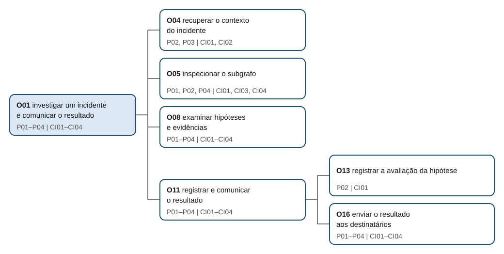

# Entrega 9 — CI01: Avaliação da hipótese sobre a falha no checkout após um deploy

[← Voltar à Entrega 9](../09_modelo_conceitual.md) · [Cenário C01](../04_cenarios_problema/c01.md) · [Tarefa T01](../05_analise_tarefas/t01.md)

**Data:** 16/11/2026

**Status:** 🟩 concluída

**Autor(a):** Gabriel Lovato — 22.123.004-8

**Responsabilidade:** soluções individuais, com consolidação da equipe para mapa de objetivos e esquema de signos.

## Objetivo da atividade

Passar do cenário de problema para uma concepção da interação, explicitando objetivos, tópicos de conversa, falas e signos que a interface deverá comunicar/manipular.

## 1. Cenário de interação

Texto em negrito: novo ou alterado em relação ao cenário refinado de C01. Número entre colchetes: pergunta respondida pelo trecho.

### CI01 — Avaliação da hipótese sobre a falha no checkout após um deploy

**Autor(a):** Gabriel Lovato — 22.123.004-8

**Origem:** cenário problema [C01 — Investigação de falha no checkout após um deploy](../04_cenarios_problema/c01.md#3-cenário-refinado)

*Perguntas exploradas no cenário:*

1. (objetivo) Por que Lucas avalia a hipótese que aponta o checkout, em vez de formular sozinho um diagnóstico do incidente?
2. (evento) Que evento leva Lucas à investigação e como o contexto do incidente chega até ele?
3. (atores) Quem depende da avaliação de Lucas e quem precisa recebê-la?
4. (planejamento) De que informações da investigação do SRE Lucas precisa para não refazê-la?
5. (ação) A delimitação do período e a busca das requisições com erro fazem parte do trabalho de Lucas nesta investigação?
6. (ação) Como Lucas chega aos spans do checkout sem refazer a busca em várias ferramentas?
7. (avaliação) Como Lucas distingue a explicação produzida pelo pipeline das evidências observadas?
8. (avaliação) Como Lucas verifica se a exceção do checkout iniciou a falha ou é consequência da lentidão do pagamento?
9. (avaliação) A indicação de que uma evidência contraria a hipótese pode ser feita pelo sistema?
10. (ambiente) O que acontece com a investigação quando Lucas é interrompido por cobranças e mensagens?
11. (ação) Que conteúdo Lucas registra na avaliação e como escolhe quem a recebe?
12. (avaliação) Como Lucas sabe que a avaliação chegou aos destinatários?

Atores: Lucas (desenvolvedor backend), SRE de plantão, equipe do serviço de pagamento

Em uma manhã de trabalho, poucos minutos depois da implantação de uma nova versão, Lucas, desenvolvedor backend responsável por três microsserviços críticos, é acionado pelo SRE de plantão porque o checkout apresenta erros e aumento de latência **[2]. A mensagem, recebida pelo canal de comunicação da equipe, traz o link do resultado do diagnóstico inicial que o SRE acabou de enviar [2]. Nele, o SRE indica a origem provável como "não determinada" e explica, na justificativa, que as duas hipóteses diagnósticas produzidas pelo pipeline ainda precisam ser conferidas: a hipótese A aponta o checkout, mantido pela equipe de Lucas, e a hipótese B aponta o serviço de pagamento. Por isso, o SRE pede a Lucas que avalie a hipótese A antes que alguém altere o checkout [1,3].** Sob pressão para restabelecer o serviço dentro do prazo operacional, ele precisa **conferir se as evidências sustentam essa hipótese**, avaliar se algum serviço sob sua responsabilidade está envolvido e reunir evidências suficientes para orientar a primeira ação corretiva **[1]**.

Lucas **abre o link, e o sistema reabre o incidente no estado em que o SRE enviou o diagnóstico inicial: o recorte (serviço checkout, sintoma erros e latência elevada, período de 30 minutos antes do alerta até a solicitação da análise), a hipótese A em foco e as evidências citadas pelo SRE, cada uma marcada como a favor ou contra [4]. Entre os resultados do incidente, o sistema apresenta o próprio diagnóstico, com autor e horário do envio, e o recorte permanece visível durante toda a investigação [4]. Lucas não precisa delimitar o período de novo nem procurar as requisições com erro em várias ferramentas: o subgrafo e as hipóteses do recorte já estão disponíveis [5]. Durante a investigação, Lucas** mantém a IDE e os canais de comunicação abertos.

**Em vez dos milhares de eventos do período, o sistema apresenta o subgrafo e informa que ele é uma seleção da filtragem estrutural e que componentes fora dele podem ser mostrados [5]. Com a hipótese A em foco, o checkout aparece como origem provável (hipótese A), e o caminho de propagação da hipótese se restringe a ele; o pagamento aparece como afetado, ligado ao checkout por uma relação vista em trace. A explicação da hipótese A, identificada como produzida pelo pipeline, liga os erros do checkout à nova versão; entre as evidências associadas a ela,** algumas mensagens mostram uma exceção no checkout, enquanto traces apontam timeouts **na chamada do checkout ao** serviço de pagamento **[7]**. **A conclusão continua com Lucas, que** precisa decidir se a exceção iniciou a falha, se foi provocada pela indisponibilidade da dependência ou se ambos os sinais são efeitos de outro problema. **Ele compara o início do desvio dos dois componentes e vê que a latência do pagamento começou antes dos erros do checkout [8]. Ao escolher o checkout, o sistema apresenta as evidências do componente no período, sem nova busca e sem perder o recorte, com os dados pessoais dos clientes mascarados [6]. Lucas vai direto aos spans com erro e vê que a exceção ocorre quando o checkout esgota o tempo de espera pela resposta do pagamento [6,8]. O sistema não marca essas evidências como contrárias à hipótese A: é Lucas quem conclui que elas contrariam a origem no checkout [9]. Como o contexto recebido informa o recorte usado pelo SRE, as evidências que ele citou e a justificativa do diagnóstico, Lucas sabe o que já foi examinado e não repete a análise [4].**

Enquanto investiga, Lucas recebe cobranças por uma estimativa; **quando volta de cada mensagem, o recorte continua visível e o componente em foco é o mesmo, e ele retoma a análise de onde parou [10].** Para comunicar **a avaliação da hipótese, ele a classifica como parcialmente sustentada: os erros se concentram no checkout e começaram depois da implantação, mas a latência do pagamento começou antes e os spans com erro aguardam a resposta do pagamento [11]. Na justificativa, Lucas explica essa conclusão; cita a métrica de taxa de erros do checkout como a favor e a métrica de latência do pagamento e os spans do checkout com erro como contra; e registra nas lacunas que a causa da latência do pagamento não foi examinada [11]. Ele escolhe como destinatários o SRE de plantão e a equipe do pagamento, entre as pessoas com acesso ao incidente, e o sistema pede que ele confirme quem receberá a avaliação e o link [3,11]. Depois da confirmação, o sistema informa que a avaliação está disponível, com o horário do envio e o link do resultado, que os destinatários recebem pelo canal de comunicação da equipe [12].**

**Como a avaliação separa o que as evidências mostram do que a hipótese afirma, Lucas reduz o risco de** interpretar um efeito como causa **e de** alterar o serviço errado, produzir uma correção parcial, recomendar um rollback desnecessário ou acionar outra equipe sem contexto suficiente. **A equipe do pagamento recebe a avaliação com o recorte e as evidências citadas e pode examinar a latência do serviço sem refazer a investigação [3].**

### Diferenças relevantes

| Alteração | Por que foi necessária | Evidência/artefato que justifica |
|---|---|---|
| O acionamento traz o link do resultado do diagnóstico inicial, e o sistema reabre o incidente com recorte, hipótese em foco, evidências citadas e justificativa do SRE. | Em C01, Lucas parte de informações resumidas, e o contexto recebido nem sempre informa o que o SRE já delimitou, as evidências descartadas ou o raciocínio seguido; [H] a passagem incompleta pode obrigá-lo a reiniciar a busca. | C01, seção 3 e questão Q3; P02, jornada (etapa 1) e decisão sobre links com o contexto do erro; H04; RC01; MU04; Entrega 8, capacidade "links que preservam o estado". |
| O objetivo de Lucas passa a ser avaliar a hipótese A, que aponta o serviço de sua equipe, em vez de identificar sozinho a provável origem do incidente. | O diagnóstico inicial cabe ao SRE; Lucas confere uma explicação recebida antes que ela oriente a correção. | T01, seção 1; T03; Entrega 5, síntese da equipe; Entrega 8, delimitação (repartição entre pessoa e sistema). |
| A delimitação do período e a busca de requisições com erro em várias ferramentas dão lugar ao recorte recebido e ao subgrafo, apresentado como seleção da filtragem estrutural. | Em C01, milhares de eventos sem relação com o incidente ocupam a investigação; [?] uma seleção apresentada como completa poderia esconder evidência relevante. | C01, seção 3 (ruptura principal); Entrega 3, contexto de uso (volume de dados); H02; RC02; F02. |
| A explicação da hipótese aparece identificada como produzida pelo pipeline, separada das evidências associadas, e o caminho de propagação da hipótese em foco fica destacado no subgrafo. | [H] Uma explicação convincente pode ser aceita sem conferência e orientar a correção ao serviço errado. | T01, HTA, itens 0 e 1; H01; H03; RC03; RC05; MU01; MU05. |
| Lucas compara o início do desvio do checkout e do pagamento e encontra sozinho a evidência que contraria a hipótese A; o sistema não a marca. | Em C01, Lucas precisa decidir manualmente se a exceção iniciou a falha ou foi provocada pela dependência; a conclusão sobre a hipótese cabe à pessoa. | C01, questão Q4; T01, HTA, item 3, e síntese (tarefa de teste com evidência contraditória); MU07. |
| As evidências do componente em foco aparecem sem nova busca, com dados pessoais mascarados, e Lucas vai direto aos spans com erro. | Em C01, as evidências estão fragmentadas e Lucas alterna entre visões e fontes; [H] P02 vai direto ao rastreamento do erro. | P02, comportamentos relevantes e decisão "drill-down direto"; T01, HTA 2.2 e GOMS, método 1.B; RC01; Entrega 8, princípio LGPD. |
| O recorte continua visível e o componente em foco é preservado quando Lucas volta das mensagens. | [H] Lucas recebe muitas mensagens nos canais de comunicação e alterna entre IDE, código e ferramentas, sob cobrança por estimativas. | P02, ambiente típico de uso; Entrega 3, contexto de uso (ambiente físico); MU04. |
| Em vez de um diagnóstico inicial próprio, Lucas registra a avaliação da hipótese: classificação "parcialmente sustentada", justificativa, evidências citadas a favor e contra e lacunas. | Em C01, o critério de conclusão é relacionar sintoma, serviço originador, caminho de propagação e evidências; [H] sem justificativa, outra pessoa não consegue conferir o motivo da decisão. | C01, questão Q5; T01, HTA, itens 4 e 5, e GOMS, goal 3; MU07; MU11. |
| A troca de mensagens com o SRE e com a equipe do pagamento dá lugar ao envio da avaliação, com destinatários que ele confirma e estado "disponível", horário e link. | Em C01, Lucas troca mensagens sob cobrança e pode acionar outra equipe sem contexto suficiente. | C01, questões Q3 e Q6; T01, HTA, item 5; Entrega 8, regra 4 de Shneiderman; MU04. |
| As consequências passam a ser riscos que a avaliação reduz, e a equipe do pagamento recebe o contexto para examinar a latência do serviço. | [F] Uma análise errônea leva a uma ação inadequada, como a correção parcial de um bug (Entrega 1, seção 4.4); em C01, interpretar um efeito como causa leva ao serviço errado, ao rollback desnecessário ou ao acionamento sem contexto. | C01, questão Q6; Entrega 1, seção 4.4; MU11. |

## 2. Design centrado na comunicação

**Nome do cenário:** CI01 — Avaliação da hipótese sobre a falha no checkout após um deploy

| Tópico > subtópico | Falas e signos envolvidos | Intenção/efeito esperado |
|---|---|---|
| recuperar o contexto do incidente (O04) | U: Recebi do SRE o **link do resultado**; preciso saber o que ele já investigou. | Lucas parte do contexto já reunido pelo SRE, sem abrir uma nova busca. |
| > abrir o link do resultado | D: Reabri o **incidente** como estava quando o SRE enviou o **diagnóstico inicial**: **recorte** com **serviço** checkout, **sintoma** **erros** e **latência elevada** e **período** de 30 minutos antes do alerta até a solicitação da análise; **hipótese em foco**, a hipótese A; e as **evidências citadas** pelo SRE. O **recorte** fica visível durante toda a investigação. | Lucas reconhece o recorte do SRE e não precisa delimitar o incidente de novo (MU04). |
| > conferir os resultados do incidente | U: O que o SRE concluiu? D: Nos **resultados do incidente** está o **diagnóstico inicial** do SRE, com **autor** e **horário do envio**: **origem provável** **não determinada**, **justificativa** que pede a conferência das **hipóteses diagnósticas** A e B e **evidências citadas**, cada uma marcada **a favor** ou **contra**. | Lucas entende o raciocínio do SRE e por que a avaliação da hipótese A foi pedida a ele (H04). |
| examinar hipóteses e evidências (O08) | U: Quero entender o que a hipótese A afirma sobre o checkout. | Lucas lê a hipótese antes de conferir os dados, como no item 1 do HTA de T01. |
| > conferir as evidências associadas | D: A hipótese A aponta o checkout como **origem provável**. A **explicação**, produzida pelo pipeline, liga os **erros** do checkout à nova versão. As **evidências associadas** são **logs** com exceção no checkout, **spans** com timeout na chamada ao pagamento e **logs** do pagamento. A hipótese B aponta o pagamento como **origem provável**. A ordem das hipóteses não indica preferência. | Lucas distingue a interpretação do pipeline das evidências observadas e sabe que precisa conferi-la (MU01; H03). |
| inspecionar o subgrafo (O05) | U: Quero ver onde o checkout fica no caminho da falha. D: Este **subgrafo** é uma seleção da **filtragem estrutural** para o **recorte**; **componentes** **fora do subgrafo** podem ser mostrados a seu pedido. | Lucas sabe que o subgrafo não reúne toda a telemetria do período (H02). |
| > examinar componentes e relações | D: Com a hipótese A em foco, o checkout, **serviço** do **recorte**, é **origem provável** (hipótese A), e o **caminho de propagação** da hipótese se restringe a ele. O pagamento é **afetado**, com **desvio observado** de **latência elevada**, e se liga ao checkout pela **relação** checkout → pagamento, vista em **trace**. | Lucas distingue o componente apontado pela hipótese do componente apenas afetado e nota que o pagamento fica fora do caminho de propagação da hipótese A (MU05; H01). |
| > comparar o início do desvio | U: O que começou primeiro, a latência do pagamento ou os erros do checkout? D: O **início do desvio** do pagamento é anterior ao **início do desvio** do checkout; os dois estão dentro do **período**. | Lucas confronta a hipótese com a ordem dos eventos antes de aceitá-la (MU05; MU07). |
| > consultar as evidências do componente | U: Quero ver as **evidências** do checkout. D: O checkout é o **componente em foco**. Estas são suas **evidências** no **período**, **com dados**: **spans** com **horário**, **identificador do trace** e **conteúdo**, com dados pessoais mascarados. U: Nos spans com erro, o checkout espera a resposta do pagamento até esgotar o tempo de espera. Isso contraria a origem no checkout. | Lucas encontra a evidência contrária à hipótese A sem que o sistema a marque e sem perder o recorte (MU07; MU04). |
| registrar a avaliação da hipótese (O13) | U: Quero registrar minha **avaliação da hipótese** A. D: Preservo o **rascunho** enquanto você escreve. Classifique a hipótese como **sustentada**, **parcialmente sustentada** ou **não sustentada**; **sustentada** indica compatibilidade com as evidências consultadas, e não causa comprovada. | Lucas entende que a classificação expressa suporte nas evidências, e não comprovação da causa (MU01; MU11). |
| > classificar a hipótese | U: **Parcialmente sustentada**: os **erros** se concentram no checkout e começaram depois da implantação, mas a latência do pagamento começou antes e os spans com erro aguardam a resposta do pagamento. D: Registrei a **classificação da hipótese** e a **justificativa**. Quais **evidências citadas** sustentam a conclusão, e cada uma é **a favor** ou **contra** a hipótese A? | Lucas registra uma conclusão que separa a parte da explicação que tem suporte da parte contrariada (MU07). |
| > informar o conteúdo do resultado | U: **A favor**: a **métrica** de taxa de erros do checkout. **Contra**: a **métrica** de latência do pagamento e os **spans** do checkout com erro. D: Escolha entre as **lacunas** detectadas no **recorte** as que afetam sua conclusão ou descreva outras. U: Nas **lacunas**, registro que a causa da latência do pagamento não foi examinada. | Lucas cita a evidência contrária e deixa explícito o que fica para a equipe do pagamento (MU07; MU11). |
| enviar o resultado aos destinatários (O16) | U: Agora quero enviar a avaliação ao SRE e à equipe do pagamento. | Para Lucas, a avaliação só termina quando é comunicada. |
| > escolher os destinatários | D: Estas são as pessoas com acesso ao **incidente**. Quem serão os **destinatários**? U: O SRE de plantão e a equipe do pagamento. | Lucas envia a avaliação só a quem pode abrir o incidente. |
| > confirmar os destinatários | D: A **avaliação da hipótese** e o **link do resultado** serão enviados ao SRE de plantão e à equipe do pagamento. Confirma? U: Confirmo. | Lucas confere quem receberá a avaliação antes do envio. |
| > conferir o envio | D: A **avaliação da hipótese** está **disponível** aos **destinatários**. Registrei o **horário do envio**; o **link do resultado** reabre o **incidente** com o **recorte**, a **hipótese em foco**, o **componente em foco** e as **evidências citadas**. | Lucas sabe que a avaliação chegou e que os destinatários poderão conferi-la sem refazer a investigação (MU04). |

**Convenção:** `U` = usuário; `D` = preposto do designer/sistema, conforme a abordagem de Engenharia Semiótica adotada na disciplina.

## 3. Mapa de objetivos

*Figura 1 — Mapa de objetivos de CI01. Fonte: elaboração do autor.*

O mapa reúne, sob o objetivo geral O01, os objetivos que a conversa de CI01 cobre. O13 (registrar a avaliação da hipótese) vem só deste cenário. Os demais são compartilhados: O04 com CI02; O05 com CI03 e CI04; O08, O11 e O16 com os quatro cenários. A notação está descrita na [seção 3 da Entrega 9](../09_modelo_conceitual.md#3-mapa-de-objetivos).

## 4. Esquema conceitual de signos

A tabela reúne os signos usados nas falas da seção 2, com as linhas da tabela única da Entrega 9; as siglas de prevenção e recuperação estão explicadas na [seção 4 da Entrega 9](../09_modelo_conceitual.md#4-esquema-conceitual-de-signos).

| Grupo | Signo | Origem | Observações/semântica | Tipo de conteúdo | Restrição | Valor padrão | Prevenção | Recuperação |
|---|---|---|---|---|---|---|---|---|
| **Incidente (I)** — investigação de um único incidente, aberta a partir de um alerta | + identificador do incidente | aplicação | Produzido pelo sistema. Atribuído quando a análise é solicitada; identifica o incidente nos resultados e nos links. | texto | não editável | — | — | — |
| Incidente (I) | recorte | aplicação | Fornecido pela pessoa. Conjunto de serviço, sintoma e período que define o que a análise considera; visível durante toda a investigação e incluído em cada resultado e no link do resultado. | composto (serviço, sintoma, período) | — | proposto a partir do alerta de origem | AL: ajustar o recorte depois de uma análise pede confirmação, pois inicia nova análise e substitui subgrafo e hipóteses; o rascunho é preservado | — |
| Incidente (I) | serviço | domínio | Fornecido pela pessoa. Serviço em que o sintoma foi observado; ponto de partida da análise. | seleção simples | conjunto flexível: serviços com telemetria no ambiente | serviço do alerta de origem | PA: só serviços com telemetria podem ser escolhidos | — |
| Incidente (I) | sintoma | domínio | Fornecido pela pessoa. Manifestação que caracteriza o incidente. | seleção múltipla | conjunto flexível: inicialmente = {erros, latência elevada, acúmulo de mensagens}; ao menos um | sintoma do alerta de origem | PA: ao menos um sintoma permanece selecionado | — |
| Incidente (I) | período | domínio | Fornecido pela pessoa. Intervalo de tempo analisado. | intervalo de data e hora | início anterior ao fim; fim não posterior ao momento atual; duração entre 5 min e 24 h | de 30 min antes do horário do alerta de origem até o momento da solicitação | PP+PA: formato e duração indicados; datas futuras e início posterior ao fim não podem ser informados | — |
| Incidente (I) | hipótese em foco | aplicação | Fornecido pela pessoa. Hipótese diagnóstica cuja origem provável e caminho de propagação aparecem destacados no subgrafo; preservada no link do resultado. | referência (H) | uma por vez | hipótese A | — | — |
| Incidente (I) | componente em foco | aplicação | Fornecido pela pessoa. Componente ou relação cujas evidências estão sendo consultadas; preservado no link do resultado. | referência (C ou R) | um por vez | — | — | — |
| Incidente (I) | resultados do incidente | aplicação | Produzido pelo sistema. Resultados já disponíveis para o incidente, visíveis a quem tem acesso a ele. | referência (RE), seleção múltipla | só resultados com estado do envio "disponível" | — | — | — |
| **Análise (A)** — execução do pipeline sobre o recorte, em dois estágios | + Incidente (I) | aplicação | Produzido pelo sistema. A é solicitada para o recorte de I; uma nova análise substitui a anterior. | referência (I) | — | — | — | — |
| Análise (A) | estágio | aplicação | Produzido pelo sistema. "filtragem estrutural": seleciona o subgrafo; "geração de hipóteses": produz as hipóteses diagnósticas a partir do subgrafo. | seleção simples | conjunto fixo = {filtragem estrutural, geração de hipóteses}, nessa ordem | — | PP: cada estágio é descrito em uma frase | — |
| Análise (A) | subgrafo | aplicação | Produzido pelo sistema (pipeline). Seleção de componentes e relações que a filtragem estrutural considerou relevantes para o recorte; pode excluir evidência relevante. | referência (C, R), seleção múltipla | — | — | PP: informa que o subgrafo é uma seleção e que componentes fora dele podem ser mostrados | — |
| **Componente (C)** — serviço ou dependência (banco de dados, fila, serviço externo) que aparece no subgrafo | + nome do componente | domínio | Derivado do domínio. Nome usado pelas equipes para o serviço ou a dependência. | texto | não pode ser nulo | — | — | — |
| Componente (C) | presença no subgrafo | aplicação | Produzido pelo sistema. "no subgrafo": selecionado pela filtragem estrutural; "fora do subgrafo": vizinho mostrado a pedido da pessoa, sem nova análise. | seleção simples | conjunto fixo = {no subgrafo, fora do subgrafo} | no subgrafo | PP: componentes fora do subgrafo ficam diferenciados e podem ser ocultados novamente | — |
| Componente (C) | estado do componente | aplicação | Produzido pelo sistema. "origem provável": apontado pela hipótese em foco; "afetado": com desvio observado no período; "relacionado": sem desvio observado. Um valor por componente, nessa precedência. | seleção simples | conjunto fixo = {origem provável, afetado, relacionado} | relacionado | PP: "origem provável" vem com a letra da hipótese que o aponta | — |
| Componente (C) | desvio observado | domínio | Derivado do domínio (telemetria). Manifestações fora do normal registradas no componente durante o período. | seleção múltipla | conjunto flexível: inicialmente = {erros, latência elevada, acúmulo de mensagens}; vazio quando não há desvio | — | — | — |
| Componente (C) | início do desvio | domínio | Derivado do domínio (telemetria). Horário em que o desvio observado começou; permite comparar a ordem dos eventos entre componentes. | data e hora | — | — | PP: quando o desvio já existia no início do período, indica a lacuna "período incompleto"; sem telemetria suficiente, indica início desconhecido | — |
| **Relação (R)** — ligação em que um componente chama outro ou depende dele | + componentes da relação (C.[nome] → C.[nome]) | domínio | Derivado do domínio (telemetria e mapa de serviços). A seta parte do componente que chama e chega ao componente chamado. | referência (C) | componentes distintos | — | — | — |
| Relação (R) | fonte da relação | domínio | Derivado do domínio. Onde a relação aparece. | seleção múltipla | conjunto fixo = {trace, log, mapa de serviços} | — | PP: relação vista em trace ou log e ausente do mapa de serviços fica destacada | — |
| **Hipótese diagnóstica (H)** — explicação sobre a provável origem do incidente, produzida pelo pipeline a partir do subgrafo; precisa ser conferida | + identificador da hipótese | aplicação | Produzido pelo sistema. Letra atribuída na ordem em que o pipeline entrega as hipóteses (A, B...); a ordem não indica preferência. | texto | — | — | PP: informa que a ordem não indica preferência | — |
| Hipótese diagnóstica (H) | origem provável | domínio | Produzido pelo sistema (pipeline). Componente que a hipótese aponta como provável origem do incidente. | referência (C) | componente do subgrafo | — | — | — |
| Hipótese diagnóstica (H) | explicação | aplicação | Produzido pelo sistema (pipeline). Texto que descreve como a falha teria se propagado da origem provável até o sintoma. | texto | — | — | PP: identificada como produzida pelo pipeline, separada das evidências e das conclusões registradas por pessoas | — |
| Hipótese diagnóstica (H) | evidências associadas | aplicação | Produzido pelo sistema (pipeline). Evidências do subgrafo usadas para formular a hipótese. | referência (E), seleção múltipla | — | — | — | — |
| Hipótese diagnóstica (H) | caminho de propagação | aplicação | Produzido pelo sistema (pipeline). Relações que ligam a origem provável ao serviço do recorte, segundo a hipótese; destacado no subgrafo quando a hipótese está em foco. | referência (R), seleção múltipla | — | — | — | — |
| **Evidência (E)** — item de telemetria de um componente ou de uma relação: span, log ou métrica | + Componente (C) ou Relação (R) | domínio | Derivado do domínio. E pertence a um componente ou a uma relação. | referência (C ou R) | — | — | — | — |
| Evidência (E) | + horário | domínio | Derivado do domínio. Data e hora do item na fonte de telemetria. | data e hora | — | — | — | — |
| Evidência (E) | tipo de evidência | domínio | Derivado do domínio. "span": operação dentro do trace de uma requisição; "log": mensagem de evento emitida por um serviço; "métrica": série de valores, como latência ou taxa de erros. | seleção simples | conjunto fixo = {span, log, métrica} | — | — | — |
| Evidência (E) | conteúdo | domínio | Derivado do domínio. Mensagem do log, atributos e duração do span ou valores da métrica. | texto | dados pessoais mascarados | mascarado | PA: dados pessoais aparecem mascarados e não podem ser revelados | — |
| Evidência (E) | identificador do trace | domínio | Derivado do domínio. Identifica a requisição e liga spans e logs; pode faltar em logs. | texto | pode ser nulo | — | PP: a ausência é indicada como lacuna "identificador ausente" | — |
| Evidência (E) | situação da consulta | aplicação | Produzido pelo sistema. Situação da consulta às evidências do componente em foco no período; "sem dados" (nenhum item encontrado) difere de itens encontrados sem erro. | seleção simples | conjunto fixo = {carregando, com dados, sem dados, acesso restrito, falha de consulta} | carregando | PP: "sem dados" e "acesso restrito" aparecem como lacunas, nunca como normalidade | RA: em "falha de consulta", descreve a causa e permite repetir a consulta sem perder o recorte; CE: em "acesso restrito", informa que o trecho exige permissão que a pessoa não tem e pode ser consultado por quem a tenha, fora do sistema |
| **Resultado (RE)** — conclusão registrada e enviada por uma pessoa: diagnóstico inicial (D), avaliação da hipótese (AV), parecer sobre a verificação da correção (PV) ou retorno ao SRE (RS) | + Incidente (I) | domínio | Produzido pelo sistema. RE refere-se a I e guarda o recorte vigente no envio. | referência (I) | — | incidente aberto | — | — |
| Resultado (RE) | + autor | domínio | Produzido pelo sistema. Pessoa identificada pelo ambiente corporativo, sem login. | texto | não editável | pessoa identificada | — | — |
| Resultado (RE) | + horário do envio | aplicação | Produzido pelo sistema. Data e hora em que o resultado ficou disponível. | data e hora | — | — | — | — |
| Resultado (RE) | origem provável | domínio | Fornecido pela pessoa. Só em D e RS: componente que a pessoa indica como provável origem, ou "não determinada". É hipótese de trabalho, não comprovação da causa. | seleção simples | componentes do subgrafo ou "não determinada"; não pode ser nulo em D e RS | — | PP: explica que a origem provável é hipótese de trabalho; PA: o envio de D e RS exige uma escolha | — |
| Resultado (RE) | justificativa | domínio | Fornecido pela pessoa. Texto que explica a conclusão. | texto | não pode ser nulo em AV e PV | — | PP+PA: obrigatória em AV e PV; o envio exige seu preenchimento | — |
| Resultado (RE) | evidências citadas | aplicação | Fornecido pela pessoa. Evidências usadas na conclusão, cada uma marcada como "a favor" ou "contra" a hipótese avaliada (em AV) ou a conclusão registrada (em D, PV e RS); vão como referência, não como cópia do conteúdo. | referência (E), seleção múltipla, cada uma com {a favor, contra} | ao menos uma em D, AV e PV | — | PP+PA: o envio de D, AV e PV exige ao menos uma evidência citada | — |
| Resultado (RE) | lacunas | aplicação | Fornecido pela pessoa. Lacunas detectadas que a pessoa considera relevantes para a conclusão, mais lacunas descritas em texto (por exemplo, condição da falha não exercitada no teste). | referência (L), seleção múltipla, e texto | — | — | PP: as lacunas detectadas no recorte são apresentadas para escolha | — |
| Resultado (RE) | destinatários | domínio | Fornecido pela pessoa. Pessoas que recebem o link do resultado. | seleção múltipla | só pessoas com acesso ao incidente; ao menos uma | — | PA: só pessoas autorizadas são oferecidas; AL: os destinatários são confirmados antes do envio | — |
| Resultado (RE) | estado do envio | aplicação | Produzido pelo sistema. "rascunho": ainda não enviado, preservado pelo sistema; "disponível": registrado e disponível aos destinatários; "falha de disponibilização": não ficou disponível. | seleção simples | conjunto fixo = {rascunho, disponível, falha de disponibilização} | rascunho | PP: só "disponível" indica que o resultado chegou aos destinatários | RA: em "falha de disponibilização", descreve a causa, preserva o rascunho e permite repetir o envio |
| Resultado (RE) | link do resultado | aplicação | Produzido pelo sistema. Reabre o incidente com recorte, hipótese em foco, componente em foco e evidências citadas no momento do envio; trechos sem permissão aparecem com acesso restrito. | link | — | — | — | — |
| **Diagnóstico inicial (D)** — conclusão do SRE sobre a provável origem e o impacto do incidente, para orientar a equipe | + Resultado (RE) | aplicação | Produzido pelo sistema. D é um RE. | referência (RE) | — | — | — | — |
| **Avaliação da hipótese (AV)** — conclusão do desenvolvedor sobre o suporte de uma hipótese diagnóstica | + Resultado (RE) | aplicação | Produzido pelo sistema. AV é um RE. | referência (RE) | — | — | — | — |
| Avaliação da hipótese (AV) | + Hipótese diagnóstica (H) | aplicação | Fornecido pela pessoa. Hipótese avaliada. | referência (H) | não pode ser nulo | hipótese em foco | — | — |
| Avaliação da hipótese (AV) | classificação da hipótese | aplicação | Fornecido pela pessoa. "sustentada": compatível com as evidências consultadas, sem comprovar a causa; "parcialmente sustentada": parte da explicação tem suporte e parte é contrariada ou não tem evidência; "não sustentada": as evidências contrariam a explicação ou não a sustentam. | seleção simples | conjunto fixo = {sustentada, parcialmente sustentada, não sustentada}; não pode ser nulo | — | PP: explica que "sustentada" não significa causa comprovada; PA: o envio exige uma escolha | — |

## Referências

- **CC8122 — Projeto de IHC e modelos conceituais.** Material de aula disponibilizado na disciplina, baseado em Barbosa e Silva (2010), consultado em 16/11/2026. Cenários de interação, design centrado na comunicação e mapa de objetivos.
- **CC8122 — Esquema conceitual de signos.** Material de aula disponibilizado na disciplina, baseado em Barbosa e Silva (2010), consultado em 16/11/2026. Signos de conteúdo e prevenção e recuperação de rupturas comunicativas.
- **CC8122 — Organização do espaço de problema.** Material de aula disponibilizado na disciplina, baseado em Barbosa e Silva (2010), consultado em 16/11/2026. Questões de refinamento e indicação das perguntas na narrativa.
- BARBOSA, Simone D. J.; SILVA, Bruno S. **Interação Humano-Computador**. Rio de Janeiro: Elsevier/Campus, 2010.
- Documentos do projeto: [cenário C01](../04_cenarios_problema/c01.md), [tarefa T01](../05_analise_tarefas/t01.md), [persona P02](../03_personas_contexto_jornada.md#persona-p02--lucas-o-desenvolvedor-sênior) e [Entrega 8](../08_engenharia_usabilidade.md).
