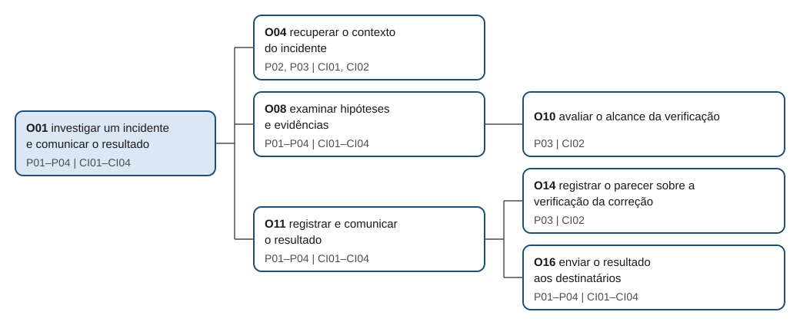

# Entrega 9 — CI02: Parecer sobre a verificação de uma correção incerta

[← Voltar à Entrega 9](../09_modelo_conceitual.md) · [Cenário C02](../04_cenarios_problema/c02.md) · [Tarefa T02](../05_analise_tarefas/t02.md)

**Data:** 16/11/2026

**Status:** 🟩 concluída

**Autor(a):** Willian Verenka Oliveira Silva — 22.124.081-5

**Responsabilidade:** soluções individuais, com consolidação da equipe para mapa de objetivos e esquema de signos.

## Objetivo da atividade

Passar do cenário de problema para uma concepção da interação, explicitando objetivos, tópicos de conversa, falas e signos que a interface deverá comunicar/manipular.

## 1. Cenário de interação

Texto em negrito: novo ou alterado em relação ao cenário refinado de C02. Número entre colchetes: pergunta respondida pelo trecho.

### CI02 — Parecer sobre a verificação de uma correção incerta

**Autor(a):** Willian Verenka Oliveira Silva — 22.124.081-5

**Origem:** cenário problema [C02 — O teste passou, mas a correção ainda é incerta](../04_cenarios_problema/c02.md#3-cenário-refinado)

*Perguntas exploradas no cenário:*

1. (objetivo) De que informações sobre o incidente Mariana precisa para avaliar a correção sem refazer a investigação?
2. (atores) Quem já registrou conclusões sobre o incidente, e como Mariana as distingue das hipóteses produzidas pelo pipeline?
3. (evento) Que condição estava presente nas compras que falharam?
4. (ambiente) Em que ambientes estão as evidências do incidente e as do teste, e como Mariana as distingue?
5. (ação) Que dificuldade pode surgir ao consultar as evidências de produção, e como ela é contornada?
6. (planejamento) Por que Mariana começa pelo fluxo habitual de compra, e como decide se ele basta?
7. (ação) Como Mariana relaciona o teste ao incidente e compara as evidências dos dois?
8. (avaliação) A ausência de erros no teste faz parte das evidências de que a correção resolveu a falha?
9. (atores) De quem depende o esclarecimento das lacunas, e o que acontece quando a resposta não chega a tempo?
10. (avaliação) Que conclusão Mariana pode registrar quando faltam a condição da falha, o acesso e o critério de aceitação?
11. (atores) Quem precisa receber o parecer?
12. (evento) O que acontece se o parecer não ficar disponível aos destinatários?

Atores: Mariana (analista de QA), desenvolvedor responsável pela correção, SRE de plantão

Mariana recebe uma correção para a falha intermitente na conclusão de compras. O chamado informa um ajuste no tempo de espera pela resposta do pagamento, e a equipe aguarda sua avaliação antes da liberação. **O chamado traz também o link do resultado da avaliação da hipótese enviada pelo desenvolvedor responsável pela correção. Pelo link, o sistema reabre o incidente no estado em que o desenvolvedor enviou a avaliação: o recorte, com o serviço de checkout, os sintomas erros e latência elevada e o período analisado, a hipótese em foco e as evidências citadas [1]. O sistema apresenta também os resultados do incidente já disponíveis, o diagnóstico inicial do SRE de plantão e a avaliação do desenvolvedor, cada um com autor e horário do envio, separados das hipóteses diagnósticas, que aparecem como produzidas pelo pipeline e sujeitas a conferência [2].**

**Entre as evidências citadas estão spans de compras que falharam em produção, cada um com horário e identificador do trace: neles, a chamada ao pagamento dura mais que o tempo de espera do checkout, e a compra termina com erro [3]. Cada evidência indica o ambiente de onde vem, e o recorte permanece visível enquanto Mariana as consulta [4].** Parte dos dados de produção depende de acesso que ela não possui. **Ao conferir as evidências associadas à hipótese em foco, ela encontra os logs do pagamento em produção, no período do incidente, com acesso restrito. O sistema informa que esse trecho exige uma permissão que Mariana não tem e pode ser consultado, fora do sistema, por quem a tenha, e o indica como lacuna, e não como ausência de erro [5]. Mariana pede ao SRE de plantão, pelo canal de comunicação da equipe, que consulte esses logs [5,9].**

Para verificar uma correção, Mariana costuma escolher entre duas estratégias: repetir o fluxo habitual de compra ou, quando o chamado descreve a condição da falha, reproduzi-la. **Agora a condição está nas evidências citadas: as falhas acompanham respostas do pagamento acima do tempo de espera. Como a equipe aguarda o parecer, Mariana começa pelo fluxo habitual, que pode executar de imediato, e planeja compará-lo com o incidente para decidir se ele basta [6].**

Ela realiza uma compra no ambiente de homologação, usado para verificar mudanças antes de liberá-las aos clientes, e o pedido é concluído. **Em seguida, relaciona esse teste ao incidente, informando a referência do teste, o ambiente, a versão verificada, o período do teste e o resultado do teste, "passou". O sistema lembra que o resultado do teste não equivale à conclusão do parecer e apresenta as evidências do teste, spans do checkout e do pagamento em homologação no período do teste, ao lado das evidências citadas nos resultados do incidente, que vêm de produção [4,7].** Nesse teste, o pagamento responde normalmente. **A situação da consulta das evidências do teste é "com dados": os spans foram encontrados e nenhum tem erro, o que o sistema diferencia de "sem dados". Comparando os dois conjuntos, Mariana conclui que o fluxo foi percorrido sem erro, mas a demora do pagamento presente nas compras que falharam não ocorreu no teste: a condição da falha não foi exercitada, e o sucesso não mostra o que acontece quando o pagamento demora [7,8].**

O desenvolvedor informa que os testes executados após a alteração passaram, mas o chamado não registra se eles reproduziram a condição original. **Mariana pergunta a ele, pelo canal de comunicação da equipe, se algum desses testes provocou a demora do pagamento. Enquanto ele e o SRE de plantão atendem outras demandas,** a resposta não chega a tempo do parecer solicitado **[9]**. Ela consegue relatar que uma compra foi concluída em homologação, mas continua sem base suficiente para afirmar que a falha intermitente foi corrigida.

Uma confirmação prematura pode permitir a reincidência da falha; **por isso, em vez de manter a decisão bloqueada, Mariana registra o parecer sobre a verificação da correção com a conclusão do parecer "inconclusivo", que o sistema explica como a falta de vínculo, condição, critério, cobertura ou acesso [10]. Na justificativa, escreve que o teste passou com o pagamento respondendo normalmente e que as falhas ocorreram com respostas acima do tempo de espera; cita, a favor dessa conclusão, os spans do teste e os das compras que falharam. Nas lacunas, escolhe o acesso restrito aos logs do pagamento em produção, entre as detectadas pelo sistema, e descreve que a condição da falha não foi exercitada no teste. Como o chamado não traz critério, registra o critério de aceitação como "não documentado", conforme o sistema orienta, e indica o desenvolvedor e o SRE de plantão como quem pode esclarecer, informação que o sistema exige em um parecer inconclusivo [9,10].**

**Mariana escolhe como destinatários o desenvolvedor e o SRE de plantão, entre as pessoas com acesso ao incidente, e o sistema pede que ela confirme quem receberá o parecer e o link do resultado [11]. Na primeira tentativa, o sistema informa falha de disponibilização, explica que a conexão com o servidor foi interrompida antes do registro e avisa que o rascunho foi preservado. Mariana repete o envio sem reescrever o parecer, e o sistema responde que ele está disponível, com o horário do envio e o link do resultado, que os destinatários recebem pelo canal de comunicação da equipe. Só então ela considera o parecer comunicado [12].**

### Diferenças relevantes

| Alteração | Por que foi necessária | Evidência/artefato que justifica |
|---|---|---|
| O chamado traz o link do resultado da avaliação da hipótese, que reabre o incidente com recorte, hipótese em foco e evidências citadas. Deixa de existir o histórico com uma mensagem de erro, sem requisição afetada nem condição da falha. | Em C02, Mariana não consegue reconstruir, a partir do chamado e das conversas, as condições que levaram os clientes ao erro. [H] Um repasse sem essas referências obriga a QA a refazer parte da investigação. | C02, seção 3 (Q1/Q3); T02, item 1.1 e regra SR1 do GOMS; H05; MU04; RC01; decisão "contexto preservado no encaminhamento" de P03. |
| Os resultados do incidente aparecem com autor e horário do envio, separados das hipóteses diagnósticas produzidas pelo pipeline. | [H] Mariana precisa distinguir resultado de teste, hipótese diagnóstica e conclusão de uma pessoa; sem essa separação, uma hipótese pode ser lida como correção já verificada. | T02, item 1.2; decisão "separação entre hipótese e verificação" de P03; H03; MU01; RC03; RC05. |
| A condição da falha aparece nas evidências citadas, como spans com horário, ambiente e identificador do trace, no lugar de trechos copiados e de menções a demora nas conversas. | Em C02, os trechos copiados não preservam identificadores e horários, e Mariana não consegue relacionar a demora do pagamento às compras que falharam. | C02, seção 3 (Q1/Q2 e Q3/Q4); T02, item 2.1; Entrega 8, princípio LGPD (comunicação por referência às evidências). |
| O trecho sem permissão aparece com acesso restrito, como lacuna, com a indicação de que pode ser consultado fora do sistema por quem tenha permissão; Mariana pede essa consulta ao SRE de plantão. | Em C02, parte dos dados de produção depende de acesso que Mariana não possui, e a falta de acesso se confunde com a falta de cobertura. [H] Ler a falta de acesso como ausência de erro favorece uma confirmação prematura. | C02, seção 3 (Q3/Q4); T02, item 2.2; H04; H06; MU02; RC04; restrições de P03. |
| Com a condição identificada, Mariana começa pelo fluxo habitual por decisão própria e planeja compará-lo com o incidente. | Em C02, sem a condição registrada, só a primeira estratégia está ao seu alcance, e ela não sabe se o teste exercita a falha. | C02, seção 3 (Q7); T02, plano 2. |
| O teste é relacionado ao incidente, e as evidências do teste aparecem ao lado das evidências do incidente, com a situação da consulta "com dados" diferenciada de "sem dados"; Mariana constata que a condição da falha não foi exercitada. | Em C02, o sucesso não esclarece se o comportamento problemático foi exercitado, e a consulta sem novos erros não informa se o caminho e o período estão cobertos. | C02, seção 3 (Q1/Q2 e Q3/Q4); T02, itens 2.1 a 2.3; H06; MU02; MU08. |
| O pedido ao desenvolvedor passa a ser específico: se algum teste provocou a demora do pagamento. Deixa de existir o pedido para recuperar as evidências usadas no diagnóstico. | Em C02, Mariana depende do desenvolvedor e do SRE para recuperar evidências que já existiam; com o link, só o que falta precisa ser perguntado. | C02, seção 3 (Q5/Q6); T02, item 3.1; H05. |
| O parecer inconclusivo é registrado com justificativa, evidências citadas, lacunas, critério de aceitação "não documentado" e quem pode esclarecer, no lugar da decisão bloqueada. | Em C02, a decisão fica bloqueada entre evidências incompletas e a pressão pela liberação, e não há critério documentado ligando os testes à falha original. [H] Sem uma forma de comunicar o limite da verificação, restam a confirmação prematura ou o atraso. | C02, seções 3 (Q5/Q6) e 4 (problemas/rupturas); T02, seção 2 (critérios do parecer) e plano 0; H06; MU08; MU11. |
| O parecer é enviado com confirmação dos destinatários; diante da falha de disponibilização, o rascunho é preservado e o envio é repetido até o estado "disponível". | O parecer só cumpre seu objetivo quando chega à equipe que aguarda a liberação, e registrar não garante que ele ficou disponível. | T02, plano 5, e CTT de T02 (A3 e U4); MU12; Entrega 8, regra 4 de Shneiderman. |

## 2. Design centrado na comunicação

**Nome do cenário:** CI02 — Parecer sobre a verificação de uma correção incerta

| Tópico > subtópico | Falas e signos envolvidos | Intenção/efeito esperado |
|---|---|---|
| recuperar o contexto do incidente (O04) | U: Recebi uma correção para verificar, e o chamado traz o **link do resultado** da **avaliação da hipótese** do desenvolvedor. Preciso entender o **incidente** sem refazer a investigação. | Mariana parte do contexto já registrado, em vez de reconstruí-lo a partir de conversas (H05). |
| > abrir o link do resultado | D: Este é o **incidente** no estado em que o desenvolvedor enviou a **avaliação da hipótese**: **recorte** com **serviço** checkout, **sintoma** **erros** e **latência elevada** e o **período** analisado; **hipótese em foco** A; **evidências citadas** na avaliação. O recorte permanece visível enquanto você consulta o incidente. | Mariana sabe a qual ocorrência o parecer se refere e mantém o recorte reconhecível durante o aprofundamento (MU04). |
| > conferir os resultados do incidente | U: Quem já concluiu algo sobre este **incidente**? D: Há dois **resultados do incidente** com **estado do envio** **disponível**: o **diagnóstico inicial**, do SRE de plantão, e a **avaliação da hipótese**, do desenvolvedor, cada um com **autor** e **horário do envio**. As **hipóteses diagnósticas** A e B foram produzidas pelo pipeline e precisam ser conferidas; não são conclusões de pessoas. | Mariana distingue as conclusões registradas por pessoas das hipóteses produzidas pelo pipeline (MU01). |
| examinar hipóteses e evidências (O08) | U: Quero ver as **evidências citadas** que mostram as compras que falharam. D: São **spans** do checkout em **produção**, cada um com **horário**, **ambiente** e **identificador do trace**. Nesses spans, a chamada ao pagamento dura mais que o tempo de espera do checkout, e a compra termina com erro. O **conteúdo** aparece com dados pessoais mascarados. U: Então as falhas acompanham a demora do pagamento. | Mariana procura a condição da falha nas evidências, e não nas conversas da equipe, e identifica as requisições afetadas sem depender de trechos copiados (MU04; H05). |
| > conferir as evidências associadas | U: Quero ver também as **evidências associadas** à **hipótese em foco**. D: Entre as **evidências associadas** à hipótese A estão **logs** do pagamento. | Mariana confere também as evidências em que a hipótese em foco se apoia. |
| > identificar as lacunas | D: A **situação da consulta** dos **logs** do pagamento em **produção**, no **período** do incidente, é **acesso restrito**: esse trecho exige uma permissão que você não tem e pode ser consultado, fora do sistema, por quem a tenha. Ele aparece como **lacuna**, e não como ausência de erro. U: Vou pedir ao SRE de plantão que consulte esses **logs**. | Mariana não toma a falta de acesso como ausência de falha e sabe o que fazer fora do sistema (CE; MU02; H04). |
| avaliar o alcance da verificação (O10) | U: Fiz uma compra em **homologação** com a versão corrigida, e o pedido foi concluído. Quero saber se esse teste exercitou a condição da falha. | Mariana parte do teste que pode executar de imediato e decide, pela comparação, se ele basta. |
| > relacionar o teste ao incidente | D: Qual é a **referência do teste**, o **ambiente**, a **versão verificada**, o **período do teste** e o **resultado do teste**? U: A **referência do teste** é (...), **ambiente** **homologação**, **versão verificada** (...), **período do teste** (...) e **resultado do teste** **passou**. D: OK, a **verificação da correção** está relacionada a este **incidente**. O **resultado do teste** não equivale à **conclusão do parecer**. | Mariana registra o vínculo entre teste e incidente sem tomar o resultado "passou" como conclusão (MU11; H06). |
| > comparar as evidências do teste e do incidente | D: Estas são as **evidências do teste**, **spans** do checkout e do pagamento em **homologação** no **período do teste**, ao lado das **evidências citadas** nos **resultados do incidente**. **Situação da consulta**: **com dados**; os spans foram encontrados e nenhum tem erro, o que difere de **sem dados**. U: No teste, o pagamento respondeu normalmente; nas compras que falharam, demorou mais que o tempo de espera. O teste passou, mas não exercitou a condição da falha. | Mariana distingue itens encontrados sem erro da falta de itens e conclui, ela mesma, que a condição da falha não foi exercitada (MU02; MU08; H06). |
| registrar o parecer sobre a verificação da correção (O14) | U: As respostas do desenvolvedor e do SRE não chegaram, e a equipe aguarda o parecer. Preciso registrar o que a verificação permite afirmar. D: Seu **parecer sobre a verificação da correção** está em **rascunho** e se refere à **verificação da correção** relacionada ao incidente. | Mariana comunica o limite da verificação no prazo, sem depender de respostas que não chegaram (H04). |
| > definir a conclusão do parecer | D: Qual é a **conclusão do parecer**? **Correção sustentada no recorte verificado** exige condições exercitadas, critério conhecido e evidências compatíveis; **falha ainda observada** exige evidência de que o comportamento persiste; **inconclusivo** indica que falta vínculo, condição, critério, cobertura ou acesso. U: **Inconclusivo**. | Mariana escolhe a conclusão compatível com as evidências, sem tratar o teste bem-sucedido como correção sustentada (MU08; MU11). |
| > informar o conteúdo do resultado | D: Qual é a **justificativa**? Quais **evidências citadas** você usa, **a favor** ou **contra** a conclusão? Estas são as **lacunas** detectadas no **recorte**. U: O teste passou com o pagamento respondendo normalmente, e as falhas ocorreram com respostas acima do tempo de espera. Cito **a favor** os **spans** do teste e os das compras que falharam. Nas **lacunas**, escolho o **acesso restrito** aos logs do pagamento e acrescento: condição da falha não exercitada no teste. | Mariana fundamenta o parecer nas evidências e registra o que falta para concluir (MU08). |
| > indicar o critério de aceitação | D: Qual é o **critério de aceitação**? Se não houver um documentado, registre **não documentado**, em vez de criar um. U: O chamado não traz critério: **não documentado**. | Mariana registra a falta do critério em vez de inventá-lo (T02, seção 2). |
| > indicar quem pode esclarecer | D: Um parecer **inconclusivo** exige **quem pode esclarecer** as **lacunas**. U: O desenvolvedor responsável pela correção e o SRE de plantão. | Mariana indica quem pode resolver as lacunas, em vez de fazer um pedido genérico de mais dados (T02, item 3.1). |
| enviar o resultado aos destinatários (O16) | U: Quero enviar o parecer à equipe que aguarda a verificação. | Para Mariana, a tarefa só termina quando o parecer é comunicado. |
| > escolher os destinatários | D: Quem são os **destinatários**? Ofereço apenas pessoas com acesso ao **incidente**. U: O desenvolvedor responsável pela correção e o SRE de plantão. | Mariana envia o parecer só a pessoas autorizadas (PA; Entrega 8, princípio LGPD). |
| > confirmar os destinatários | D: O **parecer sobre a verificação da correção** e o **link do resultado** serão enviados ao desenvolvedor responsável pela correção e ao SRE de plantão. Confirma? U: Sim. | Mariana confere quem receberá o parecer antes do envio (AL). |
| > conferir o envio | D: **Falha de disponibilização**: a conexão com o servidor foi interrompida antes do registro, e o parecer não chegou aos **destinatários**. O **rascunho** foi preservado; você pode repetir o envio. | Mariana percebe que a comunicação não terminou e não perde o que escreveu (RA; MU12). |
| > repetir o envio | U: Quero enviar de novo. D: Pronto: o **estado do envio** é **disponível**, com **horário do envio** (...). Este é o **link do resultado**, que os **destinatários** recebem pelo canal de comunicação da equipe. | Mariana só considera o parecer comunicado diante do estado "disponível" (regra 4 de Shneiderman; MU12). |

**Convenção:** `U` = usuário; `D` = preposto do designer/sistema, conforme a abordagem de Engenharia Semiótica adotada na disciplina.

## 3. Mapa de objetivos

*Figura 1 — Mapa de objetivos de CI02. Fonte: elaboração do autor.*

O mapa reúne O01, objetivo geral do recorte, e os objetivos cobertos por CI02. O10 e O14 vêm apenas deste cenário; O04 é compartilhado com CI01, e O08, O11 e O16, assim como O01, com os quatro cenários de interação. A notação está descrita na [seção 3 da Entrega 9](../09_modelo_conceitual.md#3-mapa-de-objetivos).

## 4. Esquema conceitual de signos

Signos usados nas falas da seção 2; as siglas de prevenção e recuperação estão explicadas na [seção 4 da Entrega 9](../09_modelo_conceitual.md#4-esquema-conceitual-de-signos).

| Grupo | Signo | Origem | Observações/semântica | Tipo de conteúdo | Restrição | Valor padrão | Prevenção | Recuperação |
|---|---|---|---|---|---|---|---|---|
| **Incidente (I)** — investigação de um único incidente, aberta a partir de um alerta | + identificador do incidente | aplicação | Produzido pelo sistema. Atribuído quando a análise é solicitada; identifica o incidente nos resultados e nos links. | texto | não editável | — | — | — |
| Incidente (I) | recorte | aplicação | Fornecido pela pessoa. Conjunto de serviço, sintoma e período que define o que a análise considera; visível durante toda a investigação e incluído em cada resultado e no link do resultado. | composto (serviço, sintoma, período) | — | proposto a partir do alerta de origem | AL: ajustar o recorte depois de uma análise pede confirmação, pois inicia nova análise e substitui subgrafo e hipóteses; o rascunho é preservado | — |
| Incidente (I) | serviço | domínio | Fornecido pela pessoa. Serviço em que o sintoma foi observado; ponto de partida da análise. | seleção simples | conjunto flexível: serviços com telemetria no ambiente | serviço do alerta de origem | PA: só serviços com telemetria podem ser escolhidos | — |
| Incidente (I) | sintoma | domínio | Fornecido pela pessoa. Manifestação que caracteriza o incidente. | seleção múltipla | conjunto flexível: inicialmente = {erros, latência elevada, acúmulo de mensagens}; ao menos um | sintoma do alerta de origem | PA: ao menos um sintoma permanece selecionado | — |
| Incidente (I) | período | domínio | Fornecido pela pessoa. Intervalo de tempo analisado. | intervalo de data e hora | início anterior ao fim; fim não posterior ao momento atual; duração entre 5 min e 24 h | de 30 min antes do horário do alerta de origem até o momento da solicitação | PP+PA: formato e duração indicados; datas futuras e início posterior ao fim não podem ser informados | — |
| Incidente (I) | hipótese em foco | aplicação | Fornecido pela pessoa. Hipótese diagnóstica cuja origem provável e caminho de propagação aparecem destacados no subgrafo; preservada no link do resultado. | referência (H) | uma por vez | hipótese A | — | — |
| Incidente (I) | resultados do incidente | aplicação | Produzido pelo sistema. Resultados já disponíveis para o incidente, visíveis a quem tem acesso a ele. | referência (RE), seleção múltipla | só resultados com estado do envio "disponível" | — | — | — |
| **Hipótese diagnóstica (H)** — explicação sobre a provável origem do incidente, produzida pelo pipeline a partir do subgrafo; precisa ser conferida | + identificador da hipótese | aplicação | Produzido pelo sistema. Letra atribuída na ordem em que o pipeline entrega as hipóteses (A, B...); a ordem não indica preferência. | texto | — | — | PP: informa que a ordem não indica preferência | — |
| Hipótese diagnóstica (H) | evidências associadas | aplicação | Produzido pelo sistema (pipeline). Evidências do subgrafo usadas para formular a hipótese. | referência (E), seleção múltipla | — | — | — | — |
| **Evidência (E)** — item de telemetria de um componente ou de uma relação: span, log ou métrica | + Componente (C) ou Relação (R) | domínio | Derivado do domínio. E pertence a um componente ou a uma relação. | referência (C ou R) | — | — | — | — |
| Evidência (E) | + horário | domínio | Derivado do domínio. Data e hora do item na fonte de telemetria. | data e hora | — | — | — | — |
| Evidência (E) | tipo de evidência | domínio | Derivado do domínio. "span": operação dentro do trace de uma requisição; "log": mensagem de evento emitida por um serviço; "métrica": série de valores, como latência ou taxa de erros. | seleção simples | conjunto fixo = {span, log, métrica} | — | — | — |
| Evidência (E) | ambiente | domínio | Derivado do domínio. Ambiente de onde vem a evidência. | seleção simples | conjunto fixo = {produção, homologação} | ambiente do incidente | — | — |
| Evidência (E) | conteúdo | domínio | Derivado do domínio. Mensagem do log, atributos e duração do span ou valores da métrica. | texto | dados pessoais mascarados | mascarado | PA: dados pessoais aparecem mascarados e não podem ser revelados | — |
| Evidência (E) | identificador do trace | domínio | Derivado do domínio. Identifica a requisição e liga spans e logs; pode faltar em logs. | texto | pode ser nulo | — | PP: a ausência é indicada como lacuna "identificador ausente" | — |
| Evidência (E) | situação da consulta | aplicação | Produzido pelo sistema. Situação da consulta às evidências do componente em foco no período; "sem dados" (nenhum item encontrado) difere de itens encontrados sem erro. | seleção simples | conjunto fixo = {carregando, com dados, sem dados, acesso restrito, falha de consulta} | carregando | PP: "sem dados" e "acesso restrito" aparecem como lacunas, nunca como normalidade | RA: em "falha de consulta", descreve a causa e permite repetir a consulta sem perder o recorte; CE: em "acesso restrito", informa que o trecho exige permissão que a pessoa não tem e pode ser consultado por quem a tenha, fora do sistema |
| **Lacuna (L)** — parte do recorte para a qual não há evidência utilizável | + tipo de lacuna | aplicação | Produzido pelo sistema. Motivo da falta de evidência utilizável; "amostragem" indica que só parte das requisições é registrada nos traces. | seleção simples | conjunto fixo = {sem dados, acesso restrito, falha de consulta, instrumentação parcial, instrumentação ausente, identificador ausente, período incompleto, amostragem} | — | — | — |
| **Verificação da correção (V)** — teste de uma correção, relacionado pela QA ao incidente | + Incidente (I) | domínio | Fornecido pela pessoa. V refere-se à correção de I. | referência (I) | não pode ser nulo | incidente aberto | — | — |
| Verificação da correção (V) | + referência do teste | domínio | Fornecido pela pessoa. Identificação do teste no sistema de testes ou no chamado. | texto | não pode ser nulo | — | PP: campo obrigatório | RA: o campo vazio é indicado para correção |
| Verificação da correção (V) | ambiente | domínio | Fornecido pela pessoa. Ambiente em que o teste foi executado. | seleção simples | conjunto fixo = {produção, homologação} | homologação | — | — |
| Verificação da correção (V) | versão verificada | domínio | Fornecido pela pessoa. Versão que contém a correção. | texto | não pode ser nulo | — | PP: campo obrigatório | RA: o campo vazio é indicado para correção |
| Verificação da correção (V) | período do teste | domínio | Fornecido pela pessoa. Intervalo em que o teste foi executado; o sistema consulta as evidências dos componentes do subgrafo nesse ambiente e período. | intervalo de data e hora | início posterior ao início do período do incidente; fim não posterior ao momento atual | — | PP+PA: datas futuras não podem ser informadas | — |
| Verificação da correção (V) | resultado do teste | domínio | Fornecido pela pessoa. Resultado registrado no sistema de testes. | seleção simples | conjunto fixo = {passou, falhou} | — | PP: informa que o resultado do teste não equivale à conclusão do parecer | — |
| Verificação da correção (V) | evidências do teste | aplicação | Produzido pelo sistema. Evidências dos componentes do subgrafo no ambiente e no período do teste, apresentadas ao lado das evidências citadas nos resultados do incidente. | referência (E), seleção múltipla | — | — | — | — |
| **Resultado (RE)** — conclusão registrada e enviada por uma pessoa: diagnóstico inicial (D), avaliação da hipótese (AV), parecer sobre a verificação da correção (PV) ou retorno ao SRE (RS) | + Incidente (I) | domínio | Produzido pelo sistema. RE refere-se a I e guarda o recorte vigente no envio. | referência (I) | — | incidente aberto | — | — |
| Resultado (RE) | + autor | domínio | Produzido pelo sistema. Pessoa identificada pelo ambiente corporativo, sem login. | texto | não editável | pessoa identificada | — | — |
| Resultado (RE) | + horário do envio | aplicação | Produzido pelo sistema. Data e hora em que o resultado ficou disponível. | data e hora | — | — | — | — |
| Resultado (RE) | justificativa | domínio | Fornecido pela pessoa. Texto que explica a conclusão. | texto | não pode ser nulo em AV e PV | — | PP+PA: obrigatória em AV e PV; o envio exige seu preenchimento | — |
| Resultado (RE) | evidências citadas | aplicação | Fornecido pela pessoa. Evidências usadas na conclusão, cada uma marcada como "a favor" ou "contra" a hipótese avaliada (em AV) ou a conclusão registrada (em D, PV e RS); vão como referência, não como cópia do conteúdo. | referência (E), seleção múltipla, cada uma com {a favor, contra} | ao menos uma em D, AV e PV | — | PP+PA: o envio de D, AV e PV exige ao menos uma evidência citada | — |
| Resultado (RE) | lacunas | aplicação | Fornecido pela pessoa. Lacunas detectadas que a pessoa considera relevantes para a conclusão, mais lacunas descritas em texto (por exemplo, condição da falha não exercitada no teste). | referência (L), seleção múltipla, e texto | — | — | PP: as lacunas detectadas no recorte são apresentadas para escolha | — |
| Resultado (RE) | destinatários | domínio | Fornecido pela pessoa. Pessoas que recebem o link do resultado. | seleção múltipla | só pessoas com acesso ao incidente; ao menos uma | — | PA: só pessoas autorizadas são oferecidas; AL: os destinatários são confirmados antes do envio | — |
| Resultado (RE) | estado do envio | aplicação | Produzido pelo sistema. "rascunho": ainda não enviado, preservado pelo sistema; "disponível": registrado e disponível aos destinatários; "falha de disponibilização": não ficou disponível. | seleção simples | conjunto fixo = {rascunho, disponível, falha de disponibilização} | rascunho | PP: só "disponível" indica que o resultado chegou aos destinatários | RA: em "falha de disponibilização", descreve a causa, preserva o rascunho e permite repetir o envio |
| Resultado (RE) | link do resultado | aplicação | Produzido pelo sistema. Reabre o incidente com recorte, hipótese em foco, componente em foco e evidências citadas no momento do envio; trechos sem permissão aparecem com acesso restrito. | link | — | — | — | — |
| **Diagnóstico inicial (D)** — conclusão do SRE sobre a provável origem e o impacto do incidente, para orientar a equipe | + Resultado (RE) | aplicação | Produzido pelo sistema. D é um RE. | referência (RE) | — | — | — | — |
| **Avaliação da hipótese (AV)** — conclusão do desenvolvedor sobre o suporte de uma hipótese diagnóstica | + Resultado (RE) | aplicação | Produzido pelo sistema. AV é um RE. | referência (RE) | — | — | — | — |
| **Parecer sobre a verificação da correção (PV)** — conclusão da QA sobre o que a verificação permite afirmar | + Resultado (RE) | aplicação | Produzido pelo sistema. PV é um RE. | referência (RE) | — | — | — | — |
| Parecer sobre a verificação da correção (PV) | + Verificação da correção (V) | domínio | Fornecido pela pessoa. Verificação a que o parecer se refere. | referência (V) | não pode ser nulo | — | — | — |
| Parecer sobre a verificação da correção (PV) | conclusão do parecer | aplicação | Fornecido pela pessoa. Critérios de T02, seção 2. "correção sustentada no recorte verificado": vínculo, condições exercitadas, critério conhecido e evidências compatíveis; "falha ainda observada": evidência de que o comportamento persiste; "inconclusivo": falta vínculo, condição, critério, cobertura ou acesso, ou os dados se contradizem. | seleção simples | conjunto fixo = {correção sustentada no recorte verificado, falha ainda observada, inconclusivo}; não pode ser nulo | — | PP: cada conclusão é explicada; PA: o envio exige uma escolha; AL: "correção sustentada no recorte verificado" com lacunas registradas ou critério "não documentado" pede confirmação | — |
| Parecer sobre a verificação da correção (PV) | critério de aceitação | domínio | Fornecido pela pessoa. Critério que permite considerar a correção verificada; "não documentado" quando não existe. | texto | não pode ser nulo; aceita "não documentado" | — | PP: orienta registrar "não documentado" em vez de criar um critério | — |
| Parecer sobre a verificação da correção (PV) | quem pode esclarecer | domínio | Fornecido pela pessoa. Pessoas que podem resolver as lacunas do parecer. | seleção múltipla | pessoas com acesso ao incidente; ao menos uma quando a conclusão é "inconclusivo" | — | PA: exigido quando a conclusão é "inconclusivo" | — |

## Referências

- **CC8122 — Projeto de IHC e modelos conceituais.** Material de aula disponibilizado na disciplina, baseado em Barbosa e Silva (2010), consultado em 16/11/2026. Cenários de interação, design centrado na comunicação e mapa de objetivos.
- **CC8122 — Esquema conceitual de signos.** Material de aula disponibilizado na disciplina, baseado em Barbosa e Silva (2010), consultado em 16/11/2026. Signos de conteúdo e prevenção e recuperação de rupturas comunicativas.
- **CC8122 — Organização do espaço de problema.** Material de aula disponibilizado na disciplina, baseado em Barbosa e Silva (2010), consultado em 16/11/2026. Questões de refinamento e indicação das perguntas na narrativa.
- BARBOSA, Simone D. J.; SILVA, Bruno S. **Interação Humano-Computador**. Rio de Janeiro: Elsevier/Campus, 2010.
- Documentos do projeto: [cenário C02](../04_cenarios_problema/c02.md), [tarefa T02](../05_analise_tarefas/t02.md), [persona P03](../03_personas_contexto_jornada.md#persona-p03--mariana-a-analista-de-qa) e [Entrega 8](../08_engenharia_usabilidade.md).
