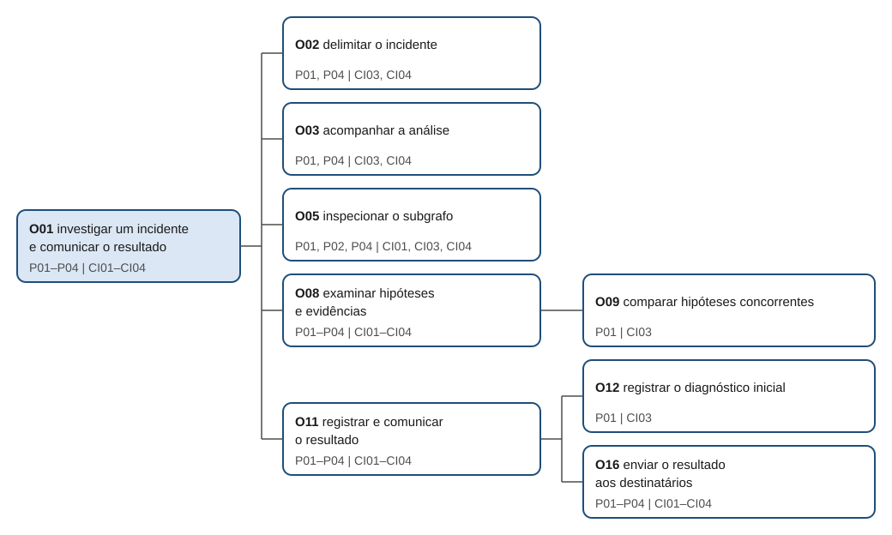

# Entrega 9 — CI03: Diagnóstico inicial com hipóteses concorrentes

[← Voltar à Entrega 9](../09_modelo_conceitual.md) · [Cenário C03](../04_cenarios_problema/c03.md) · [Tarefa T03](../05_analise_tarefas/t03.md)

**Data:** 16/11/2026

**Status:** 🟩 concluída

**Autor(a):** Théo Zago Zimmermann — 22.123.035-2

**Responsabilidade:** soluções individuais, com consolidação da equipe para mapa de objetivos e esquema de signos.

## Objetivo da atividade

Passar do cenário de problema para uma concepção da interação, explicitando objetivos, tópicos de conversa, falas e signos que a interface deverá comunicar/manipular.

## 1. Cenário de interação

Texto em negrito: novo ou alterado em relação ao cenário refinado de C03. Número entre colchetes: pergunta respondida pelo trecho.

### CI03 — Diagnóstico inicial com hipóteses concorrentes

**Autor(a):** Théo Zago Zimmermann — 22.123.035-2

**Origem:** cenário problema [C03 — Dificuldade em distinguir a causa de um incidente de seus efeitos](../04_cenarios_problema/c03.md#3-cenário-refinado)

*Perguntas exploradas no cenário:*

1. (objetivo) O que Rafael precisa comunicar para que a equipe de desenvolvimento saiba qual componente investigar primeiro?
2. (ambiente) Como Rafael chega ao incidente, e de onde vêm o serviço, o sintoma e o período iniciais?
3. (atores) Quem produz as hipóteses diagnósticas, e quem decide qual delas sustenta o diagnóstico?
4. (atores) Quem precisa receber o diagnóstico inicial, e como ele chega a essa pessoa?
5. (planejamento) O que Rafael pode fazer enquanto a análise não termina?
6. (evento) O que o sistema informa enquanto a análise está em andamento?
7. (evento) O período proposto pelo sistema sempre alcança o início dos desvios?
8. (ação) Como Rafael compara as duas interpretações com a ordem dos eventos?
9. (ação) Como Rafael consulta os sinais de um componente sem refazer a busca?
10. (avaliação) A origem provável pode ser registrada com o que a sustenta e o que a contraria, sem ser apresentada como comprovada?
11. (avaliação) Como Rafael sabe que o diagnóstico chegou ao desenvolvedor?

Atores: Rafael (SRE de plantão), desenvolvedor responsável

Durante o incidente, usuários continuam enfrentando lentidão e falhas na funcionalidade afetada. **Rafael**, SRE de plantão, precisa indicar à equipe de desenvolvimento qual componente deve ser investigado primeiro, mas os sinais disponíveis apontam para explicações diferentes. **Ele precisa também deixar claro o quanto essa indicação está sustentada [1]. A notificação do alerta de origem, recebida na ferramenta de alertas da empresa, leva Rafael ao sistema, que abre um novo incidente e propõe o recorte: o serviço que recebe as requisições da funcionalidade, os sintomas erros e latência elevada e o período de 30 minutos antes do alerta até aquele momento [2]. Rafael confirma o recorte e solicita a análise.**

**O sistema informa que a filtragem estrutural está em andamento e que a geração de hipóteses aguarda o fim desse estágio [6]. Quando a filtragem estrutural termina, o subgrafo já pode ser inspecionado, e o sistema avisa que ele é uma seleção feita para o recorte e que componentes fora dele podem ser mostrados. Enquanto as hipóteses diagnósticas são geradas, Rafael examina o subgrafo e começa o diagnóstico inicial registrando o impacto, lentidão e falhas na funcionalidade para os usuários, que o sistema preserva como rascunho [5]. No subgrafo, o** serviço que recebe as requisições **aparece afetado, com** a maior concentração de erros, o que sugere que ele possa ser a origem do problema. **Porém, o sistema indica que o desvio de uma das dependências desse serviço já existia no início do período, com a lacuna "período incompleto", e não se sabe quando ele começou [7].**

**A geração de hipóteses também termina, mas, antes de examinar as hipóteses, Rafael antecipa o início do período. O sistema avisa que ajustar o recorte inicia nova análise, que substitui o subgrafo e as hipóteses diagnósticas, e que o rascunho é preservado; Rafael confirma, e o sistema volta a informar o andamento dos dois estágios [7]. No novo subgrafo, o início do desvio de cada componente mostra** que uma dependência começou a apresentar latência elevada antes do aumento das falhas no serviço que recebe as requisições **[8]**. **Rafael** considera a possibilidade de que o primeiro componente esteja apenas acumulando os efeitos do atraso na dependência, mas ainda não consegue **comprovar que todos os erros vêm desse atraso**. **Quando ele escolhe o serviço que recebe as requisições como componente em foco, o sistema apresenta as evidências desse componente no período, sem nova busca e sem perder o recorte: spans com erro que aguardam a resposta da dependência e logs de erro, parte deles sem identificador do trace, o que o sistema indica como lacuna "identificador ausente" [9]. Os spans reforçam a possibilidade considerada; os logs sem identificador não podem ser ligados às chamadas à dependência.**

**A geração de hipóteses entrega duas hipóteses diagnósticas, produzidas pelo pipeline e apresentadas sem ordem de preferência: a hipótese A indica como origem provável o serviço que recebe as requisições, e a hipótese B, a dependência. Quem decide qual delas sustenta o diagnóstico é Rafael [3]. Com a hipótese A em foco, o subgrafo destaca o caminho de propagação a partir do serviço; quando Rafael troca a hipótese em foco para B, o destaque passa a partir da dependência, e ele confere as evidências associadas a cada uma e as compara com o início do desvio [8].** A concentração dos erros em um serviço favorece uma explicação; a ordem temporal dos eventos favorece outra. Nenhum dos sinais, isoladamente, resolve a divergência. **Entre as lacunas da hipótese B, o sistema indica os logs de erro sem identificador do trace: esses erros podem ter outra origem [10].**

O desenvolvedor precisa dessa indicação para decidir onde concentrar os esforços de investigação e se deve priorizar uma correção local ou procurar um problema na dependência. **Rafael completa o diagnóstico inicial: adota a hipótese B e indica a dependência como origem provável, e o sistema lembra que a origem provável é uma hipótese de trabalho, e não a comprovação da causa. Na justificativa, explica por que a ordem dos eventos pesa mais que a concentração dos erros; cita como evidências a favor a métrica de latência da dependência e os spans do serviço que aguardam a resposta dela e, como evidência contra, a métrica de taxa de erros do serviço que recebe as requisições, que sustenta a hipótese A; entre as lacunas detectadas no recorte, escolhe o identificador ausente nos logs de erro [10].**

**Rafael** precisa comunicar o que já é conhecido sem apresentar uma hipótese como se fosse uma causa confirmada, enquanto a equipe aguarda uma orientação para prosseguir. **Ele escolhe o desenvolvedor responsável, que tem acesso ao incidente, como destinatário do diagnóstico inicial e pede o envio; o sistema pede a confirmação dos destinatários e, depois dela, responde que o diagnóstico está disponível, com o horário do envio e o link do resultado [11]. O desenvolvedor recebe o link pelo canal de comunicação da equipe e reabre o incidente com o recorte, a hipótese em foco e as evidências citadas por Rafael [4]. Com isso, decide começar pela dependência, sabendo que parte dos erros do serviço ainda não está explicada.**

### Diferenças relevantes

| Alteração | Por que foi necessária | Evidência/artefato que justifica |
|---|---|---|
| Rafael chega ao incidente pela notificação do alerta de origem, e o sistema propõe o recorte (serviço, sintoma e período), que ele confirma antes de solicitar a análise. | C03 parte do incidente já em curso e deixa a delimitação implícita; um recorte reconstruído de memória pode deixar de fora o componente relevante. [H] O SRE começa pela identificação do incidente e restringe o período e os serviços envolvidos. | P01, comportamentos relevantes; T03, item 1 e CTT I1; F01; MU04. |
| O sistema informa o estado de cada estágio, e o subgrafo pode ser inspecionado antes das hipóteses diagnósticas. | Sem o estado da análise, Rafael não sabe o que já está disponível nem de que estágio vem cada resultado. [?] A duração real da análise é desconhecida. | T03, CTT S1; decisão de P01 sobre o estado da análise; Entrega 8, seção 1; MU03. |
| Durante a geração de hipóteses, Rafael registra o impacto, que o sistema preserva como rascunho, inclusive no ajuste do recorte. | A espera é aproveitada sem risco de perder o que foi escrito quando a análise é refeita. [H] O SRE usa a interface sob pressão de tempo e com interrupções. | P01, restrições; T03, item 4; Entrega 8, seção 2 (estado da investigação preservado). |
| A ordem temporal dos eventos passa a ser dada pelo início do desvio de cada componente do subgrafo, e o desvio que já existia no começo do período aparece como lacuna "período incompleto". | Em C03 os sinais mostram o que aconteceu em cada componente, mas não esclarecem qual evento desencadeou a sequência; sem a lacuna, um desvio cortado pelo período pareceria começar no início dele. | C03, seção 3; T03, itens 2.1 e 3.1; RC04; MU05. |
| Rafael antecipa o início do período, e o sistema avisa que a nova análise substitui subgrafo e hipóteses e pede confirmação. | O recorte inicial pode deixar de fora o começo de um desvio, e refazer a análise descarta resultados já obtidos. | T03, plano 0, GOMS método 2 e CTT I3; decisão de P01 sobre a delimitação por serviço, período e sintomas. |
| As evidências do componente em foco aparecem sem nova busca e sem perder o recorte, e o log sem identificador do trace aparece como lacuna "identificador ausente", que impede comprovar que todos os erros vêm do atraso na dependência. | Consultar cada fonte separadamente reabre a busca e o risco de sair do recorte; a falta do identificador limita o que os logs permitem concluir. | T03, item 2.2 e seção 5; RC01; RC04. |
| As duas interpretações de C03 passam a ser as hipóteses diagnósticas A e B, produzidas pelo pipeline e sem ordem de preferência, comparadas pela troca da hipótese em foco e pelo caminho de propagação. | Em C03 os sinais sustentam duas interpretações, e nenhum deles, isoladamente, resolve a divergência. [H] H03: hipóteses acompanhadas das evidências que as sustentam permitem avaliar criticamente o resultado. | C03, seção 3; T03, plano 3; H03; RC03; RC05; MU01; MU05. |
| Removidos o trecho em que os sinais não esclarecem o evento desencadeador, a hesitação do SRE em indicar uma ação e a consequência de indicar o componente errado; Rafael registra o diagnóstico inicial com a origem provável como hipótese de trabalho, a hipótese adotada, o impacto, evidências a favor e contra e lacunas. | Em C03 a decisão sobre onde investigar fica bloqueada à espera de certeza. [?] Ainda não se sabe que evidências tornam uma hipótese suficiente para ser comunicada ou levam a rejeitá-la (C03, Q1 e Q5); por isso o diagnóstico declara o suporte e as lacunas em vez de exigir certeza. | C03, seção 4 (decisão bloqueada); T03, itens 3.2 e 4 e plano 3; RC05; MU06; MU11. |
| Removida a frase sobre a dificuldade central; Rafael envia o diagnóstico ao desenvolvedor responsável, com confirmação dos destinatários, estado "disponível" e link do resultado, e o desenvolvedor reabre o incidente pelo link. | Em C03 a equipe aguarda uma orientação; sem a confirmação de disponibilidade, Rafael não sabe se a orientação chegou, e sem o contexto o desenvolvedor refaria a busca. [H] H04: políticas de acesso limitam quem pode receber evidências. | C03, seção 3; T03, CTT I4 e seção 5; decisão de P02 sobre links com o contexto do erro; regra 4 de Shneiderman (Entrega 8, seção 2); MU04; MU06. |

## 2. Design centrado na comunicação

**Nome do cenário:** CI03 — Diagnóstico inicial com hipóteses concorrentes

| Tópico > subtópico | Falas e signos envolvidos | Intenção/efeito esperado |
|---|---|---|
| delimitar o incidente (O02) | U: Recebi o **alerta de origem** de lentidão e falhas na funcionalidade e preciso investigá-lo. D: Abri um **incidente** para esse alerta e proponho o **recorte**: **serviço** que recebe as requisições, **sintoma** **erros** e **latência elevada**, **período** de 30 minutos antes do alerta até agora. | Rafael começa pelo alerta sem reconstruir de memória serviço, sintoma e período (MU04). |
| > confirmar o recorte proposto | U: Esse **recorte** serve; pode solicitar a **análise**. D: **Análise** solicitada. O **recorte** fica visível durante toda a investigação. | Rafael confirma o que será analisado e sabe que pode conferi-lo a qualquer momento (MU04). |
| acompanhar a análise (O03) > acompanhar os estágios | D: A **filtragem estrutural** está **em andamento**; a **geração de hipóteses** está **aguardando**. D: A **filtragem estrutural** foi **concluída**: o **subgrafo** já pode ser inspecionado enquanto a **geração de hipóteses** está **em andamento**. | Rafael sabe qual estágio está em andamento e de qual estágio vem cada resultado, e começa pelo subgrafo sem procurar hipóteses que ainda não existem (MU03). |
| inspecionar o subgrafo (O05) | D: Este **subgrafo** é uma seleção feita pela **filtragem estrutural** para o **recorte**; componentes fora dele podem ser mostrados. | Rafael entende que o subgrafo pode não conter tudo o que é relevante (H02; RC02). |
| > examinar componentes e relações | U: Quais **componentes** têm desvio no período? D: O serviço que recebe as requisições: **estado do componente** **afetado**, **desvio observado** **erros**. A dependência desse serviço: **afetado**, **desvio observado** **latência elevada**. Os demais: **relacionado**, sem **desvio observado**. | Rafael distingue os componentes afetados dos apenas relacionados (MU05). |
| registrar o diagnóstico inicial (O12) > informar o conteúdo do resultado | U: Enquanto as hipóteses são geradas, quero registrar o **impacto**: lentidão e falhas na funcionalidade para os usuários. D: **Impacto** registrado no **rascunho** do **diagnóstico inicial**. | Rafael aproveita a espera da análise sem risco de perder o que escreveu. |
| inspecionar o subgrafo (O05) > comparar o início do desvio | U: Qual desvio começou primeiro? D: Os **erros** no serviço que recebe as requisições começaram dentro do **período**. O desvio da dependência já existia no início do **período**: **lacuna** **período incompleto**; o **início do desvio** dela não é conhecido. | Rafael percebe que o período não alcança o começo de um desvio e que a ordem dos eventos ainda não pode ser comparada (RC04; MU05). |
| delimitar o incidente (O02) > ajustar o recorte | U: Quero antecipar o início do **período** para ver quando a latência da dependência começou. D: Ajustar o **recorte** inicia nova **análise**, que substitui o **subgrafo** e as **hipóteses diagnósticas** atuais; o **rascunho** do **diagnóstico inicial** é preservado. Confirma o ajuste? U: Confirmo. D: Nova **análise** solicitada para o **recorte** ajustado. | Rafael decide o ajuste sabendo o que será substituído e que não perderá o que já escreveu (T03, I3). |
| acompanhar a análise (O03) > acompanhar os estágios | D: Os dois **estágios** da nova **análise**, **filtragem estrutural** e **geração de hipóteses**, foram **concluídos**. | Rafael sabe que o subgrafo e as hipóteses correspondem ao recorte ajustado (MU03). |
| inspecionar o subgrafo (O05) > comparar o início do desvio | U: E agora, qual desvio começou primeiro? D: O **início do desvio** da dependência, com **latência elevada**, é anterior ao **início do desvio** do serviço que recebe as requisições, com **erros**. | Rafael vê a ordem dos eventos entre os componentes afetados sem montar uma linha do tempo por conta própria (MU05). |
| > consultar as evidências do componente | U: Quero as **evidências** do serviço que recebe as requisições. D: **Componente em foco**: serviço que recebe as requisições. **Situação da consulta**: **carregando**. D: **Com dados**: **spans** com erro que aguardam a resposta da dependência e **logs** de erro no **período**; parte dos **logs** não tem **identificador do trace** (**identificador ausente**). | Rafael confere os sinais do componente sem nova busca e sem perder o recorte, e vê quais erros não podem ser ligados às chamadas à dependência (RC01; RC04). |
| examinar hipóteses e evidências (O08) | D: A **geração de hipóteses** produziu duas **hipóteses diagnósticas**; a ordem não indica preferência. **Hipótese A**: **origem provável** no serviço que recebe as requisições. **Hipótese B**: **origem provável** na dependência. Cada **explicação** foi produzida pelo pipeline e precisa ser conferida. | Rafael reconhece as hipóteses como interpretações do pipeline, sem pontuação nem ordem de preferência, distintas das evidências e da conclusão que ele vai registrar (MU01; H03; RC05). |
| > conferir as evidências associadas | U: Em que se apoia a **hipótese A**? D: Nas **evidências associadas**: a **métrica** de taxa de erros do serviço que recebe as requisições e os **logs** de erro desse serviço. | Rafael verifica o que sustenta a hipótese antes de aceitá-la (MU01). |
| comparar hipóteses concorrentes (O09) > trocar a hipótese em foco | U: Quero a **hipótese B** em foco. D: **Hipótese em foco**: B. A dependência é a **origem provável**, e o **caminho de propagação** destacado vai da dependência ao serviço que recebe as requisições. **Evidências associadas**: a **métrica** de latência da dependência e os **spans** do serviço que aguardam a resposta dela. U: A concentração dos erros favorece a A; o **início do desvio** favorece a B. | Rafael confronta as duas hipóteses com a ordem dos eventos e com a concentração dos erros, em vez de aceitar a que aponta o componente com mais erros (MU05; H03). |
| examinar hipóteses e evidências (O08) > identificar as lacunas | U: O que falta para sustentar a **hipótese B**? D: **Lacunas da hipótese**: **identificador ausente** em parte dos **logs** de erro do serviço que recebe as requisições; esses erros não podem ser ligados às chamadas à dependência. | Rafael sabe que parte dos erros pode ter outra origem e não trata a hipótese B como comprovada (MU11; RC04). |
| registrar o diagnóstico inicial (O12) > indicar a origem provável | U: Adoto a **hipótese B**: **origem provável** na dependência. D: **Hipótese adotada**: B. A **origem provável** é uma hipótese de trabalho, não a comprovação da causa. | Rafael comunica uma indicação sem apresentá-la como comprovada (MU06; MU11; RC05). |
| > informar o conteúdo do resultado | U: Na **justificativa**, a ordem dos eventos pesa mais que a concentração dos erros. Cito **a favor** a **métrica** de latência da dependência e os **spans** do serviço que aguardam a resposta dela, e **contra** a **métrica** de taxa de erros do serviço que recebe as requisições. D: Estas são as **lacunas** detectadas no **recorte**; quais entram no diagnóstico? U: O **identificador ausente** nos **logs** de erro do serviço. D: O **diagnóstico inicial** tem **origem provável**, **impacto** e **evidências citadas**; pode ser enviado. | Rafael registra, separados, o que sustenta e o que contraria a indicação e o que ainda falta saber (MU01; MU06). |
| enviar o resultado aos destinatários (O16) > escolher os destinatários | U: Quero enviar o **diagnóstico inicial** ao desenvolvedor responsável. D: Só pessoas com acesso ao **incidente** podem ser **destinatários**; o desenvolvedor responsável tem acesso. | Rafael escolhe quem recebe o diagnóstico sem expor o incidente a quem não tem acesso (H04). |
| > confirmar os destinatários | D: O **diagnóstico inicial** e o **link do resultado** vão para o desenvolvedor responsável. Confirma os **destinatários**? U: Confirmo. | Rafael confere quem receberá o diagnóstico antes que ele fique disponível. |
| > conferir o envio | D: **Estado do envio**: **disponível**. O desenvolvedor responsável recebe o **link do resultado** pelo canal de comunicação da equipe; **horário do envio** registrado. | Rafael só considera a orientação comunicada quando o estado é "disponível" (MU06; regra 4 de Shneiderman, Entrega 8). |

**Convenção:** `U` = usuário; `D` = preposto do designer/sistema, conforme a abordagem de Engenharia Semiótica adotada na disciplina.

## 3. Mapa de objetivos

*Figura 1 — Mapa de objetivos de CI03. Fonte: elaboração do autor.*

O mapa reúne o objetivo geral O01 e os objetivos cobertos por CI03. O09 (comparar hipóteses concorrentes) e O12 (registrar o diagnóstico inicial) vêm só deste cenário; O02 e O03 são compartilhados com CI04, O05 com CI01 e CI04, e O01, O08, O11 e O16 com os quatro cenários. A notação está descrita na [seção 3 da Entrega 9](../09_modelo_conceitual.md#3-mapa-de-objetivos).

## 4. Esquema conceitual de signos

Signos usados nas falas da seção 2, com as siglas de prevenção e recuperação explicadas na [seção 4 da Entrega 9](../09_modelo_conceitual.md#4-esquema-conceitual-de-signos).

| Grupo | Signo | Origem | Observações/semântica | Tipo de conteúdo | Restrição | Valor padrão | Prevenção | Recuperação |
|---|---|---|---|---|---|---|---|---|
| **Incidente (I)** — investigação de um único incidente, aberta a partir de um alerta | + identificador do incidente | aplicação | Produzido pelo sistema. Atribuído quando a análise é solicitada; identifica o incidente nos resultados e nos links. | texto | não editável | — | — | — |
| Incidente (I) | alerta de origem | domínio | Derivado do domínio (ferramenta de alertas). Serviço, sintoma e horário do alerta que abriu a investigação; fornece o valor padrão do recorte. | texto | não pode ser nulo | — | — | — |
| Incidente (I) | recorte | aplicação | Fornecido pela pessoa. Conjunto de serviço, sintoma e período que define o que a análise considera; visível durante toda a investigação e incluído em cada resultado e no link do resultado. | composto (serviço, sintoma, período) | — | proposto a partir do alerta de origem | AL: ajustar o recorte depois de uma análise pede confirmação, pois inicia nova análise e substitui subgrafo e hipóteses; o rascunho é preservado | — |
| Incidente (I) | serviço | domínio | Fornecido pela pessoa. Serviço em que o sintoma foi observado; ponto de partida da análise. | seleção simples | conjunto flexível: serviços com telemetria no ambiente | serviço do alerta de origem | PA: só serviços com telemetria podem ser escolhidos | — |
| Incidente (I) | sintoma | domínio | Fornecido pela pessoa. Manifestação que caracteriza o incidente. | seleção múltipla | conjunto flexível: inicialmente = {erros, latência elevada, acúmulo de mensagens}; ao menos um | sintoma do alerta de origem | PA: ao menos um sintoma permanece selecionado | — |
| Incidente (I) | período | domínio | Fornecido pela pessoa. Intervalo de tempo analisado. | intervalo de data e hora | início anterior ao fim; fim não posterior ao momento atual; duração entre 5 min e 24 h | de 30 min antes do horário do alerta de origem até o momento da solicitação | PP+PA: formato e duração indicados; datas futuras e início posterior ao fim não podem ser informados | — |
| Incidente (I) | hipótese em foco | aplicação | Fornecido pela pessoa. Hipótese diagnóstica cuja origem provável e caminho de propagação aparecem destacados no subgrafo; preservada no link do resultado. | referência (H) | uma por vez | hipótese A | — | — |
| Incidente (I) | componente em foco | aplicação | Fornecido pela pessoa. Componente ou relação cujas evidências estão sendo consultadas; preservado no link do resultado. | referência (C ou R) | um por vez | — | — | — |
| **Análise (A)** — execução do pipeline sobre o recorte, em dois estágios | + Incidente (I) | aplicação | Produzido pelo sistema. A é solicitada para o recorte de I; uma nova análise substitui a anterior. | referência (I) | — | — | — | — |
| Análise (A) | estágio | aplicação | Produzido pelo sistema. "filtragem estrutural": seleciona o subgrafo; "geração de hipóteses": produz as hipóteses diagnósticas a partir do subgrafo. | seleção simples | conjunto fixo = {filtragem estrutural, geração de hipóteses}, nessa ordem | — | PP: cada estágio é descrito em uma frase | — |
| Análise (A) | estado do estágio | aplicação | Produzido pelo sistema. Situação de cada estágio; o subgrafo fica disponível quando a filtragem estrutural termina, mesmo com a geração de hipóteses em andamento. | seleção simples | conjunto fixo = {aguardando, em andamento, concluído, cancelado, falha} | aguardando | PP: indica o estágio em andamento e de qual estágio vem cada resultado | RA: em "falha", descreve a causa e permite repetir a análise sem perder o recorte |
| Análise (A) | subgrafo | aplicação | Produzido pelo sistema (pipeline). Seleção de componentes e relações que a filtragem estrutural considerou relevantes para o recorte; pode excluir evidência relevante. | referência (C, R), seleção múltipla | — | — | PP: informa que o subgrafo é uma seleção e que componentes fora dele podem ser mostrados | — |
| **Componente (C)** — serviço ou dependência (banco de dados, fila, serviço externo) que aparece no subgrafo | + nome do componente | domínio | Derivado do domínio. Nome usado pelas equipes para o serviço ou a dependência. | texto | não pode ser nulo | — | — | — |
| Componente (C) | estado do componente | aplicação | Produzido pelo sistema. "origem provável": apontado pela hipótese em foco; "afetado": com desvio observado no período; "relacionado": sem desvio observado. Um valor por componente, nessa precedência. | seleção simples | conjunto fixo = {origem provável, afetado, relacionado} | relacionado | PP: "origem provável" vem com a letra da hipótese que o aponta | — |
| Componente (C) | desvio observado | domínio | Derivado do domínio (telemetria). Manifestações fora do normal registradas no componente durante o período. | seleção múltipla | conjunto flexível: inicialmente = {erros, latência elevada, acúmulo de mensagens}; vazio quando não há desvio | — | — | — |
| Componente (C) | início do desvio | domínio | Derivado do domínio (telemetria). Horário em que o desvio observado começou; permite comparar a ordem dos eventos entre componentes. | data e hora | — | — | PP: quando o desvio já existia no início do período, indica a lacuna "período incompleto"; sem telemetria suficiente, indica início desconhecido | — |
| **Hipótese diagnóstica (H)** — explicação sobre a provável origem do incidente, produzida pelo pipeline a partir do subgrafo; precisa ser conferida | + identificador da hipótese | aplicação | Produzido pelo sistema. Letra atribuída na ordem em que o pipeline entrega as hipóteses (A, B...); a ordem não indica preferência. | texto | — | — | PP: informa que a ordem não indica preferência | — |
| Hipótese diagnóstica (H) | origem provável | domínio | Produzido pelo sistema (pipeline). Componente que a hipótese aponta como provável origem do incidente. | referência (C) | componente do subgrafo | — | — | — |
| Hipótese diagnóstica (H) | explicação | aplicação | Produzido pelo sistema (pipeline). Texto que descreve como a falha teria se propagado da origem provável até o sintoma. | texto | — | — | PP: identificada como produzida pelo pipeline, separada das evidências e das conclusões registradas por pessoas | — |
| Hipótese diagnóstica (H) | evidências associadas | aplicação | Produzido pelo sistema (pipeline). Evidências do subgrafo usadas para formular a hipótese. | referência (E), seleção múltipla | — | — | — | — |
| Hipótese diagnóstica (H) | lacunas da hipótese | aplicação | Produzido pelo sistema. Lacunas do recorte que afetam a origem provável ou o caminho de propagação da hipótese. | referência (L), seleção múltipla | — | — | — | — |
| Hipótese diagnóstica (H) | caminho de propagação | aplicação | Produzido pelo sistema (pipeline). Relações que ligam a origem provável ao serviço do recorte, segundo a hipótese; destacado no subgrafo quando a hipótese está em foco. | referência (R), seleção múltipla | — | — | — | — |
| **Evidência (E)** — item de telemetria de um componente ou de uma relação: span, log ou métrica | + Componente (C) ou Relação (R) | domínio | Derivado do domínio. E pertence a um componente ou a uma relação. | referência (C ou R) | — | — | — | — |
| Evidência (E) | tipo de evidência | domínio | Derivado do domínio. "span": operação dentro do trace de uma requisição; "log": mensagem de evento emitida por um serviço; "métrica": série de valores, como latência ou taxa de erros. | seleção simples | conjunto fixo = {span, log, métrica} | — | — | — |
| Evidência (E) | identificador do trace | domínio | Derivado do domínio. Identifica a requisição e liga spans e logs; pode faltar em logs. | texto | pode ser nulo | — | PP: a ausência é indicada como lacuna "identificador ausente" | — |
| Evidência (E) | situação da consulta | aplicação | Produzido pelo sistema. Situação da consulta às evidências do componente em foco no período; "sem dados" (nenhum item encontrado) difere de itens encontrados sem erro. | seleção simples | conjunto fixo = {carregando, com dados, sem dados, acesso restrito, falha de consulta} | carregando | PP: "sem dados" e "acesso restrito" aparecem como lacunas, nunca como normalidade | RA: em "falha de consulta", descreve a causa e permite repetir a consulta sem perder o recorte; CE: em "acesso restrito", informa que o trecho exige permissão que a pessoa não tem e pode ser consultado por quem a tenha, fora do sistema |
| **Lacuna (L)** — parte do recorte para a qual não há evidência utilizável | + tipo de lacuna | aplicação | Produzido pelo sistema. Motivo da falta de evidência utilizável; "amostragem" indica que só parte das requisições é registrada nos traces. | seleção simples | conjunto fixo = {sem dados, acesso restrito, falha de consulta, instrumentação parcial, instrumentação ausente, identificador ausente, período incompleto, amostragem} | — | — | — |
| **Resultado (RE)** — conclusão registrada e enviada por uma pessoa: diagnóstico inicial (D), avaliação da hipótese (AV), parecer sobre a verificação da correção (PV) ou retorno ao SRE (RS) | + Incidente (I) | domínio | Produzido pelo sistema. RE refere-se a I e guarda o recorte vigente no envio. | referência (I) | — | incidente aberto | — | — |
| Resultado (RE) | + horário do envio | aplicação | Produzido pelo sistema. Data e hora em que o resultado ficou disponível. | data e hora | — | — | — | — |
| Resultado (RE) | origem provável | domínio | Fornecido pela pessoa. Só em D e RS: componente que a pessoa indica como provável origem, ou "não determinada". É hipótese de trabalho, não comprovação da causa. | seleção simples | componentes do subgrafo ou "não determinada"; não pode ser nulo em D e RS | — | PP: explica que a origem provável é hipótese de trabalho; PA: o envio de D e RS exige uma escolha | — |
| Resultado (RE) | justificativa | domínio | Fornecido pela pessoa. Texto que explica a conclusão. | texto | não pode ser nulo em AV e PV | — | PP+PA: obrigatória em AV e PV; o envio exige seu preenchimento | — |
| Resultado (RE) | evidências citadas | aplicação | Fornecido pela pessoa. Evidências usadas na conclusão, cada uma marcada como "a favor" ou "contra" a hipótese avaliada (em AV) ou a conclusão registrada (em D, PV e RS); vão como referência, não como cópia do conteúdo. | referência (E), seleção múltipla, cada uma com {a favor, contra} | ao menos uma em D, AV e PV | — | PP+PA: o envio de D, AV e PV exige ao menos uma evidência citada | — |
| Resultado (RE) | lacunas | aplicação | Fornecido pela pessoa. Lacunas detectadas que a pessoa considera relevantes para a conclusão, mais lacunas descritas em texto (por exemplo, condição da falha não exercitada no teste). | referência (L), seleção múltipla, e texto | — | — | PP: as lacunas detectadas no recorte são apresentadas para escolha | — |
| Resultado (RE) | destinatários | domínio | Fornecido pela pessoa. Pessoas que recebem o link do resultado. | seleção múltipla | só pessoas com acesso ao incidente; ao menos uma | — | PA: só pessoas autorizadas são oferecidas; AL: os destinatários são confirmados antes do envio | — |
| Resultado (RE) | estado do envio | aplicação | Produzido pelo sistema. "rascunho": ainda não enviado, preservado pelo sistema; "disponível": registrado e disponível aos destinatários; "falha de disponibilização": não ficou disponível. | seleção simples | conjunto fixo = {rascunho, disponível, falha de disponibilização} | rascunho | PP: só "disponível" indica que o resultado chegou aos destinatários | RA: em "falha de disponibilização", descreve a causa, preserva o rascunho e permite repetir o envio |
| Resultado (RE) | link do resultado | aplicação | Produzido pelo sistema. Reabre o incidente com recorte, hipótese em foco, componente em foco e evidências citadas no momento do envio; trechos sem permissão aparecem com acesso restrito. | link | — | — | — | — |
| **Diagnóstico inicial (D)** — conclusão do SRE sobre a provável origem e o impacto do incidente, para orientar a equipe | + Resultado (RE) | aplicação | Produzido pelo sistema. D é um RE. | referência (RE) | — | — | — | — |
| Diagnóstico inicial (D) | hipótese adotada | aplicação | Fornecido pela pessoa. Hipótese diagnóstica com que a pessoa concorda, se houver. | referência (H) | no máximo uma | — | — | — |
| Diagnóstico inicial (D) | impacto | domínio | Fornecido pela pessoa. Efeito observado para usuários e serviços. | texto | não pode ser nulo | — | PP+PA: obrigatório; o envio exige seu preenchimento | — |

## Referências

- **CC8122 — Projeto de IHC e modelos conceituais.** Material de aula disponibilizado na disciplina, baseado em Barbosa e Silva (2010), consultado em 16/11/2026. Cenários de interação, design centrado na comunicação e mapa de objetivos.
- **CC8122 — Esquema conceitual de signos.** Material de aula disponibilizado na disciplina, baseado em Barbosa e Silva (2010), consultado em 16/11/2026. Signos de conteúdo e prevenção e recuperação de rupturas comunicativas.
- **CC8122 — Organização do espaço de problema.** Material de aula disponibilizado na disciplina, baseado em Barbosa e Silva (2010), consultado em 16/11/2026. Questões de refinamento e indicação das perguntas na narrativa.
- BARBOSA, Simone D. J.; SILVA, Bruno S. **Interação Humano-Computador**. Rio de Janeiro: Elsevier/Campus, 2010.
- Documentos do projeto: [cenário C03](../04_cenarios_problema/c03.md), [tarefa T03](../05_analise_tarefas/t03.md), [persona P01](../03_personas_contexto_jornada.md#persona-p01--rafael-mendes) e [Entrega 8](../08_engenharia_usabilidade.md).
