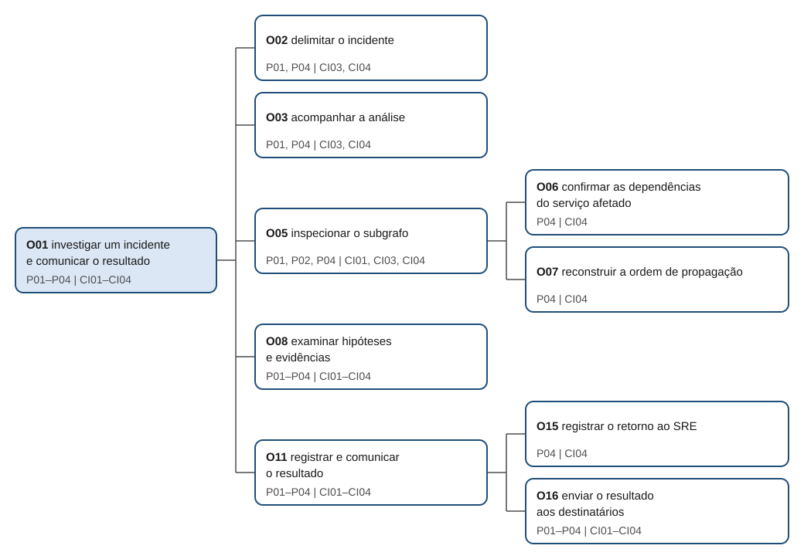

# Entrega 9 — CI04: Retorno ao SRE sobre a propagação de uma falha entre microsserviços

[← Voltar à Entrega 9](../09_modelo_conceitual.md) · [Cenário C04](../04_cenarios_problema/c04.md) · [Tarefas T04–T06](../05_analise_tarefas/t04.md)

**Data:** 16/11/2026

**Status:** 🟩 concluída

**Autor(a):** João Sitta Giopatto — 22.123.054-3

**Responsabilidade:** soluções individuais, com consolidação da equipe para mapa de objetivos e esquema de signos.

## Objetivo da atividade

Passar do cenário de problema para uma concepção da interação, explicitando objetivos, tópicos de conversa, falas e signos que a interface deverá comunicar/manipular.

## 1. Cenário de interação

Texto em negrito: novo ou alterado em relação ao cenário refinado de C04. Número entre colchetes: pergunta respondida pelo trecho.

### CI04 — Retorno ao SRE sobre a propagação de uma falha entre microsserviços

**Autor(a):** João Sitta Giopatto — 22.123.054-3

**Origem:** cenário problema [C04 — Investigação de uma falha propagada entre microsserviços](../04_cenarios_problema/c04.md#3-cenário-refinado)

*Perguntas exploradas no cenário:*

1. (objetivo) De que o SRE precisa para decidir, até cerca de 14h40, quais equipes acionar e se reinicia o serviço de pedidos?
2. (evento) Que evento dá início à investigação e como Camila parte dele sem montar a busca do zero?
3. (ambiente) Como Camila consulta métricas, logs e traces, antes espalhados em ferramentas próprias, e o que acontece quando uma fonte não responde?
4. (planejamento) Como Camila escolhe por onde começar quando o mapa de serviços aponta para o estoque?
5. (ação) Como Camila verifica uma relação que o mapa de serviços não mostra?
6. (ação) Como Camila distingue um serviço sem erro de um serviço sem telemetria?
7. (ação) Como Camila confere se a seleção do subgrafo deixou de fora algum serviço com desvio?
8. (planejamento) Como Camila reconstrói a ordem de propagação quando um componente não tem início do desvio conhecido?
9. (planejamento) O que Camila faz quando o prazo do SRE chega antes de a investigação terminar?
10. (atores) Quem depende do retorno e quem precisa recebê-lo?
11. (avaliação) Como Camila sabe que o retorno chegou ao SRE?
12. (avaliação) Como quem lê o retorno distingue o que foi observado, o que foi inferido e o que ficou sem cobertura?

Atores: Camila (especialista em observabilidade), SRE de plantão, equipes de pedidos, estoque e frete

Às 14h20, os alertas chegam ao SRE de plantão. Ele precisa decidir até cerca de 14h40 quais equipes chamar primeiro e se reinicia o serviço de pedidos, ciente de que o reinício pode descartar requisições em andamento e apagar o estado dos processos. Pede **a Camila** um primeiro retorno **pelo canal de comunicação da equipe** e avisa que decidirá em poucos minutos, com ou sem ele **[1]**.

**Camila abre a notificação do alerta de latência do serviço de pedidos na ferramenta de alertas da empresa, que a leva ao sistema. O sistema abre um novo incidente e propõe um recorte a partir desse alerta de origem: serviço pedidos, sintoma latência elevada e período de 13h50, 30 minutos antes do alerta, até o momento da solicitação [2]. Como os outros alertas indicam erros 5xx no gateway de API e acúmulo de mensagens na fila de notificações, Camila acrescenta erros e acúmulo de mensagens ao sintoma e solicita a análise. O sistema informa que a filtragem estrutural está em andamento e que a geração de hipóteses aguarda o fim desse estágio. Quando a filtragem estrutural é concluída, o subgrafo já pode ser inspecionado enquanto as hipóteses são geradas, e o sistema avisa que o subgrafo é uma seleção e que componentes fora dele podem ser mostrados.**

**Camila** parte **do desvio observado e do início do desvio de cada componente do subgrafo** para saber quais serviços saíram do normal e quando. **O serviço de pedidos está afetado por latência elevada desde 14h09; o gateway de API, por erros desde 14h11; e a fila de notificações, por acúmulo de mensagens desde 14h13 [4].** O mapa de serviços mostra pedidos dependendo de estoque, **mas o sistema apresenta essa relação como não verificada, porque sua única fonte é o mapa, e o estoque como relacionado, sem desvio observado no período. Camila não se detém nesse serviço [4].** O que o mapa não mostra é que, havia poucas semanas, pedidos passou a consultar também um serviço de estimativa de frete. **No subgrafo, a relação pedidos → frete aparece destacada como ausente do mapa de serviços, com fonte em trace e log [5]. Logo depois, a geração de hipóteses é concluída: a hipótese A, produzida pelo pipeline, indica o frete como origem provável e aponta a instrumentação parcial do frete entre as lacunas da hipótese. O frete passa a aparecer como origem provável da hipótese A, e o caminho de propagação até pedidos fica destacado.**

O serviço de frete quase não tem instrumentação, apenas uma métrica de CPU. **O sistema indica a instrumentação do frete como parcial e seu início do desvio como desconhecido [8]. Ao consultar as evidências do frete, Camila vê a métrica de CPU normal e os logs sem dados, situação que o sistema apresenta como lacuna, e não como ausência de erro [3,6]. Em seguida, consulta as evidências da relação pedidos → frete.** Um trace mostra o serviço de pedidos esperando até 30 segundos por uma chamada **ao frete, mas a consulta aos logs falha. O sistema informa que a fonte de logs não respondeu e oferece repetir a consulta sem perder o recorte. Na nova tentativa, aparece** nos logs de pedidos uma mensagem de timeout ao chamar o frete, mas sem o identificador da requisição presente nos traces. **O sistema indica essa falta como lacuna identificador ausente [3,5]. Camila mantém a classificação da relação proposta pela fonte: gateway de API → pedidos e pedidos → frete como observadas; pedidos → estoque e pedidos → fila de notificações como não verificadas [5]. Antes de responder ao SRE, pede os vizinhos de pedidos que ficaram fora do subgrafo; o sistema os mostra diferenciados como fora do subgrafo, nenhum com desvio observado no período, e Camila os oculta novamente [7].**

**Às 14h33, com a relação com a fila ainda por verificar e o prazo do SRE perto do fim, Camila registra um retorno ao SRE e marca a completude do retorno como parcial [9]. Indica o frete como origem provável, que o sistema apresenta como hipótese de trabalho, e o inclui entre os componentes envolvidos, ao lado do gateway de API, do serviço de pedidos e da fila de notificações. Na ordem de propagação proposta pelo início do desvio, o frete fica em posição desconhecida [8]. As relações classificadas seguem com a classificação de cada uma; o span da chamada ao frete e o log de timeout entram como evidências citadas a favor; entre as lacunas, Camila escolhe instrumentação parcial, sem dados, identificador ausente e amostragem, pois só parte das requisições aparece nos traces. Na justificativa, escreve que o estoque não tem desvio observado e que a relação com ele está apenas no mapa [12]. Ela escolhe o SRE de plantão como destinatário e o confirma quando o sistema pede. Às 14h34, o sistema responde que o retorno está disponível, com o horário do envio e o link do resultado [10,11].**

O retorno chega **antes da decisão. Com ele, o SRE aciona as equipes de pedidos e de frete, repassa a elas o link do resultado, deixa a equipe de estoque fora do acionamento e adia o reinício do serviço de pedidos [1,10]. Enquanto isso, Camila continua a investigação.** O acúmulo na fila de notificações também não está encadeado ao status, e a relação só pode ser inferida pelo horário. **Como o acúmulo começa quatro minutos depois do desvio em pedidos e nenhum trace ou log liga os dois, Camila classifica a relação pedidos → fila de notificações como inferida [12].** Por volta das 14h45, **ela envia ao SRE e às equipes de pedidos e de frete um novo retorno, com a completude do retorno marcada como completo; o sistema o identifica como atualização do retorno parcial, que continua disponível [9]. Pelo link do resultado, as equipes acionadas encontram a origem provável ao lado da relação observada no trace, do log de timeout e da lacuna de instrumentação parcial do frete, o que mostra por que a CPU normal não descarta esse serviço [12].**

### Diferenças relevantes

| Alteração | Por que foi necessária | Evidência/artefato que justifica |
|---|---|---|
| O pedido do SRE chega pelo canal de comunicação da equipe, e Camila abre a investigação pela notificação do alerta de origem, com o recorte proposto pelo sistema e ampliado por ela para os sintomas dos três alertas. | Em C04, a especialista delimita serviços e horário sozinha, ferramenta por ferramenta. [H] A decisão que o SRE precisa tomar e o prazo definem o que o retorno precisa conter. | C04, seção 3 (Q1, Q2); T04, itens 1 e 2; F01 (Entrega 1, seção 9.2); MU04. |
| O sistema informa o estado de cada estágio da análise e libera o subgrafo antes das hipóteses. | [H] Com cerca de 20 minutos até a decisão do SRE, uma espera sem informação consome o tempo do retorno. | C04, seção 3 (Q1); Entrega 8, seção 1 ("Tempo de processamento" e "Capacidade: processamento em dois estágios no servidor"); decisão "Estado da análise" de P04; MU03. |
| Desvio observado e início do desvio de cada componente substituem a consulta às métricas de latência e erro em ferramenta própria. | Em C04, a especialista parte de métricas numa ferramenta separada de logs e traces. [H] Horários em formatos e precisões diferentes dificultam saber quem saiu do normal primeiro. | T04, itens 2.1, 2.2 e 4.1; MU05. |
| A relação pedidos → estoque aparece como não verificada, sustentada só pelo mapa, e o estoque como relacionado; sai o trecho em que Camila segue o mapa e gasta cerca de dez minutos no estoque. | Em C04, seguir o mapa leva a especialista a um serviço com métricas normais. [H] O mapa de serviços pode omitir dependências recentes. | C04, seção 3 (Q2, Q3); T04, item 3.1; T05, SR1, SR2 e regra de parada; MU09. |
| A relação pedidos → frete aparece no subgrafo destacada como ausente do mapa de serviços, com fonte em trace e log, e o trace identifica a chamada ao frete. | Em C04, a especialista só chega ao frete quando um trace mostra uma espera de até 30 segundos sem etapa associada. | C04, seção 3 (Q3); T05, M2 e SR2; RC02; MU09. |
| A hipótese A aparece como produzida pelo pipeline, com a lacuna da hipótese, a origem provável e o caminho de propagação. | [H] Uma origem apresentada sem os dados que a sustentam tende a ser lida como conclusão. | Decisão "Evidência antes da interpretação" de P04; RC03 e RC05; H03; MU01 e MU05. |
| O sistema indica instrumentação parcial e início do desvio desconhecido no frete, sem dados nos logs do frete e identificador ausente no log de timeout, sempre como lacunas. | Em C04, o frete quase sem instrumentação e o log sem identificador impedem ligar os sinais, e a equipe de frete contesta o retorno ao ver apenas CPU normal. | C04, seção 3 (Q4, Q6); T04, itens 3.2 e 3.3; decisão "Limitações visíveis" de P04; RC04; MU02. |
| Evento novo: a consulta aos logs falha, e Camila a repete sem perder o recorte. | [H] Consultas a logs e traces podem demorar ou falhar, e a recuperação precisa caber no prazo do SRE. | Entrega 8, seção 1 ("Conectividade/latência") e síntese (falha de consulta no MoLIC); RC01. |
| Camila pede os vizinhos de pedidos que ficaram fora do subgrafo e depois os oculta. | [H] A seleção do subgrafo pode excluir evidência relevante, risco apontado nas dores de P04. | Decisão "Filtragem reversível" de P04; H02; RC02; Entrega 8, seção 1 ("o subgrafo é um recorte"). |
| O retorno leva origem provável como hipótese de trabalho, relações classificadas como observada, inferida ou não verificada, evidências citadas e lacunas; sai o trecho em que Camila decide sozinha como separar, na mensagem, o observado, o deduzido e o que ficou sem cobertura. | Em C04, não há forma fixa de registrar essa classificação, e a equipe de frete lê o "provável" como certo. | C04, seção 3 (Q5, Q6); T04, itens 4.3 e 5.2; T05, regra de parada; MU10 e MU11. |
| Retorno parcial às 14h34, antes da decisão do SRE, e retorno completo por volta das 14h45, identificado como atualização do parcial, que continua disponível. | Em C04, o retorno chega depois do reinício das 14h38 e do acionamento da equipe de estoque. | C04, seção 3 (Q1, Q6); T04, plano 0; T06, desativação e concorrência com comunicação; MU10 e MU13. |
| O envio pede a confirmação do destinatário e responde com estado disponível, horário do envio e link do resultado, que o SRE repassa às equipes acionadas. | [H] Sem saber se o retorno chegou, a especialista não sabe se ele serviu à decisão do SRE. | T04, item 5.3; T06; regra 4 de Shneiderman (Entrega 8, seção 2); Entrega 8, seção 1 (links que preservam o estado); MU04. |
| As consequências de C04 (reinício com perda de estado, cerca de 30 minutos da equipe de estoque em serviço saudável, contestação da equipe de frete e cerca de 55 minutos sem consulta de status) e a frase final dão lugar à decisão do SRE com o retorno parcial e à leitura do retorno pelas equipes acionadas. | A intervenção atua sobre a decisão prejudicada em C04: quais equipes acionar e se reiniciar o serviço de pedidos. | C04, seção 4 (decisão prejudicada e consequências). |

## 2. Design centrado na comunicação

**Nome do cenário:** CI04 — Retorno ao SRE sobre a propagação de uma falha entre microsserviços

| Tópico > subtópico | Falas e signos envolvidos | Intenção/efeito esperado |
|---|---|---|
| delimitar o incidente (O02) | U: O SRE quer um primeiro retorno até 14h40. Preciso investigar o **alerta de origem** de latência no serviço de pedidos. D: Abri um novo **incidente**. Proponho este **recorte**: **serviço** pedidos, **sintoma** **latência elevada** e **período** de 13h50, 30 minutos antes do alerta, até agora. | Camila parte do alerta sem montar a busca do zero e vê o que a análise vai considerar (MU04). |
| > ajustar o recorte | U: Os outros alertas mostram erros 5xx no gateway de API e acúmulo na fila de notificações. Quero incluir **erros** e **acúmulo de mensagens** no **sintoma**. D: OK. O **recorte** fica com **serviço** pedidos, **sintoma** **latência elevada**, **erros** e **acúmulo de mensagens** e **período** de 13h50 até agora. U: Pode solicitar a **análise**. D: **Análise** solicitada. | Camila cobre os três alertas no mesmo recorte antes de solicitar a análise (MU04). |
| acompanhar a análise (O03) | D: O **estágio** **filtragem estrutural** está **em andamento**; a **geração de hipóteses** está **aguardando**. | Camila sabe que a análise começou e qual estágio está em andamento (MU03). |
| > acompanhar os estágios | D: O **estágio** **filtragem estrutural** foi **concluído**. O **subgrafo** já pode ser inspecionado; a **geração de hipóteses** está **em andamento**. | Camila começa a inspeção sem esperar as hipóteses e ganha tempo dentro do prazo do SRE (MU03). |
| inspecionar o subgrafo (O05) | D: Este **subgrafo** é uma seleção feita pela **filtragem estrutural** para o **recorte**. Componentes fora dele podem ser mostrados. U: Quais componentes saíram do normal, e desde quando? | Camila entende que o subgrafo é uma seleção e que pode pedir o que ficou de fora (H02). |
| > examinar componentes e relações | D: Estão no **estado do componente** **afetado**: pedidos, com **desvio observado** **latência elevada**; gateway de API, com **erros**; fila de notificações, com **acúmulo de mensagens**. Estão como **relacionado**: estoque, sem **desvio observado**, e frete, com **instrumentação** **parcial**. | Camila distingue os componentes com desvio dos apenas ligados a eles, sem tomar o frete como normal (MU05, MU02). |
| > comparar o início do desvio | U: Em que ordem os desvios começaram? D: **Início do desvio**: pedidos às 14h09, gateway de API às 14h11 e fila de notificações às 14h13. No frete, o **início do desvio** é desconhecido, porque a **instrumentação** é **parcial**. | Camila vê que pedidos saiu do normal antes do gateway e da fila e que a telemetria não mostra quando o frete foi atingido (MU05). |
| confirmar as dependências do serviço afetado (O06) | U: De quais serviços pedidos depende? D: Pedidos → estoque e pedidos → fila de notificações têm **fonte da relação** **mapa de serviços** e **classificação da relação** **não verificada**. Pedidos → frete tem **fonte da relação** **trace** e **log**. | Camila percebe que a relação com o estoque só tem o mapa como apoio e não se detém num serviço sem desvio (MU09). |
| > verificar relação ausente do mapa | D: A **relação** pedidos → frete fica destacada: sua **fonte da relação** não inclui o **mapa de serviços**. U: O mapa está desatualizado para pedidos. Vou conferir essa **relação**. | Camila encontra a relação que o mapa omite sem procurar em cada ferramenta (MU09, H01). |
| acompanhar a análise (O03) > acompanhar os estágios | D: O **estágio** **geração de hipóteses** foi **concluído**. | Camila sabe que a análise terminou e que já há hipótese para examinar (MU03). |
| examinar hipóteses e evidências (O08) | D: A **hipótese A**, produzida pelo pipeline, indica o frete como **origem provável**. O **caminho de propagação** até pedidos está destacado. | Camila lê a hipótese como interpretação do pipeline, que ainda precisa ser conferida nas evidências (MU01, H03). |
| > identificar as lacunas | D: **Lacunas da hipótese**: **instrumentação parcial** do frete. | Camila sabe que a hipótese aponta um componente com instrumentação parcial e não a trata como comprovada (MU02, MU11). |
| inspecionar o subgrafo (O05) > consultar as evidências do componente | U: Quero ver as **evidências** do frete. D: **Métrica** de CPU: **com dados**, dentro do normal. **Logs**: **sem dados** no **período**; nenhum log foi encontrado, o que não significa ausência de erro. Ficam como **lacuna**: **instrumentação parcial** e **sem dados** no frete. | Camila não toma a CPU normal e a falta de logs como sinal de que o frete está saudável (MU02). |
| > consultar as evidências do componente | U: Agora as **evidências** da **relação** pedidos → frete. D: **Spans**: **com dados**; a chamada de pedidos ao frete espera até 30 segundos. **Logs**: **falha de consulta**; a fonte de logs não respondeu. Posso repetir a consulta sem alterar o **recorte**. | Camila vê a espera no span e sabe que a falta de logs vem de uma falha da consulta, e não de ausência de mensagens (MU02). |
| > repetir a consulta | U: Repita a consulta aos logs. D: **Logs**: **com dados**. Há um **log** de timeout de pedidos ao chamar o frete, sem **identificador do trace**: **lacuna** **identificador ausente**. | Camila recupera o log sem perder o recorte e sabe que ele não pode ser ligado a uma requisição específica (MU02). |
| confirmar as dependências do serviço afetado (O06) > classificar as relações | D: Pela **fonte da relação**, proponho a **classificação da relação**: gateway de API → pedidos e pedidos → frete, **observada**; pedidos → estoque e pedidos → fila de notificações, **não verificada**. U: Mantenho. A relação com a fila ainda não foi verificada. | Camila deixa registrado o grau de certeza de cada relação, sem apresentar como observada uma relação que só o mapa sustenta (MU09, MU11). |
| inspecionar o subgrafo (O05) > mostrar componentes fora do subgrafo | U: Quero ver os vizinhos de pedidos que ficaram fora do **subgrafo**. D: Estes são os vizinhos, marcados como **fora do subgrafo**; nenhum tem **desvio observado** no **período**. U: Pode ocultá-los. D: Ocultados. O **subgrafo** continua o mesmo, sem nova **análise**. | Camila verifica que a seleção não deixou de fora outro serviço com desvio e volta ao subgrafo sem nova análise (H02). |
| registrar o retorno ao SRE (O15) | U: São 14h33, e o SRE decide até 14h40. Preciso enviar um primeiro **retorno ao SRE** com o que já sei. D: Proponho como **componentes envolvidos** o gateway de API, pedidos e a fila de notificações, que têm **desvio observado**, e como **relações classificadas** as relações entre eles, com a **classificação da relação** de cada uma. Um retorno **parcial** pode ser seguido por outro que o atualiza. | Camila percebe que pode responder dentro do prazo sem esperar o fim da investigação (MU10). |
| > marcar a completude do retorno | U: Marque como **parcial**; a relação com a fila ainda não foi verificada. D: **Completude do retorno**: **parcial**. | Camila deixa claro ao SRE que o retorno ainda pode ser atualizado (MU10). |
| reconstruir a ordem de propagação (O07) > ordenar os componentes envolvidos | U: Inclua o frete entre os **componentes envolvidos**. D: Proponho a **ordem de propagação** pelo **início do desvio**: pedidos, gateway de API e fila de notificações. A posição do frete fica desconhecida, porque ele não tem **início do desvio**. U: Mantenha essa ordem. | Camila comunica a sequência que a telemetria permite afirmar e deixa explícito o ponto que ela não cobre (MU10). |
| registrar o retorno ao SRE (O15) > indicar a origem provável | U: A **origem provável** é o frete. D: A **origem provável** vai como hipótese de trabalho, não como comprovação da causa. | Camila aponta o frete sem que o retorno o apresente como causa estabelecida (MU11). |
| > informar o conteúdo do resultado | U: Cito **a favor** o **span** da chamada ao frete e o **log** de timeout. Nas **lacunas**, escolho **instrumentação parcial** e **sem dados** no frete, **identificador ausente** no log e **amostragem** nos traces. Na **justificativa**: o estoque não tem **desvio observado**, e a relação com ele está só no mapa. D: O **retorno ao SRE** leva o **recorte**, a **origem provável**, os **componentes envolvidos**, a **ordem de propagação**, as **relações classificadas**, as **evidências citadas**, as **lacunas** e a **justificativa**. | Camila separa no retorno o observado, o inferido e o que ficou sem cobertura e evita que o estoque seja investigado sem necessidade (MU10, MU11). |
| enviar o resultado aos destinatários (O16) > escolher os destinatários | U: O **destinatário** é o SRE de plantão. | Camila envia o retorno a quem precisa decidir. |
| > confirmar os destinatários | D: O **retorno ao SRE** será enviado ao SRE de plantão, que receberá o **link do resultado** pelo canal de comunicação da equipe. Confirma os **destinatários**? U: Confirmo. | Camila confere quem receberá o retorno antes do envio. |
| > conferir o envio | D: O **retorno ao SRE** está **disponível** para o SRE de plantão. **Horário do envio**: 14h34. Este é o **link do resultado**. | Camila sabe que o retorno chegou antes da decisão do SRE e tem o link para responder às dúvidas dele (MU04). |
| confirmar as dependências do serviço afetado (O06) > classificar as relações | U: O acúmulo na fila começou quatro minutos depois do desvio em pedidos, e nenhum trace ou log liga os dois. Quero a relação pedidos → fila de notificações como **inferida**. D: **Classificação da relação**: **inferida**, deduzida da coincidência de horários. | Camila registra a relação com a fila como dedução, sem apresentá-la como observada (MU09, MU11). |
| registrar o retorno ao SRE (O15) > marcar a completude do retorno | U: Quero enviar um novo **retorno ao SRE**, agora **completo**. D: Este retorno é **atualização de** um retorno **parcial** de 14h34, que continua **disponível**. A **relação** pedidos → fila de notificações aparece como **inferida**. | Camila atualiza o SRE sem apagar o retorno que ele já leu (MU10). |
| enviar o resultado aos destinatários (O16) > escolher os destinatários | U: Os **destinatários** são o SRE de plantão e as equipes de pedidos e de frete. | Camila leva às equipes acionadas as relações classificadas e as lacunas junto da origem provável (MU10). |
| > confirmar os destinatários | D: O **retorno ao SRE** será enviado ao SRE de plantão e às equipes de pedidos e de frete, que receberão o **link do resultado**. Confirma os **destinatários**? U: Confirmo. | Camila confere os destinatários antes do envio. |
| > conferir o envio | D: O **retorno ao SRE** está **disponível**. **Horário do envio**: 14h45. Este é o **link do resultado**. | Camila sabe que o retorno atualizado chegou ao SRE e às equipes (MU04). |

**Convenção:** `U` = usuário; `D` = preposto do designer/sistema, conforme a abordagem de Engenharia Semiótica adotada na disciplina.

## 3. Mapa de objetivos

*Figura 1 — Mapa de objetivos de CI04. Fonte: elaboração do autor.*

O mapa reúne O01 e os objetivos cobertos por este cenário. O06 (confirmar as dependências do serviço afetado), O07 (reconstruir a ordem de propagação) e O15 (registrar o retorno ao SRE) vêm só de CI04; O02 e O03 são compartilhados com CI03, O05 com CI01 e CI03, e O01, O08, O11 e O16 com os quatro cenários. A notação está descrita na [seção 3 da Entrega 9](../09_modelo_conceitual.md#3-mapa-de-objetivos).

## 4. Esquema conceitual de signos

Signos usados nas falas da seção 2, com os nomes e as definições da tabela única; as siglas de prevenção e recuperação estão explicadas na [seção 4 da Entrega 9](../09_modelo_conceitual.md#4-esquema-conceitual-de-signos).

| Grupo | Signo | Origem | Observações/semântica | Tipo de conteúdo | Restrição | Valor padrão | Prevenção | Recuperação |
|---|---|---|---|---|---|---|---|---|
| **Incidente (I)** — investigação de um único incidente, aberta a partir de um alerta | + identificador do incidente | aplicação | Produzido pelo sistema. Atribuído quando a análise é solicitada; identifica o incidente nos resultados e nos links. | texto | não editável | — | — | — |
| Incidente (I) | alerta de origem | domínio | Derivado do domínio (ferramenta de alertas). Serviço, sintoma e horário do alerta que abriu a investigação; fornece o valor padrão do recorte. | texto | não pode ser nulo | — | — | — |
| Incidente (I) | recorte | aplicação | Fornecido pela pessoa. Conjunto de serviço, sintoma e período que define o que a análise considera; visível durante toda a investigação e incluído em cada resultado e no link do resultado. | composto (serviço, sintoma, período) | — | proposto a partir do alerta de origem | AL: ajustar o recorte depois de uma análise pede confirmação, pois inicia nova análise e substitui subgrafo e hipóteses; o rascunho é preservado | — |
| Incidente (I) | serviço | domínio | Fornecido pela pessoa. Serviço em que o sintoma foi observado; ponto de partida da análise. | seleção simples | conjunto flexível: serviços com telemetria no ambiente | serviço do alerta de origem | PA: só serviços com telemetria podem ser escolhidos | — |
| Incidente (I) | sintoma | domínio | Fornecido pela pessoa. Manifestação que caracteriza o incidente. | seleção múltipla | conjunto flexível: inicialmente = {erros, latência elevada, acúmulo de mensagens}; ao menos um | sintoma do alerta de origem | PA: ao menos um sintoma permanece selecionado | — |
| Incidente (I) | período | domínio | Fornecido pela pessoa. Intervalo de tempo analisado. | intervalo de data e hora | início anterior ao fim; fim não posterior ao momento atual; duração entre 5 min e 24 h | de 30 min antes do horário do alerta de origem até o momento da solicitação | PP+PA: formato e duração indicados; datas futuras e início posterior ao fim não podem ser informados | — |
| **Análise (A)** — execução do pipeline sobre o recorte, em dois estágios | + Incidente (I) | aplicação | Produzido pelo sistema. A é solicitada para o recorte de I; uma nova análise substitui a anterior. | referência (I) | — | — | — | — |
| Análise (A) | estágio | aplicação | Produzido pelo sistema. "filtragem estrutural": seleciona o subgrafo; "geração de hipóteses": produz as hipóteses diagnósticas a partir do subgrafo. | seleção simples | conjunto fixo = {filtragem estrutural, geração de hipóteses}, nessa ordem | — | PP: cada estágio é descrito em uma frase | — |
| Análise (A) | estado do estágio | aplicação | Produzido pelo sistema. Situação de cada estágio; o subgrafo fica disponível quando a filtragem estrutural termina, mesmo com a geração de hipóteses em andamento. | seleção simples | conjunto fixo = {aguardando, em andamento, concluído, cancelado, falha} | aguardando | PP: indica o estágio em andamento e de qual estágio vem cada resultado | RA: em "falha", descreve a causa e permite repetir a análise sem perder o recorte |
| Análise (A) | subgrafo | aplicação | Produzido pelo sistema (pipeline). Seleção de componentes e relações que a filtragem estrutural considerou relevantes para o recorte; pode excluir evidência relevante. | referência (C, R), seleção múltipla | — | — | PP: informa que o subgrafo é uma seleção e que componentes fora dele podem ser mostrados | — |
| **Componente (C)** — serviço ou dependência (banco de dados, fila, serviço externo) que aparece no subgrafo | + nome do componente | domínio | Derivado do domínio. Nome usado pelas equipes para o serviço ou a dependência. | texto | não pode ser nulo | — | — | — |
| Componente (C) | presença no subgrafo | aplicação | Produzido pelo sistema. "no subgrafo": selecionado pela filtragem estrutural; "fora do subgrafo": vizinho mostrado a pedido da pessoa, sem nova análise. | seleção simples | conjunto fixo = {no subgrafo, fora do subgrafo} | no subgrafo | PP: componentes fora do subgrafo ficam diferenciados e podem ser ocultados novamente | — |
| Componente (C) | estado do componente | aplicação | Produzido pelo sistema. "origem provável": apontado pela hipótese em foco; "afetado": com desvio observado no período; "relacionado": sem desvio observado. Um valor por componente, nessa precedência. | seleção simples | conjunto fixo = {origem provável, afetado, relacionado} | relacionado | PP: "origem provável" vem com a letra da hipótese que o aponta | — |
| Componente (C) | desvio observado | domínio | Derivado do domínio (telemetria). Manifestações fora do normal registradas no componente durante o período. | seleção múltipla | conjunto flexível: inicialmente = {erros, latência elevada, acúmulo de mensagens}; vazio quando não há desvio | — | — | — |
| Componente (C) | início do desvio | domínio | Derivado do domínio (telemetria). Horário em que o desvio observado começou; permite comparar a ordem dos eventos entre componentes. | data e hora | — | — | PP: quando o desvio já existia no início do período, indica a lacuna "período incompleto"; sem telemetria suficiente, indica início desconhecido | — |
| Componente (C) | instrumentação | domínio | Derivado do domínio (telemetria). Cobertura dos sinais do componente; "parcial" quando faltam traces ou logs. | seleção simples | conjunto fixo = {completa, parcial, ausente} | — | PP: instrumentação parcial ou ausente aparece como lacuna, e não como ausência de desvio | — |
| **Relação (R)** — ligação em que um componente chama outro ou depende dele | + componentes da relação (C.[nome] → C.[nome]) | domínio | Derivado do domínio (telemetria e mapa de serviços). A seta parte do componente que chama e chega ao componente chamado. | referência (C) | componentes distintos | — | — | — |
| Relação (R) | fonte da relação | domínio | Derivado do domínio. Onde a relação aparece. | seleção múltipla | conjunto fixo = {trace, log, mapa de serviços} | — | PP: relação vista em trace ou log e ausente do mapa de serviços fica destacada | — |
| Relação (R) | classificação da relação | aplicação | Fornecido pela pessoa. "observada": vista em trace ou log; "inferida": deduzida de evidência indireta, como a coincidência de horários; "não verificada": sustentada só pelo mapa de serviços ou sem fonte. | seleção simples | conjunto fixo = {observada, inferida, não verificada} | proposta pela fonte da relação: "observada" se há trace ou log; "não verificada" nos demais casos | PP: cada valor é explicado; PA: "observada" só pode ser escolhida quando a fonte da relação inclui trace ou log | — |
| **Hipótese diagnóstica (H)** — explicação sobre a provável origem do incidente, produzida pelo pipeline a partir do subgrafo; precisa ser conferida | + identificador da hipótese | aplicação | Produzido pelo sistema. Letra atribuída na ordem em que o pipeline entrega as hipóteses (A, B...); a ordem não indica preferência. | texto | — | — | PP: informa que a ordem não indica preferência | — |
| Hipótese diagnóstica (H) | origem provável | domínio | Produzido pelo sistema (pipeline). Componente que a hipótese aponta como provável origem do incidente. | referência (C) | componente do subgrafo | — | — | — |
| Hipótese diagnóstica (H) | lacunas da hipótese | aplicação | Produzido pelo sistema. Lacunas do recorte que afetam a origem provável ou o caminho de propagação da hipótese. | referência (L), seleção múltipla | — | — | — | — |
| Hipótese diagnóstica (H) | caminho de propagação | aplicação | Produzido pelo sistema (pipeline). Relações que ligam a origem provável ao serviço do recorte, segundo a hipótese; destacado no subgrafo quando a hipótese está em foco. | referência (R), seleção múltipla | — | — | — | — |
| **Evidência (E)** — item de telemetria de um componente ou de uma relação: span, log ou métrica | + Componente (C) ou Relação (R) | domínio | Derivado do domínio. E pertence a um componente ou a uma relação. | referência (C ou R) | — | — | — | — |
| Evidência (E) | tipo de evidência | domínio | Derivado do domínio. "span": operação dentro do trace de uma requisição; "log": mensagem de evento emitida por um serviço; "métrica": série de valores, como latência ou taxa de erros. | seleção simples | conjunto fixo = {span, log, métrica} | — | — | — |
| Evidência (E) | identificador do trace | domínio | Derivado do domínio. Identifica a requisição e liga spans e logs; pode faltar em logs. | texto | pode ser nulo | — | PP: a ausência é indicada como lacuna "identificador ausente" | — |
| Evidência (E) | situação da consulta | aplicação | Produzido pelo sistema. Situação da consulta às evidências do componente em foco no período; "sem dados" (nenhum item encontrado) difere de itens encontrados sem erro. | seleção simples | conjunto fixo = {carregando, com dados, sem dados, acesso restrito, falha de consulta} | carregando | PP: "sem dados" e "acesso restrito" aparecem como lacunas, nunca como normalidade | RA: em "falha de consulta", descreve a causa e permite repetir a consulta sem perder o recorte; CE: em "acesso restrito", informa que o trecho exige permissão que a pessoa não tem e pode ser consultado por quem a tenha, fora do sistema |
| **Lacuna (L)** — parte do recorte para a qual não há evidência utilizável | + tipo de lacuna | aplicação | Produzido pelo sistema. Motivo da falta de evidência utilizável; "amostragem" indica que só parte das requisições é registrada nos traces. | seleção simples | conjunto fixo = {sem dados, acesso restrito, falha de consulta, instrumentação parcial, instrumentação ausente, identificador ausente, período incompleto, amostragem} | — | — | — |
| **Resultado (RE)** — conclusão registrada e enviada por uma pessoa: diagnóstico inicial (D), avaliação da hipótese (AV), parecer sobre a verificação da correção (PV) ou retorno ao SRE (RS) | + Incidente (I) | domínio | Produzido pelo sistema. RE refere-se a I e guarda o recorte vigente no envio. | referência (I) | — | incidente aberto | — | — |
| Resultado (RE) | + horário do envio | aplicação | Produzido pelo sistema. Data e hora em que o resultado ficou disponível. | data e hora | — | — | — | — |
| Resultado (RE) | origem provável | domínio | Fornecido pela pessoa. Só em D e RS: componente que a pessoa indica como provável origem, ou "não determinada". É hipótese de trabalho, não comprovação da causa. | seleção simples | componentes do subgrafo ou "não determinada"; não pode ser nulo em D e RS | — | PP: explica que a origem provável é hipótese de trabalho; PA: o envio de D e RS exige uma escolha | — |
| Resultado (RE) | justificativa | domínio | Fornecido pela pessoa. Texto que explica a conclusão. | texto | não pode ser nulo em AV e PV | — | PP+PA: obrigatória em AV e PV; o envio exige seu preenchimento | — |
| Resultado (RE) | evidências citadas | aplicação | Fornecido pela pessoa. Evidências usadas na conclusão, cada uma marcada como "a favor" ou "contra" a hipótese avaliada (em AV) ou a conclusão registrada (em D, PV e RS); vão como referência, não como cópia do conteúdo. | referência (E), seleção múltipla, cada uma com {a favor, contra} | ao menos uma em D, AV e PV | — | PP+PA: o envio de D, AV e PV exige ao menos uma evidência citada | — |
| Resultado (RE) | lacunas | aplicação | Fornecido pela pessoa. Lacunas detectadas que a pessoa considera relevantes para a conclusão, mais lacunas descritas em texto (por exemplo, condição da falha não exercitada no teste). | referência (L), seleção múltipla, e texto | — | — | PP: as lacunas detectadas no recorte são apresentadas para escolha | — |
| Resultado (RE) | destinatários | domínio | Fornecido pela pessoa. Pessoas que recebem o link do resultado. | seleção múltipla | só pessoas com acesso ao incidente; ao menos uma | — | PA: só pessoas autorizadas são oferecidas; AL: os destinatários são confirmados antes do envio | — |
| Resultado (RE) | estado do envio | aplicação | Produzido pelo sistema. "rascunho": ainda não enviado, preservado pelo sistema; "disponível": registrado e disponível aos destinatários; "falha de disponibilização": não ficou disponível. | seleção simples | conjunto fixo = {rascunho, disponível, falha de disponibilização} | rascunho | PP: só "disponível" indica que o resultado chegou aos destinatários | RA: em "falha de disponibilização", descreve a causa, preserva o rascunho e permite repetir o envio |
| Resultado (RE) | link do resultado | aplicação | Produzido pelo sistema. Reabre o incidente com recorte, hipótese em foco, componente em foco e evidências citadas no momento do envio; trechos sem permissão aparecem com acesso restrito. | link | — | — | — | — |
| **Retorno ao SRE (RS)** — conclusão da especialista em observabilidade sobre os componentes envolvidos e a propagação, para uma decisão do SRE com prazo | + Resultado (RE) | aplicação | Produzido pelo sistema. RS é um RE. | referência (RE) | — | — | — | — |
| Retorno ao SRE (RS) | componentes envolvidos | domínio | Fornecido pela pessoa. Componentes que a pessoa considera envolvidos no incidente, com ou sem o estado "afetado". | referência (C), seleção múltipla | ao menos um | componentes com desvio observado | — | — |
| Retorno ao SRE (RS) | ordem de propagação | domínio | Fornecido pela pessoa. Sequência em que os componentes envolvidos foram atingidos; desconhecida para componente sem início do desvio. | sequência de referências (C) | — | ordem do início do desvio | PP: a ordem proposta segue o início do desvio e pode ser alterada | — |
| Retorno ao SRE (RS) | relações classificadas | aplicação | Fornecido pela pessoa. Relações entre os componentes envolvidos, cada uma com sua classificação da relação. | referência (R), seleção múltipla | relações entre componentes envolvidos | relações entre componentes envolvidos | — | — |
| Retorno ao SRE (RS) | completude do retorno | domínio | Fornecido pela pessoa. "parcial": enviado antes de concluir a investigação, para não atrasar a decisão do SRE; "completo": investigação considerada concluída. | seleção simples | conjunto fixo = {parcial, completo} | parcial | PP: um retorno parcial pode ser seguido por outro que o atualiza | — |
| Retorno ao SRE (RS) | atualização de | aplicação | Produzido pelo sistema. Retorno anterior que este retorno atualiza; o anterior continua disponível. | referência (RS) | — | — | — | — |

## Referências

- **CC8122 — Projeto de IHC e modelos conceituais.** Material de aula disponibilizado na disciplina, baseado em Barbosa e Silva (2010), consultado em 16/11/2026. Cenários de interação, design centrado na comunicação e mapa de objetivos.
- **CC8122 — Esquema conceitual de signos.** Material de aula disponibilizado na disciplina, baseado em Barbosa e Silva (2010), consultado em 16/11/2026. Signos de conteúdo e prevenção e recuperação de rupturas comunicativas.
- **CC8122 — Organização do espaço de problema.** Material de aula disponibilizado na disciplina, baseado em Barbosa e Silva (2010), consultado em 16/11/2026. Questões de refinamento e indicação das perguntas na narrativa.
- BARBOSA, Simone D. J.; SILVA, Bruno S. **Interação Humano-Computador**. Rio de Janeiro: Elsevier/Campus, 2010.
- Documentos do projeto: [cenário C04](../04_cenarios_problema/c04.md), [tarefas T04–T06](../05_analise_tarefas/t04.md), [persona P04](../03_personas_contexto_jornada.md#persona-p04--camila-nunes) e [Entrega 8](../08_engenharia_usabilidade.md).
