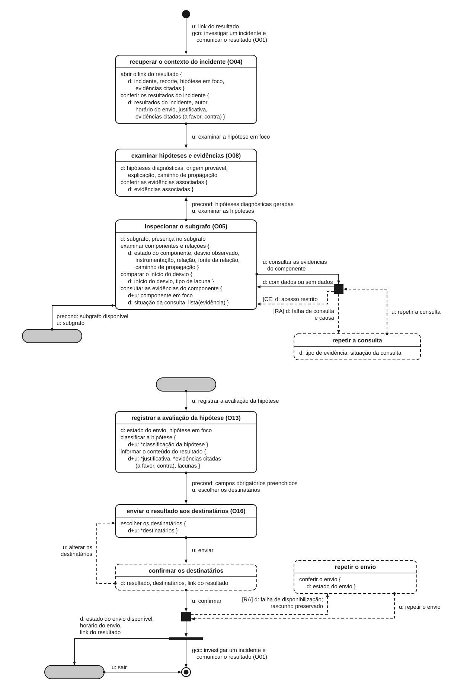

# Entrega 10 — M01: Avaliação da hipótese sobre a falha no checkout após um deploy

[← Voltar à Entrega 10](../10_molic.md) · [Cenário de interação CI01](../09_modelo_conceitual/ci01.md) · [Tarefa T01](../05_analise_tarefas/t01.md)

**Data:** 17/11/2026

**Status:** 🟩 concluída

**Autor(a):** Gabriel Lovato — 22.123.004-8

**Responsabilidade:** 1 solução completa por integrante

## Objetivo da atividade

Modelar a interação como uma **conversa entre usuário e preposto do designer**, oferecendo visão global dos caminhos que permitem ao usuário atingir seus objetivos — incluindo alternativas e rupturas relevantes. MoLIC não deve ser reduzida a um fluxograma de telas.

## M01 — Avaliação da hipótese sobre a falha no checkout após um deploy

**Autor(a):** Gabriel Lovato — 22.123.004-8

**Cenário de interação de origem:** [CI01 — Avaliação da hipótese sobre a falha no checkout após um deploy](../09_modelo_conceitual/ci01.md)

**Objetivo(s):** O04 recuperar o contexto do incidente; O08 examinar hipóteses e evidências; O05 inspecionar o subgrafo; O13 registrar a avaliação da hipótese; O16 enviar o resultado aos destinatários. A abertura (`gco`) e o fechamento (`gcc`) da conversa relacionada à meta se referem a O01 investigar um incidente e comunicar o resultado.

**Tarefa(s) relacionada(s):** [T01 — Avaliar uma hipótese diagnóstica e decidir se ela é sustentada pelas evidências](../05_analise_tarefas/t01.md)

**Signos relevantes:** link do resultado, recorte (serviço, sintoma, período), hipótese em foco, resultados do incidente, hipótese diagnóstica (origem provável, explicação, evidências associadas, caminho de propagação), subgrafo, presença no subgrafo, estado do componente, início do desvio, componente em foco, situação da consulta, classificação da hipótese, justificativa, evidências citadas (a favor, contra), lacunas, destinatários, estado do envio.

### Diagrama

*Figura 1 — MoLIC M01, a partir de CI01. Fonte: elaboração do autor.*

**Fonte editável:** o próprio SVG ([`assets/10_molic/molic_m01.svg`](../../assets/10_molic/molic_m01.svg)), editável em editor de texto ou de vetores. A notação está descrita na [legenda da Entrega 10](../10_molic.md#legenda-da-notação).

### Leitura do diagrama

O diagrama MoLIC (*Modeling Language for Interaction as Conversation*, linguagem que modela a interação como uma conversa entre o usuário e o preposto do designer) cobre a conversa de CI01: Lucas reabre o incidente pelo link do diagnóstico inicial do SRE, examina a hipótese A, inspeciona o subgrafo e as evidências do checkout, registra a avaliação da hipótese e a envia. A conversa começa no ponto de abertura, com a fala do link do resultado, e termina no ponto de encerramento, com `gcc` depois do envio disponível ou sem `gcc` quando Lucas sai antes de enviar. O subgrafo, o registro da avaliação e a saída são acessos ubíquos, isto é, mudanças de tópico possíveis em qualquer momento da investigação. [H] O caminho é uma proposta de design da equipe, ainda não avaliada com usuários; a verificação ocorre no teste com usuários da Entrega 14, pelas metas da Entrega 8.

#### Caminho principal

1. Lucas recebe do SRE de plantão, pelo canal de comunicação da equipe, o link do diagnóstico inicial. No ponto de abertura, a fala `u: link do resultado` inicia a conversa sobre a meta (`gco: investigar um incidente e comunicar o resultado (O01)`) e leva a `recuperar o contexto do incidente (O04)`.
2. Em `abrir o link do resultado`, o preposto reabre o incidente no estado do envio do diagnóstico inicial: recorte com serviço checkout, sintoma erros e latência elevada e período de 30 minutos antes do alerta até a solicitação da análise; hipótese A em foco; e as evidências citadas pelo SRE. Em `conferir os resultados do incidente`, Lucas lê o diagnóstico inicial, com autor e horário do envio: origem provável "não determinada", justificativa que pede a conferência das hipóteses A e B e evidências citadas, cada uma marcada a favor ou contra.
3. `u: examinar a hipótese em foco` leva a `examinar hipóteses e evidências (O08)`. O preposto apresenta as hipóteses diagnósticas: a hipótese A aponta o checkout como origem provável, e sua explicação, produzida pelo pipeline, liga os erros do checkout à nova versão; a hipótese B aponta o pagamento. Em `conferir as evidências associadas`, Lucas vê os logs com exceção no checkout, os spans com timeout na chamada ao pagamento e os logs do pagamento.
4. Pelo acesso ubíquo, `u: subgrafo` leva a `inspecionar o subgrafo (O05)`; a precondição `subgrafo disponível` já está atendida, pois o subgrafo e as hipóteses do recorte existem desde a abertura. Em `examinar componentes e relações`, com a hipótese A em foco, o checkout tem o estado do componente "origem provável" (hipótese A), e o caminho de propagação se restringe a ele; o pagamento está "afetado", com desvio observado de latência elevada, e se liga ao checkout pela relação checkout → pagamento, com fonte da relação trace. Em `comparar o início do desvio`, Lucas vê que o início do desvio do pagamento é anterior ao do checkout.
5. Em `consultar as evidências do componente`, Lucas escolhe o checkout como componente em foco, e `u: consultar as evidências do componente` chega ao processo da consulta. A saída `d: com dados ou sem dados` devolve a conversa a `inspecionar o subgrafo (O05)` com a situação da consulta "com dados": os spans do checkout no período, com horário, identificador do trace e conteúdo com dados pessoais mascarados. Nos spans com erro, Lucas vê que o checkout esgota o tempo de espera pela resposta do pagamento e conclui que essas evidências contrariam a origem no checkout; o preposto não as marca como contrárias.
6. Pelo acesso ubíquo, `u: registrar a avaliação da hipótese` leva a `registrar a avaliação da hipótese (O13)`, que apresenta o estado do envio "rascunho" e a hipótese A como hipótese em foco. Em `classificar a hipótese`, Lucas escolhe "parcialmente sustentada". Em `informar o conteúdo do resultado`, escreve a justificativa, cita a métrica de taxa de erros do checkout a favor e a métrica de latência do pagamento e os spans do checkout com erro contra e registra nas lacunas que a causa da latência do pagamento não foi examinada.
7. Com os campos obrigatórios preenchidos, `u: escolher os destinatários` leva a `enviar o resultado aos destinatários (O16)`. Em `escolher os destinatários`, Lucas escolhe o SRE de plantão e a equipe do pagamento entre as pessoas com acesso ao incidente.
8. `u: enviar` leva à cena de alerta `confirmar os destinatários`, que apresenta a avaliação da hipótese, os destinatários e o link do resultado. `u: confirmar` chega ao processo do envio.
9. O processo do envio segue para a barra de fechamento. Um ramo leva `gcc: investigar um incidente e comunicar o resultado (O01)` ao ponto de encerramento: a meta foi alcançada. O outro leva ao acesso ubíquo a fala `d: estado do envio disponível, horário do envio, link do resultado`: a avaliação está disponível, e os destinatários recebem o link pelo canal de comunicação da equipe. Desse acesso ubíquo, Lucas pode voltar à investigação ou sair (`u: sair`).

#### Alternativas e rupturas

| Situação | Onde ocorre | Como o usuário percebe | Caminho de recuperação/saída |
|---|---|---|---|
| Partir do subgrafo antes das evidências associadas (método 1.B do GOMS de T01) | `recuperar o contexto do incidente (O04)` ou `examinar hipóteses e evidências (O08)` | O acesso ubíquo ao subgrafo está disponível em qualquer cena, pois o subgrafo existe desde a abertura (`precond: subgrafo disponível`) | `u: subgrafo` leva direto a `inspecionar o subgrafo (O05)`, onde a origem provável da hipótese em foco aparece no estado do componente; depois de consultar as evidências do componente, `u: examinar as hipóteses` leva a `examinar hipóteses e evidências (O08)`, onde Lucas compara os registros encontrados com a explicação da hipótese (`precond: hipóteses diagnósticas geradas`, cumprida desde a abertura) |
| Consulta sem itens no período | processo da consulta, a partir de `inspecionar o subgrafo (O05)` | `d: com dados ou sem dados`, com a situação da consulta "sem dados", apresentada como lacuna, e não como ausência de erro (PP) | A conversa volta a `inspecionar o subgrafo (O05)`; Lucas escolhe outro componente em foco ou registra a lacuna em `informar o conteúdo do resultado` |
| Trecho de telemetria sem permissão | processo da consulta | `[CE] d: acesso restrito`: o trecho exige uma permissão que Lucas não tem e pode ser consultado por quem a tenha, fora do sistema | A conversa volta a `inspecionar o subgrafo (O05)`; Lucas pede a consulta a quem tem a permissão, fora do sistema, ou registra o acesso restrito nas lacunas |
| Falha na consulta às evidências | processo da consulta | `[RA] d: falha de consulta e causa` leva à cena de recuperação apoiada `repetir a consulta`, com o tipo de evidência e a situação da consulta | `u: repetir a consulta` volta ao processo da consulta, sem perder o recorte |
| Campos obrigatórios não preenchidos | `registrar a avaliação da hipótese (O13)` | Os signos marcados com `*` (classificação da hipótese, justificativa e evidências citadas) indicam o que falta; sem eles, a fala `u: escolher os destinatários` não ocorre (`precond: campos obrigatórios preenchidos`, PA) | Lucas completa os campos na mesma cena; o rascunho fica preservado |
| Destinatário errado | cena de alerta `confirmar os destinatários` | O preposto apresenta o resultado, os destinatários e o link do resultado e pede confirmação antes do envio (AL) | `u: alterar os destinatários` volta a `enviar o resultado aos destinatários (O16)` |
| Falha de disponibilização | processo do envio | `[RA] d: falha de disponibilização; rascunho preservado` leva à cena de recuperação apoiada `repetir o envio`, onde, em `conferir o envio`, o estado do envio indica a falha | `u: repetir o envio` volta ao processo do envio; só o estado "disponível" leva à barra de fechamento e ao `gcc` |
| Interrupção com abandono antes do envio | qualquer cena, pelo acesso ubíquo | O estado do envio "rascunho", em `registrar a avaliação da hipótese (O13)`, indica que a avaliação ainda não foi enviada | `u: sair` leva ao ponto de encerramento sem `gcc`, pois a meta não foi alcançada; a avaliação fica preservada como rascunho |

## Referências

- **CC8122 — MoLIC, partes A, B e C.** Material de aula disponibilizado na disciplina, baseado em Barbosa e Silva (2010), consultado em 17/11/2026. Notação MoLIC e passagem da interação para o design de interface.
- BARBOSA, Simone D. J.; SILVA, Bruno S. **Interação Humano-Computador**. Rio de Janeiro: Elsevier/Campus, 2010.
- Documentos do projeto: [CI01](../09_modelo_conceitual/ci01.md), [esquema de signos da Entrega 9](../09_modelo_conceitual.md#4-esquema-conceitual-de-signos), [tarefa T01](../05_analise_tarefas/t01.md) e [Entrega 8](../08_engenharia_usabilidade.md).
