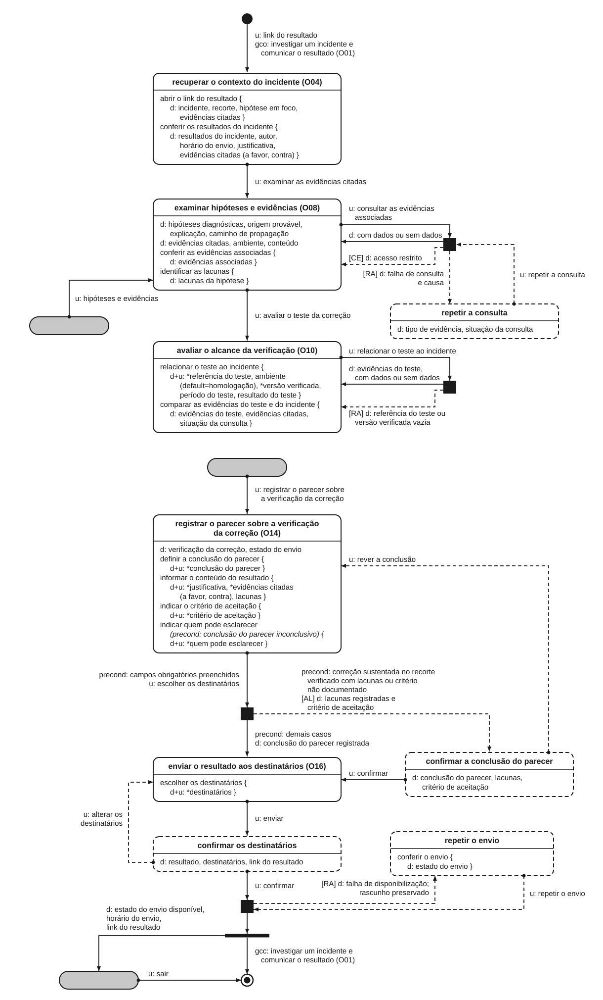

# Entrega 10 — M02: Parecer sobre a verificação de uma correção incerta

[← Voltar à Entrega 10](../10_molic.md) · [Cenário de interação CI02](../09_modelo_conceitual/ci02.md) · [Tarefa T02](../05_analise_tarefas/t02.md)

**Data:** 17/11/2026

**Status:** 🟩 concluída

**Autor(a):** Willian Verenka Oliveira Silva — 22.124.081-5

**Responsabilidade:** 1 solução completa por integrante

## Objetivo da atividade

Modelar a interação como uma **conversa entre usuário e preposto do designer**, oferecendo visão global dos caminhos que permitem ao usuário atingir seus objetivos — incluindo alternativas e rupturas relevantes. MoLIC não deve ser reduzida a um fluxograma de telas.

## M02 — Parecer sobre a verificação de uma correção incerta

**Autor(a):** Willian Verenka Oliveira Silva — 22.124.081-5

**Cenário de interação de origem:** [CI02 — Parecer sobre a verificação de uma correção incerta](../09_modelo_conceitual/ci02.md)

**Objetivo(s):** O04 recuperar o contexto do incidente; O08 examinar hipóteses e evidências; O10 avaliar o alcance da verificação; O14 registrar o parecer sobre a verificação da correção; O16 enviar o resultado aos destinatários. A abertura (`gco`) e o fechamento (`gcc`) da conversa relacionada à meta se referem a O01 investigar um incidente e comunicar o resultado.

**Tarefa(s) relacionada(s):** [T02 — Emitir um parecer fundamentado sobre a verificação da correção](../05_analise_tarefas/t02.md)

**Signos relevantes:** link do resultado, recorte, hipótese em foco, resultados do incidente, evidências citadas, evidências associadas, ambiente, situação da consulta, lacunas da hipótese, verificação da correção (referência do teste, ambiente, versão verificada, período do teste, resultado do teste, evidências do teste), conclusão do parecer, justificativa, lacunas, critério de aceitação, quem pode esclarecer, destinatários, estado do envio.

### Diagrama

*Figura 1 — MoLIC M02, a partir de CI02. Fonte: elaboração do autor.*

**Fonte editável:** o próprio SVG ([`assets/10_molic/molic_m02.svg`](../../assets/10_molic/molic_m02.svg)), editável em editor de texto ou de vetores. A notação está descrita na [legenda da Entrega 10](../10_molic.md#legenda-da-notação).

### Leitura do diagrama

O diagrama MoLIC (*Modeling Language for Interaction as Conversation*, linguagem que modela a interação como uma conversa entre o usuário e o preposto do designer) cobre a conversa de CI02: Mariana reabre o incidente pelo link da avaliação da hipótese, examina as evidências citadas e as associadas à hipótese em foco, relaciona o teste da correção ao incidente e compara as evidências dos dois, registra o parecer sobre a verificação da correção e o envia. A conversa começa no ponto de abertura, com a fala do link do resultado, e termina no ponto de encerramento, com `gcc` depois do envio disponível ou sem `gcc` quando Mariana sai antes de enviar. O retorno a hipóteses e evidências, o registro do parecer e a saída são acessos ubíquos, isto é, mudanças de tópico possíveis em qualquer momento da conversa. [H] O caminho é uma proposta de design da equipe, ainda não avaliada com usuários; a verificação ocorre no teste com usuários da Entrega 14, pelas metas da Entrega 8, entre elas MU08 (parecer compatível com as evidências) e MU12 (recuperação da falha de disponibilização).

#### Caminho principal

1. O chamado da correção traz o link do resultado da avaliação da hipótese enviada pelo desenvolvedor responsável pela correção. No ponto de abertura, a fala `u: link do resultado` inicia a conversa sobre a meta (`gco: investigar um incidente e comunicar o resultado (O01)`) e leva a `recuperar o contexto do incidente (O04)`.
2. Em `abrir o link do resultado`, o preposto reabre o incidente no estado do envio da avaliação: recorte com serviço checkout, sintomas erros e latência elevada e o período analisado; hipótese A em foco; e as evidências citadas na avaliação. Em `conferir os resultados do incidente`, Mariana vê os dois resultados disponíveis, o diagnóstico inicial do SRE de plantão e a avaliação da hipótese do desenvolvedor, cada um com autor, horário do envio, justificativa e evidências citadas, marcadas a favor ou contra.
3. `u: examinar as evidências citadas` leva a `examinar hipóteses e evidências (O08)`. O preposto apresenta as hipóteses diagnósticas A e B, com origem provável, explicação e caminho de propagação, identificadas como produzidas pelo pipeline, e as evidências citadas: spans de compras que falharam, com ambiente produção e conteúdo com dados pessoais mascarados, nos quais a chamada ao pagamento dura mais que o tempo de espera do checkout e a compra termina com erro. Em `conferir as evidências associadas`, Mariana vê que entre as evidências associadas à hipótese A estão logs do pagamento.
4. `u: consultar as evidências associadas` chega ao processo da consulta. A saída `[CE] d: acesso restrito` devolve a conversa a `examinar hipóteses e evidências (O08)`: os logs do pagamento em produção, no período do incidente, exigem uma permissão que Mariana não tem e podem ser consultados, fora do sistema, por quem a tenha. Em `identificar as lacunas`, esse trecho aparece entre as lacunas da hipótese como acesso restrito, e não como ausência de erro. Mariana pede ao SRE de plantão, pelo canal de comunicação da equipe, que consulte esses logs; o pedido ocorre fora do sistema.
5. Mariana conclui uma compra em homologação com a versão corrigida, e `u: avaliar o teste da correção` leva a `avaliar o alcance da verificação (O10)`. Em `relacionar o teste ao incidente`, ela informa a referência do teste, o ambiente homologação (valor padrão), a versão verificada, o período do teste e o resultado do teste "passou".
6. `u: relacionar o teste ao incidente` chega ao processo da verificação, e a saída `d: evidências do teste, com dados ou sem dados` devolve a conversa a `avaliar o alcance da verificação (O10)` com a situação da consulta "com dados". Em `comparar as evidências do teste e do incidente`, os spans do checkout e do pagamento em homologação, no período do teste, aparecem ao lado das evidências citadas, de produção: nenhum span do teste tem erro, e o pagamento respondeu normalmente. Mariana conclui que a condição da falha, a demora do pagamento, não foi exercitada no teste.
7. Mariana pergunta ao desenvolvedor, pelo canal de comunicação da equipe e fora do sistema, se algum teste provocou a demora do pagamento; a resposta não chega a tempo, nem a do SRE de plantão. Pelo acesso ubíquo, `u: registrar o parecer sobre a verificação da correção` leva a `registrar o parecer sobre a verificação da correção (O14)`, que apresenta a verificação da correção relacionada ao incidente e o estado do envio "rascunho".
8. Em `definir a conclusão do parecer`, Mariana escolhe "inconclusivo". Em `informar o conteúdo do resultado`, escreve na justificativa que o teste passou com o pagamento respondendo normalmente e que as falhas ocorreram com respostas acima do tempo de espera; cita a favor os spans do teste e os das compras que falharam; e, nas lacunas, escolhe o acesso restrito aos logs do pagamento e descreve que a condição da falha não foi exercitada no teste. Em `indicar o critério de aceitação`, registra "não documentado". Como a conclusão é "inconclusivo", o diálogo `indicar quem pode esclarecer` ocorre, e ela indica o desenvolvedor e o SRE de plantão.
9. Com os campos obrigatórios preenchidos, `u: escolher os destinatários` chega ao processo da conclusão do parecer. Para um parecer inconclusivo, a saída é `precond: demais casos` com a fala `d: conclusão do parecer registrada`, que leva a `enviar o resultado aos destinatários (O16)` sem alerta. Em `escolher os destinatários`, Mariana escolhe o desenvolvedor e o SRE de plantão entre as pessoas com acesso ao incidente.
10. `u: enviar` leva à cena de alerta `confirmar os destinatários`, que apresenta o parecer, os destinatários e o link do resultado. `u: confirmar` chega ao processo do envio.
11. Na primeira tentativa, `[RA] d: falha de disponibilização; rascunho preservado` leva à cena de recuperação apoiada `repetir o envio`. Em `conferir o envio`, o estado do envio indica a falha de disponibilização e a causa: a conexão com o servidor foi interrompida antes do registro. `u: repetir o envio` volta ao processo do envio sem que Mariana reescreva o parecer.
12. O processo do envio segue para a barra de fechamento. Um ramo leva `gcc: investigar um incidente e comunicar o resultado (O01)` ao ponto de encerramento: a meta foi alcançada. O outro leva ao acesso ubíquo a fala `d: estado do envio disponível, horário do envio, link do resultado`: o parecer está disponível, e os destinatários recebem o link pelo canal de comunicação da equipe. Só então Mariana considera o parecer comunicado; pelos acessos ubíquos, ela pode voltar a hipóteses e evidências ou ao registro, ou sair (`u: sair`).

#### Alternativas e rupturas

| Situação | Onde ocorre | Como o usuário percebe | Caminho de recuperação/saída |
|---|---|---|---|
| Consulta sem itens no período | processo da consulta, a partir de `examinar hipóteses e evidências (O08)` | `d: com dados ou sem dados`, com a situação da consulta "sem dados", apresentada como lacuna, e não como ausência de erro (PP) | A conversa volta a `examinar hipóteses e evidências (O08)`; Mariana pode registrar a lacuna em `informar o conteúdo do resultado` |
| Trecho de telemetria sem permissão | processo da consulta | `[CE] d: acesso restrito`: os logs do pagamento em produção exigem uma permissão que Mariana não tem e podem ser consultados por quem a tenha, fora do sistema | A conversa volta a `examinar hipóteses e evidências (O08)`, com o trecho em `identificar as lacunas`; Mariana pede a consulta ao SRE de plantão fora do sistema e registra o acesso restrito nas lacunas do parecer |
| Falha na consulta às evidências | processo da consulta | `[RA] d: falha de consulta e causa` leva à cena de recuperação apoiada `repetir a consulta`, com o tipo de evidência e a situação da consulta | `u: repetir a consulta` volta ao processo da consulta, sem perder o recorte |
| Teste com itens sem erro ou sem itens | processo da verificação | `d: evidências do teste, com dados ou sem dados`: em `comparar as evidências do teste e do incidente`, a situação da consulta "com dados" (itens encontrados, nenhum com erro) é diferenciada de "sem dados" (nenhum item no ambiente e no período do teste) (PP) | A conversa volta a `avaliar o alcance da verificação (O10)`; com "com dados", Mariana compara as evidências do teste com as evidências citadas; com "sem dados", a falta de evidências do teste é uma lacuna a registrar no parecer |
| Referência do teste ou versão verificada vazia | processo da verificação | `[RA] d: referência do teste ou versão verificada vazia` devolve a conversa a `avaliar o alcance da verificação (O10)` com o campo vazio indicado | Mariana preenche o campo em `relacionar o teste ao incidente` e repete `u: relacionar o teste ao incidente` |
| Campos obrigatórios não preenchidos | `registrar o parecer sobre a verificação da correção (O14)` | Os signos marcados com `*` (conclusão do parecer, justificativa, evidências citadas, critério de aceitação e, no parecer inconclusivo, quem pode esclarecer) indicam o que falta; sem eles, a fala `u: escolher os destinatários` não ocorre (`precond: campos obrigatórios preenchidos`, PA) | Mariana completa os campos na mesma cena; o rascunho fica preservado |
| Parecer inconclusivo sem quem pode esclarecer | `registrar o parecer sobre a verificação da correção (O14)` | O diálogo `indicar quem pode esclarecer` aparece com a precondição `conclusão do parecer inconclusivo`, e quem pode esclarecer é obrigatório (PA) | Mariana indica quem pode resolver as lacunas; até lá, a fala `u: escolher os destinatários` não ocorre |
| "Correção sustentada no recorte verificado" com lacunas registradas ou critério de aceitação "não documentado" | processo da conclusão do parecer | `[AL] d: lacunas registradas e critério de aceitação` leva à cena de alerta `confirmar a conclusão do parecer`, que apresenta a conclusão do parecer, as lacunas e o critério de aceitação | `u: confirmar` segue para `enviar o resultado aos destinatários (O16)`; `u: rever a conclusão` volta a `registrar o parecer sobre a verificação da correção (O14)`. Nos demais casos, como o parecer inconclusivo de CI02, `precond: demais casos` e `d: conclusão do parecer registrada` levam direto ao envio |
| Voltar às evidências ou à verificação da correção depois de abrir o registro ou de rever a conclusão | `registrar o parecer sobre a verificação da correção (O14)` ou `avaliar o alcance da verificação (O10)` | O acesso ubíquo a hipóteses e evidências está disponível em qualquer cena; o estado do envio "rascunho" indica que o parecer ainda não foi enviado | `u: hipóteses e evidências` leva a `examinar hipóteses e evidências (O08)`; de lá, `u: avaliar o teste da correção` leva a `avaliar o alcance da verificação (O10)`, e `u: registrar o parecer sobre a verificação da correção` retoma o rascunho preservado |
| Destinatário errado | cena de alerta `confirmar os destinatários` | O preposto apresenta o resultado, os destinatários e o link do resultado e pede confirmação antes do envio (AL) | `u: alterar os destinatários` volta a `enviar o resultado aos destinatários (O16)` |
| Falha de disponibilização | processo do envio | `[RA] d: falha de disponibilização; rascunho preservado` leva à cena de recuperação apoiada `repetir o envio`, onde o estado do envio indica a falha e a causa | `u: repetir o envio` volta ao processo do envio; só o estado "disponível" leva à barra de fechamento e ao `gcc` |
| Interrupção com abandono antes do envio | qualquer cena, pelo acesso ubíquo | O estado do envio "rascunho", em `registrar o parecer sobre a verificação da correção (O14)`, indica que o parecer ainda não foi enviado | `u: sair` leva ao ponto de encerramento sem `gcc`, pois a meta não foi alcançada; o parecer fica preservado como rascunho |

## Referências

- **CC8122 — MoLIC, partes A, B e C.** Material de aula disponibilizado na disciplina, baseado em Barbosa e Silva (2010), consultado em 17/11/2026. Notação MoLIC e passagem da interação para o design de interface.
- BARBOSA, Simone D. J.; SILVA, Bruno S. **Interação Humano-Computador**. Rio de Janeiro: Elsevier/Campus, 2010.
- Documentos do projeto: [CI02](../09_modelo_conceitual/ci02.md), [esquema de signos da Entrega 9](../09_modelo_conceitual.md#4-esquema-conceitual-de-signos), [tarefa T02](../05_analise_tarefas/t02.md) e [Entrega 8](../08_engenharia_usabilidade.md).
