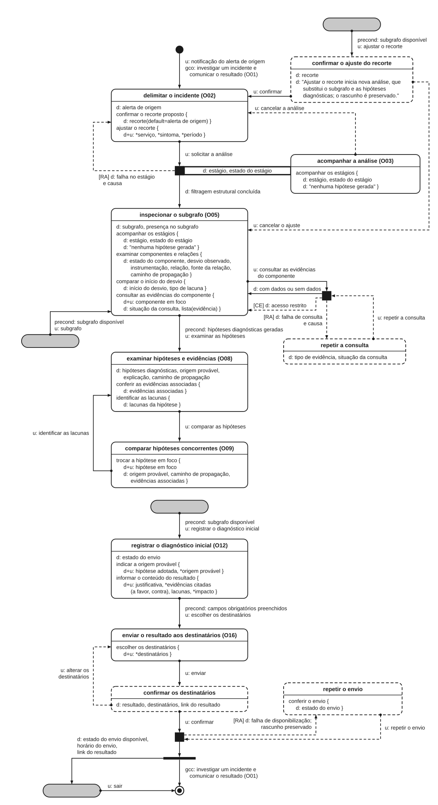

# Entrega 10 — M03: Diagnóstico inicial com hipóteses concorrentes

[← Voltar à Entrega 10](../10_molic.md) · [Cenário de interação CI03](../09_modelo_conceitual/ci03.md) · [Tarefa T03](../05_analise_tarefas/t03.md)

**Data:** 17/11/2026

**Status:** 🟩 concluída

**Autor(a):** Théo Zago Zimmermann — 22.123.035-2

**Responsabilidade:** 1 solução completa por integrante

## Objetivo da atividade

Modelar a interação como uma **conversa entre usuário e preposto do designer**, oferecendo visão global dos caminhos que permitem ao usuário atingir seus objetivos — incluindo alternativas e rupturas relevantes. MoLIC não deve ser reduzida a um fluxograma de telas.

## M03 — Diagnóstico inicial com hipóteses concorrentes

**Autor(a):** Théo Zago Zimmermann — 22.123.035-2

**Cenário de interação de origem:** [CI03 — Diagnóstico inicial com hipóteses concorrentes](../09_modelo_conceitual/ci03.md)

**Objetivo(s):** O02 delimitar o incidente; O03 acompanhar a análise; O05 inspecionar o subgrafo; O08 examinar hipóteses e evidências; O09 comparar hipóteses concorrentes; O12 registrar o diagnóstico inicial; O16 enviar o resultado aos destinatários. A abertura (`gco`) e o fechamento (`gcc`) da conversa relacionada à meta se referem a O01 investigar um incidente e comunicar o resultado.

**Tarefa(s) relacionada(s):** [T03 — Formular um diagnóstico inicial fundamentado sobre um incidente](../05_analise_tarefas/t03.md)

**Signos relevantes:** alerta de origem, recorte (serviço, sintoma, período), estágio, estado do estágio, subgrafo, presença no subgrafo, estado do componente, desvio observado, início do desvio, tipo de lacuna, componente em foco, situação da consulta, hipótese diagnóstica, hipótese em foco, caminho de propagação, lacunas da hipótese, hipótese adotada, origem provável, impacto, justificativa, evidências citadas (a favor, contra), lacunas, destinatários, estado do envio, link do resultado.

### Diagrama

*Figura 1 — MoLIC M03, a partir de CI03. Fonte: elaboração do autor.*

**Fonte editável:** o próprio SVG ([`assets/10_molic/molic_m03.svg`](../../assets/10_molic/molic_m03.svg)), editável em editor de texto ou de vetores. A notação está descrita na [legenda da Entrega 10](../10_molic.md#legenda-da-notação).

### Leitura do diagrama

O diagrama MoLIC (*Modeling Language for Interaction as Conversation*, linguagem que modela a interação como uma conversa entre o usuário e o preposto do designer) representa a conversa de CI03 entre Rafael (P01), SRE de plantão, e o preposto do designer, da notificação do alerta de origem ao envio do diagnóstico inicial ao desenvolvedor responsável. Cada objetivo de CI03 é uma cena, e os subtópicos da tabela de conversa são os diálogos dessas cenas; `confirmar o ajuste do recorte` e `confirmar os destinatários` são cenas de alerta, e `repetir a consulta` e `repetir o envio`, cenas de recuperação apoiada, alcançadas por falas `[RA]`. Três processos do sistema decidem o rumo da conversa: o da análise, o da consulta às evidências e o do envio. A conversa começa no ponto de abertura, com `gco` na meta O01, e termina no ponto de encerramento, pelo ramo `gcc` depois do envio disponível ou por `u: sair`, sem `gcc`. Os acessos ubíquos levam ao subgrafo, ao ajuste do recorte, ao registro do diagnóstico inicial e à saída em qualquer momento da investigação; os três primeiros exigem o subgrafo disponível. [H] O caminho é uma proposta de design, ainda não avaliada com usuários, e será verificado no teste com usuários da Entrega 14, pelas metas MU01–MU14 da Entrega 8.

#### Caminho principal

1. Ponto de abertura → `delimitar o incidente (O02)`: a fala `u: notificação do alerta de origem` abre a conversa sobre a meta O01 (`gco`). O preposto apresenta o alerta de origem e, em `confirmar o recorte proposto`, o recorte proposto a partir dele: o serviço que recebe as requisições da funcionalidade, os sintomas erros e latência elevada e o período de 30 minutos antes do alerta até o momento da solicitação. Rafael confirma o recorte e diz `u: solicitar a análise`.
2. Processo da análise e `acompanhar a análise (O03)`: pela faixa de andamento, o preposto informa `d: estágio, estado do estágio`, com a filtragem estrutural "em andamento" e a geração de hipóteses "aguardando". Quando a filtragem estrutural termina, a fala `d: filtragem estrutural concluída` leva a conversa a `inspecionar o subgrafo (O05)`.
3. `inspecionar o subgrafo (O05)`: o preposto apresenta o subgrafo como seleção feita para o recorte, com a presença no subgrafo de cada componente, e, em `acompanhar os estágios`, a geração de hipóteses "em andamento". Em `examinar componentes e relações`, o serviço que recebe as requisições tem estado do componente "afetado" e desvio observado "erros"; a dependência desse serviço, "afetado" e "latência elevada"; os demais componentes, "relacionado".
4. Enquanto as hipóteses são geradas, com o subgrafo já disponível, Rafael usa o acesso ubíquo `u: registrar o diagnóstico inicial`. Em `registrar o diagnóstico inicial (O12)`, informa o impacto, lentidão e falhas na funcionalidade para os usuários, e o preposto mostra o estado do envio "rascunho". Pelo acesso ubíquo `u: subgrafo`, Rafael volta a `inspecionar o subgrafo (O05)`.
5. Em `comparar o início do desvio`, os erros do serviço começam dentro do período, mas o desvio da dependência já existia no início dele, com o tipo de lacuna "período incompleto". A geração de hipóteses também chega a "concluído" em `acompanhar os estágios`, e Rafael, antes de examinar as hipóteses, usa o acesso ubíquo `u: ajustar o recorte`, disponível porque o subgrafo existe.
6. `confirmar o ajuste do recorte`: o preposto mostra o recorte e avisa que o ajuste inicia nova análise, que substitui o subgrafo e as hipóteses diagnósticas, e que o rascunho é preservado. Rafael diz `u: confirmar` e volta a `delimitar o incidente (O02)`, onde, em `ajustar o recorte`, antecipa o início do período e diz `u: solicitar a análise`.
7. O processo da análise volta a informar o andamento dos dois estágios em `acompanhar a análise (O03)`, e `d: filtragem estrutural concluída` leva de novo a `inspecionar o subgrafo (O05)`, onde `acompanhar os estágios` mostra os dois estágios da nova análise chegarem a "concluído". Em `comparar o início do desvio`, o início do desvio da dependência, com latência elevada, é anterior ao do serviço que recebe as requisições, com erros.
8. Em `consultar as evidências do componente`, Rafael escolhe o serviço que recebe as requisições como componente em foco e diz `u: consultar as evidências do componente`. O processo da consulta responde `d: com dados ou sem dados` com a situação da consulta "com dados": spans com erro que aguardam a resposta da dependência e logs de erro, parte deles sem identificador do trace, indicados com a lacuna "identificador ausente". A conversa volta à mesma cena, sem nova busca e com o mesmo recorte.
9. Com as hipóteses diagnósticas geradas (`precond: hipóteses diagnósticas geradas`), Rafael diz `u: examinar as hipóteses` e passa a `examinar hipóteses e evidências (O08)`. O preposto apresenta as hipóteses A e B, sem ordem de preferência, com a origem provável (A no serviço que recebe as requisições, B na dependência), a explicação produzida pelo pipeline e o caminho de propagação. Em `conferir as evidências associadas`, a hipótese A se apoia na métrica de taxa de erros do serviço e nos logs de erro dele.
10. `u: comparar as hipóteses` leva a `comparar hipóteses concorrentes (O09)`. Em `trocar a hipótese em foco`, Rafael põe B em foco, e o preposto apresenta a dependência como origem provável, o caminho de propagação da dependência ao serviço e as evidências associadas a B: a métrica de latência da dependência e os spans do serviço que aguardam a resposta dela. Rafael confronta a concentração dos erros, que favorece A, com o início do desvio, que favorece B.
11. `u: identificar as lacunas` volta a `examinar hipóteses e evidências (O08)`. Em `identificar as lacunas`, as lacunas da hipótese B incluem o identificador ausente em parte dos logs de erro do serviço: esses erros não podem ser ligados às chamadas à dependência.
12. Pelo acesso ubíquo `u: registrar o diagnóstico inicial`, Rafael retoma o rascunho. Em `indicar a origem provável`, adota a hipótese B e indica a dependência como origem provável; em `informar o conteúdo do resultado`, escreve a justificativa (a ordem dos eventos pesa mais que a concentração dos erros), cita a favor a métrica de latência da dependência e os spans do serviço e, contra, a métrica de taxa de erros do serviço que recebe as requisições, e escolhe a lacuna "identificador ausente". O impacto já está no rascunho.
13. Com os campos obrigatórios preenchidos (origem provável, evidências citadas e impacto), `u: escolher os destinatários` leva a `enviar o resultado aos destinatários (O16)`. Rafael escolhe o desenvolvedor responsável, que tem acesso ao incidente, e diz `u: enviar`. Em `confirmar os destinatários`, o preposto mostra o diagnóstico inicial, o destinatário e o link do resultado, e Rafael diz `u: confirmar`.
14. O processo do envio leva à barra de fechamento. Um ramo leva `gcc: investigar um incidente e comunicar o resultado (O01)` ao ponto de encerramento; o outro, `d: estado do envio disponível, horário do envio, link do resultado`, volta ao acesso ubíquo, de onde Rafael pode retomar a investigação ou sair.

#### Alternativas e rupturas

| Situação | Onde ocorre | Como o usuário percebe | Caminho de recuperação/saída |
|---|---|---|---|
| Ajuste do recorte depois de uma análise | acesso ubíquo `u: ajustar o recorte` → `confirmar o ajuste do recorte` | cena de alerta (AL do recorte): `d: "Ajustar o recorte inicia nova análise, que substitui o subgrafo e as hipóteses diagnósticas; o rascunho é preservado."` | `u: confirmar` → `delimitar o incidente (O02)`, para ajustar o recorte e solicitar nova análise; `u: cancelar o ajuste` → `inspecionar o subgrafo (O05)`, com o recorte e a análise anteriores |
| Cancelar a análise em andamento | `acompanhar a análise (O03)` | `d: estágio, estado do estágio`, com um estágio "em andamento" | `u: cancelar a análise` → `delimitar o incidente (O02)`, com o recorte preservado para ajuste e nova solicitação |
| Falha em um estágio | processo da análise | `[RA] d: falha no estágio e causa`, com o estado do estágio "falha" | volta a `delimitar o incidente (O02)`, com o recorte preservado; `u: solicitar a análise` repete a análise |
| Nenhuma hipótese gerada | `acompanhar os estágios`, em `acompanhar a análise (O03)` e em `inspecionar o subgrafo (O05)` | `d: "nenhuma hipótese gerada"` (PP do grupo Hipótese diagnóstica) | `u: examinar as hipóteses` não ocorre (`precond: hipóteses diagnósticas geradas`); a investigação segue pelo subgrafo e pelas evidências, e o diagnóstico inicial pode registrar a origem provável "não determinada" |
| Período incompleto | `comparar o início do desvio`, em `inspecionar o subgrafo (O05)` | `d: início do desvio, tipo de lacuna`, com a lacuna "período incompleto" no componente cujo desvio já existia no início do período (PP do início do desvio) | `u: ajustar o recorte` (acesso ubíquo), para antecipar o início do período, ou a lacuna entra em `lacunas` no diagnóstico inicial |
| Identificador ausente | `consultar as evidências do componente`, em `inspecionar o subgrafo (O05)`; `identificar as lacunas`, em `examinar hipóteses e evidências (O08)` | `lista(evidência)` com logs sem identificador do trace, indicados com a lacuna "identificador ausente" (PP do identificador do trace); a mesma lacuna em `d: lacunas da hipótese` | sem recuperação pelo sistema; a lacuna é escolhida em `lacunas` no diagnóstico inicial |
| Consulta sem dados | processo da consulta | `d: com dados ou sem dados`, com "sem dados" apresentado como lacuna, e não como normalidade (PP da situação da consulta) | volta a `inspecionar o subgrafo (O05)`, com o mesmo recorte; Rafael consulta outro componente em foco ou registra a lacuna no diagnóstico inicial |
| Acesso restrito | processo da consulta | `[CE] d: acesso restrito` | volta a `inspecionar o subgrafo (O05)`; o trecho só pode ser consultado por quem tem a permissão, fora do sistema, e pode entrar como lacuna no diagnóstico inicial |
| Falha de consulta | processo da consulta | `[RA] d: falha de consulta e causa`; `repetir a consulta` mostra o tipo de evidência e a situação da consulta | `u: repetir a consulta` → processo da consulta, sem perder o recorte nem o componente em foco |
| Campos obrigatórios não preenchidos | `registrar o diagnóstico inicial (O12)` | `*` em origem provável, evidências citadas e impacto; `u: escolher os destinatários` só ocorre com `precond: campos obrigatórios preenchidos` (PA) | Rafael completa os campos; o diagnóstico inicial permanece com estado do envio "rascunho" |
| Destinatário errado | `confirmar os destinatários` | `d: resultado, destinatários, link do resultado` (AL dos destinatários) | `u: alterar os destinatários` → `enviar o resultado aos destinatários (O16)` |
| Falha de disponibilização | processo do envio | `[RA] d: falha de disponibilização; rascunho preservado`; em `conferir o envio`, `repetir o envio` mostra o estado do envio | `u: repetir o envio` → processo do envio; com o envio disponível, a conversa segue para a barra de fechamento |
| Interrupção com abandono | qualquer cena, pelo acesso ubíquo | sem fala do preposto; o diagnóstico inicial fica com estado do envio "rascunho" | `u: sair` → ponto de encerramento, sem `gcc`; o rascunho pode ser retomado por `u: registrar o diagnóstico inicial` |

## Referências

- **CC8122 — MoLIC, partes A, B e C.** Material de aula disponibilizado na disciplina, baseado em Barbosa e Silva (2010), consultado em 17/11/2026. Notação MoLIC e passagem da interação para o design de interface.
- BARBOSA, Simone D. J.; SILVA, Bruno S. **Interação Humano-Computador**. Rio de Janeiro: Elsevier/Campus, 2010.
- Documentos do projeto: [CI03](../09_modelo_conceitual/ci03.md), [esquema de signos da Entrega 9](../09_modelo_conceitual.md#4-esquema-conceitual-de-signos), [tarefa T03](../05_analise_tarefas/t03.md) e [Entrega 8](../08_engenharia_usabilidade.md).
