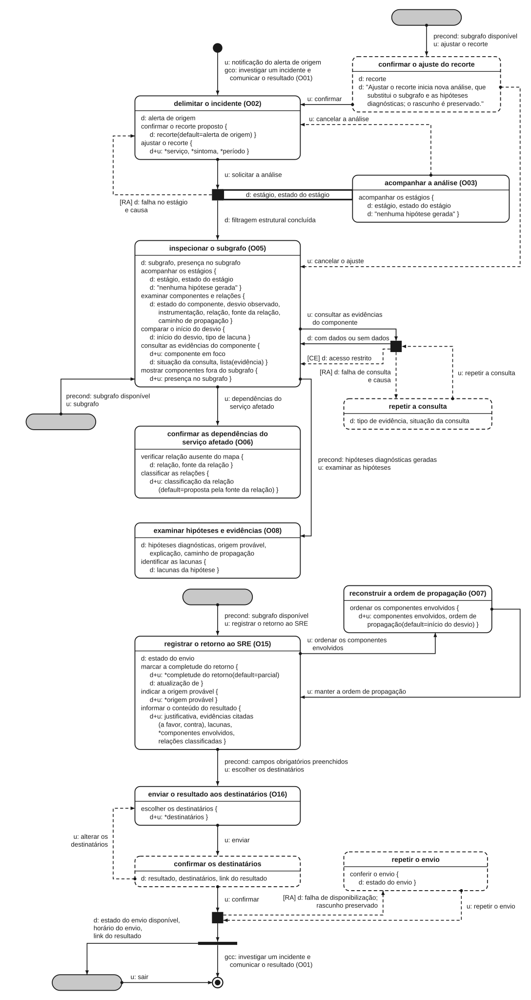

# Entrega 10 — M04: Retorno ao SRE sobre a propagação de uma falha entre microsserviços

[← Voltar à Entrega 10](../10_molic.md) · [Cenário de interação CI04](../09_modelo_conceitual/ci04.md) · [Tarefas T04–T06](../05_analise_tarefas/t04.md)

**Data:** 17/11/2026

**Status:** 🟩 concluída

**Autor(a):** João Sitta Giopatto — 22.123.054-3

**Responsabilidade:** 1 solução completa por integrante

## Objetivo da atividade

Modelar a interação como uma **conversa entre usuário e preposto do designer**, oferecendo visão global dos caminhos que permitem ao usuário atingir seus objetivos — incluindo alternativas e rupturas relevantes. MoLIC não deve ser reduzida a um fluxograma de telas.

## M04 — Retorno ao SRE sobre a propagação de uma falha entre microsserviços

**Autor(a):** João Sitta Giopatto — 22.123.054-3

**Cenário de interação de origem:** [CI04 — Retorno ao SRE sobre a propagação de uma falha entre microsserviços](../09_modelo_conceitual/ci04.md)

**Objetivo(s):** O02 delimitar o incidente; O03 acompanhar a análise; O05 inspecionar o subgrafo; O06 confirmar as dependências do serviço afetado; O08 examinar hipóteses e evidências; O15 registrar o retorno ao SRE; O07 reconstruir a ordem de propagação; O16 enviar o resultado aos destinatários (com `gco` e `gcc` em O01 investigar um incidente e comunicar o resultado).

**Tarefa(s) relacionada(s):** [T04 — Investigar a propagação de uma falha entre serviços e entregar um retorno ao SRE](../05_analise_tarefas/t04.md#hta--t04-investigar-a-propagação-de-uma-falha-entre-serviços-e-entregar-um-retorno-ao-sre); [T05 — Confirmar de quais serviços o serviço afetado depende durante um incidente](../05_analise_tarefas/t04.md#goms--t05-confirmar-de-quais-serviços-o-serviço-afetado-depende-durante-um-incidente); [T06 — Comunicar o retorno ao SRE e acompanhar a decisão](../05_analise_tarefas/t04.md#ctt--t06-comunicar-o-retorno-ao-sre-e-acompanhar-a-decisão)

**Signos relevantes:** alerta de origem, recorte (serviço, sintoma, período), estágio, estado do estágio, subgrafo, presença no subgrafo, estado do componente, desvio observado, início do desvio, instrumentação, relação, fonte da relação, classificação da relação, componente em foco, situação da consulta, hipótese diagnóstica, lacunas da hipótese, completude do retorno, atualização de, origem provável, componentes envolvidos, ordem de propagação, relações classificadas, evidências citadas (a favor, contra), lacunas, justificativa, destinatários, estado do envio, link do resultado.

### Diagrama

*Figura 1 — MoLIC M04, a partir de CI04. Fonte: elaboração do autor.*

**Fonte editável:** o próprio SVG ([`assets/10_molic/molic_m04.svg`](../../assets/10_molic/molic_m04.svg)), editável em editor de texto ou de vetores. A notação está descrita na [legenda da Entrega 10](../10_molic.md#legenda-da-notação).

### Leitura do diagrama

O MoLIC (*Modeling Language for Interaction as Conversation*, linguagem de modelagem da interação como conversa) de CI04 começa no ponto de abertura, com a notificação do alerta de origem e `gco` (abertura da conversa relacionada à meta) em O01, e termina no ponto de encerramento: com `gcc` (fechamento da conversa relacionada à meta) a cada envio disponível, do retorno parcial e do completo, ou sem `gcc` quando Camila sai pelo acesso ubíquo. Cada tópico da tabela de conversa de CI04 é uma cena, com o nome e o ID do objetivo no dicionário da Entrega 9, e os subtópicos são diálogos dessas cenas. As exceções são `repetir a consulta`, cena de recuperação apoiada alcançada por fala `[RA]`, como `repetir o envio`, e `confirmar os destinatários`, cena de alerta, como `confirmar o ajuste do recorte`. `conferir o envio` é diálogo de `repetir o envio`, e o envio disponível é a fala do preposto que sai da barra. Os quatro acessos ubíquos ficam junto do destino de suas falas: `u: ajustar o recorte`, `u: subgrafo`, `u: registrar o retorno ao SRE` e `u: sair`; os três primeiros exigem `precond: subgrafo disponível`, e o de `u: sair` também recebe a fala do envio disponível. Os processos não têm rótulo e são chamados aqui de processo da análise, da consulta e do envio. [H] O caminho é uma proposta de design ainda não avaliada com usuários; a verificação ocorrerá na Entrega 14, na tarefa de teste derivada de T04, com T05 e T06, segundo as metas da Entrega 8.

#### Caminho principal

1. Camila abre a notificação do alerta de latência do serviço de pedidos: do ponto de abertura, `u: notificação do alerta de origem`, com `gco: investigar um incidente e comunicar o resultado (O01)`, leva a `delimitar o incidente (O02)`. O preposto apresenta o alerta de origem e, em `confirmar o recorte proposto`, o recorte padrão: serviço pedidos, sintoma latência elevada e período de 13h50 até o momento da solicitação. Em `ajustar o recorte`, Camila acrescenta erros e acúmulo de mensagens ao sintoma, para cobrir os três alertas.
2. `u: solicitar a análise` chega ao processo da análise. Pela faixa de andamento, `d: estágio, estado do estágio` leva a `acompanhar a análise (O03)`, onde `acompanhar os estágios` mostra a filtragem estrutural em andamento e a geração de hipóteses aguardando.
3. `d: filtragem estrutural concluída` leva a `inspecionar o subgrafo (O05)`, e a geração de hipóteses continua em `acompanhar os estágios`. O preposto apresenta o subgrafo como seleção, com componentes fora dele que podem ser mostrados. Em `examinar componentes e relações`, pedidos, gateway de API e fila de notificações estão afetados (latência elevada, erros e acúmulo de mensagens), o estoque está relacionado, sem desvio observado, e o frete está relacionado, com instrumentação parcial. Em `comparar o início do desvio`, os inícios são 14h09 em pedidos, 14h11 no gateway de API e 14h13 na fila de notificações; o do frete é desconhecido.
4. `u: dependências do serviço afetado` leva a `confirmar as dependências do serviço afetado (O06)`. Em `verificar relação ausente do mapa`, a relação pedidos → frete aparece destacada, com fonte da relação trace e log e sem o mapa de serviços; pedidos → estoque e pedidos → fila de notificações têm só o mapa como fonte.
5. Pelo acesso ubíquo `u: subgrafo`, Camila volta a `inspecionar o subgrafo (O05)`, e `acompanhar os estágios` informa a geração de hipóteses concluída. Com `precond: hipóteses diagnósticas geradas` cumprida, `u: examinar as hipóteses` leva a `examinar hipóteses e evidências (O08)`: a hipótese A, produzida pelo pipeline, indica o frete como origem provável, com o caminho de propagação até pedidos, e `identificar as lacunas` mostra a instrumentação parcial do frete.
6. Por `u: subgrafo`, Camila volta ao subgrafo e, em `consultar as evidências do componente`, põe o frete em foco. `u: consultar as evidências do componente` chega ao processo da consulta, e `d: com dados ou sem dados` devolve à cena a métrica de CPU com dados, dentro do normal, e os logs sem dados, apresentados como lacuna.
7. Pelo mesmo diálogo, Camila consulta as evidências da relação pedidos → frete. Os spans vêm com dados, com a chamada ao frete esperando até 30 segundos, mas a consulta aos logs falha: `[RA] d: falha de consulta e causa` (a fonte de logs não respondeu) leva à cena `repetir a consulta`, com o tipo de evidência e a situação da consulta. `u: repetir a consulta` volta ao processo, e `d: com dados ou sem dados` traz o log de timeout de pedidos ao chamar o frete, sem identificador do trace, indicado como lacuna identificador ausente.
8. `u: dependências do serviço afetado` leva de novo a O06. Em `classificar as relações`, a classificação proposta pela fonte da relação é gateway de API → pedidos e pedidos → frete como observadas e pedidos → estoque e pedidos → fila de notificações como não verificadas; Camila a mantém.
9. Por `u: subgrafo`, em `mostrar componentes fora do subgrafo`, Camila pede os vizinhos de pedidos. O preposto os mostra marcados como fora do subgrafo, nenhum com desvio observado no período, e Camila os oculta, sem nova análise.
10. Às 14h33, com o prazo do SRE perto do fim, `u: registrar o retorno ao SRE` leva a `registrar o retorno ao SRE (O15)`, com o estado do envio "rascunho". Em `marcar a completude do retorno`, Camila mantém o valor padrão "parcial".
11. `u: ordenar os componentes envolvidos` leva a `reconstruir a ordem de propagação (O07)`. Em `ordenar os componentes envolvidos`, Camila inclui o frete ao lado do gateway de API, de pedidos e da fila de notificações; a ordem de propagação proposta pelo início do desvio é pedidos, gateway de API e fila de notificações, com o frete em posição desconhecida. `u: manter a ordem de propagação` volta a O15.
12. Em `indicar a origem provável`, Camila indica o frete, que o retorno leva como hipótese de trabalho. Em `informar o conteúdo do resultado`, cita a favor o span da chamada ao frete e o log de timeout; escolhe as lacunas instrumentação parcial, sem dados, identificador ausente e amostragem; e escreve na justificativa que o estoque não tem desvio observado e que a relação com ele está só no mapa. As relações classificadas seguem com a classificação do passo 8.
13. Com `precond: campos obrigatórios preenchidos`, `u: escolher os destinatários` leva a `enviar o resultado aos destinatários (O16)`, onde Camila escolhe o SRE de plantão. `u: enviar` leva à cena de alerta `confirmar os destinatários`, com o retorno, o destinatário e o link do resultado, e `u: confirmar` chega ao processo do envio. Da barra saem os dois ramos: `gcc: investigar um incidente e comunicar o resultado (O01)` leva ao ponto de encerramento, com o retorno parcial disponível, e `d: estado do envio disponível, horário do envio, link do resultado` (14h34) devolve a conversa ao acesso ubíquo, de onde Camila continua a investigação.
14. Por `u: subgrafo` e `u: dependências do serviço afetado`, Camila volta a `classificar as relações` e classifica pedidos → fila de notificações como inferida: o acúmulo começou quatro minutos depois do desvio em pedidos, e nenhum trace ou log liga os dois.
15. Por `u: registrar o retorno ao SRE`, Camila registra novo retorno. Em `marcar a completude do retorno`, marca "completo", e `d: atualização de` identifica o retorno parcial de 14h34, que continua disponível. O envio segue o passo 13, agora para o SRE de plantão e as equipes de pedidos e de frete; às 14h45, depois do processo do envio, os dois ramos saem de novo da barra: `gcc: investigar um incidente e comunicar o resultado (O01)` chega ao ponto de encerramento, agora com o retorno completo disponível, e o envio disponível volta ao acesso ubíquo.

#### Alternativas e rupturas

| Situação | Onde ocorre | Como o usuário percebe | Caminho de recuperação/saída |
|---|---|---|---|
| Consulta sem dados, como os logs do frete | processo da consulta, chamado de `inspecionar o subgrafo (O05)` | `d: com dados ou sem dados`: "sem dados" aparece como lacuna, e não como ausência de erro (PP da situação da consulta) | Camila continua em `consultar as evidências do componente`, consulta outro componente ou relação e pode escolher a lacuna "sem dados" no retorno. |
| Falha de consulta, como os logs da relação pedidos → frete | processo da consulta | `[RA] d: falha de consulta e causa`; a cena `repetir a consulta` mostra o tipo de evidência e a situação da consulta | `u: repetir a consulta` volta ao processo sem perder o recorte; Camila também pode deixar a cena por um acesso ubíquo e escolher a lacuna "falha de consulta" no retorno. |
| Acesso restrito a um trecho de telemetria | processo da consulta | `[CE] d: acesso restrito`, que volta a `inspecionar o subgrafo (O05)`; o trecho exige permissão que Camila não tem e pode ser consultado por quem a tenha, fora do sistema | Camila continua a inspeção e pode escolher a lacuna "acesso restrito" no retorno. |
| Instrumentação parcial e início do desvio desconhecido, como no frete | `inspecionar o subgrafo (O05)`, diálogos `examinar componentes e relações` e `comparar o início do desvio` | instrumentação "parcial" e início do desvio desconhecido aparecem como lacuna, e não como ausência de desvio (PP da instrumentação e do início do desvio), sem fala de ruptura | Camila mantém o componente na investigação; em `reconstruir a ordem de propagação (O07)`, ele fica com posição desconhecida na ordem de propagação. |
| Relação ausente do mapa de serviços, como pedidos → frete | `confirmar as dependências do serviço afetado (O06)`, diálogo `verificar relação ausente do mapa` | a relação com fonte em trace ou log e sem o mapa de serviços fica destacada (PP da fonte da relação) | Camila consulta as evidências da relação por `u: subgrafo` e a classifica em `classificar as relações`. |
| "observada" para relação sem trace ou log, como pedidos → fila de notificações | `confirmar as dependências do serviço afetado (O06)`, diálogo `classificar as relações` | o valor "observada" não pode ser escolhido quando a fonte da relação não inclui trace ou log (PA da classificação da relação); não há fala de ruptura | Camila escolhe "inferida" ou "não verificada", que o retorno leva nas relações classificadas. |
| Seleção do subgrafo que pode ter deixado de fora um componente com desvio | `inspecionar o subgrafo (O05)`, diálogo `mostrar componentes fora do subgrafo` | os vizinhos aparecem marcados como "fora do subgrafo" (PP da presença no subgrafo) | Camila os oculta no mesmo diálogo; o subgrafo continua o mesmo, sem nova análise. |
| Cancelamento da análise | `acompanhar a análise (O03)` | `d: estágio, estado do estágio` pela faixa de andamento mostra o estágio em andamento | `u: cancelar a análise` volta a `delimitar o incidente (O02)`, onde Camila ajusta o recorte e solicita nova análise. |
| Falha em um estágio | processo da análise | `[RA] d: falha no estágio e causa` (RA do estado do estágio) | A fala volta a `delimitar o incidente (O02)` com o recorte preservado; `u: solicitar a análise` repete a análise. |
| Nenhuma hipótese gerada | `acompanhar os estágios`, em `acompanhar a análise (O03)` e em `inspecionar o subgrafo (O05)` | `d: "nenhuma hipótese gerada"` | Sem `precond: hipóteses diagnósticas geradas`, `u: examinar as hipóteses` não ocorre; Camila continua pelo subgrafo e pode indicar a origem provável como "não determinada" no retorno. |
| Ajuste do recorte depois de uma análise | acesso ubíquo `precond: subgrafo disponível` / `u: ajustar o recorte` | cena de alerta `confirmar o ajuste do recorte`: o recorte vigente e a mensagem de que a nova análise substitui o subgrafo e as hipóteses diagnósticas e de que o rascunho é preservado (AL do recorte) | `u: confirmar` leva a `delimitar o incidente (O02)` para ajustar o recorte e solicitar nova análise; `u: cancelar o ajuste` volta a `inspecionar o subgrafo (O05)`, com o recorte e a análise anteriores. |
| Prazo do SRE antes do fim da investigação | `registrar o retorno ao SRE (O15)`, diálogo `marcar a completude do retorno` | completude do retorno "parcial" por padrão, com a indicação de que um retorno parcial pode ser seguido por outro que o atualiza (PP); no novo retorno, `d: atualização de` identifica o anterior, que continua disponível | Depois do envio disponível, a conversa volta ao acesso ubíquo; Camila continua a investigação e registra novo retorno marcado como "completo". |
| Campos obrigatórios não preenchidos | `registrar o retorno ao SRE (O15)` | completude do retorno, origem provável e componentes envolvidos levam `*`; sem eles, `u: escolher os destinatários` não ocorre (`precond: campos obrigatórios preenchidos`, PA) | Camila preenche os campos na mesma cena; o rascunho fica preservado. |
| Destinatário errado | `confirmar os destinatários` | `d: resultado, destinatários, link do resultado` antes do envio (AL dos destinatários) | `u: alterar os destinatários` volta a `enviar o resultado aos destinatários (O16)`. |
| Falha de disponibilização | processo do envio | `[RA] d: falha de disponibilização; rascunho preservado`; a cena `repetir o envio` mostra o estado do envio | `u: repetir o envio` volta ao processo do envio, com o rascunho preservado. |
| Interrupção com abandono | acesso ubíquo, em qualquer cena | `u: sair` | A conversa chega ao ponto de encerramento sem `gcc`; o rascunho do retorno fica preservado, com o estado do envio "rascunho". |

## Referências

- **CC8122 — MoLIC, partes A, B e C.** Material de aula disponibilizado na disciplina, baseado em Barbosa e Silva (2010), consultado em 17/11/2026. Notação MoLIC e passagem da interação para o design de interface.
- BARBOSA, Simone D. J.; SILVA, Bruno S. **Interação Humano-Computador**. Rio de Janeiro: Elsevier/Campus, 2010.
- Documentos do projeto: [CI04](../09_modelo_conceitual/ci04.md), [esquema de signos da Entrega 9](../09_modelo_conceitual.md#4-esquema-conceitual-de-signos), [tarefas T04–T06](../05_analise_tarefas/t04.md) e [Entrega 8](../08_engenharia_usabilidade.md).
