# Entrega 11 — Protótipo no Figma

[← Início do projeto](../README.md) · [Entrega 10 — MoLIC](10_molic.md) · [Entrega 12 — Planejamento da avaliação](12_planejamento_avaliacao.md)

**Data:** 17/11/2026

**Status:** 🟨 em andamento

**Responsabilidade:** 1 protótipo integrado por equipe cobrindo os fluxos MoLIC. O responsável por cada fluxo é o autor do diagrama MoLIC de origem, indicado na [cobertura MoLIC → Figma](#cobertura-molic--figma).

## Objetivo e entradas

Materializar o modelo de interação em um protótipo navegável, preservando a lógica dos objetivos, tópicos, signos, feedbacks, alternativas e recuperações definidos anteriormente.

O **protótipo** é a representação da interface em média ou alta fidelidade usada para simular a interação do usuário e testar as principais interações; a disciplina o distingue do *wireframe*, de baixa fidelidade, e do *mockup*, representação estática. Este protótipo é de alta fidelidade e cobre os quatro diagramas MoLIC da [Entrega 10](10_molic.md). A passagem do MoLIC para a interface segue os slides da disciplina e a [preparação para o Figma](10_molic.md#preparação-para-o-figma): os acessos ubíquos viram elementos persistentes de navegação; cada cena vira uma unidade de apresentação, isto é, uma tela ou uma área de tela; os diálogos viram grupos de elementos da unidade; os signos emitidos pelo preposto (`d:`) viram conteúdo exibido, e os que o usuário informa (`d+u:`), campos com o valor padrão do esquema de signos; as falas do usuário viram controles com o verbo da fala; a fala de sucesso do preposto vira mensagem de status na unidade da cena de destino; a fala de ruptura que volta à mesma cena vira mensagem de erro nessa unidade, e a que leva a uma cena de alerta ou de recuperação apoiada vira unidade própria; e cada processo vira um estado de carregamento ou de andamento. Como a [Entrega 8](08_engenharia_usabilidade.md) prevê subgrafo, hipóteses e evidências visíveis ao mesmo tempo, `inspecionar o subgrafo (O05)`, `examinar hipóteses e evidências (O08)` e `comparar hipóteses concorrentes (O09)` são áreas da mesma tela de investigação. Os estilos de interação são a barra de navegação para os acessos ubíquos, o formulário para a delimitação e o registro e a manipulação direta no subgrafo, sempre com alternativa por lista e por teclado, porque a manipulação direta é mais difícil para quem tem limitações visuais ou motoras.

As entradas são os diagramas M01–M04 da [Entrega 10](10_molic.md); o [mapa de objetivos](09_modelo_conceitual.md#3-mapa-de-objetivos) e o [esquema conceitual de signos](09_modelo_conceitual.md#4-esquema-conceitual-de-signos) da [Entrega 9](09_modelo_conceitual.md), cujos nomes e valores aparecem com a mesma grafia nas telas; a delimitação do sistema interativo, as características da plataforma (telas de 1440 px de largura), os princípios e as metas MU01–MU14 da [Entrega 8](08_engenharia_usabilidade.md); e as [recomendações RC01–RC06](02_analise_concorrencia.md#5-recomendações-derivadas) da Entrega 2. Os vínculos estão nas linhas R01–R04 da [matriz de rastreabilidade](../RASTREABILIDADE.md#3-rastreabilidade-entre-contribuição-técnica-necessidades-e-artefatos).

Conforme a delimitação da Entrega 8, o protótipo apresenta um único incidente fictício, o INC-4721, em produção: falha no checkout depois da implantação da versão 2.14.0, com timeouts na chamada ao pagamento, a relação pagamento → antifraude ausente do mapa de serviços e o antifraude com instrumentação parcial. P01–P04 veem esse incidente em momentos diferentes, cada fluxo a partir do estímulo de abertura do seu diagrama. Para reunir as quatro narrativas, os componentes de CI03 e CI04 recebem os nomes do INC-4721: o checkout é o serviço que recebe as requisições em CI03 e o serviço de pedidos em CI04; o pagamento é a dependência de CI03; e o antifraude ocupa o lugar do frete de CI04, agora como dependência do pagamento, de modo que a relação ausente do mapa passa a ser pagamento → antifraude. O alerta de origem de M03 e M04 é o do checkout, com erros e latência elevada, às 14h20; por isso, em M04, Camila acrescenta ao sintoma só o acúmulo de mensagens. As hipóteses diagnósticas são as mesmas nos quatro fluxos: A, com origem provável no checkout, e B, no pagamento, com a instrumentação parcial do antifraude entre as lacunas de B. A origem provável no antifraude é indicada por Camila no retorno ao SRE, como hipótese de trabalho. Em M01 e M02, o recorte reaberto pelo link é o já ajustado pelo SRE, de 13h30 a 14h22, e não o de 30 minutos antes do alerta descrito em CI01. Cada fluxo parte do seu próprio estado de abertura: os resultados enviados em um fluxo não alimentam os outros, e o diagnóstico inicial D-1 e a avaliação da hipótese AV-1 que aparecem nas aberturas de M01 e M02 seguem CI01 e CI02. O subgrafo, as hipóteses diagnósticas, as evidências, os resultados já enviados e as evidências do teste da correção foram elaborados pela equipe; a análise, as consultas, a verificação da correção e o envio são simulados com duração fixa, e as rupturas acontecem sempre nos mesmos trechos, para todos os participantes:

- **sem dados:** spans e logs do antifraude e das relações checkout → estoque e checkout → fila de notificações;
- **acesso restrito:** logs do pagamento em produção, para o desenvolvedor do checkout (M01), a analista de QA (M02) e a especialista em observabilidade (M04); o SRE de plantão (M03) tem essa permissão;
- **falha de consulta:** primeira consulta da sessão aos logs da relação pagamento → antifraude;
- **falha no estágio:** filtragem estrutural de um período com mais de 6 h;
- **nenhuma hipótese gerada:** serviço do recorte sem desvio observado no período;
- **período incompleto:** período que começa depois de 13h41, quando o desvio do pagamento já existia;
- **falha de disponibilização:** primeira tentativa do primeiro envio da sessão em M02, do segundo em M01 e M03 e do terceiro em M04, de modo que os caminhos principais de CI01, CI03 e CI04 terminam com o envio disponível na primeira tentativa;
- **verificação da correção (M02):** campo vazio quando falta a referência do teste ou a versão verificada; evidências do teste sem dados quando o ambiente não é homologação ou o período do teste não inclui 11/11/2026 10h07.

O protótipo não executa o pipeline do TCC nem se liga a fontes de telemetria ou a ferramentas de comunicação: a filtragem estrutural e a geração de hipóteses aparecem só pelo estado do estágio e pelos resultados que a pessoa confere. Como o incidente simulado tem até nove componentes e até cinco registros por consulta, ficaram de fora a paginação dos registros e a aproximação e o deslocamento do grafo previstos na Entrega 8, que também não têm fala no MoLIC. Não há dados reais nem pessoais; conteúdos com dados pessoais aparecem como `[mascarado]`. Não há tela de login, painel geral, lista de incidentes nem tela administrativa: a pessoa é identificada pelo ambiente corporativo (Entrega 8), e os estímulos de abertura (notificação do alerta, mensagem e chamado com o link do resultado) aparecem como contexto simulado, fora do sistema.

## Link do Figma

**Protótipo:** PENDENTE

**Arquivo editável:** PENDENTE

**Última verificação de permissão:** PENDENTE

## Cobertura MoLIC → Figma

Cada linha indica os objetivos do diagrama, o caminho principal da leitura do diagrama em IDs de tela e os estados de erro e de recuperação das alternativas e rupturas; o responsável é o autor do MoLIC.

| MoLIC | Objetivo | Fluxo/telas no Figma | Estados de erro/recuperação | Responsável |
|---|---|---|---|---|
| [M01](10_molic/m01.md) | O04, O08, O05, O13, O16 (`gco` e `gcc`: O01) | `F00B → F04 → F03 → F02 → F06C → F06 → F11 → F07 → F07A → F07C → F07S → F08S` | `F06V, F06P, F06R, F06S, F07R, F08` | Gabriel Lovato — 22.123.004-8 |
| [M02](10_molic/m02.md) | O04, O08, O10, O14, O16 (`gco` e `gcc`: O01) | `F00C → F04 → F03D → F03 → F06C → F06P → F12 → F12C → F12D → F13 → F07 → F07A → F07C → F07R → F07C → F07S → F08S` | `F06V, F06P, F06R, F06S, F12E, F12V, F13A, F07R, F08` | Willian Verenka Oliveira Silva — 22.124.081-5 |
| [M03](10_molic/m03.md) | O02, O03, O05, O08, O09, O12, O16 (`gco` e `gcc`: O01) | `F00A → F01 → F05 → F02C → F10 → F02C → F02 → F01A → F01 → F05 → F02C → F02 → F06C → F06 → F03 → F09 → F03 → F10 → F07 → F07A → F07C → F07S → F08S` | `F01E, F01X, F02V, F06V, F06R, F06S, F07R, F08` | Théo Zago Zimmermann — 22.123.035-2 |
| [M04](10_molic/m04.md) | O02, O03, O05, O06, O08, O15, O07, O16 (`gco` e `gcc`: O01) | `F00A → F01 → F05 → F02C → F14 → F02 → F03 → F02 → F06C → F06V → F06C → F06R → F06C → F06S → F14 → F02 → F02D → F02 → F16 → F15 → F16 → F07 → F07A → F07C → F07S → F14 → F16D → F07 → F07A → F07C → F07S → F08S` | `F01A, F01E, F01X, F02V, F06V, F06P, F06R, F06S, F07R, F08` | João Sitta Giopatto — 22.123.054-3 |

Os elementos que se repetem nos diagramas são a mesma unidade nos quatro fluxos, com o mesmo controle, rótulo, posição e comportamento: a barra superior com os acessos ubíquos, a barra do recorte, a tela de investigação (F02, F03, F06 e seus estados), a moldura do registro, o envio (F07 a F07S) e a saída (F08, F08S). As entradas nas cenas exclusivas aparecem só no fluxo do diagrama correspondente: `Comparar as hipóteses` (F09) em M03, `Avaliar o teste da correção` (F12) em M02 e `Dependências do serviço afetado` (F14) em M04. Em M03, a consulta às evidências tem as mesmas saídas, mas o acesso restrito não ocorre no incidente simulado: o SRE de plantão tem a permissão para os logs do pagamento em produção que, em M02, a analista de QA lhe pede que consulte.

[H] O protótipo é proposta de design da equipe, ainda não avaliada; a inspeção ocorre na Entrega 13 e o teste com usuários na Entrega 14, pelas metas MU01–MU14 da Entrega 8.

## Catálogo de telas/estados

F01, F02 e F03 mantêm a correspondência com as ações F01–F03 da [Entrega 1, seção 9.2](01_conhecendo_o_problema.md#92-que-ações-o-usuário-deverá-conseguir-realizar): F01 é a tela de delimitação do incidente, e F02 e F03 são as áreas do subgrafo e das hipóteses e evidências da tela de investigação. As demais telas seguem de F04 a F08 (comuns aos fluxos) e de F09 a F16 (exclusivas de um fluxo); F00A, F00B e F00C são os estímulos de abertura, fora do sistema. Um estado é o ID da tela com um sufixo: C, carregamento ou processamento; V, sem dados ou nenhum resultado; E, erro informado na própria unidade; P, permissão insuficiente; R, recuperação apoiada; S, sucesso; X, cancelamento; A, alerta antes de uma ação de risco; D, detalhe mostrado a pedido. As imagens têm 1440 px de largura. As telas mais altas que a janela aparecem inteiras; os estados com diálogo aparecem no recorte da janela, com 900 px de altura.

### F00A — Notificação do alerta de origem

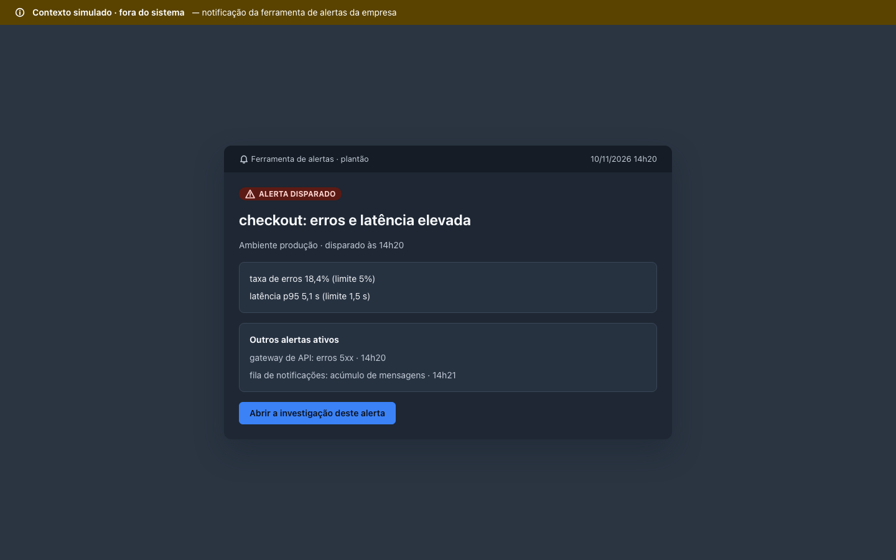

**Objetivo do usuário:** investigar um incidente e comunicar o resultado (O01): abrir, a partir da notificação da ferramenta de alertas, a investigação do alerta de origem do checkout (erros e latência elevada, 10/11/2026 14h20), vendo também os outros alertas ativos.

**Signos principais:** alerta de origem (serviço, sintoma, horário), ambiente.

**Origem no MoLIC:** M03 e M04, ponto de abertura e fala `u: notificação do alerta de origem`, com `gco: investigar um incidente e comunicar o resultado (O01)`; contexto simulado, fora do sistema, identificado pela faixa "Contexto simulado · fora do sistema".

### F00B — Mensagem com o link do diagnóstico inicial

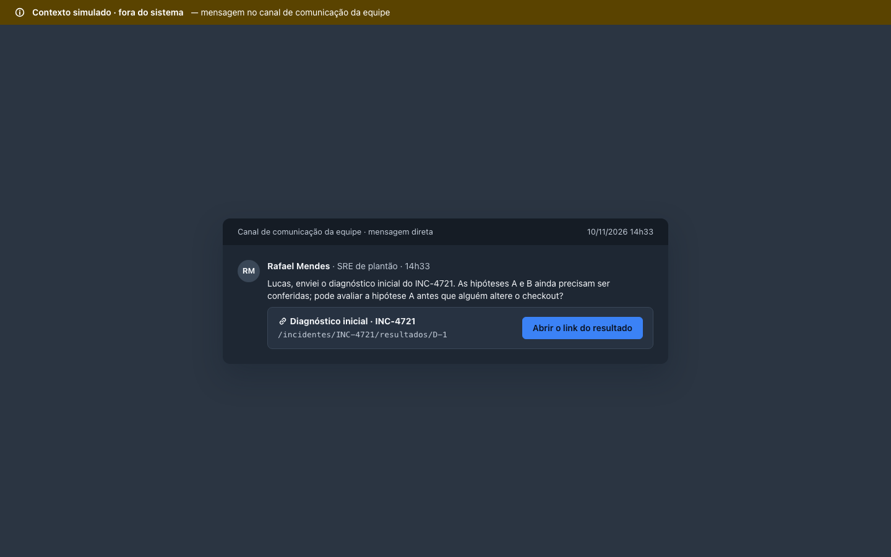

**Objetivo do usuário:** investigar um incidente e comunicar o resultado (O01): abrir, pela mensagem de Rafael Mendes no canal de comunicação da equipe, o link do diagnóstico inicial D-1 do INC-4721.

**Signos principais:** link do resultado, diagnóstico inicial, autor.

**Origem no MoLIC:** M01, ponto de abertura e fala `u: link do resultado`, com `gco: investigar um incidente e comunicar o resultado (O01)`; contexto simulado, fora do sistema.

### F00C — Chamado da correção com o link da avaliação da hipótese

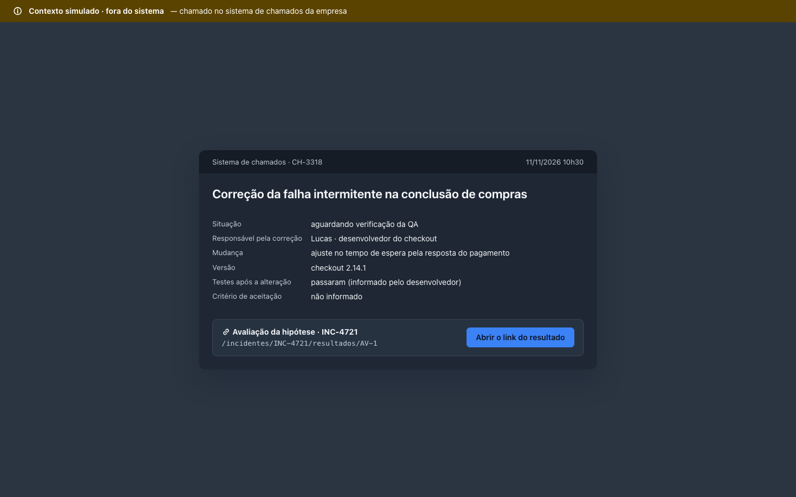

**Objetivo do usuário:** investigar um incidente e comunicar o resultado (O01): abrir, pelo chamado CH-3318 da correção (checkout 2.14.1, aguardando verificação da QA), o link da avaliação da hipótese AV-1.

**Signos principais:** link do resultado, avaliação da hipótese.

**Origem no MoLIC:** M02, ponto de abertura e fala `u: link do resultado`, com `gco: investigar um incidente e comunicar o resultado (O01)`; contexto simulado, fora do sistema.

### F01 — Delimitar o incidente

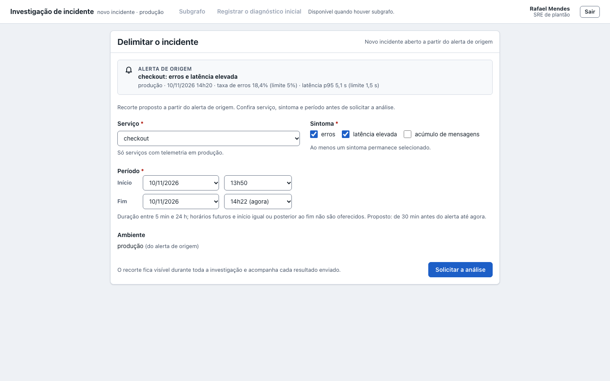

**Objetivo do usuário:** delimitar o incidente (O02): conferir o recorte proposto a partir do alerta de origem (checkout; erros e latência elevada; 10/11/2026 13h50–14h22) e ajustá-lo, se preciso, antes de solicitar a análise.

**Signos principais:** alerta de origem, recorte, serviço (só serviços com telemetria), sintoma (ao menos um permanece selecionado), período (duração entre 5 min e 24 h, sem horários futuros nem início igual ou posterior ao fim), ambiente.

**Origem no MoLIC:** M03 e M04, cena `delimitar o incidente (O02)`: `d: alerta de origem`; `confirmar o recorte proposto {d: recorte(default=alerta de origem)}`; `ajustar o recorte {d+u: *serviço, *sintoma, *período}`; fala `u: solicitar a análise`. Na chegada por `u: confirmar`, em F01A, a mesma tela abre com o título "Ajustar o recorte", a mensagem de status "Ajuste do recorte" e o recorte vigente nos campos.

### F01A — Confirmar o ajuste do recorte

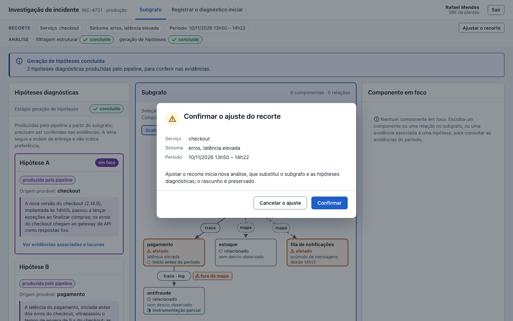

**Objetivo do usuário:** delimitar o incidente (O02): decidir se ajusta o recorte depois de uma análise, sabendo que a nova análise substitui o subgrafo e as hipóteses diagnósticas e que o rascunho é preservado.

**Signos principais:** recorte (serviço, sintoma, período), subgrafo, hipótese diagnóstica.

**Origem no MoLIC:** M03 e M04, acesso ubíquo `u: ajustar o recorte` (`precond: subgrafo disponível`) e cena de alerta `confirmar o ajuste do recorte` (AL do recorte), com `u: confirmar`, que leva a O02, e `u: cancelar o ajuste`, que volta a `inspecionar o subgrafo (O05)`; o foco inicial fica em cancelar o ajuste, e Esc equivale a ele.

### F01E — Falha no estágio, recorte preservado

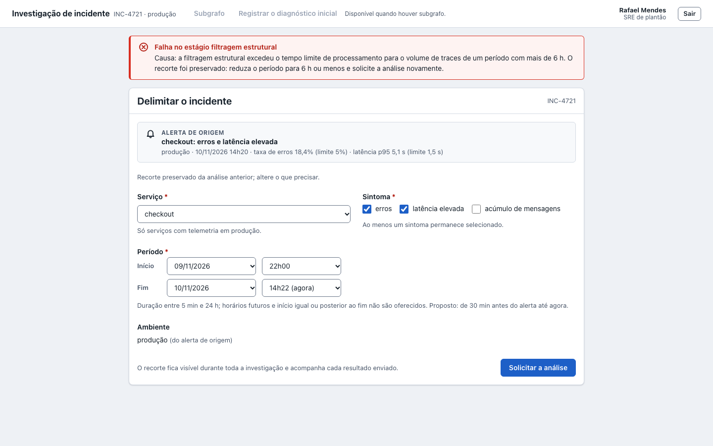

**Objetivo do usuário:** delimitar o incidente (O02) e acompanhar a análise (O03): entender a causa da falha na filtragem estrutural, num período com mais de 6 h, e solicitar a análise de novo com o período reduzido, sem refazer o recorte.

**Signos principais:** estado do estágio (falha), recorte.

**Origem no MoLIC:** M03 e M04, processo da análise, `[RA] d: falha no estágio e causa`, que volta a `delimitar o incidente (O02)` com o recorte preservado (RA do estado do estágio); `u: solicitar a análise` repete a análise.

### F01X — Análise cancelada, recorte preservado

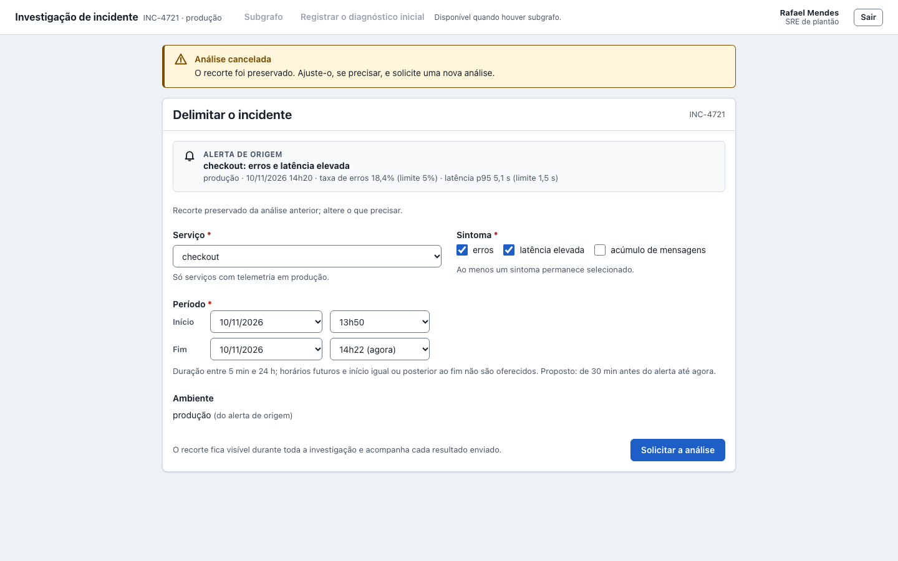

**Objetivo do usuário:** delimitar o incidente (O02) e acompanhar a análise (O03): depois de cancelar a análise em andamento, ajustar o recorte preservado e solicitar nova análise.

**Signos principais:** estado do estágio (cancelado), recorte.

**Origem no MoLIC:** M03 e M04, `u: cancelar a análise`, de `acompanhar a análise (O03)` para `delimitar o incidente (O02)`.

### F05 — Acompanhar a análise

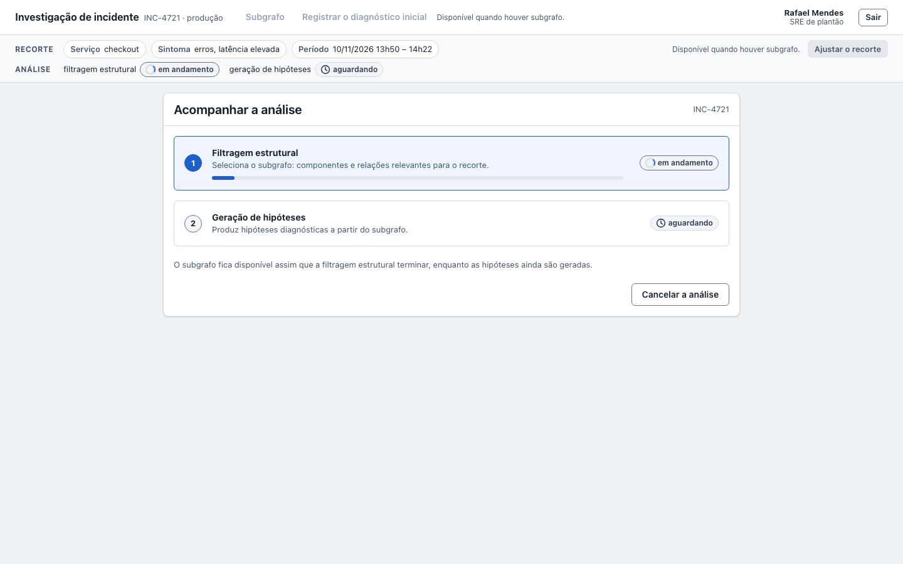

**Objetivo do usuário:** acompanhar a análise (O03): saber qual estágio está em andamento, com a filtragem estrutural antes da geração de hipóteses, e cancelar a análise se o recorte precisar mudar.

**Signos principais:** estágio (filtragem estrutural, geração de hipóteses), estado do estágio (em andamento, aguardando).

**Origem no MoLIC:** M03 e M04, processo da análise com a faixa de andamento `d: estágio, estado do estágio`; cena `acompanhar a análise (O03)`, diálogo `acompanhar os estágios`; fala `u: cancelar a análise`. O andamento não mostra porcentagem, porque a duração real é desconhecida (Entrega 8).

### F02 — Subgrafo

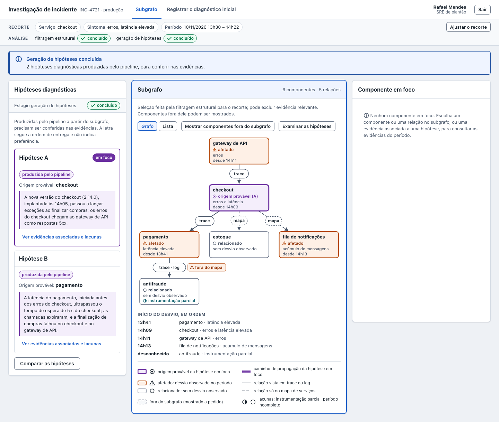

**Objetivo do usuário:** inspecionar o subgrafo (O05): examinar os componentes e as relações selecionados pela filtragem estrutural, comparar o início do desvio e escolher o componente ou a relação cujas evidências consultar, com a origem provável e o caminho de propagação da hipótese em foco destacados.

**Signos principais:** subgrafo, presença no subgrafo, estado do componente (origem provável, afetado, relacionado), desvio observado, início do desvio, instrumentação, relação, fonte da relação, caminho de propagação, hipótese em foco.

**Origem no MoLIC:** M01, M03 e M04, cena `inspecionar o subgrafo (O05)`: `d: subgrafo, presença no subgrafo`; `examinar componentes e relações`; `comparar o início do desvio`; `acompanhar os estágios`; chegada pelo acesso ubíquo `u: subgrafo` e saída para O08 por `u: examinar as hipóteses` (`precond: hipóteses diagnósticas geradas`). A vista Lista apresenta componentes e relações em tabelas, com os mesmos controles.

### F02C — Subgrafo disponível, geração de hipóteses em andamento

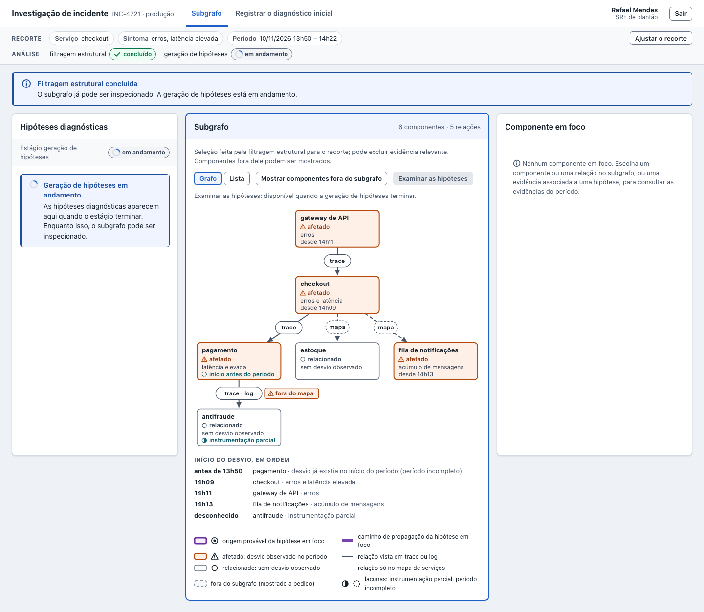

**Objetivo do usuário:** acompanhar a análise (O03) e inspecionar o subgrafo (O05): começar a inspeção enquanto as hipóteses ainda são geradas; o exame das hipóteses fica indisponível até o fim da geração.

**Signos principais:** estado do estágio, subgrafo, início do desvio, tipo de lacuna (período incompleto no pagamento).

**Origem no MoLIC:** M03 e M04, `d: filtragem estrutural concluída`, do processo da análise para O05, como mensagem de status na unidade de destino; `acompanhar os estágios` com a geração em andamento; `comparar o início do desvio` com a lacuna "período incompleto" (PP do início do desvio).

### F02V — Nenhuma hipótese gerada

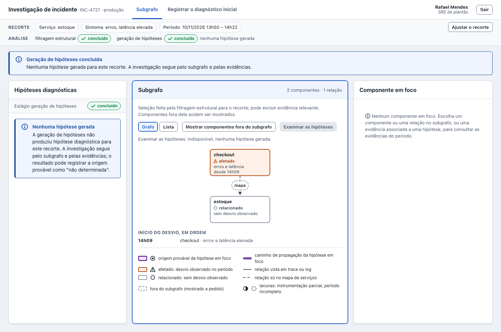

**Objetivo do usuário:** acompanhar a análise (O03), inspecionar o subgrafo (O05) e examinar hipóteses e evidências (O08): perceber que a geração não produziu hipótese para um recorte cujo serviço (estoque) não tem desvio observado e seguir pelo subgrafo e pelas evidências, podendo registrar a origem provável "não determinada".

**Signos principais:** estado do estágio, hipótese diagnóstica (nenhuma gerada), subgrafo.

**Origem no MoLIC:** M03 e M04, `acompanhar os estágios {d: "nenhuma hipótese gerada"}`, na barra do recorte (O03) e no painel de hipóteses (O05) (PP do grupo Hipótese diagnóstica); `precond: hipóteses diagnósticas geradas` mantém `Examinar as hipóteses` indisponível.

### F02D — Componentes fora do subgrafo mostrados

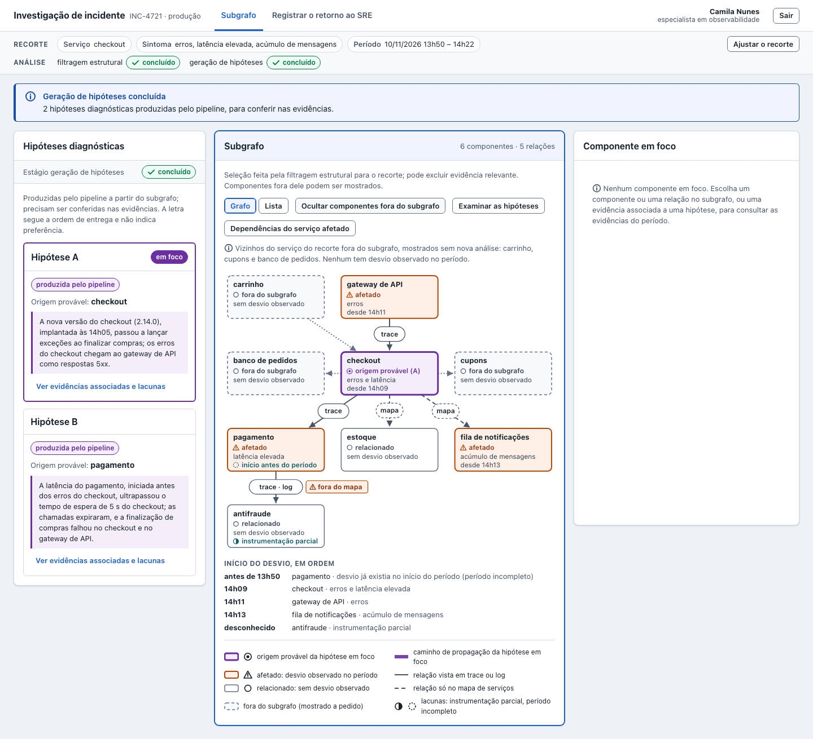

**Objetivo do usuário:** inspecionar o subgrafo (O05): conferir se a seleção deixou de fora um vizinho do checkout com desvio, vendo carrinho, cupons e banco de pedidos marcados como fora do subgrafo, sem nova análise, e ocultá-los de novo.

**Signos principais:** presença no subgrafo (fora do subgrafo), desvio observado.

**Origem no MoLIC:** M04, diálogo `mostrar componentes fora do subgrafo {d+u: presença no subgrafo}` de O05 (PP da presença no subgrafo); disponível também nos demais fluxos, porque a tela de investigação é a mesma.

### F03 — Hipóteses e evidências

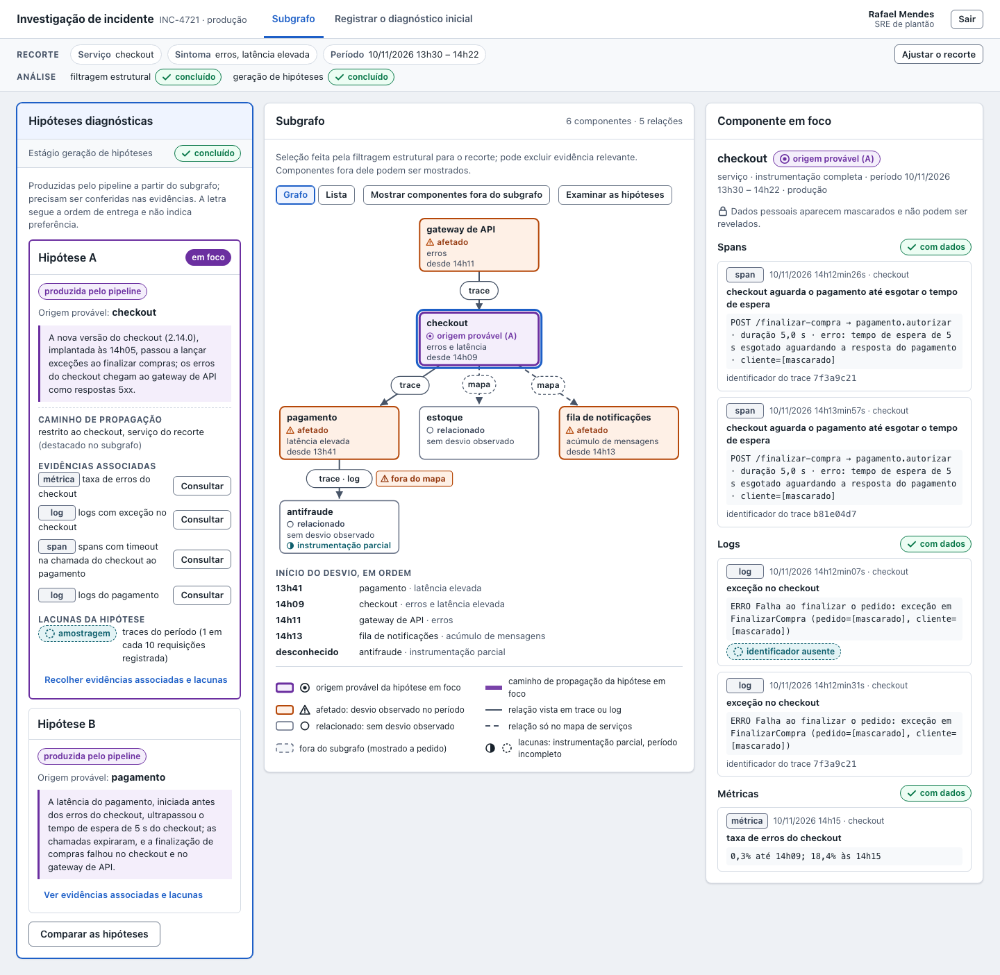

**Objetivo do usuário:** examinar hipóteses e evidências (O08): conferir as hipóteses A e B, produzidas pelo pipeline e sem ordem de preferência, com origem provável, explicação, caminho de propagação, evidências associadas e lacunas da hipótese, e consultar cada evidência associada sem nova busca.

**Signos principais:** hipótese diagnóstica (identificador, origem provável, explicação, evidências associadas, lacunas da hipótese, caminho de propagação), hipótese em foco.

**Origem no MoLIC:** M01–M04, cena `examinar hipóteses e evidências (O08)`: `conferir as evidências associadas`; `identificar as lacunas`; chegada por `u: examinar a hipótese em foco` (M01), `u: examinar as hipóteses` (M01, M03, M04), `u: identificar as lacunas` (M03) ou pelo acesso ubíquo `u: hipóteses e evidências` (M02); `u: consultar as evidências associadas` (M02).

### F03D — Evidências citadas

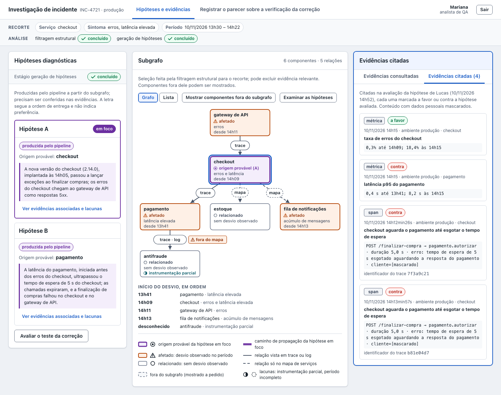

**Objetivo do usuário:** examinar hipóteses e evidências (O08): conferir, no painel ao lado do subgrafo, as evidências citadas no resultado aberto pelo link, cada uma marcada a favor ou contra, com ambiente e conteúdo mascarado.

**Signos principais:** evidências citadas (a favor, contra), ambiente, conteúdo, horário, identificador do trace.

**Origem no MoLIC:** M02, O08 com `d: evidências citadas, ambiente, conteúdo`, a partir de `u: examinar as evidências citadas` em O04; disponível também em M01, que reabre o incidente pelo link do resultado.

### F04 — Incidente reaberto pelo link do resultado

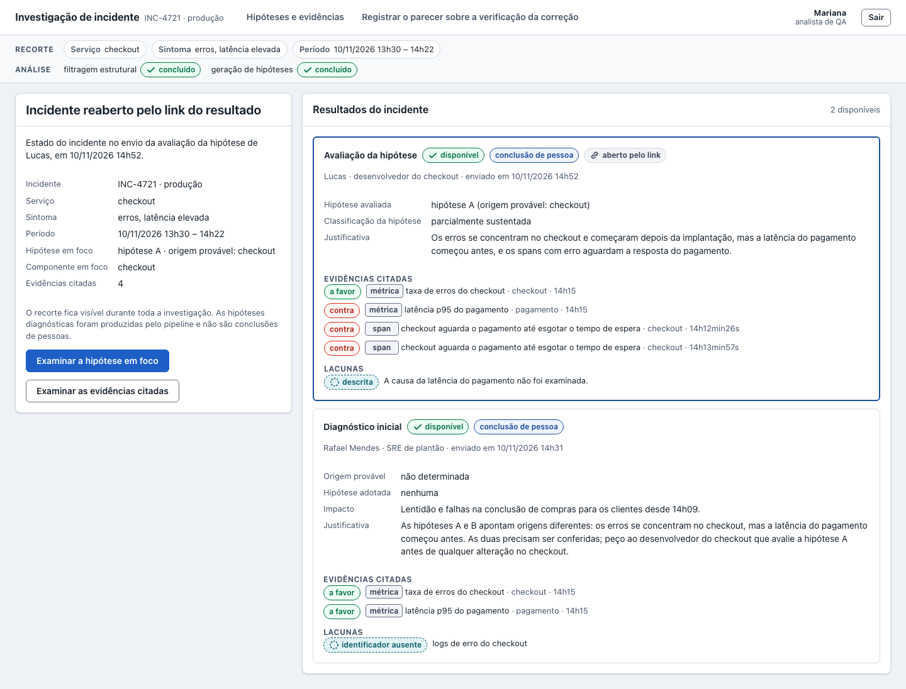

**Objetivo do usuário:** recuperar o contexto do incidente (O04): ver o incidente no estado do envio do resultado recebido (recorte, hipótese em foco, componente em foco e evidências citadas) e os resultados do incidente, com autor, horário do envio e justificativa, antes de examinar a hipótese em foco ou as evidências citadas.

**Signos principais:** identificador do incidente, recorte, hipótese em foco, componente em foco, evidências citadas, resultados do incidente, autor, horário do envio, justificativa, estado do envio (disponível).

**Origem no MoLIC:** M01 e M02, cena `recuperar o contexto do incidente (O04)`: `abrir o link do resultado`; `conferir os resultados do incidente`; falas `u: examinar a hipótese em foco` (M01) e `u: examinar as evidências citadas` (M02), oferecidas juntas.

### F06 — Evidências do componente em foco: com dados

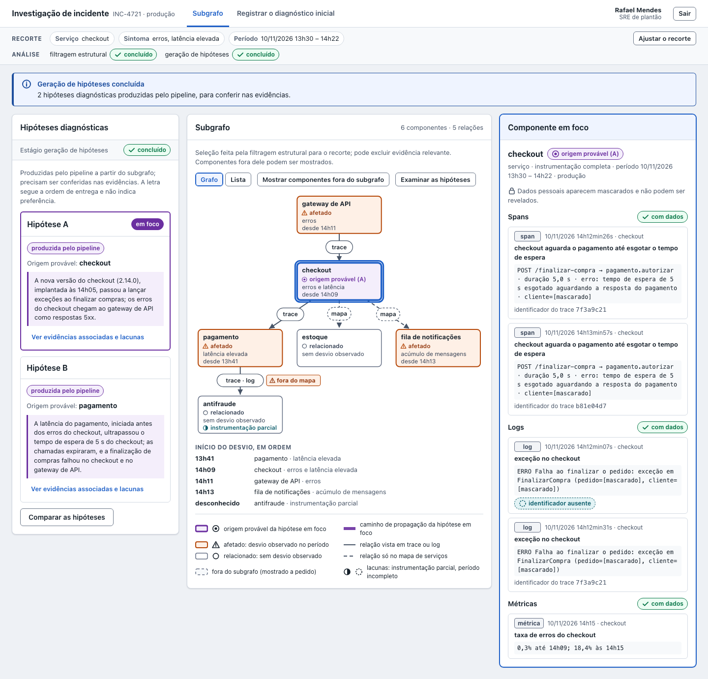

**Objetivo do usuário:** inspecionar o subgrafo (O05; O08 em M02): ler os spans, os logs e as métricas do componente em foco no período, com conteúdo mascarado e identificador do trace, sem perder o recorte nem o subgrafo à vista.

**Signos principais:** componente em foco, situação da consulta (com dados), evidência (tipo de evidência, horário, conteúdo, identificador do trace), tipo de lacuna (identificador ausente).

**Origem no MoLIC:** M01–M04, diálogo `consultar as evidências do componente`, fala `u: consultar as evidências do componente` (nó, relação ou linha da vista Lista), processo da consulta e saída `d: com dados ou sem dados` com "com dados".

### F06C — Consulta em andamento

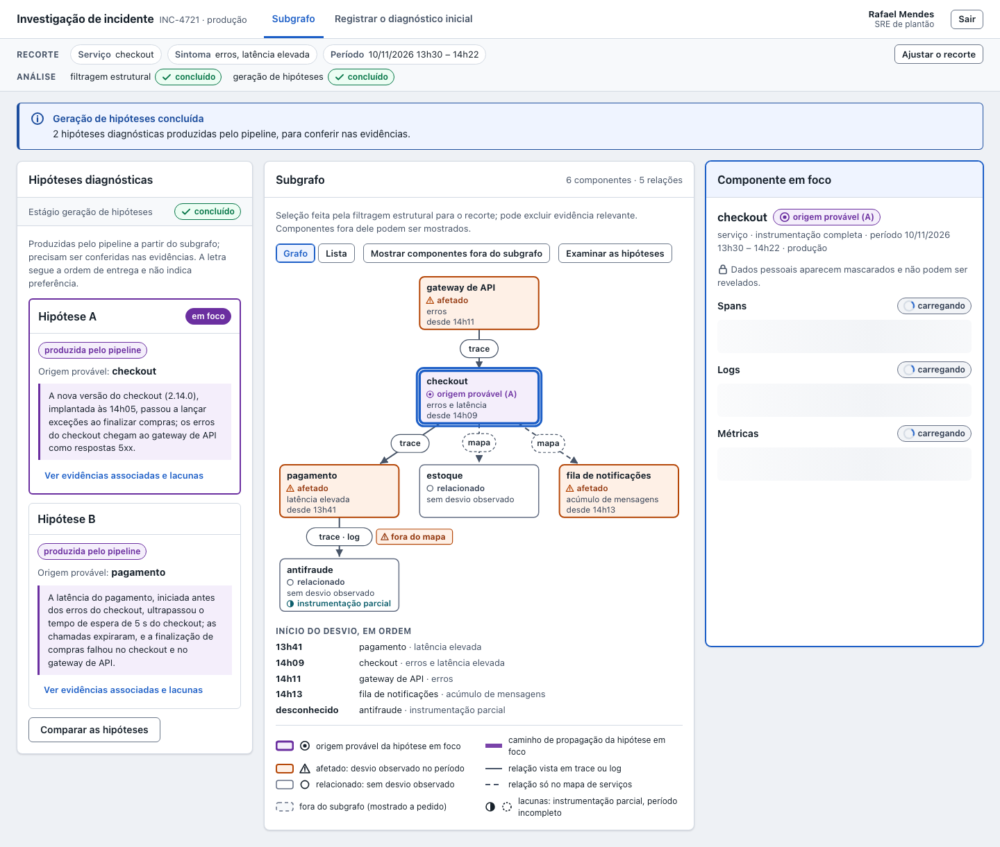

**Objetivo do usuário:** inspecionar o subgrafo (O05) ou examinar hipóteses e evidências (O08): acompanhar a consulta às evidências, por tipo de evidência, enquanto o subgrafo e as hipóteses continuam à vista.

**Signos principais:** situação da consulta (carregando), componente em foco.

**Origem no MoLIC:** M01–M04, processo da consulta, depois de `u: consultar as evidências do componente` ou de `u: consultar as evidências associadas`.

### F06V — Sem dados (lacuna)

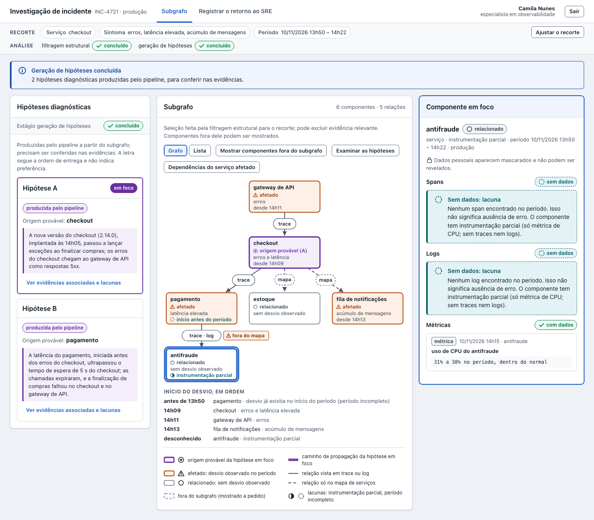

**Objetivo do usuário:** inspecionar o subgrafo (O05): perceber que spans e logs do antifraude não têm itens no período e que isso é lacuna, e não ausência de erro, e seguir com outro componente ou registrar a lacuna no resultado.

**Signos principais:** situação da consulta (sem dados), instrumentação (parcial), tipo de lacuna (sem dados).

**Origem no MoLIC:** M01–M04, saída `d: com dados ou sem dados` com "sem dados" (PP da situação da consulta), que devolve a conversa à cena de origem; narrada em M04.

### F06P — Acesso restrito

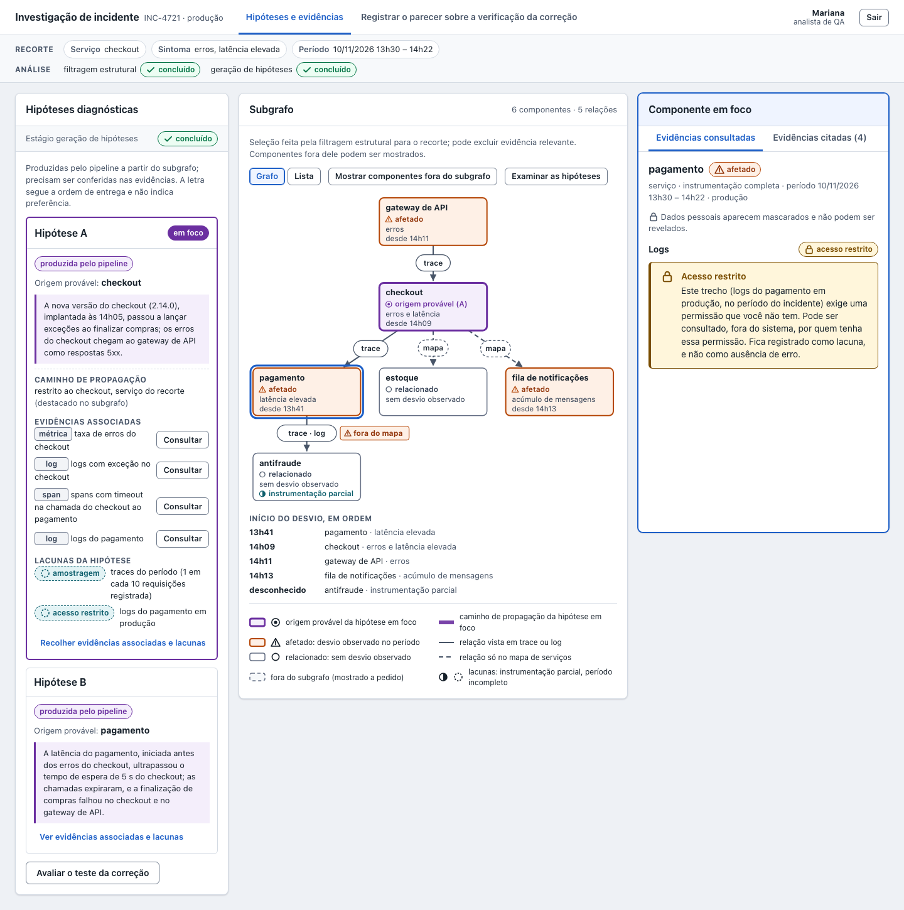

**Objetivo do usuário:** examinar hipóteses e evidências (O08; O05 em M01 e M04): perceber que os logs do pagamento em produção exigem uma permissão que a pessoa não tem, que podem ser consultados fora do sistema por quem a tenha e que entram como lacuna, e não como ausência de erro.

**Signos principais:** situação da consulta (acesso restrito), lacunas da hipótese, tipo de lacuna (acesso restrito), ambiente.

**Origem no MoLIC:** M02, `u: consultar as evidências associadas` e `[CE] d: acesso restrito`, que volta a O08 com o trecho em `identificar as lacunas` (CE da situação da consulta); a mesma fala volta a O05 em M01 e M04.

### F06R — Repetir a consulta

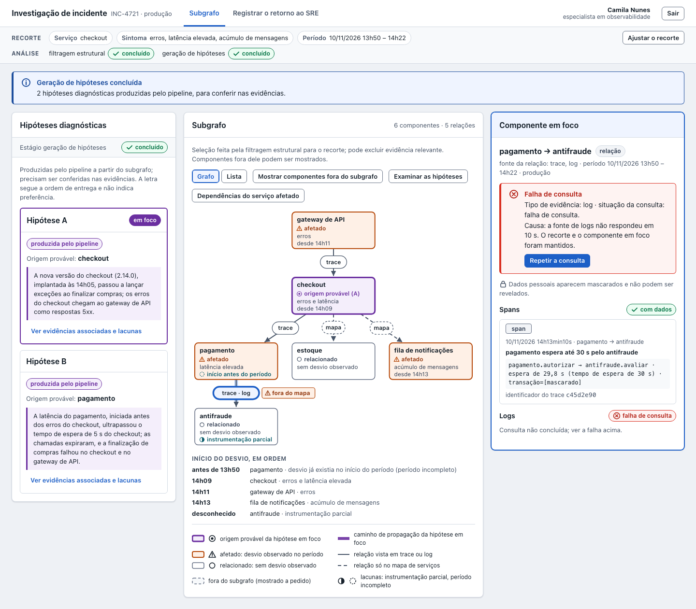

**Objetivo do usuário:** inspecionar o subgrafo (O05): recuperar os logs da relação pagamento → antifraude depois da falha de consulta, sem perder o recorte nem o componente em foco.

**Signos principais:** tipo de evidência, situação da consulta (falha de consulta), componente em foco, recorte.

**Origem no MoLIC:** M04, processo da consulta, `[RA] d: falha de consulta e causa` e cena de recuperação apoiada `repetir a consulta`, com a fala `u: repetir a consulta`; mesma ruptura em M01, M02 e M03.

### F06S — Consulta repetida com dados

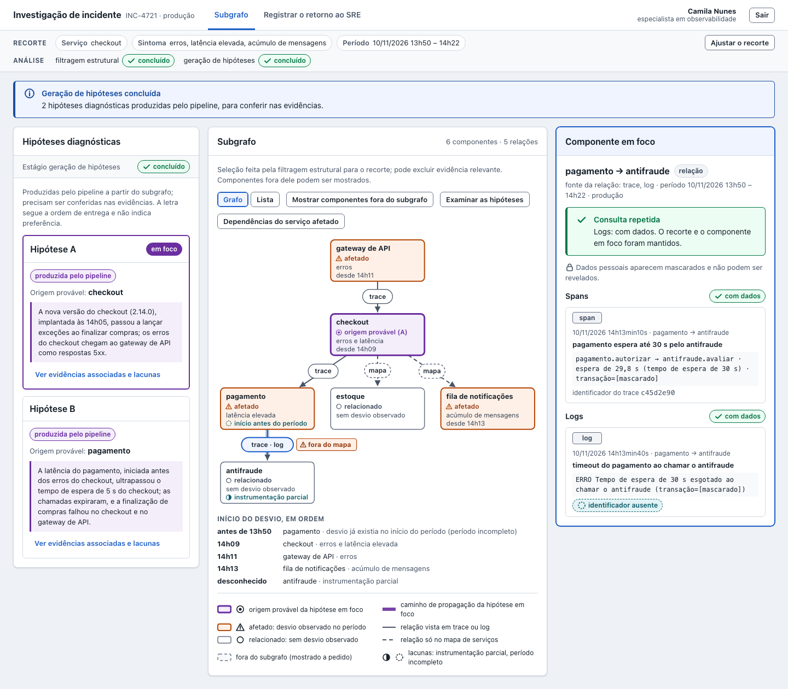

**Objetivo do usuário:** inspecionar o subgrafo (O05): confirmar que a consulta repetida trouxe o log de timeout do pagamento ao chamar o antifraude, sem identificador do trace, e que a lacuna de falha de consulta deixou de valer.

**Signos principais:** situação da consulta (com dados), tipo de lacuna (identificador ausente), componente em foco.

**Origem no MoLIC:** M04, `u: repetir a consulta`, processo da consulta e `d: com dados ou sem dados` com "com dados", como mensagem de sucesso na mesma unidade; mesma recuperação em M01, M02 e M03.

### F07 — Escolher os destinatários

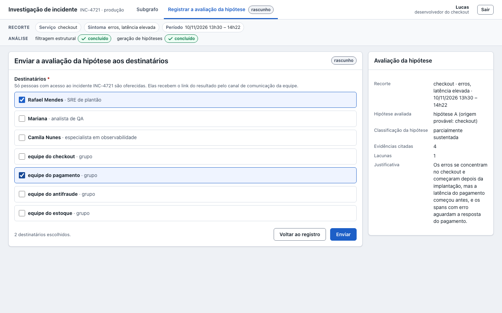

**Objetivo do usuário:** enviar o resultado aos destinatários (O16): escolher, entre as pessoas com acesso ao incidente, quem recebe a avaliação da hipótese; no M01, Rafael Mendes (SRE de plantão) e a equipe do pagamento.

**Signos principais:** destinatários, avaliação da hipótese (hipótese avaliada, classificação da hipótese, evidências citadas, lacunas, justificativa), recorte, estado do envio (rascunho).

**Origem no MoLIC:** M01, cena `enviar o resultado aos destinatários (O16)`, diálogo `escolher os destinatários {d+u: *destinatários}`, alcançada por `precond: campos obrigatórios preenchidos` e `u: escolher os destinatários`, com a fala `u: enviar`; mesma cena em M02, M03 e M04. Em M02, a fala `d: conclusão do parecer registrada` (`precond: demais casos`), do processo da conclusão do parecer, aparece nesta unidade como mensagem de status. `Voltar ao registro` realiza o acesso ubíquo `u: registrar …` do fluxo.

### F07A — Confirmar os destinatários

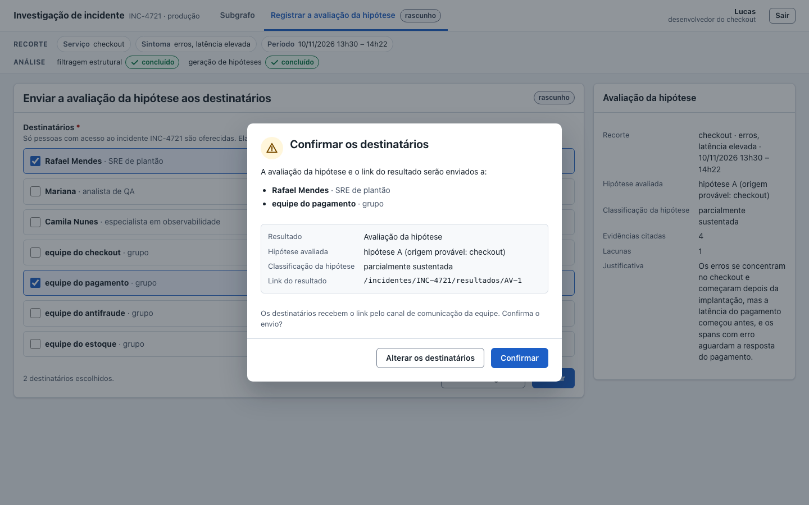

**Objetivo do usuário:** enviar o resultado aos destinatários (O16): conferir quem receberá a avaliação da hipótese e o link do resultado antes do envio.

**Signos principais:** avaliação da hipótese, destinatários, link do resultado.

**Origem no MoLIC:** M01, cena de alerta `confirmar os destinatários {d: resultado, destinatários, link do resultado}`, com as falas `u: confirmar` e `u: alterar os destinatários` (Esc equivale a alterar); mesma cena em M02, M03 e M04.

### F07C — Envio em andamento

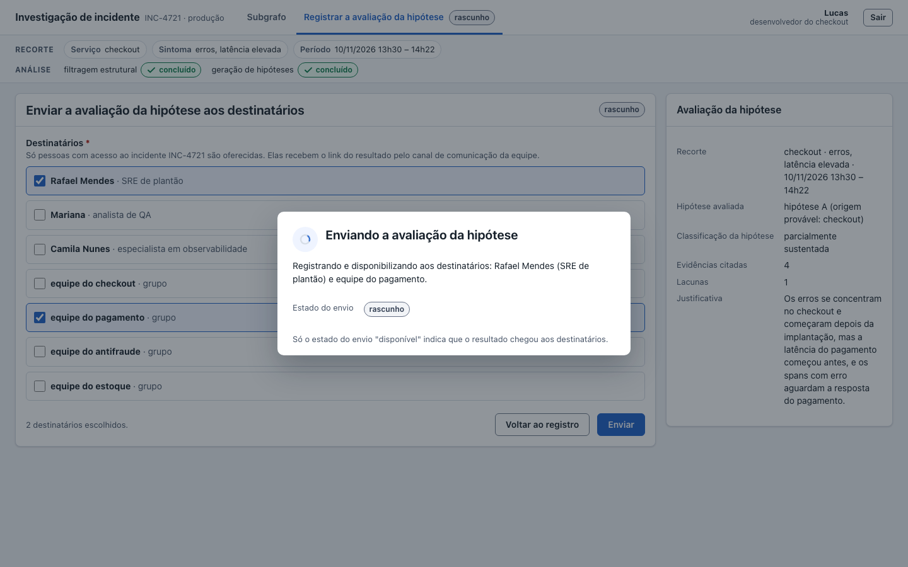

**Objetivo do usuário:** enviar o resultado aos destinatários (O16): acompanhar o registro e a disponibilização da avaliação da hipótese, cujo estado do envio continua "rascunho" até o fim do processo.

**Signos principais:** estado do envio (rascunho).

**Origem no MoLIC:** M01, processo do envio, depois de `u: confirmar` ou de `u: repetir o envio`; mesmo processo em M02, M03 e M04.

### F07R — Repetir o envio

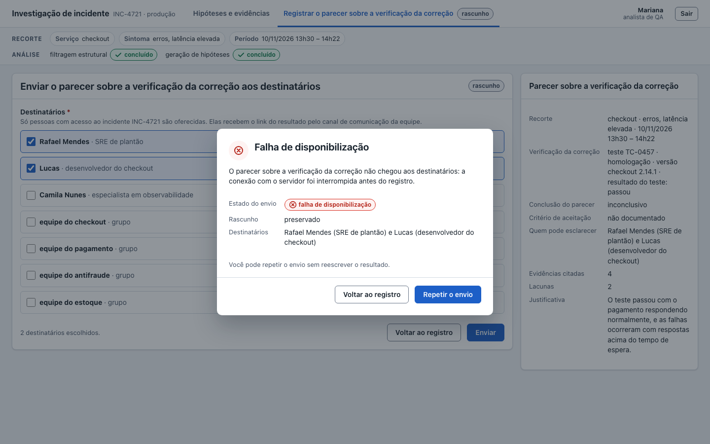

**Objetivo do usuário:** enviar o resultado aos destinatários (O16): perceber que o parecer sobre a verificação da correção não ficou disponível, conferir a causa e repetir o envio sem reescrever o parecer.

**Signos principais:** estado do envio (falha de disponibilização), destinatários, rascunho preservado, parecer sobre a verificação da correção.

**Origem no MoLIC:** M02, processo do envio, `[RA] d: falha de disponibilização; rascunho preservado` e cena de recuperação apoiada `repetir o envio`, diálogo `conferir o envio {d: estado do envio}`, fala `u: repetir o envio`; mesma ruptura em M01, M03 e M04. `Voltar ao registro` realiza o acesso ubíquo `u: registrar …` do fluxo.

### F07S — Envio disponível

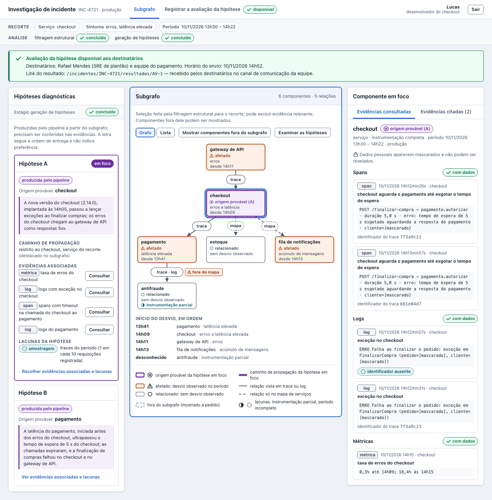

**Objetivo do usuário:** enviar o resultado aos destinatários (O16) e investigar um incidente e comunicar o resultado (O01): saber que a avaliação da hipótese está disponível aos destinatários, com horário do envio (10/11/2026 14h52) e link do resultado, e voltar à investigação ou sair.

**Signos principais:** estado do envio (disponível), horário do envio, link do resultado, destinatários.

**Origem no MoLIC:** M01, barra de fechamento: a fala `d: estado do envio disponível, horário do envio, link do resultado` levada ao acesso ubíquo, como mensagem de sucesso na tela de investigação; mesma fala em M02, M03 e M04.

### F08 — Saída com rascunho preservado

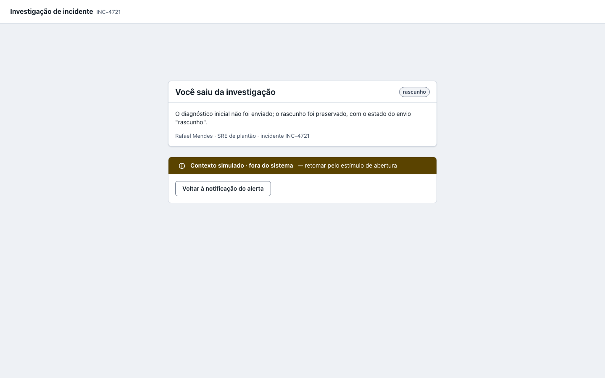

**Objetivo do usuário:** investigar um incidente e comunicar o resultado (O01): sair da investigação antes do envio, sabendo que o diagnóstico inicial não foi enviado e que o rascunho, preservado, pode ser retomado pelo estímulo de abertura.

**Signos principais:** estado do envio (rascunho).

**Origem no MoLIC:** M01–M04, acesso ubíquo `u: sair` até o ponto de encerramento sem `gcc`, pois a meta não foi alcançada; a saída não pede confirmação, porque o rascunho fica preservado. O estímulo de abertura do fluxo, reapresentado como contexto simulado, reabre o incidente sem reiniciar a investigação, e o rascunho é retomado pelo acesso ubíquo `u: registrar …`, como na leitura de [M03](10_molic/m03.md).

### F08S — Saída depois do envio disponível

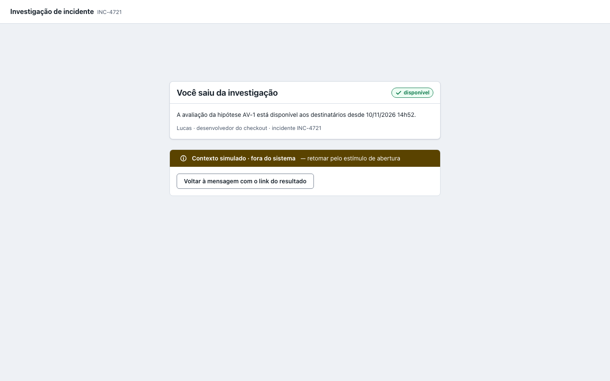

**Objetivo do usuário:** investigar um incidente e comunicar o resultado (O01): encerrar a investigação depois de comunicar a avaliação da hipótese AV-1, disponível desde 10/11/2026 14h52.

**Signos principais:** avaliação da hipótese enviada, horário do envio, estado do envio (disponível).

**Origem no MoLIC:** M01, `gcc: investigar um incidente e comunicar o resultado (O01)` e acesso ubíquo `u: sair` até o ponto de encerramento; mesmo encerramento em M02, M03 e M04; a volta ao estímulo de abertura é a de F08.

### F09 — Comparar hipóteses concorrentes

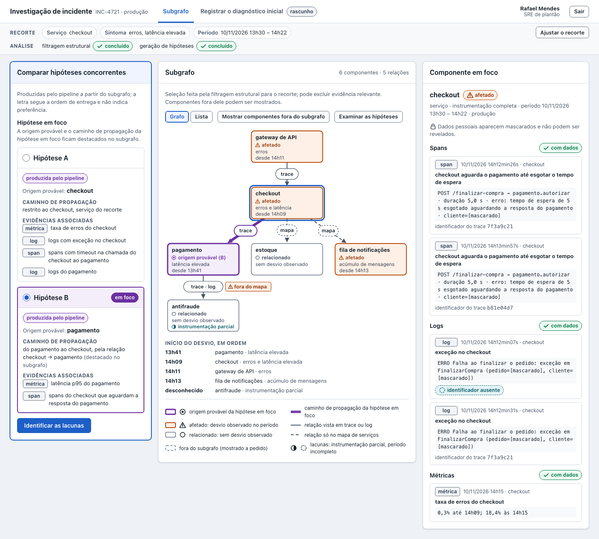

**Objetivo do usuário:** comparar hipóteses concorrentes (O09): trocar a hipótese em foco entre A e B e confrontar a origem provável, o caminho de propagação destacado no subgrafo e as evidências associadas de cada uma, ao lado do início do desvio dos componentes.

**Signos principais:** hipótese em foco, hipótese diagnóstica (identificador, origem provável, caminho de propagação, evidências associadas), subgrafo, estado do componente (origem provável), início do desvio, recorte.

**Origem no MoLIC:** M03, cena `comparar hipóteses concorrentes (O09)`, diálogo `trocar a hipótese em foco {d+u: hipótese em foco; d: origem provável, caminho de propagação, evidências associadas}`; chegada por `u: comparar as hipóteses` (O08) e saída por `u: identificar as lacunas` (volta a O08).

### F10 — Registrar o diagnóstico inicial

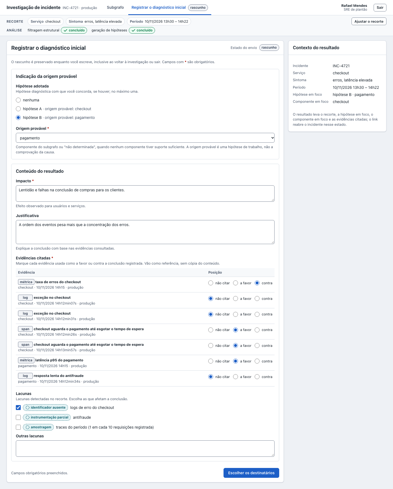

**Objetivo do usuário:** registrar o diagnóstico inicial (O12): indicar a hipótese adotada e a origem provável como hipótese de trabalho e informar impacto, justificativa, evidências citadas a favor e contra e lacunas, com o rascunho preservado, até poder escolher os destinatários.

**Signos principais:** estado do envio (rascunho), hipótese adotada, origem provável, impacto, justificativa, evidências citadas (a favor, contra), lacunas, recorte, hipótese em foco, componente em foco.

**Origem no MoLIC:** M03, cena `registrar o diagnóstico inicial (O12)`: `d: estado do envio`; `indicar a origem provável {d+u: hipótese adotada, *origem provável}`; `informar o conteúdo do resultado {d+u: justificativa, *evidências citadas (a favor, contra), lacunas, *impacto}`; chegada pelo acesso ubíquo `u: registrar o diagnóstico inicial` (`precond: subgrafo disponível`) e saída por `precond: campos obrigatórios preenchidos` e `u: escolher os destinatários`.

### F11 — Registrar a avaliação da hipótese

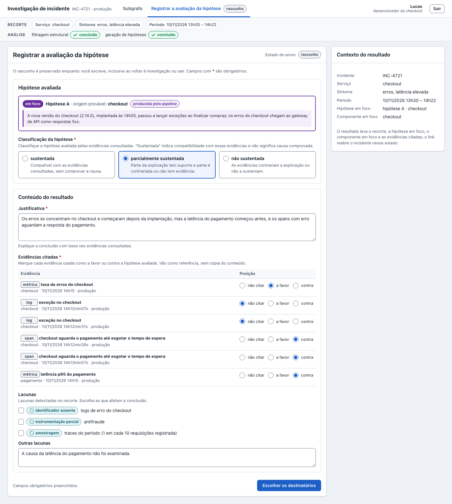

**Objetivo do usuário:** registrar a avaliação da hipótese (O13): classificar a hipótese A como sustentada, parcialmente sustentada ou não sustentada e informar a justificativa, as evidências citadas a favor e contra e as lacunas, com o rascunho preservado.

**Signos principais:** estado do envio (rascunho), hipótese em foco (hipótese avaliada: hipótese A, origem provável checkout, explicação produzida pelo pipeline), classificação da hipótese, justificativa, evidências citadas (a favor, contra), lacunas, recorte, componente em foco.

**Origem no MoLIC:** M01, acesso ubíquo `u: registrar a avaliação da hipótese` e cena `registrar a avaliação da hipótese (O13)`: `d: estado do envio, hipótese em foco`; `classificar a hipótese {d+u: *classificação da hipótese}`; `informar o conteúdo do resultado {d+u: *justificativa, *evidências citadas (a favor, contra), lacunas}`; `precond: campos obrigatórios preenchidos` mantém `Escolher os destinatários` indisponível, com a lista do que falta.

### F12 — Avaliar o alcance da verificação

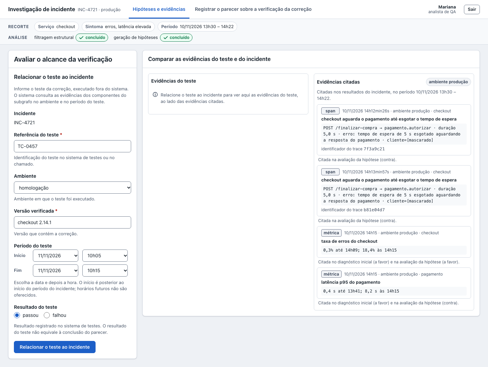

**Objetivo do usuário:** avaliar o alcance da verificação (O10): relacionar ao incidente o teste da correção executado fora do sistema, com referência do teste, ambiente, versão verificada, período do teste e resultado do teste, ao lado das evidências citadas.

**Signos principais:** verificação da correção (incidente, referência do teste, ambiente com valor padrão homologação, versão verificada, período do teste, resultado do teste), evidências citadas, recorte.

**Origem no MoLIC:** M02, cena `avaliar o alcance da verificação (O10)`, diálogo `relacionar o teste ao incidente {d+u: *referência do teste, ambiente(default=homologação), *versão verificada, período do teste, resultado do teste}` e fala `u: relacionar o teste ao incidente`; chegada por `u: avaliar o teste da correção`, a partir de `examinar hipóteses e evidências (O08)`.

### F12C — Consultando as evidências do teste

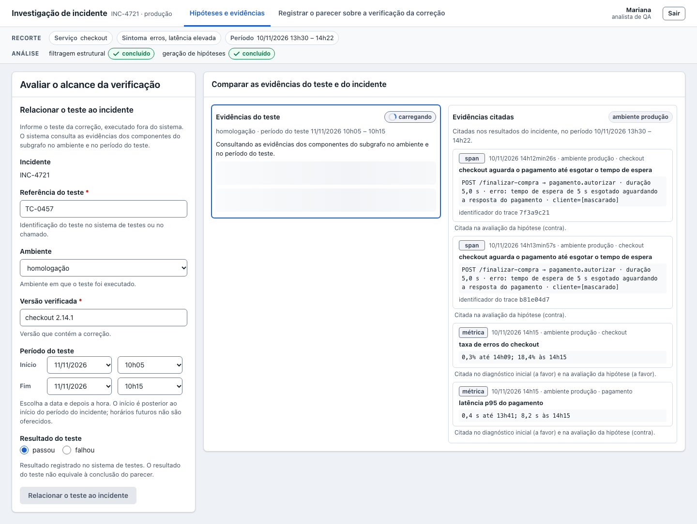

**Objetivo do usuário:** avaliar o alcance da verificação (O10): acompanhar a consulta às evidências dos componentes do subgrafo no ambiente e no período do teste, com os dados do teste preservados no formulário.

**Signos principais:** situação da consulta (carregando), ambiente, período do teste, evidências citadas.

**Origem no MoLIC:** M02, processo da verificação, depois de `u: relacionar o teste ao incidente`.

### F12E — Campo obrigatório vazio

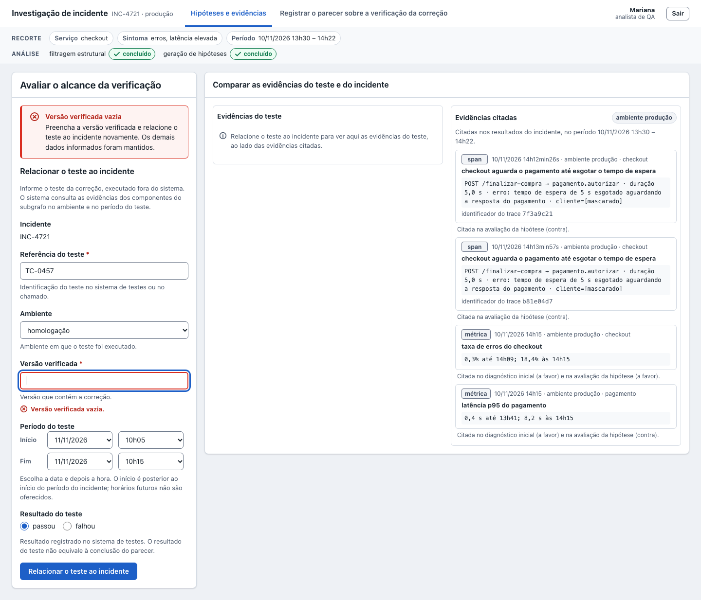

**Objetivo do usuário:** avaliar o alcance da verificação (O10): identificar o campo obrigatório vazio, preenchê-lo e relacionar o teste ao incidente novamente, sem perder os demais dados informados.

**Signos principais:** versão verificada (vazia), referência do teste, ambiente, período do teste, resultado do teste.

**Origem no MoLIC:** M02, processo da verificação, `[RA] d: referência do teste ou versão verificada vazia`, que devolve a conversa a `avaliar o alcance da verificação (O10)` com o campo vazio indicado.

### F12V — Evidências do teste sem dados

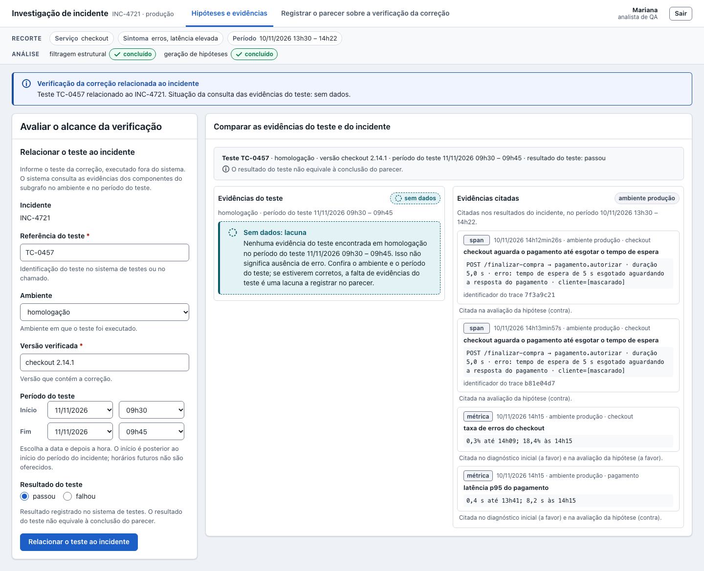

**Objetivo do usuário:** avaliar o alcance da verificação (O10): perceber que nenhuma evidência do teste foi encontrada no ambiente e no período informados, conferir esses dados e, se estiverem corretos, levar a lacuna ao parecer.

**Signos principais:** evidências do teste, situação da consulta (sem dados), tipo de lacuna (sem dados), ambiente, período do teste, resultado do teste.

**Origem no MoLIC:** M02, processo da verificação, saída `d: evidências do teste, com dados ou sem dados` com "sem dados", diálogo `comparar as evidências do teste e do incidente`.

### F12D — Comparação das evidências do teste e do incidente

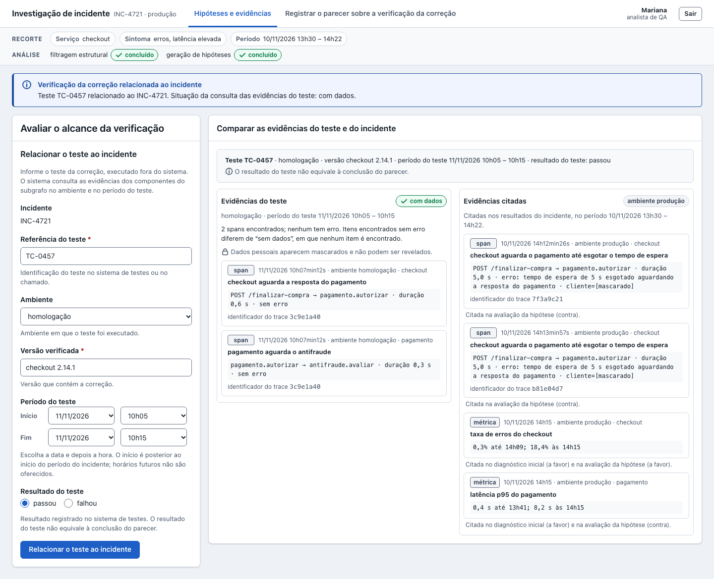

**Objetivo do usuário:** avaliar o alcance da verificação (O10): comparar os spans do teste, em homologação, com as evidências citadas, de produção, e decidir se a condição da falha foi exercitada no teste.

**Signos principais:** evidências do teste, evidências citadas (a favor, contra), situação da consulta (com dados), ambiente, conteúdo, identificador do trace, resultado do teste ("não equivale à conclusão do parecer").

**Origem no MoLIC:** M02, cena `avaliar o alcance da verificação (O10)`, diálogo `comparar as evidências do teste e do incidente {d: evidências do teste, evidências citadas, situação da consulta}` com "com dados", depois do processo da verificação.

### F13 — Registrar o parecer sobre a verificação da correção

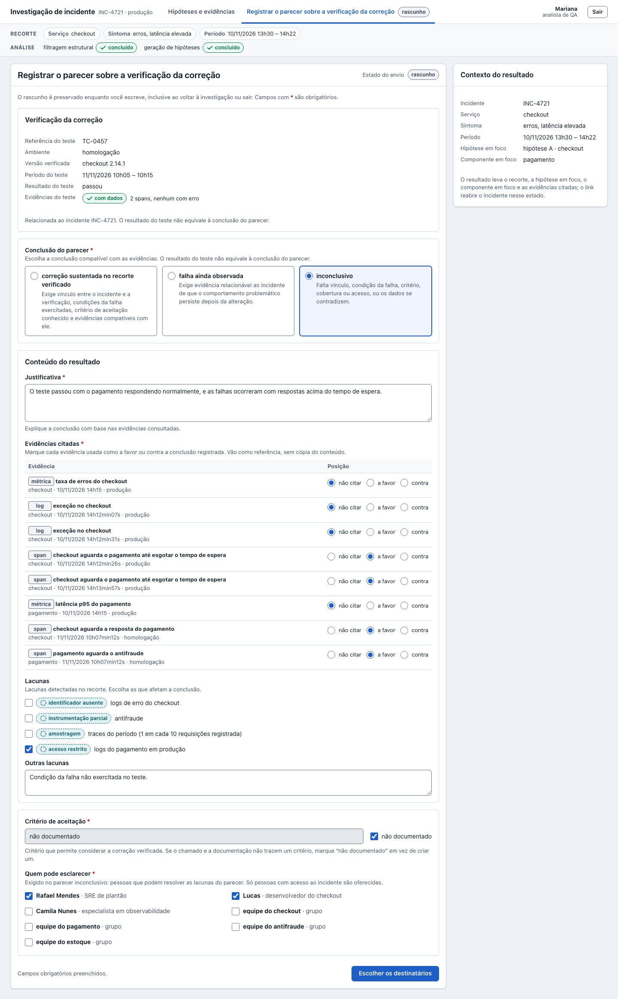

**Objetivo do usuário:** registrar o parecer sobre a verificação da correção (O14): definir a conclusão do parecer e fundamentá-la com justificativa, evidências citadas, lacunas, critério de aceitação e, no parecer inconclusivo, quem pode esclarecer.

**Signos principais:** verificação da correção, estado do envio (rascunho), conclusão do parecer, justificativa, evidências citadas (a favor, contra), lacunas, critério de aceitação, quem pode esclarecer.

**Origem no MoLIC:** M02, cena `registrar o parecer sobre a verificação da correção (O14)`: `d: verificação da correção, estado do envio`, `definir a conclusão do parecer`, `informar o conteúdo do resultado`, `indicar o critério de aceitação`, `indicar quem pode esclarecer (precond: conclusão do parecer inconclusivo)`; acesso ubíquo `u: registrar o parecer sobre a verificação da correção`; saída por `precond: campos obrigatórios preenchidos` e `u: escolher os destinatários`.

### F13A — Confirmar a conclusão do parecer

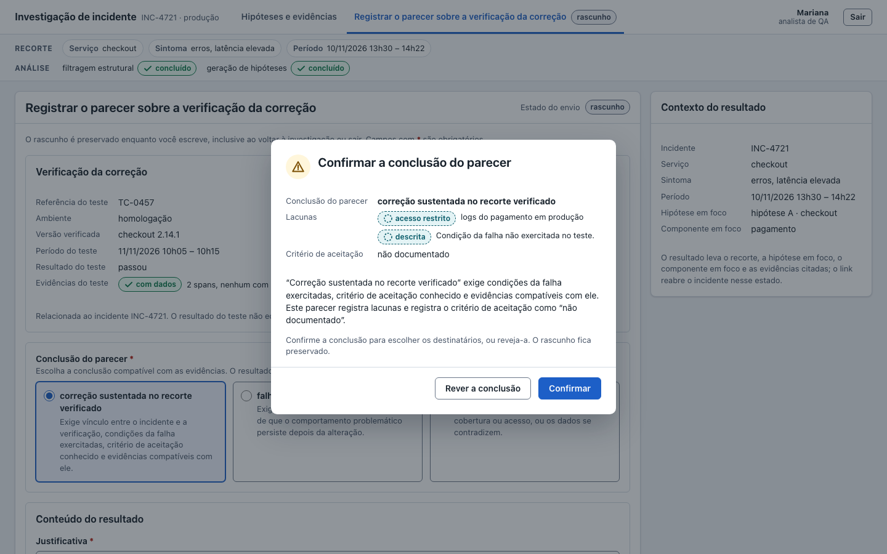

**Objetivo do usuário:** registrar o parecer sobre a verificação da correção (O14): rever ou confirmar a conclusão "correção sustentada no recorte verificado" quando o parecer registra lacunas ou o critério de aceitação "não documentado".

**Signos principais:** conclusão do parecer, lacunas, critério de aceitação.

**Origem no MoLIC:** M02, processo da conclusão do parecer, `[AL] d: lacunas registradas e critério de aceitação` e cena de alerta `confirmar a conclusão do parecer`, falas `u: confirmar` (para `enviar o resultado aos destinatários (O16)`) e `u: rever a conclusão` (para O14).

### F14 — Confirmar as dependências do serviço afetado

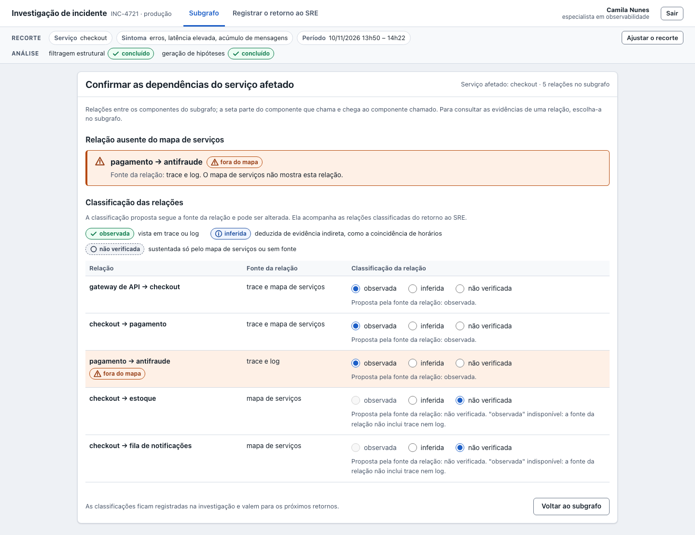

**Objetivo do usuário:** confirmar as dependências do serviço afetado (O06): ver em destaque a relação pagamento → antifraude, vista em trace e log e ausente do mapa de serviços, e manter ou alterar, para cada relação do subgrafo, a classificação proposta pela fonte da relação.

**Signos principais:** relação, fonte da relação, classificação da relação (observada, inferida, não verificada), recorte.

**Origem no MoLIC:** M04, cena `confirmar as dependências do serviço afetado (O06)`, diálogos `verificar relação ausente do mapa {d: relação, fonte da relação}` e `classificar as relações {d+u: classificação da relação(default=proposta pela fonte da relação)}`, alcançada por `u: dependências do serviço afetado` a partir de `inspecionar o subgrafo (O05)`; "observada" indisponível para relação sem trace ou log (PA da classificação da relação). `Voltar ao subgrafo` realiza o acesso ubíquo `u: subgrafo`.

### F15 — Reconstruir a ordem de propagação

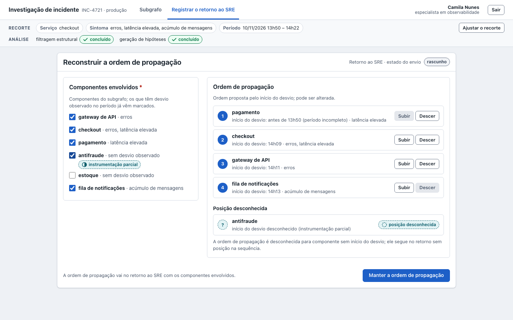

**Objetivo do usuário:** reconstruir a ordem de propagação (O07): incluir o antifraude entre os componentes envolvidos e conferir a ordem proposta pelo início do desvio (pagamento antes de 13h50, checkout 14h09, gateway de API 14h11, fila de notificações 14h13), com o antifraude em posição desconhecida.

**Signos principais:** componentes envolvidos, ordem de propagação, início do desvio, instrumentação, estado do envio.

**Origem no MoLIC:** M04, cena `reconstruir a ordem de propagação (O07)`, diálogo `ordenar os componentes envolvidos {d+u: componentes envolvidos, ordem de propagação(default=início do desvio)}`, alcançada por `u: ordenar os componentes envolvidos` em `registrar o retorno ao SRE (O15)`; volta a O15 por `u: manter a ordem de propagação`.

### F16 — Registrar o retorno ao SRE

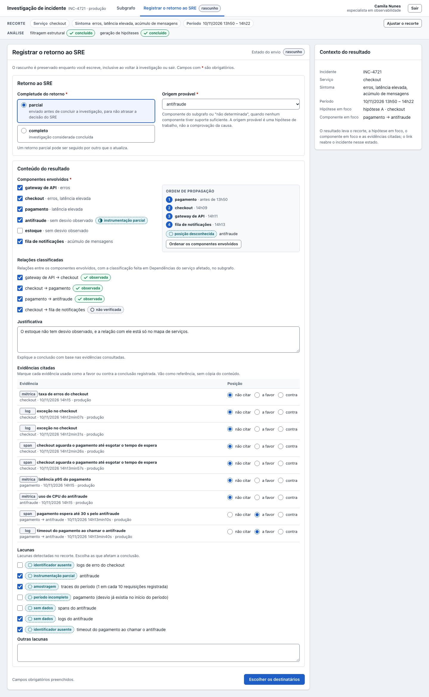

**Objetivo do usuário:** registrar o retorno ao SRE (O15): antes do prazo do SRE, marcar o retorno como parcial, indicar o antifraude como origem provável (hipótese de trabalho) e informar componentes envolvidos, relações classificadas, evidências citadas, lacunas e justificativa.

**Signos principais:** estado do envio (rascunho), completude do retorno, origem provável, componentes envolvidos, ordem de propagação, relações classificadas, justificativa, evidências citadas (a favor, contra), lacunas.

**Origem no MoLIC:** M04, cena `registrar o retorno ao SRE (O15)`: `d: estado do envio`; `marcar a completude do retorno {d+u: *completude do retorno(default=parcial); d: atualização de}`; `indicar a origem provável {d+u: *origem provável}`; `informar o conteúdo do resultado {d+u: justificativa, evidências citadas (a favor, contra), lacunas, *componentes envolvidos, relações classificadas}`; alcançada pelo acesso ubíquo `u: registrar o retorno ao SRE` (`precond: subgrafo disponível`); sai por `u: ordenar os componentes envolvidos` e, com `precond: campos obrigatórios preenchidos`, por `u: escolher os destinatários`.

### F16D — Retorno que atualiza um retorno anterior

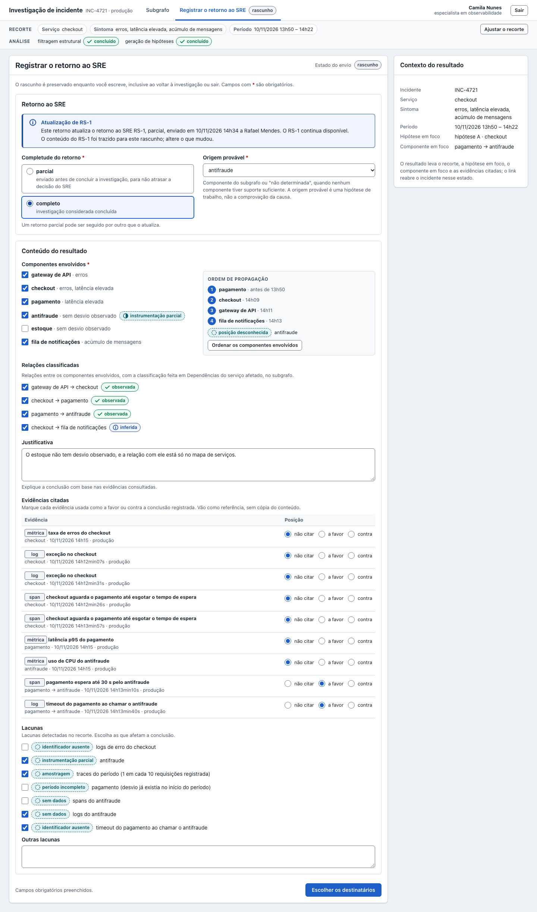

**Objetivo do usuário:** registrar o retorno ao SRE (O15): registrar novo retorno, marcado como completo, que atualiza o retorno parcial RS-1 de 14h34; o RS-1 continua disponível, e seu conteúdo volta ao rascunho, já com a relação checkout → fila de notificações classificada como inferida.

**Signos principais:** atualização de, completude do retorno (completo), estado do envio, origem provável, componentes envolvidos, relações classificadas, evidências citadas, lacunas.

**Origem no MoLIC:** M04, cena `registrar o retorno ao SRE (O15)`, diálogo `marcar a completude do retorno {d+u: *completude do retorno; d: atualização de}` no segundo registro, depois de `d: estado do envio disponível, horário do envio, link do resultado` (14h34) devolver a conversa ao acesso ubíquo.

## Sistema visual e consistência

| Elemento | Regra adotada | Justificativa |
|---|---|---|
| Tipografia | Fonte sem serifa do sistema operacional em todas as telas; conteúdo de evidência e link do resultado em fonte monoespaçada. Escala: título da tela 20 px semi-negrito; títulos de painel, cartão e seção 16 px; título de diálogo 20 px; texto corrente, campos e botões 14 px; texto secundário, tabelas e nome do componente no subgrafo 13 px; demais textos do subgrafo, etiquetas, legenda e rótulos de campo em caixa alta 12 px, tamanho mínimo; altura de linha 1,45. | Leitura prolongada em tela de 1440 px de largura (Entrega 8); a fonte monoespaçada segue as ferramentas de observabilidade conhecidas pelo público (Entrega 2) e separa o conteúdo da evidência do texto da interface; poucos tamanhos marcam a hierarquia entre tela, painel e detalhe. |
| Cores | Neutros na estrutura: texto #17212B, texto secundário #475467, fundo #EEF1F5, superfície branca; azul #1D5FC7 na ação principal, no foco, na área em uso e na vista selecionada. Cor por significado, igual em todas as telas: lilás #6B2FA0 para origem provável, hipótese em foco e interpretação do pipeline; azul #1D4E9E para conclusão de pessoa, mensagens de status e relação inferida; laranja #93370D para afetado e "fora do mapa"; cinza #344054 para relacionado, rascunho e relação não verificada; verde-petróleo #0B5D6B, com borda tracejada, para lacuna; verde #067647 para com dados, a favor, disponível e observada; vermelho #B42318 para erro, falha e contra; âmbar #7A4D00 para acesso restrito e aviso; contexto simulado em fundo escuro, com faixa marrom #5A4300. | Uma ação principal por unidade; semântica estável entre os quatro fluxos; evidência observada, interpretação do pipeline e conclusão da pessoa com aparências distintas (MU01, RC03); lacuna e acesso restrito nunca com a aparência de normalidade (MU02, RC04); contraste calculado na verificação de acessibilidade. |
| Componentes | Barra superior fixa com os acessos ubíquos (subgrafo ou hipóteses e evidências; registro do resultado com a etiqueta do estado do envio; Sair) e barra do recorte fixa, com o estado dos dois estágios e Ajustar o recorte (M03, M04); opção indisponível atenuada, com o motivo escrito ao lado; tela de investigação em três painéis (hipóteses, subgrafo, componente em foco); botão principal com fundo azul, secundário com contorno e vista selecionada do alternador Grafo/Lista com fundo azul-claro e borda de 2 px; campos com rótulo visível acima, `*` nos obrigatórios e ajuda abaixo, no elemento que corresponde ao tipo de conteúdo do signo na Entrega 9: seleção simples em lista de seleção ou grupo de opções, seleção múltipla em caixas de seleção, texto em área de texto ou, quando curto, em caixa de texto, intervalo de data e hora em pares de seleção de data e hora e referência em item que leva ao elemento ou o põe em foco; grupos de opções em cartões quando cada valor precisa de explicação (classificação da hipótese, conclusão do parecer, completude do retorno); tabela de evidências citadas com "não citar", "a favor" e "contra"; etiquetas de estado com ícone e texto; cenas de alerta (F01A, F07A e F13A) e a cena repetir o envio (F07R) em diálogo; a cena repetir a consulta (F06R) em bloco próprio no painel do componente em foco, para manter subgrafo, hipóteses e os demais tipos de evidência à vista (Entrega 8); nas cenas de alerta, o foco inicial fica na opção de recuo, e Esc equivale a ela. A mesma fala tem o mesmo rótulo nos quatro fluxos: Solicitar a análise, Cancelar a análise, Repetir a consulta, Escolher os destinatários, Enviar, Confirmar, Alterar os destinatários, Repetir o envio, Sair. | Passagem do MoLIC para a interface (acesso ubíquo em navegação persistente, cena em unidade, diálogo em grupo de elementos, fala do usuário em controle, expressão de cada signo pelo tipo de conteúdo); princípios de consistência e padronização e de controle e liberdade; padrões das ferramentas de observabilidade, como mapa de dependências com serviço focal e painel lateral do componente (Entrega 2, RC01, RC02). |
| Feedback | Ação frequente com resultado esperado (abrir cartão, trocar aba, pôr componente em foco, mostrar componentes fora do subgrafo): mudança no próprio elemento. Processos (análise, consulta, verificação da correção, envio): estado por extenso e indicador de andamento, sem porcentagem. Fim de estágio e envio disponível: mensagem de status ou de sucesso no topo da unidade de destino, o envio com horário e link do resultado. Ruptura recuperável: mensagem com a causa, o que foi preservado e a ação (Repetir…). Sem dados e acesso restrito: mensagem de lacuna, com o que fazer. Ação de risco: cena de alerta com o que será substituído ou enviado. | Visibilidade e reconhecimento (resposta sutil para ação frequente e destacada para ação infrequente e de grande consequência); projeto para erros (o que ocorreu, consequência e como reverter); regra de fechamento: só "disponível" indica que o resultado chegou aos destinatários (Entrega 8); MU03 e RC04. |

## Verificação de acessibilidade básica

Nas 42 telas e estados do catálogo foram verificados os critérios da WCAG 2.2 citados na Entrega 8 (1.1.1, 1.4.1, 1.4.3 e 1.4.11), o indicador de foco desenhado e o tamanho do alvo. Como na Entrega 8, o acesso por teclado (2.1.1) é requisito da implementação e não é verificável no protótipo; a linha desse critério registra o que as telas preveem. As razões de contraste foram calculadas pela fórmula de luminância relativa da WCAG.

| Critério (WCAG 2.2) | O que foi verificado nas telas | Resultado |
|---|---|---|
| 1.1.1 Conteúdo não textual | Cada componente e cada relação do subgrafo têm rótulo textual com nome, estado do componente, desvio observado, início do desvio e instrumentação, ou fonte da relação; o subgrafo tem resumo textual, e a vista Lista apresenta componentes e relações em tabelas, com os mesmos controles; os ícones acompanham sempre um texto. | atendido |
| 1.4.1 Uso de cor | Estado do componente, estado do estágio, situação da consulta, classificação da relação, posição da evidência citada e estado do envio são sempre indicados por texto, e os quatro primeiros também por ícone; relação só no mapa de serviços em traço tracejado e componente fora do subgrafo em borda tracejada; lacunas com borda tracejada e ícone pontilhado; campo vazio indicado por texto e ícone. | atendido |
| 1.4.3 Contraste (mínimo) | Pares de texto e fundo da tabela abaixo: menor razão 5,09:1 (botão do contexto simulado), seguida de 5,40:1 (verde sobre o fundo de sucesso). | todas as razões ≥ 4,5:1; o texto de opções indisponíveis fica fora do critério |
| 1.4.11 Contraste não textual | Borda de campo 4,54:1; contorno de foco 5,98:1 sobre branco e 5,42:1 sobre o fundo do painel em uso; bordas dos componentes no subgrafo de 4,71:1 a 8,27:1; relações 7,69:1. | todas as razões ≥ 3:1 |
| 2.1.1 Teclado | Previsto nas telas: componentes e relações do subgrafo operados como botões, com a vista Lista como alternativa à manipulação direta; abas e grupos de opções com as setas; caixas de seleção com Espaço; campos alcançados pelo Tab na ordem visual. Ao abrir uma tela, o foco vai para o título da tela ou da área ativa; nas cenas de alerta, o foco inicial fica na opção de recuo, não sai do diálogo, e Esc equivale a essa opção; o controle em foco não fica sob as barras fixas. | requisito da implementação (Entrega 8), não verificado no protótipo |
| 2.4.7 Foco visível | Contorno azul de 3 px desenhado para todos os controles; componente e relação em foco com borda azul. | atendido |
| 2.5.8 Tamanho do alvo (mínimo) | Medidos os controles das 42 telas e estados: o menor alvo é o rótulo de uma relação no subgrafo, com 25,9 px de altura; botões pequenos têm 28 px de altura, e caixas de seleção e opções de 18 px têm o rótulo como área de clique, com pelo menos 28 px de altura. | todos os alvos ≥ 24 × 24 px |

| Par de cores | Uso | Razão | Critério |
|---|---|---|---|
| #17212B sobre #FFFFFF | texto corrente | 16,29:1 | 1.4.3 |
| #17212B sobre #EEF1F5 | texto sobre o fundo da página | 14,38:1 | 1.4.3 |
| #475467 sobre #FFFFFF | texto secundário | 7,69:1 | 1.4.3 |
| #475467 sobre #F7F9FB | texto secundário na barra do recorte e em cabeçalhos | 7,28:1 | 1.4.3 |
| #FFFFFF sobre #1D5FC7 | botão principal | 5,98:1 | 1.4.3 |
| #1D5FC7 sobre #EFF4FF | título do painel em uso e vista selecionada | 5,42:1 | 1.4.3 |
| #6B2FA0 sobre #F4EEFB | origem provável e "produzida pelo pipeline" | 7,27:1 | 1.4.3 |
| #FFFFFF sobre #6B2FA0 | etiqueta "em foco" | 8,27:1 | 1.4.3 |
| #93370D sobre #FEF0E6 | afetado e "fora do mapa" | 6,74:1 | 1.4.3 |
| #344054 sobre #F2F4F7 | relacionado, rascunho e não verificada | 9,49:1 | 1.4.3 |
| #0B5D6B sobre #E3F3F5 | lacuna | 6,59:1 | 1.4.3 |
| #067647 sobre #ECFDF3 | com dados, a favor, disponível e observada | 5,40:1 | 1.4.3 |
| #B42318 sobre #FEF3F2 | erro, falha e contra | 6,05:1 | 1.4.3 |
| #1D4E9E sobre #EFF4FF | status, conclusão de pessoa e inferida | 7,23:1 | 1.4.3 |
| #7A4D00 sobre #FFF6DB | acesso restrito e aviso | 6,73:1 | 1.4.3 |
| #17212B sobre os fundos das mensagens | texto das mensagens de status, sucesso, erro, aviso e lacuna | 14,28:1 a 15,45:1 | 1.4.3 |
| #FFFFFF sobre #5A4300 | faixa do contexto simulado | 9,39:1 | 1.4.3 |
| #F5F7FA sobre #1E2733 | texto do contexto simulado | 14,04:1 | 1.4.3 |
| #C3CCD8 sobre #1E2733 | texto secundário do contexto simulado | 9,29:1 | 1.4.3 |
| #0B1220 sobre #3B82F6 | botão do contexto simulado | 5,09:1 | 1.4.3 |
| #6B7789 sobre #FFFFFF | borda de campo | 4,54:1 | 1.4.11 |
| #1D5FC7 sobre #FFFFFF | contorno de foco e borda da vista selecionada | 5,98:1 | 1.4.11 |
| #B54708 sobre #FFFFFF e sobre #FEF0E6 | borda do componente afetado | 5,43:1 e 4,86:1 | 1.4.11 |
| #667085 sobre #FFFFFF e sobre #F7F9FB | borda do componente relacionado e do componente fora do subgrafo | 4,97:1 e 4,71:1 | 1.4.11 |
| #6B2FA0 sobre #FFFFFF | borda da origem provável e caminho de propagação | 8,27:1 | 1.4.11 |
| #475467 sobre #FFFFFF | relações no subgrafo | 7,69:1 | 1.4.11 |

## Checklist

- [ ] Link do Figma está acessível.
- [x] Há screenshots representativos no repositório.
- [x] Todos os MoLIC relevantes estão cobertos.
- [x] Estados de erro, feedback e recuperação foram prototipados.
- [x] Terminologia/signos são consistentes com Entrega 9.
- [x] Componentes equivalentes se comportam de forma consistente.
- [ ] Fluxos críticos são clicáveis do início ao fim.
- [ ] O protótipo está pronto para inspeção e testes, sem “links mortos” nas tarefas avaliadas.
- [x] Dashboards, relatórios, históricos, filtros, administração e CRUDs presentes possuem justificativa rastreável.
- [x] Estados de vazio, processamento, erro e recuperação foram considerados quando pertinentes.
- [x] Resultados técnicos são apresentados de forma interpretável para o perfil de usuário.
- [x] A equipe distingue no protótipo o que é interação simulada e o que é funcionalidade técnica realmente integrada, quando necessário.

## Referências

- **CC8122 — MoLIC, parte C.** Material de aula disponibilizado na disciplina, baseado em Barbosa e Silva (2010), consultado em 17/11/2026. Estilos de interação, representações da interface com o usuário e passagem da interação para o design de interface.
- **CC8122 — Princípios e diretrizes para o design de IHC.** Material de aula disponibilizado na disciplina, baseado em Barbosa e Silva (2010), consultado em 17/11/2026. Princípios de design, padrões, guias de estilo, *wireframe*, protótipo e *mockup*.
- BARBOSA, Simone D. J.; SILVA, Bruno S. **Interação Humano-Computador**. Rio de Janeiro: Elsevier/Campus, 2010.
- W3C. **Web Content Accessibility Guidelines (WCAG) 2.2**. W3C Recommendation, 12 dez. 2024. Disponível em: [https://www.w3.org/TR/WCAG22/](https://www.w3.org/TR/WCAG22/). Acesso em: 17 nov. 2026.
- Documentos do projeto: [Entrega 10](10_molic.md) ([M01](10_molic/m01.md), [M02](10_molic/m02.md), [M03](10_molic/m03.md), [M04](10_molic/m04.md)), [Entrega 9](09_modelo_conceitual.md), [Entrega 8](08_engenharia_usabilidade.md), [Entrega 2](02_analise_concorrencia.md) e [matriz de rastreabilidade](../RASTREABILIDADE.md).
