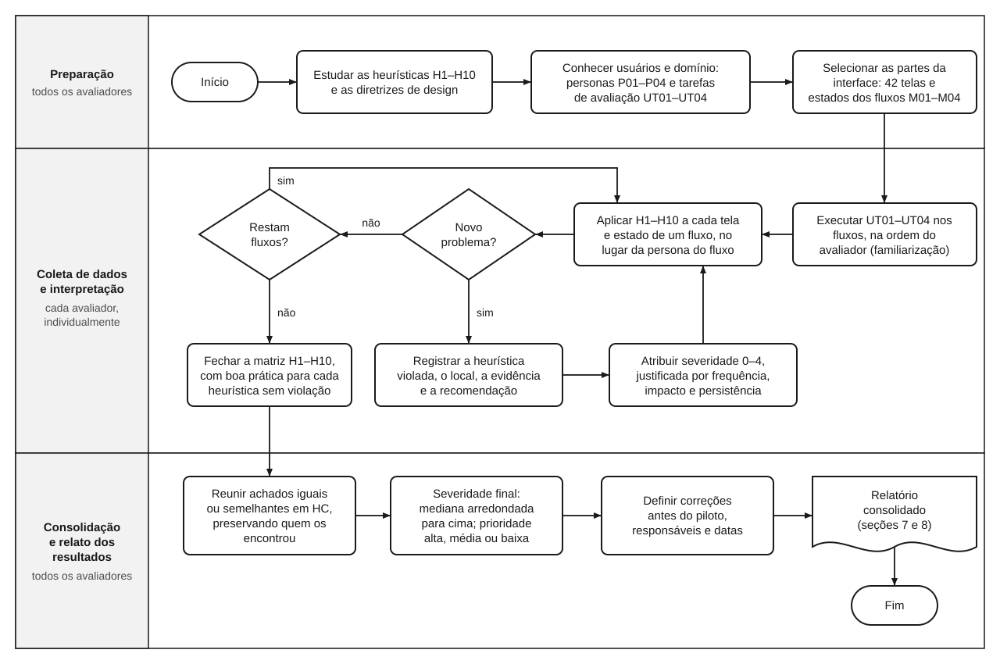

# Entrega 13 — Avaliação de IHC por inspeção heurística

[← Início do projeto](../README.md) · [Entrega 12 — Planejamento da avaliação](12_planejamento_avaliacao.md) · [Entrega 14 — Avaliação por observação de usuários](14_observacao_usuario.md)

**Data:** 18/11/2026

**Status:** 🟩 concluída

**Responsabilidade:** 1 avaliação completa por integrante, sobre todas as telas/estados relevantes do projeto.

## Objetivo e entradas

Encontrar problemas de usabilidade por inspeção sistemática da interface com as **10 heurísticas de Nielsen**. Cada avaliador trabalha individualmente primeiro; depois a equipe consolida problemas duplicados e prioridades.

A **avaliação heurística** é um método de inspeção: sem a participação de usuários, o avaliador se coloca no lugar de quem usa o sistema e examina a interface diante de um conjunto de heurísticas, isto é, de características desejáveis da interação e da interface. Cada problema registra a heurística violada, o local (tela e elemento de interface), a gravidade de 0 a 4 com justificativa e a recomendação, no formato dos slides de avaliação por inspeções e do Modelo 02 da disciplina, com a captura da tela e o problema destacado. Os avaliadores registraram só problemas encontrados no protótipo. A matriz de cobertura H1–H10 de cada um mostra que as dez heurísticas foram aplicadas, e cada heurística sem violação recebeu um exemplo didático de boa prática, como pede o modelo da entrega para a atividade de uso das heurísticas dos slides.

As entradas vêm da [Entrega 12](12_planejamento_avaliacao.md): a etapa C do DECIDE, o cronograma, as perguntas QA15–QA20, as tarefas de avaliação UT01–UT04 e a regra de priorização da seção F. Vêm também o protótipo da [Entrega 11](11_figma.md), com a [cobertura dos fluxos MoLIC](11_figma.md#cobertura-molic--figma) e o [catálogo de 42 telas e estados](11_figma.md#catálogo-de-telasestados); as metas MU01–MU14 e o ciclo de Mayhew da [Entrega 8](08_engenharia_usabilidade.md); as personas P01–P04 da [Entrega 3](03_personas_contexto_jornada.md); e o [formulário de avaliação heurística](../instrumentos/formulario_heuristica_modelo.md). Os problemas consolidados que afetam as telas de cada fluxo estão na coluna "Heurística / problema" das linhas R01–R04 da [matriz de rastreabilidade](../RASTREABILIDADE.md#3-rastreabilidade-entre-contribuição-técnica-necessidades-e-artefatos).

## 1. Heurísticas adotadas

São as heurísticas de Nielsen, com o nome do modelo da entrega e a pergunta de verificação do Modelo 02, na redação do formulário da Entrega 12. As diretrizes dos slides de princípios e diretrizes de design (visibilidade e reconhecimento, correspondência com as expectativas dos usuários, equilíbrio entre controle e liberdade, consistência e padronização, projeto para erros, promoção da eficiência, conteúdo relevante e expressão adequada, antecipação) apoiaram o julgamento de cada heurística.

1. Visibilidade do status do sistema: os usuários são mantidos informados sobre o progresso do sistema, com feedback apropriado e em tempo razoável?
2. Compatibilidade entre o sistema e o mundo real: o sistema usa conceitos e linguagem familiares ao usuário, em vez de termos orientados ao sistema, e exibe as informações em ordem lógica e natural?
3. Controle e liberdade do usuário: os usuários podem fazer o que querem quando querem e sair de um estado indesejado sem percorrer um diálogo extenso?
4. Consistência e padrões: objetos e ações têm o mesmo significado ou efeito em diferentes situações?
5. Prevenção de erros: os usuários podem cometer erros que um bom projeto poderia prevenir?
6. Reconhecimento em vez de memorização: objetos, ações e opções estão visíveis, ou o usuário precisa lembrar informações de uma parte do sistema para outra?
7. Flexibilidade e eficiência de uso: as tarefas são eficientes e se adaptam às ações mais frequentes do usuário, por exemplo com atalhos?
8. Estética e design minimalista: os diálogos contêm informações irrelevantes ou raramente necessárias?
9. Ajudar usuários a reconhecer, diagnosticar e recuperar-se de erros: as mensagens de erro usam linguagem simples, sem códigos, descrevem exatamente o problema e sugerem uma solução?
10. Ajuda e documentação: há informações de ajuda apropriadas, fáceis de encontrar e focadas nas tarefas do usuário?

## Cobertura especial para interfaces administrativas e analíticas

A disciplina pede que a inspeção não se limite às telas principais. A tabela indica, para cada item a inspecionar, se ele existe no protótipo e em que telas ou estados foi examinado.

| Item a inspecionar | No protótipo |
|---|---|
| Dashboard em estados normal, vazio e erro | Não existe: painel geral e lista de incidentes ficam fora do sistema interativo (Entrega 8, delimitação; Entrega 11, objetivo e entradas). |
| Filtros sem resultado e filtros combinados | Não há filtros. O equivalente é a delimitação por serviço, sintoma e período (F01, F01A); um recorte cujo serviço não tem desvio observado leva a nenhuma hipótese gerada (F02V). |
| Relatórios e exportação | Não existem. O resultado comunicado (diagnóstico inicial, avaliação da hipótese, parecer ou retorno ao SRE) foi examinado no registro (F10, F11, F13, F16, F16D) e no envio (F07 a F07S). |
| Histórico/listas longas | Não existem: o incidente simulado tem até nove componentes e até cinco registros por consulta, e a paginação ficou fora do protótipo (Entrega 11). |
| Formulários CRUD (criação, edição, exclusão, validação) | Não há CRUD. Há formulários de delimitação (F01), de verificação da correção (F12) e de registro (F10, F11, F13, F16, F16D), sem exclusão; o registro fica em rascunho até o envio, e a validação aparece em F12E e no botão "Escolher os destinatários", indisponível enquanto faltam campos obrigatórios. |
| Alteração de perfil/permissão | Não existe; a permissão aparece só como acesso restrito a um trecho das evidências (F06P). |
| Confirmações de ações destrutivas | Há confirmações antes de ações de risco: o ajuste do recorte, que substitui subgrafo e hipóteses (F01A), o envio (F07A) e a conclusão "correção sustentada no recorte verificado" com lacunas ou critério de aceitação não documentado (F13A). |
| Processamento/loading/progresso | F05, F02C, F06C, F07C e F12C. |
| Falha e recuperação | F01E, F01X, F02V, F06V, F06P, F06R, F06S, F07R, F12E, F12V e a saída com rascunho preservado (F08). |
| Comparação de resultados | F09 (hipóteses A e B) e F12D (evidências do teste e do incidente). |
| Mensagens de termos técnicos, métricas e recomendações | Hipóteses, evidências (spans, logs e métricas), estados dos componentes e das consultas e classificação das relações, em todas as telas da investigação e em F09, F12D, F14 e F15. O sistema não faz recomendações além das propostas que a pessoa confere: hipóteses diagnósticas apresentadas como interpretação do pipeline, classificação proposta pela fonte da relação (F14) e ordem proposta pelo início do desvio (F15). |
| Ajuda/documentação contextual | Textos de ajuda dos campos (F01, F10 a F16), legenda do subgrafo (F02 e seus estados), explicação de cada valor nos cartões de opção (F11, F13, F16) e legenda da classificação das relações (F14); não há documentação à parte. |

Como pede a disciplina para TCCs técnicos, a inspeção observou em especial se a interface comunica o estado da análise, das consultas e do envio (H1, QA15) e se traduz subgrafo, hipóteses e evidências para o vocabulário de cada perfil (H2, QA16).

## 2. Escopo da inspeção

| Item | Definição |
|---|---|
| Versão avaliada | Protótipo da Entrega 11, versão do catálogo de telas de 17/11/2026, com o link registrado na [Entrega 11](11_figma.md#link-do-figma). |
| Telas/estados | As 42 telas e estados do catálogo da Entrega 11, listados abaixo, inclusive os estados de carregamento, sem dados, erro, permissão, recuperação, cancelamento, alerta, sucesso e detalhe. |
| Fluxos | M01, M02, M03 e M04, cada um com o caminho principal e os estados de erro e de recuperação da [cobertura dos fluxos MoLIC](11_figma.md#cobertura-molic--figma), percorridos com a tarefa de avaliação do fluxo (UT01 a UT04, Entrega 12). |
| Dispositivo/viewport | Computador, com viewport de 1440 × 900 px: 1440 px é a largura das telas da Entrega 11, e as capturas de evidência mostram a janela visível nesse tamanho. |
| Avaliadores | A01 — Gabriel Lovato — 22.123.004-8; A02 — Willian Verenka Oliveira Silva — 22.124.081-5; A03 — Théo Zago Zimmermann — 22.123.035-2; A04 — João Sitta Giopatto — 22.123.054-3. |

Telas e estados examinados, com os nomes do catálogo da Entrega 11 e os fluxos em que cada um aparece (coluna "Tela(s) Figma" das linhas R01–R04 da matriz de rastreabilidade). Os sufixos indicam o estado: C, carregamento ou processamento; V, sem dados ou nenhum resultado; E, erro informado na própria unidade; P, permissão insuficiente; R, recuperação apoiada; S, sucesso; X, cancelamento; A, alerta antes de uma ação de risco; D, detalhe mostrado a pedido. F00A, F00B e F00C são os estímulos de abertura, contexto simulado fora do sistema.

| ID | Nome no catálogo | Fluxos |
|---|---|---|
| [F00A](11_figma.md#f00a--notificação-do-alerta-de-origem) | Notificação do alerta de origem | M03 e M04 |
| [F00B](11_figma.md#f00b--mensagem-com-o-link-do-diagnóstico-inicial) | Mensagem com o link do diagnóstico inicial | M01 |
| [F00C](11_figma.md#f00c--chamado-da-correção-com-o-link-da-avaliação-da-hipótese) | Chamado da correção com o link da avaliação da hipótese | M02 |
| [F01](11_figma.md#f01--delimitar-o-incidente) | Delimitar o incidente | M03 e M04 |
| [F01A](11_figma.md#f01a--confirmar-o-ajuste-do-recorte) | Confirmar o ajuste do recorte | M03 e M04 |
| [F01E](11_figma.md#f01e--falha-no-estágio-recorte-preservado) | Falha no estágio, recorte preservado | M03 e M04 |
| [F01X](11_figma.md#f01x--análise-cancelada-recorte-preservado) | Análise cancelada, recorte preservado | M03 e M04 |
| [F05](11_figma.md#f05--acompanhar-a-análise) | Acompanhar a análise | M03 e M04 |
| [F02](11_figma.md#f02--subgrafo) | Subgrafo | M01, M03 e M04 |
| [F02C](11_figma.md#f02c--subgrafo-disponível-geração-de-hipóteses-em-andamento) | Subgrafo disponível, geração de hipóteses em andamento | M03 e M04 |
| [F02V](11_figma.md#f02v--nenhuma-hipótese-gerada) | Nenhuma hipótese gerada | M03 e M04 |
| [F02D](11_figma.md#f02d--componentes-fora-do-subgrafo-mostrados) | Componentes fora do subgrafo mostrados | M01, M03 e M04 |
| [F03](11_figma.md#f03--hipóteses-e-evidências) | Hipóteses e evidências | M01–M04 |
| [F03D](11_figma.md#f03d--evidências-citadas) | Evidências citadas | M01 e M02 |
| [F04](11_figma.md#f04--incidente-reaberto-pelo-link-do-resultado) | Incidente reaberto pelo link do resultado | M01 e M02 |
| [F06](11_figma.md#f06--evidências-do-componente-em-foco-com-dados) | Evidências do componente em foco: com dados | M01–M04 |
| [F06C](11_figma.md#f06c--consulta-em-andamento) | Consulta em andamento | M01–M04 |
| [F06V](11_figma.md#f06v--sem-dados-lacuna) | Sem dados (lacuna) | M01–M04 |
| [F06P](11_figma.md#f06p--acesso-restrito) | Acesso restrito | M01, M02 e M04 |
| [F06R](11_figma.md#f06r--repetir-a-consulta) | Repetir a consulta | M01–M04 |
| [F06S](11_figma.md#f06s--consulta-repetida-com-dados) | Consulta repetida com dados | M01–M04 |
| [F07](11_figma.md#f07--escolher-os-destinatários) | Escolher os destinatários | M01–M04 |
| [F07A](11_figma.md#f07a--confirmar-os-destinatários) | Confirmar os destinatários | M01–M04 |
| [F07C](11_figma.md#f07c--envio-em-andamento) | Envio em andamento | M01–M04 |
| [F07R](11_figma.md#f07r--repetir-o-envio) | Repetir o envio | M01–M04 |
| [F07S](11_figma.md#f07s--envio-disponível) | Envio disponível | M01–M04 |
| [F08](11_figma.md#f08--saída-com-rascunho-preservado) | Saída com rascunho preservado | M01–M04 |
| [F08S](11_figma.md#f08s--saída-depois-do-envio-disponível) | Saída depois do envio disponível | M01–M04 |
| [F09](11_figma.md#f09--comparar-hipóteses-concorrentes) | Comparar hipóteses concorrentes | M03 |
| [F10](11_figma.md#f10--registrar-o-diagnóstico-inicial) | Registrar o diagnóstico inicial | M03 |
| [F11](11_figma.md#f11--registrar-a-avaliação-da-hipótese) | Registrar a avaliação da hipótese | M01 |
| [F12](11_figma.md#f12--avaliar-o-alcance-da-verificação) | Avaliar o alcance da verificação | M02 |
| [F12C](11_figma.md#f12c--consultando-as-evidências-do-teste) | Consultando as evidências do teste | M02 |
| [F12E](11_figma.md#f12e--campo-obrigatório-vazio) | Campo obrigatório vazio | M02 |
| [F12V](11_figma.md#f12v--evidências-do-teste-sem-dados) | Evidências do teste sem dados | M02 |
| [F12D](11_figma.md#f12d--comparação-das-evidências-do-teste-e-do-incidente) | Comparação das evidências do teste e do incidente | M02 |
| [F13](11_figma.md#f13--registrar-o-parecer-sobre-a-verificação-da-correção) | Registrar o parecer sobre a verificação da correção | M02 |
| [F13A](11_figma.md#f13a--confirmar-a-conclusão-do-parecer) | Confirmar a conclusão do parecer | M02 |
| [F14](11_figma.md#f14--confirmar-as-dependências-do-serviço-afetado) | Confirmar as dependências do serviço afetado | M04 |
| [F15](11_figma.md#f15--reconstruir-a-ordem-de-propagação) | Reconstruir a ordem de propagação | M04 |
| [F16](11_figma.md#f16--registrar-o-retorno-ao-sre) | Registrar o retorno ao SRE | M04 |
| [F16D](11_figma.md#f16d--retorno-que-atualiza-um-retorno-anterior) | Retorno que atualiza um retorno anterior | M04 |

## 3. Procedimento individual

Cada avaliador deve:

1. percorrer os fluxos/telas ao menos uma vez para familiarização;
2. inspecionar novamente aplicando sistematicamente H1–H10;
3. registrar cada problema com evidência e contexto;
4. atribuir severidade **depois de compreender bem o problema**, justificando a decisão;
5. não discutir achados com os demais antes de terminar a inspeção individual, quando o objetivo for preservar independência.

### Escala de severidade (0–4)

| Grau | Interpretação |
|---:|---|
| 0 | não é considerado problema de usabilidade |
| 1 | problema cosmético; corrigir se houver tempo |
| 2 | problema menor; baixa prioridade |
| 3 | problema maior; alta prioridade |
| 4 | catástrofe de usabilidade; correção imperativa antes de disponibilizar |

Ao justificar, considere **frequência, impacto e persistência** do problema no contexto real de uso.

### Processo/Fluxograma da avaliação heurística

Na Entrega 13, o procedimento seguiu as fases da avaliação heurística dos slides (preparação, coleta de dados, interpretação, consolidação e relato dos resultados), o passo a passo do Modelo 02 e a etapa C do DECIDE da Entrega 12, como mostra a Figura 1. A parte iterativa está na coleta e na interpretação: a cada problema registrado, o avaliador volta à inspeção do fluxo, até não encontrar problema novo (Modelo 02, passo 3). Depois da consolidação, o ciclo continua com as correções e com o teste com usuários (seção 8).

*Figura 1 — Processo da avaliação heurística da Entrega 13, com as fases nas faixas e os responsáveis por fase. Fonte: elaboração da equipe.*

Na preparação, os quatro avaliadores leram as heurísticas e as diretrizes de apoio da seção 1, as personas P01–P04, as tarefas de avaliação UT01–UT04 (Entrega 12, seção D) e o catálogo da Entrega 11, e partiram do mesmo escopo (seção 2). Em 18/11/2026, data registrada nos arquivos individuais, cada avaliador percorreu os quatro fluxos na ordem definida no cronograma da Entrega 12, executando a tarefa de avaliação de cada fluxo pelo caminho principal e abrindo os estados de erro e de recuperação. Depois, percorreu de novo os fluxos, na mesma ordem e um de cada vez, e aplicou H1–H10 a cada tela e estado, no lugar da persona do fluxo. As perguntas QA15–QA20 indicaram onde concentrar a atenção, sem limitar as heurísticas às telas que elas citam.

| Avaliador | Autor do fluxo | Ordem dos fluxos |
|---|---|---|
| A01 — Gabriel Lovato | M01 | M02 → M03 → M04 → M01 |
| A02 — Willian Verenka Oliveira Silva | M02 | M03 → M04 → M01 → M02 |
| A03 — Théo Zago Zimmermann | M03 | M04 → M01 → M02 → M03 |
| A04 — João Sitta Giopatto | M04 | M01 → M02 → M03 → M04 |

Cada problema foi classificado na heurística mais diretamente violada. Um problema repetido em várias telas foi registrado uma vez, com todos os IDs, e problemas diferentes na mesma tela ficaram em linhas separadas. A severidade foi atribuída depois de compreendido o problema, com a justificativa pela frequência (quantos fluxos e perfis passam pela tela e se ela está no caminho principal ou numa ruptura), pelo impacto (se pode impedir a tarefa, levar a erro de interpretação ou só atrasar) e pela persistência, indicando a tarefa de avaliação ou a meta MU afetada quando havia. A evidência de cada violação é a captura da janela visível com o elemento do problema destacado por um contorno magenta, cor que não aparece no sistema visual da Entrega 11, seguida de uma legenda descritiva, como pede a atividade dos slides.

Os avaliadores são os autores do protótipo. Cada um começou por um fluxo de que não é autor, e a inspeção individual terminou antes da consolidação, sem discussão dos achados entre os avaliadores; esses dois cuidados, previstos na etapa C do DECIDE, reduzem o viés de quem avalia o próprio projeto. As condições declaradas da simulação (Entrega 12, "O que está sendo avaliado") não foram registradas como violação: incidente único e fictício, processamento simulado com duração fixa, rupturas programadas, áreas sem resposta fora dos caminhos modelados, texto livre dito em voz alta e contexto simulado fora do sistema. Também ficaram de fora a operação por teclado, requisito da implementação não verificável no protótipo (Entrega 11), e o mérito técnico do pipeline do TCC. A forma como a interface apresenta essas situações foi inspecionada.

## Soluções individuais

Cada avaliador registrou as seções 4 (matriz de cobertura das 10 heurísticas), 5 (declaração de violações) e 6 (boas práticas das heurísticas não violadas) em arquivo próprio na pasta [`13_avaliacao_heuristica/`](13_avaliacao_heuristica/). As capturas estão em [`assets/13_heuristica/`](../assets/13_heuristica/).

| Avaliador | Autor(a) | Violações | Heurísticas sem violação | Status | Avaliação completa |
|---|---|---|---|---|---|
| A01 | Gabriel Lovato — 22.123.004-8 | 11 (V01–V11) | H7, H8 | 🟩 concluída | [Abrir A01](13_avaliacao_heuristica/a01.md) |
| A02 | Willian Verenka Oliveira Silva — 22.124.081-5 | 10 (V01–V10) | H4, H7, H8 | 🟩 concluída | [Abrir A02](13_avaliacao_heuristica/a02.md) |
| A03 | Théo Zago Zimmermann — 22.123.035-2 | 6 (V01–V06) | H7, H8, H9, H10 | 🟩 concluída | [Abrir A03](13_avaliacao_heuristica/a03.md) |
| A04 | João Sitta Giopatto — 22.123.054-3 | 9 (V01–V09) | H3, H4, H7, H8, H10 | 🟩 concluída | [Abrir A04](13_avaliacao_heuristica/a04.md) |

## 7. Consolidação da equipe

Problemas iguais ou muito semelhantes encontrados por avaliadores diferentes devem ser consolidados, preservando quem os encontrou.

Os 36 achados individuais foram reunidos em 21 problemas consolidados, HC01 a HC21, e cada achado está em um único problema, citado como V01(A01). Os achados foram reunidos quando descrevem o mesmo elemento, na mesma situação e com a mesma consequência para a pessoa, ainda que classificados em heurísticas diferentes; nesses casos (HC04 e HC09), a coluna Heurística traz primeiro a heurística dos achados de maior severidade, usada nas contagens da seção 8.

A severidade final segue a seção F da Entrega 12: é a mediana das severidades dadas pelos avaliadores que encontraram o problema, mostradas entre parênteses, arredondada para cima. Nenhuma severidade foi alterada por consenso. A prioridade é alta para 3 e 4, média para 2 e baixa para 0 e 1. O responsável pela correção segue a cobertura dos fluxos da Entrega 11, em que cada fluxo tem como responsável o autor do diagrama MoLIC de origem: o problema em tela de um só fluxo fica com o autor desse fluxo, e o problema em unidade comum a vários fluxos fica com o autor de um deles; a correção é conferida na nova verificação dos caminhos (seção 8). A tabela segue a ordem da severidade final e, na mesma severidade, a das heurísticas.

| ID consolidado | Achados individuais | Heurística | Problema | Severidade final | Prioridade | Responsável pela correção |
|---|---|---|---|---:|---|---|
| HC01 | V08(A01), V01(A04) | H2 | O antifraude, que só tem métrica de CPU (instrumentação parcial), aparece como "relacionado" e "sem desvio observado", com a mesma aparência do estoque, que tem instrumentação completa, e fica na última linha de "Início do desvio, em ordem", com "desconhecido". A lacuna é apresentada como se fosse normalidade. Telas da investigação (F02 e estados, F03, F06 e estados, F09), em M01–M04, e F15, F16 e F16D, em M04. | 3 (2, 3) | alta | João Sitta Giopatto |
| HC02 | V05(A01), V03(A02) | H2 | Com a hipótese B em foco, o caminho de propagação é destacado sobre a seta da relação checkout → pagamento, que aponta do checkout para o pagamento, enquanto o texto descreve a propagação do pagamento ao checkout; o traço mais saliente do subgrafo sugere o sentido oposto ao da hipótese B. F09 e, com B em foco, F02 e F03 (M03). | 3 (3, 2) | alta | Théo Zago Zimmermann |
| HC03 | V03(A03) | H3 | Em M04, a hipótese A entra em foco sozinha ao fim da geração, sem controle para trocá-la ou retirá-la, porque a troca existe só em F09, de M03. O checkout aparece como "origem provável (A)", e o retorno ao SRE leva "Hipótese em foco: hipótese A · checkout" mesmo com o antifraude indicado como origem provável. F02, F03, F16 e F16D (M04). | 3 (3) | alta | João Sitta Giopatto |
| HC04 | V05(A02), V08(A04) | H5; H6 | O antifraude pode ser escolhido como origem provável do retorno ao SRE sem estar entre os componentes envolvidos, onde vem desmarcado por não ter desvio observado. Sem ele, a relação pagamento → antifraude, ausente do mapa e confirmada em F14, não aparece em "Relações classificadas", e o retorno segue para os destinatários sem aviso. F16 e resumo de F07 (M04). | 3 (3, 2) | alta | João Sitta Giopatto |
| HC05 | V07(A01), V01(A02) | H1 | Quando a geração de hipóteses termina com a pessoa fora do subgrafo (F14 em M04, F10 em M03), nenhuma mensagem informa o fim do estágio: em F14, a única mudança é a etiqueta do estágio na barra do recorte; em F10, além da etiqueta, as opções de hipótese adotada tomam o lugar do aviso de geração em andamento. A mensagem "Geração de hipóteses concluída" não aparece nessas unidades nem na volta a F02, onde as hipóteses e a nova marcação do checkout surgem sem aviso. | 2 (2, 2) | média | Théo Zago Zimmermann |
| HC06 | V01(A03) | H1 | Quando o retorno ao SRE fica disponível antes do fim da geração de hipóteses, a mensagem de sucesso do envio, com horário e link do resultado, é substituída segundos depois por "Geração de hipóteses concluída", sem ação da pessoa; resta só a etiqueta "disponível". F07S (M04). | 2 (2) | média | João Sitta Giopatto |
| HC07 | V02(A02), V04(A04) | H1 | Depois do envio disponível, o acesso ao registro mantém a etiqueta "disponível", mas abre o formulário com os campos do resultado em branco (em F13, resta só o teste relacionado) e "Estado do envio: rascunho", sem informar que se trata de novo resultado nem onde está o resultado enviado. F11 (M01), F13 (M02) e F10 (M03); em M04, F16D já trata essa situação. | 2 (2, 2) | média | Willian Verenka Oliveira Silva |
| HC08 | V05(A04) | H1 | Com a página rolada para alcançar "Relacionar o teste ao incidente", no fim do formulário, o título do painel e a etiqueta "carregando" ficam sob as barras fixas durante a consulta; o texto da consulta fica encoberto em parte ou aparece, conforme a rolagem (com a página no fim, só a última linha aparece, cortada), e a mensagem de status do fim da consulta fica acima da janela. A espera tem só explicação parcial na janela. F12C e F12D (M02). | 2 (2) | média | Willian Verenka Oliveira Silva |
| HC09 | V10(A01), V04(A02), V02(A03), V09(A04) | H3; H2 | Depois de "Subir" ou "Descer", F15 informa "Ordem alterada", mas não oferece restaurar a ordem proposta. A única saída, "Manter a ordem de propagação", leva a ordem alterada ao registro, e o rótulo pode ser lido como manter a ordem proposta; desfazer exige reconstruir a sequência pelos horários. F15 e F16 (M04). | 2 (2, 2, 1, 1) | média | João Sitta Giopatto |
| HC10 | V01(A01) | H4 | A latência p95 do pagamento aparece citada "a favor" no diagnóstico inicial D-1 e "contra" na avaliação da hipótese AV-1, sem indicar a favor ou contra o quê; a mesma palavra parece afirmar coisas opostas sobre a mesma evidência. F04, F12 e F12D (M02). | 2 (2) | média | Willian Verenka Oliveira Silva |
| HC11 | V04(A03) | H4 | As evidências associadas das hipóteses A e B aparecem em F09 sem o "Consultar" que a mesma lista tem em F03; para ler uma delas, é preciso escolher o componente no subgrafo, o que fecha a comparação. F09 (M03). | 2 (2) | média | Théo Zago Zimmermann |
| HC12 | V06(A01), V06(A02), V05(A03), V06(A04) | H5 | Hipótese adotada e origem provável são escolhidas de forma independente: adotar uma hipótese não preenche a origem provável, e combinações contraditórias, como hipótese B com origem no checkout ou hipótese A com origem no pagamento, seguem sem aviso até o resumo de F07 e F07A. F10 (M03). | 2 (2, 2, 2, 3) | média | Théo Zago Zimmermann |
| HC13 | V03(A01) | H5 | A ajuda do período indica duração de até 24 h, mas a filtragem estrutural falha acima de 6 h; o limite só aparece em F01E, depois de solicitada e esperada a análise. F01 e F01E (M03, M04). | 2 (2) | média | Théo Zago Zimmermann |
| HC14 | V11(A01), V08(A02) | H6 | A tabela "Evidências citadas" dos registros mostra só tipo, título, componente, horário e ambiente, sem o conteúdo consultado (valores, duração ou mensagem), e há linhas que diferem só no horário. Como o registro ocupa o lugar da investigação, marcar uma evidência "a favor" ou "contra" exige lembrar o que se viu em F06 ou voltar ao subgrafo. F11 (M01), F13 (M02), F10 (M03) e F16 (M04). | 2 (2, 2) | média | Gabriel Lovato |
| HC15 | V02(A01) | H6 | A entrada para avaliar o alcance da verificação (F12) existe só no botão "Avaliar o teste da correção", no fim da coluna Hipóteses diagnósticas e fora da área visível; F04 não a oferece, e o aviso de F13 manda usá-la sem oferecer o controle. F03, F03D, F06P, F04 e F13 (M02). | 2 (2) | média | Willian Verenka Oliveira Silva |
| HC16 | V07(A02) | H6 | A classificação, a justificativa e as lacunas dos resultados abertos pelo link (avaliação da hipótese AV-1 e diagnóstico inicial D-1) só aparecem em F04; depois, nem a barra superior nem a aba de evidências citadas as mostram, e rever a lacuna registrada por Lucas exige memória ou reabrir o link. F03D, F03, F12 e F13 (M02); F02, F03 e F11 (M01). | 2 (2) | média | Willian Verenka Oliveira Silva |
| HC17 | V03(A04) | H6 | Na escolha dos destinatários, o resumo mostra só a quantidade de evidências citadas e de lacunas, e F07A não mostra nem as quantidades; conferir o que vai ao destinatário exige memória ou a volta ao registro. F07 e F07A (M01–M04). | 2 (2) | média | Gabriel Lovato |
| HC18 | V06(A03) | H6 | A tabela de classificação das relações não mostra o início do desvio dos componentes de cada relação; classificar uma relação como "inferida", definida pela coincidência de horários, exige lembrar os horários vistos no subgrafo ou sair de F14. F14 (M04). | 2 (2) | média | João Sitta Giopatto |
| HC19 | V04(A01), V07(A04) | H9 | Quando o serviço do recorte não tem desvio observado, as mensagens de F02V dizem que nenhuma hipótese foi gerada e que a investigação segue pelo subgrafo, mas não dão a causa nem oferecem o ajuste do recorte. F02V (M03, M04). | 2 (2, 2) | média | Théo Zago Zimmermann |
| HC20 | V09(A02), V02(A04) | H9 | A mensagem de acesso restrito aos logs do pagamento em produção diz que o trecho pode ser consultado fora do sistema "por quem tenha essa permissão", sem indicar quem a tem entre as pessoas com acesso ao incidente. F06P (M01, M02, M04). | 2 (2, 2) | média | Willian Verenka Oliveira Silva |
| HC21 | V09(A01), V10(A02) | H10 | Ao mostrar os componentes fora do subgrafo, as ligações de carrinho, cupons e banco de pedidos com o checkout aparecem em traço pontilhado, sem a fonte da relação que as demais têm, e a legenda do subgrafo não explica esse traço. F02D (M01, M03, M04). | 1 (1, 1) | baixa | João Sitta Giopatto |

## 8. Síntese e plano de melhoria

**Problemas por heurística e severidade.** Os 36 achados individuais (11 de A01, 10 de A02, 6 de A03 e 9 de A04) formaram 21 problemas consolidados: 4 de severidade 3, 16 de severidade 2 e 1 de severidade 1; nenhum recebeu 4 ou 0. Onze problemas foram encontrados por mais de um avaliador, e dois por todos (HC09 e HC12). H6 e H1 reúnem mais problemas, 5 e 4. Nenhum avaliador encontrou violação de H7 nem de H8; os exemplos de boa prática mais citados são F02C, que deixa o subgrafo e o registro disponíveis enquanto a geração de hipóteses continua (H7, por A01, A02 e A03), e F07A, que mostra só o que a decisão de enviar exige (H8, por A01, A02 e A03). Na tabela, os achados individuais seguem a heurística de cada avaliador, e os problemas consolidados, a primeira heurística da seção 7.

| Heurística | Achados individuais | Problemas consolidados | Severidade 3 | Severidade 2 | Severidade 1 |
|---|---:|---:|---|---|---|
| H1 | 6 | 4 | — | HC05, HC06, HC07, HC08 | — |
| H2 | 6 | 2 | HC01, HC02 | — | — |
| H3 | 3 | 2 | HC03 | HC09 | — |
| H4 | 2 | 2 | — | HC10, HC11 | — |
| H5 | 6 | 3 | HC04 | HC12, HC13 | — |
| H6 | 7 | 5 | — | HC14, HC15, HC16, HC17, HC18 | — |
| H7 | 0 | 0 | — | — | — |
| H8 | 0 | 0 | — | — | — |
| H9 | 4 | 2 | — | HC19, HC20 | — |
| H10 | 2 | 1 | — | — | HC21 |
| **Total** | **36** | **21** | **4** | **16** | **1** |

**Problemas que bloqueiam o teste ou a liberação.** Nenhum problema recebeu severidade 4, e, pelas justificativas dos avaliadores, nenhum impede a conclusão de UT01 a UT04. Os quatro de severidade 3 (HC01 a HC04) não bloqueiam a navegação, mas podem levar às interpretações que o teste conta como erro: tratar a lacuna do antifraude como normalidade (MU02, MU05), tomar o checkout como origem pela seta da hipótese B (MU05 e erro crítico de MU11 em UT03) e enviar a Rafael Mendes um retorno com hipótese em foco e componentes envolvidos incoerentes com a origem indicada (MU09, MU10). Pela Entrega 12, eles são corrigidos antes das sessões de teste. Não há liberação de produto nesta etapa: a implementação da interface depende de decisão da equipe e do orientador.

**Padrões recorrentes entre telas.**

- O estado do sistema aparece num só lugar e não acompanha a pessoa (H1). O fim da geração de hipóteses só é anunciado no topo do subgrafo e, quando chega com a confirmação do envio na tela, toma o lugar dela (HC05, HC06); o registro reaberto não mostra o resultado enviado (HC07); e, na janela rolada, o andamento da verificação da correção aparece só em parte, e a confirmação do fim fica acima dela (HC08).
- A informação necessária para decidir fica em outra unidade (H6, H4): o conteúdo das evidências fora do registro (HC14), os resultados do incidente só em F04 (HC16), o resumo do envio só com quantidades (HC17), o início do desvio fora de F14 (HC18), a entrada da verificação fora da área visível (HC15) e a consulta às evidências fora de F09 (HC11). Como o registro ocupa o lugar da investigação, a pessoa precisa lembrar o que viu ou ir e voltar.
- Os signos ligados à origem provável não se mantêm coerentes entre si (H3, H5): hipótese adotada e origem provável em F10 (HC12), origem provável e componentes envolvidos em F16 (HC04) e hipótese em foco fixada em A no retorno de M04 (HC03). A origem provável é o conteúdo cujo erro tem a maior consequência nos cenários C01, C03 e C04 (MU11).
- Marcas visuais do subgrafo têm significado ambíguo (H2, H10): a lacuna do antifraude com a aparência de componente sem desvio (HC01), a seta da relação usada como caminho de propagação (HC02) e o traço pontilhado sem legenda (HC21). A legenda do subgrafo não distingue esses casos.
- Mensagens de ruptura chegam sem a ação de recuperação completa (H5, H9): F02V sem causa nem ajuste do recorte (HC19), F06P sem quem tem a permissão (HC20) e o limite de 6 h conhecido só pela falha (HC13).

**Correções previstas antes da avaliação com usuários.** Pelo cronograma e pelos critérios de QA15–QA20 da Entrega 12 (seções A e B) e pela Entrega 8, seção 4, corrigem-se antes das sessões de teste os problemas de severidade 3 ou 4 e os que comprometem MU01–MU05 ou os critérios de MU06–MU12. Considerou-se que um problema compromete uma meta quando a justificativa de quem o encontrou indica que ele pode levar ao erro, à omissão ou à interpretação que a meta descreve ou que o critério dela verifica, e não apenas a atraso. HC06 entra junto com HC05 porque as duas correções mudam a mesma mensagem: mostrar o fim da geração em qualquer unidade sem resolver HC06 levaria a substituição da confirmação do envio a outras telas. São 14 problemas, com correção de 24/11 a 25/11/2026. Em 25/11/2026, os caminhos de UT01 a UT04 são verificados de novo na versão corrigida, e as sessões do mesmo dia usam essa versão, identificada na Entrega 14 (passo 1).

| Problema | Correção prevista | Motivo | Responsável | Data |
|---|---|---|---|---|
| HC01 | Para componente com instrumentação parcial e início do desvio desconhecido, trocar "sem desvio observado" e "nenhum" por "desvio desconhecido (instrumentação parcial)", com a aparência de lacuna, no nó, na vista Lista, em F15, F16 e F16D; separar esses componentes na lista do início do desvio sob "Posição desconhecida", como em F15; distinguir o caso na legenda do subgrafo. | severidade 3 | João Sitta Giopatto | 24/11 a 25/11/2026 |
| HC02 | Desenhar o caminho de propagação com marcação de sentido própria, da origem provável ao serviço do recorte, separada da seta da relação, e explicar na legenda o sentido do traço lilás e o das setas cinza, que partem do componente que chama. | severidade 3 | Théo Zago Zimmermann | 24/11 a 25/11/2026 |
| HC03 | Em M04, não pôr hipótese em foco por padrão; oferecer nos cartões de F03 a troca da hipótese em foco de F09, com a opção "nenhuma"; em F16 e F16D, permitir escolher a hipótese em foco que vai no retorno e mostrá-la em F07A. | severidade 3 | João Sitta Giopatto | 24/11 a 25/11/2026 |
| HC04 | Ao escolher a origem provável, incluí-la entre os componentes envolvidos, com as relações dela; mostrar pagamento → antifraude em "Relações classificadas" mesmo desmarcada, indicando que marcá-la inclui o antifraude; manter "Escolher os destinatários" indisponível, com o motivo escrito, enquanto a origem estiver fora dos componentes envolvidos. | severidade 3 | João Sitta Giopatto | 24/11 a 25/11/2026 |
| HC05 | Mostrar "Geração de hipóteses concluída", com o número de hipóteses produzidas, no topo da unidade em que a pessoa estiver quando o estágio terminar (F10, F14, F15, F16) e manter a mensagem no subgrafo até a primeira volta a ele. | MU03 | Théo Zago Zimmermann | 24/11 a 25/11/2026 |
| HC06 | Manter a mensagem de sucesso do envio até a pessoa fechá-la ou agir no registro, mostrar o fim da geração em mensagem separada e deixar o horário do envio e o link do resultado acessíveis pela etiqueta "disponível". | correção ligada a HC05 | João Sitta Giopatto | 24/11 a 25/11/2026 |
| HC07 | Ao abrir o registro depois de um envio disponível, informar no topo, como em F16D, que se trata de novo resultado e que o resultado enviado, com identificador e horário, continua disponível e pode ser lido; fazer a etiqueta do acesso ao registro acompanhar o resultado em edição. | critério de MU12 e reconhecimento da confirmação sem novo envio (Entrega 12, seção F) | Willian Verenka Oliveira Silva | 24/11 a 25/11/2026 |
| HC09 | Acrescentar "Restaurar a ordem proposta" junto da mensagem "Ordem alterada", trocar o rótulo do botão por "Usar esta ordem" depois de uma alteração e indicar "ordem alterada" junto da ordem de propagação em F16. | critério de MU10 | João Sitta Giopatto | 24/11 a 25/11/2026 |
| HC10 | Escrever o referente junto da posição da evidência citada, por exemplo "contra a hipótese A (AV-1)" e "a favor da conclusão do diagnóstico inicial (D-1)", em todas as unidades que mostram evidências citadas. | MU01 e critério de MU08 | Willian Verenka Oliveira Silva | 24/11 a 25/11/2026 |
| HC12 | Ao adotar uma hipótese, propor a origem provável dela; se a pessoa escolher outra origem, avisar junto aos dois campos que a origem difere da hipótese adotada e destacar a divergência em F07A, antes da confirmação. | MU06 e MU11 | Théo Zago Zimmermann | 24/11 a 25/11/2026 |
| HC14 | Permitir abrir, em cada linha da tabela "Evidências citadas" dos quatro registros, o conteúdo mascarado e o identificador do trace da evidência, sem sair do registro. | critério de MU07 | Gabriel Lovato | 24/11 a 25/11/2026 |
| HC16 | Mostrar o resultado aberto pelo link, com classificação, justificativa e lacunas, numa aba ao lado de "Evidências citadas" e no painel "Contexto do resultado" de F11 e F13. | MU04 e critério de MU08 | Willian Verenka Oliveira Silva | 24/11 a 25/11/2026 |
| HC17 | Listar no resumo de F07 as evidências citadas, com a posição, e as lacunas, com tipo e local, no lugar das quantidades, e incluir as lacunas em F07A. | MU01, MU02 e critérios de MU06 e MU10 | Gabriel Lovato | 24/11 a 25/11/2026 |
| HC19 | Informar em F02V a causa ("o serviço do recorte, estoque, não tem desvio observado no período") e oferecer "Ajustar o recorte" ao lado da continuação pelo subgrafo. | critério de MU06 | Théo Zago Zimmermann | 24/11 a 25/11/2026 |

Os outros sete problemas (HC08, HC11, HC13, HC15, HC18, HC20 e HC21) ficam na versão do teste, com os mesmos responsáveis. As justificativas indicam atraso ou busca, com efeito no tempo de MU13, que a Entrega 12 só considera para violações de H7 e H10 (QA20), ou dificuldade que não compromete MU01–MU12, e o teste mostrará se os participantes os encontram. Eles serão comparados aos problemas observados na Entrega 14 (seção F), que decide a correção e o nível do ciclo de Mayhew a que cada um leva (Entrega 8, seção 4).

## Checklist

- [x] Cada integrante fez uma inspeção completa e identificada.
- [x] Todas as telas/estados relevantes foram examinados.
- [x] Estados administrativos, filtros, relatórios, históricos, processamento e erros foram incluídos quando existentes.
- [x] A inspeção avaliou a interface/protótipo, não o mérito técnico do algoritmo/modelo.
- [x] H1–H10 aparecem na matriz de cobertura de cada avaliador.
- [x] Parte de violações contém apenas violações, sem “forçar” exemplos.
- [x] Todo problema tem print/localização e contexto.
- [x] Severidade possui justificativa, não apenas número.
- [x] Recomendação resolve a causa ou reduz o impacto.
- [x] Achados duplicados foram consolidados ao final.

## Referências

- **CC8122 — Avaliação de usabilidade por inspeções.** Material de aula disponibilizado na disciplina, baseado em Barbosa e Silva (2010), consultado em 18/11/2026. Avaliação por inspeção, heurísticas de Nielsen, atividades da avaliação heurística, relato e gravidade dos problemas e atividade de processo, avaliação e uso das heurísticas.
- **CC8122 — Princípios e diretrizes para o design de IHC.** Material de aula disponibilizado na disciplina, baseado em Barbosa e Silva (2010), consultado em 18/11/2026. Princípios e diretrizes que apoiaram o julgamento das heurísticas.
- **CC8122 — Modelos 01 a 04 de avaliação heurística.** Modelos disponibilizados na disciplina, consultados em 18/11/2026.
- BARBOSA, Simone D. J.; SILVA, Bruno S. **Interação Humano-Computador**. Rio de Janeiro: Elsevier/Campus, 2010.
- NIELSEN, Jakob; MOLICH, Rolf. Heuristic evaluation of user interfaces. In: **Proceedings of the SIGCHI Conference on Human Factors in Computing Systems (CHI '90)**. ACM, 1990. p. 249–256.
- Documentos do projeto: [Entrega 3](03_personas_contexto_jornada.md), [Entrega 8](08_engenharia_usabilidade.md), [Entrega 11](11_figma.md), [Entrega 12](12_planejamento_avaliacao.md), [formulário de avaliação heurística](../instrumentos/formulario_heuristica_modelo.md) e [matriz de rastreabilidade](../RASTREABILIDADE.md).
