# Entrega 13 — Avaliador A01: Gabriel Lovato

[← Voltar à Entrega 13](../13_avaliacao_heuristica.md)

**Autor(a):** Gabriel Lovato — 22.123.004-8

**Data da inspeção:** 18/11/2026

## 4. Matriz de cobertura das 10 heurísticas

| Heurística | Telas/fluxos examinados | Houve violação? | IDs dos achados | Exemplo de boa prática se não violada |
|---|---|---|---|---|
| H1 | M02, M03, M04, M01: 42 telas e estados; em especial F05, F02C, F02V, F06C, F07C, F07S e F12C e a volta de F10 e F14 ao subgrafo (F02) | sim | V07 | — |
| H2 | M02, M03, M04, M01: 42 telas e estados; em especial F02, F03, F04, F09, F10, F11, F13, F14 e F16 | sim | V05, V08 | — |
| H3 | M02, M03, M04, M01: 42 telas e estados; em especial F01A, F01X, F07A, F07R, F08, F13A e F15 e a volta ao subgrafo | sim | V10 | — |
| H4 | M02, M03, M04, M01: 42 telas e estados; em especial F03, F03D, F04, F09, F10, F11, F12, F12D, F13, F14 e F16 | sim | V01 | — |
| H5 | M02, M03, M04, M01: 42 telas e estados; em especial F01, F01E, F02V, F06V, F06P, F06R, F06S, F07R, F10, F12E, F12V e F13A | sim | V03, V06 | — |
| H6 | M02, M03, M04, M01: 42 telas e estados; em especial F02, F02D, F03, F03D, F04, F06, F06P, F09, F10, F11, F13, F14, F15 e F16 | sim | V02, V11 | — |
| H7 | M02, M03, M04, M01: 42 telas e estados; em especial F02C, F04, F07, F07R, F08 e as unidades de registro (F10, F11, F13, F16) | não | — | F02C (M03, M04): subgrafo e registro do resultado disponíveis enquanto as hipóteses são geradas |
| H8 | M02, M03, M04, M01: 42 telas e estados; em especial F02, F02D, F03, F06, F07A, F09, F14, F15 e F16 | não | — | F07A (M01–M04): confirmação só com destinatários, resumo do resultado e link do resultado |
| H9 | M02, M03, M04, M01: 42 telas e estados; em especial F01E, F02V, F06V, F06P, F06R, F06S, F07R, F12E, F12V e F13A | sim | V04 | — |
| H10 | M02, M03, M04, M01: 42 telas e estados; em especial os textos de ajuda dos campos (F01, F10, F11, F12, F13, F14, F15, F16), a legenda do subgrafo e a vista Lista (F02, F02D) | sim | V09 | — |

## 5. Declaração de violações

| ID | Heurística | Tela/estado | Problema observado | Evidência | Severidade | Justificativa da severidade | Recomendação |
|---|---|---|---|---|---:|---|---|
| V01 | H4 | F04, F12 e F12D (M02): posição "a favor" ou "contra" das evidências citadas no diagnóstico inicial D-1 e na avaliação da hipótese AV-1 | Ao reabrir o incidente pelo link da AV-1 (F04) e ao relacionar o teste (F12, F12D), Mariana vê a mesma evidência, a métrica latência p95 do pagamento, como "a favor" no D-1 e "contra" na AV-1 ("Citada no diagnóstico inicial (a favor) e na avaliação da hipótese (contra)"). A etiqueta não diz a favor ou contra o quê: na AV-1, a posição se refere à hipótese A; no D-1, à conclusão registrada pelo SRE, com origem provável "não determinada". Sem o referente, a mesma palavra parece afirmar coisas opostas sobre a mesma evidência, e a analista de QA, que precisa decidir o que as evidências permitem afirmar sobre a correção, pode ler a citação como desacordo entre os colegas ou atribuir à evidência um sentido que ela não tem. | [a01_v01.png](../../assets/13_heuristica/a01_v01.png) | 2 | Frequência: só M02 mostra os dois resultados juntos, mas no caminho principal de UT02. Impacto: não impede a tarefa e pode ser superado lendo a justificativa de cada resultado em F04, mas confunde a leitura das evidências que sustentam o parecer (MU01, critério de MU08). Persistência: repete-se em três unidades e em cada evidência citada nos dois resultados. | Escrever o referente junto da posição em todas as unidades que mostram evidências citadas, por exemplo "contra a hipótese A (AV-1)" e "a favor da conclusão do diagnóstico inicial (D-1)". |
| V02 | H6 | F13 (M02): aviso "Nenhum teste relacionado ao incidente", sem o controle que ele indica; F04 (M02): ação ausente ao lado de "Examinar as evidências citadas"; F03, F03D e F06P (M02): botão "Avaliar o teste da correção" no fim da coluna Hipóteses diagnósticas | A entrada para avaliar o alcance da verificação (F12), atividade central de Mariana, existe só como o botão "Avaliar o teste da correção" no fim da coluna Hipóteses diagnósticas, depois das duas hipóteses, fora da área visível da janela de 900 px em F03, F03D e F06P; em F06P, com a hipótese A aberta, o botão desce ainda mais. F04, onde Mariana chega pelo link, oferece só "Examinar a hipótese em foco" e "Examinar as evidências citadas". Se ela abre antes o registro do parecer pela barra superior, F13 avisa que nenhum teste foi relacionado e manda usar "Avaliar o teste da correção" em Hipóteses e evidências, sem oferecer o controle: ela precisa guardar o nome do botão, trocar de área e rolar a coluna até encontrá-lo. | [a01_v02.png](../../assets/13_heuristica/a01_v02.png) | 2 | Frequência: só em M02, mas no caminho principal de UT02, que começa com o teste já executado. Impacto: não impede a tarefa, porque o aviso diz onde está a ação, mas acrescenta busca e navegação e pode levar ao erro de navegação definido na Entrega 12 (abrir a unidade que não leva ao objetivo e voltar), com efeito no tempo de UT02 (MU13). Persistência: repete-se a cada volta à verificação, e a posição do botão muda conforme as hipóteses estão abertas ou fechadas. | Oferecer "Avaliar o teste da correção" no próprio aviso de F13 e em F04, ao lado de "Examinar as evidências citadas", e colocar o botão no topo da coluna Hipóteses diagnósticas em M02, visível sem rolagem. |
| V03 | H5 | F01 e F01E (M03, M04): ajuda do campo Período e mensagem "Falha no estágio filtragem estrutural" | A ajuda do período diz "Duração entre 5 min e 24 h", e as listas de início e fim oferecem períodos de até 24 h, mas a filtragem estrutural falha com período acima de 6 h. O limite de 6 h só aparece na mensagem de F01E, depois de solicitada a análise e de esperada a filtragem. O SRE que amplia o período para alcançar o início do desvio (por exemplo, de 09/11/2026 22h00 a 10/11/2026 14h22) escolhe um valor que a interface apresenta como válido e só conhece o limite pela falha. | [a01_v03.png](../../assets/13_heuristica/a01_v03.png) | 2 | Frequência: só no caminho alternativo em que o período passa de 6 h, em M03 e M04 (P01, P04). Impacto: a recuperação é simples, porque F01E dá a causa e preserva o recorte, mas a pessoa perde a espera da filtragem, de duração real desconhecida (Entrega 8), sob a pressão de UT03 e UT04 (MU13). Persistência: tende a ocorrer uma vez por pessoa, até ela aprender o limite. | Informar na ajuda do período o limite aceito pela análise e não oferecer nas listas valores que deixem o período acima de 6 h, ou avisar ao lado do campo antes de "Solicitar a análise". |
| V04 | H9 | F02V (M03, M04): mensagem de status "Geração de hipóteses concluída" e bloco "Nenhuma hipótese gerada" no painel Hipóteses diagnósticas | Quando o serviço do recorte não tem desvio observado no período (estoque), as duas mensagens dizem que nenhuma hipótese foi gerada e que a investigação segue pelo subgrafo e pelas evidências, com a origem provável "não determinada", mas não dizem a causa provável (o serviço do recorte não tem desvio, enquanto o checkout, no mesmo subgrafo, está afetado) nem sugerem ajustar o recorte. A situação aparece com a aparência de mensagem de status, em azul e com ícone de informação, e o texto orienta a seguir com um recorte que pode ter sido mal delimitado. | [a01_v04.png](../../assets/13_heuristica/a01_v04.png) | 2 | Frequência: só na ruptura de M03 e M04 em que o serviço escolhido não tem desvio. Impacto: a pessoa pode enviar um diagnóstico com origem "não determinada" para um recorte que deveria corrigir (UT03, MU06); o subgrafo mostra o estoque "sem desvio observado" e o checkout "afetado", o que permite perceber o erro com atenção. Persistência: uma vez por análise. | Incluir na mensagem a causa ("o serviço do recorte, estoque, não tem desvio observado no período") e a ação "Ajustar o recorte", mantendo a opção de seguir pelo subgrafo com a origem "não determinada". |
| V05 | H2 | F09 (M03): caminho de propagação da hipótese B destacado no subgrafo | Com a hipótese B em foco, o cartão diz que o caminho vai "do pagamento ao checkout, pela relação checkout → pagamento", mas o subgrafo destaca em lilás a seta da relação, que parte do checkout e aponta para o pagamento. A legenda apresenta a linha lilás como "caminho de propagação da hipótese em foco" e não explica que a seta indica quem chama quem; essa explicação só aparece em F14, em M04. Lida como propagação, a seta mostra o contrário da hipótese B, a falha indo do checkout para o pagamento, a leitura que favorece tomar o checkout, que concentra os erros, como origem. | [a01_v05.png](../../assets/13_heuristica/a01_v05.png) | 3 | Frequência: só em M03, mas no caminho principal de UT03, tarefa da persona primária, sempre que a hipótese B está em foco. Impacto: compromete a distinção entre a origem provável e o componente que concentra os erros, evidência desejada de MU05 e parte do critério de UT03; o texto do cartão e a etiqueta "origem provável (B)" no pagamento permitem corrigir a leitura, o que afasta o grau 4. Persistência: repete-se a cada troca da hipótese em foco. | Desenhar o caminho de propagação com direção própria, da origem provável ao serviço do recorte (do pagamento ao checkout), separado da seta da chamada, e explicar na legenda do subgrafo que as setas cinza indicam o componente que chama. |
| V06 | H5 | F10 (M03): campos Hipótese adotada e Origem provável | Ao escolher a hipótese B (origem provável: pagamento) como hipótese adotada, o campo Origem provável continua em "Escolha a origem provável" e aceita o checkout sem aviso. Preenchidos impacto e evidência citada, o diagnóstico chega a F07A dizendo ao mesmo tempo "Origem provável: checkout (hipótese de trabalho)" e "Hipótese adotada: hipótese B (origem provável: pagamento)". A contradição só pode ser notada comparando essas duas linhas no resumo de F07 e de F07A, e Lucas recebe um diagnóstico com duas indicações opostas de origem. | [a01_v06.png](../../assets/13_heuristica/a01_v06.png) | 2 | Frequência: só em M03 e só quando a pessoa escolhe por engano um item da lista, deslize provável sob pressão. Impacto: alto quando ocorre, porque o diagnóstico orienta a avaliação de Lucas (UT01) e a decisão sobre onde corrigir (C03), e afeta o conteúdo exigido por MU06; o resumo de F07A dá uma chance de perceber. Persistência: uma vez por registro. | Preencher a origem provável com a origem da hipótese adotada ao escolhê-la e, se a pessoa escolher outra origem, avisar ao lado do campo e pedir confirmação antes de "Escolher os destinatários". |
| V07 | H1 | F02 (M04), na volta de F14; F02 (M03), na volta de F10: fim da geração de hipóteses, etiqueta do estágio na barra do recorte e nó do checkout | Se a geração de hipóteses termina enquanto Camila confere as dependências (F14) ou o SRE registra o diagnóstico (F10), nenhuma mensagem informa o fim do estágio: em F14, a única mudança visível é a etiqueta da barra do recorte, que passa de "em andamento" a "concluído"; em F10, além dela, as opções de hipótese adotada substituem o aviso de geração em andamento. De volta ao subgrafo, não aparece a mensagem "Geração de hipóteses concluída", mostrada quando a pessoa espera no próprio subgrafo, e o nó do checkout passa de "afetado" a "origem provável (A)" sem nenhum aviso de que a nova marcação vem da hipótese A, produzida pelo pipeline. O fim do estágio é infrequente e de grande consequência, mas recebe só a resposta sutil adequada a ações frequentes. | [a01_v07.png](../../assets/13_heuristica/a01_v07.png) | 2 | Frequência: caminho principal de UT04 (F02C → F14 → F02) e, em UT03, sempre que o registro iniciado durante a geração dura mais que ela (P04, P01). Impacto: a pessoa pode não perceber quando as hipóteses ficaram disponíveis nem de que estágio vem a nova marcação do checkout, o que contraria MU03; o painel de hipóteses preenchido e a etiqueta permitem perceber com atenção. Persistência: uma vez por análise. | Mostrar a mensagem de fim do estágio na unidade em que a pessoa estiver quando a geração terminar (F10, F14, F15, F16) e mantê-la no topo do subgrafo até a primeira volta a ele. |
| V08 | H2 | F02, F02C, F02D, F03, F06 e estados da consulta, F09 (M01–M04): nó do antifraude, item "relacionado: sem desvio observado" da legenda e linha do antifraude na lista "Início do desvio, em ordem" | O antifraude, com instrumentação parcial (só métrica de CPU, sem traces nem logs), aparece no nó como "relacionado" e "sem desvio observado", e a legenda define "relacionado: sem desvio observado", a mesma apresentação do estoque, que tem instrumentação completa. Na lista "Início do desvio, em ordem", ele ocupa a última linha, com "desconhecido", depois da fila de notificações (14h13). A interface apresenta uma lacuna como normalidade: o nó dá a entender que o antifraude foi observado e está normal, quando a falta de desvio decorre da falta de sinais, e a posição na lista sugere que ele teria sido o último atingido. | [a01_v08.png](../../assets/13_heuristica/a01_v08.png) | 2 | Frequência: nos quatro fluxos, em todas as telas da investigação, no caminho principal. Impacto: favorece descartar o antifraude e a relação pagamento → antifraude, ausente do mapa de serviços, que UT04 investiga (MU02, MU05); a etiqueta "instrumentação parcial" no nó e a mensagem de F06V ("Isso não significa ausência de erro") permitem corrigir a leitura. Persistência: a cada visualização do subgrafo. | Para componente com instrumentação parcial ou ausente, trocar "sem desvio observado" por uma indicação com a aparência de lacuna, como "desvio não verificável (instrumentação parcial)", e separar na lista do início do desvio os componentes de início desconhecido sob "Posição desconhecida", como já faz F15. |
| V09 | H10 | F02D (M01, M03, M04): relações pontilhadas entre o checkout e carrinho, cupons e banco de pedidos; legenda do subgrafo | Ao mostrar os componentes fora do subgrafo, o grafo liga carrinho, cupons e banco de pedidos ao checkout por um traço pontilhado, sem a etiqueta da fonte da relação que as demais relações têm (trace, mapa, trace · log). A legenda explica a borda tracejada de "fora do subgrafo", a linha contínua (relação vista em trace ou log) e a tracejada (relação só no mapa de serviços), mas não o traço pontilhado. A especialista não consegue saber se essas relações foram vistas em trace ou estão só no mapa, o que importa para julgar se a filtragem deixou de fora uma dependência real. | [a01_v09.png](../../assets/13_heuristica/a01_v09.png) | 1 | Frequência: só no detalhe mostrado a pedido, em M01, M03 e M04. Impacto: baixo, porque o texto acima do grafo informa que nenhum dos três componentes tem desvio observado, o que basta para a decisão em UT04; o traço pontilhado pode ser confundido com o tracejado de "relação só no mapa de serviços". Persistência: a cada vez que os componentes fora do subgrafo são mostrados. | Incluir o traço pontilhado na legenda ("relação com componente fora do subgrafo") e dar a essas relações a etiqueta da fonte da relação, como às demais. |
| V10 | H3 | F15 (M04): mensagem "Ordem alterada" e botão "Manter a ordem de propagação" | Depois de mover um componente com "Subir" ou "Descer", F15 informa "Ordem alterada. A ordem proposta segue o início do desvio.", mas não oferece como voltar à ordem proposta: para desfazer, a especialista precisa repetir os movimentos um a um, reconstruindo a sequência pelos horários. O único botão da unidade, "Manter a ordem de propagação", volta ao registro do retorno com a ordem alterada, e o rótulo pode ser lido como "manter a ordem proposta". | [a01_v10.png](../../assets/13_heuristica/a01_v10.png) | 2 | Frequência: só quando a ordem é alterada, em M04. Impacto: a recuperação é possível, com vários cliques; o risco é enviar ao SRE, sob prazo, uma ordem de propagação diferente da pretendida, que é parte do critério de MU10. Persistência: a cada alteração da ordem. | Acrescentar "Restaurar a ordem proposta" junto da mensagem "Ordem alterada" e, depois de uma alteração, usar no botão principal um rótulo inequívoco, como "Usar esta ordem". |
| V11 | H6 | F11 (M01): tabela "Evidências citadas"; mesmo padrão em F10 (M03), F13 (M02) e F16 (M04) | Para marcar cada evidência como "a favor" ou "contra", Lucas vê só o tipo, o título, o componente, o horário e o ambiente. O conteúdo que ele consultou em F06 não aparece, como a duração de 5,0 s e o erro de tempo de espera esgotado nos spans ou os valores de 0,4 s até 13h41 e 8,2 s às 14h15 na latência p95 do pagamento, e a linha não abre a evidência. O registro ocupa o lugar do subgrafo e do painel do componente em foco, e as duas linhas "checkout aguarda o pagamento até esgotar o tempo de espera" e as duas "exceção no checkout" só se distinguem pelo horário. Para conferir uma evidência, ele precisa lembrar o que viu ou voltar ao subgrafo e consultá-la de novo. | [a01_v11.png](../../assets/13_heuristica/a01_v11.png) | 2 | Frequência: os quatro fluxos passam por uma unidade de registro com essa tabela, no caminho principal. Impacto: a pessoa pode citar a evidência errada ou com a posição errada, o que afeta o critério de MU07 em UT01 (citar a evidência que contradiz a origem no checkout) e o conteúdo de MU06, MU08 e MU10; o rascunho preservado permite voltar ao subgrafo sem perda. Persistência: a cada evidência citada, em todo registro. | Permitir expandir cada linha da tabela para ver o conteúdo mascarado e o identificador do trace da evidência, sem sair do registro. |

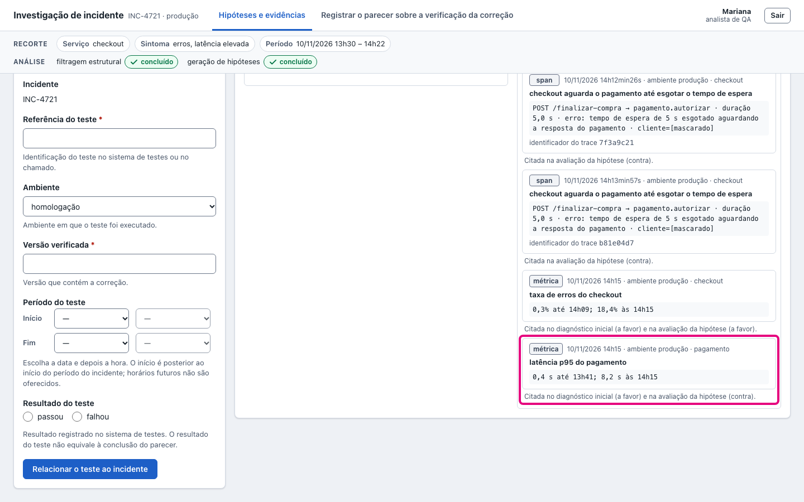

*Figura 1 — V01, F12 (Avaliar o alcance da verificação) em M02: nota de citação da latência p95 do pagamento, "a favor" no diagnóstico inicial e "contra" na avaliação da hipótese. Fonte: elaboração do autor.*

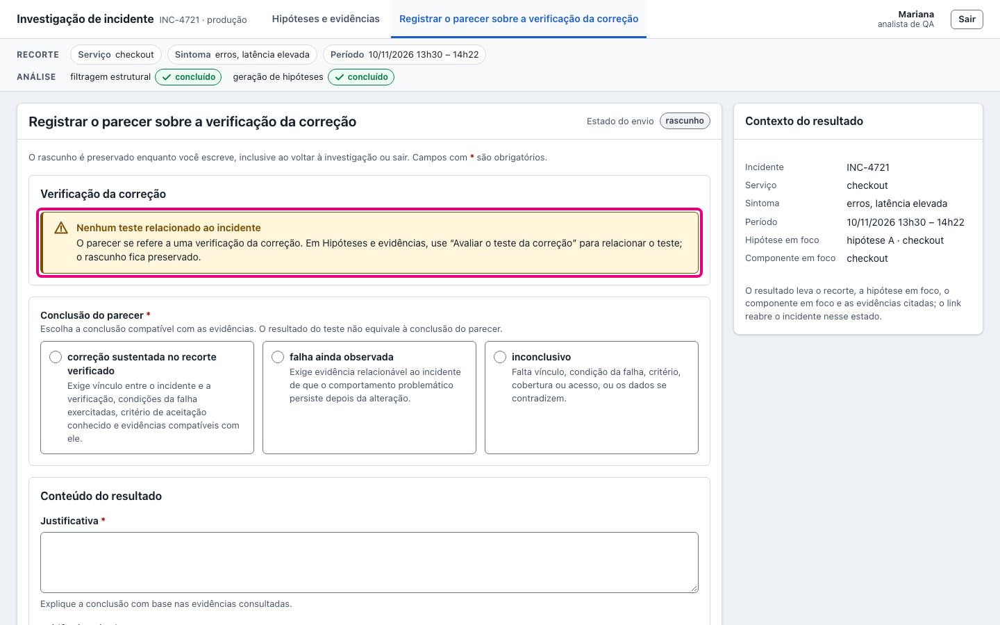

*Figura 2 — V02, F13 (Registrar o parecer sobre a verificação da correção) em M02: aviso que manda usar "Avaliar o teste da correção" em outra área, sem oferecer o controle. Fonte: elaboração do autor.*

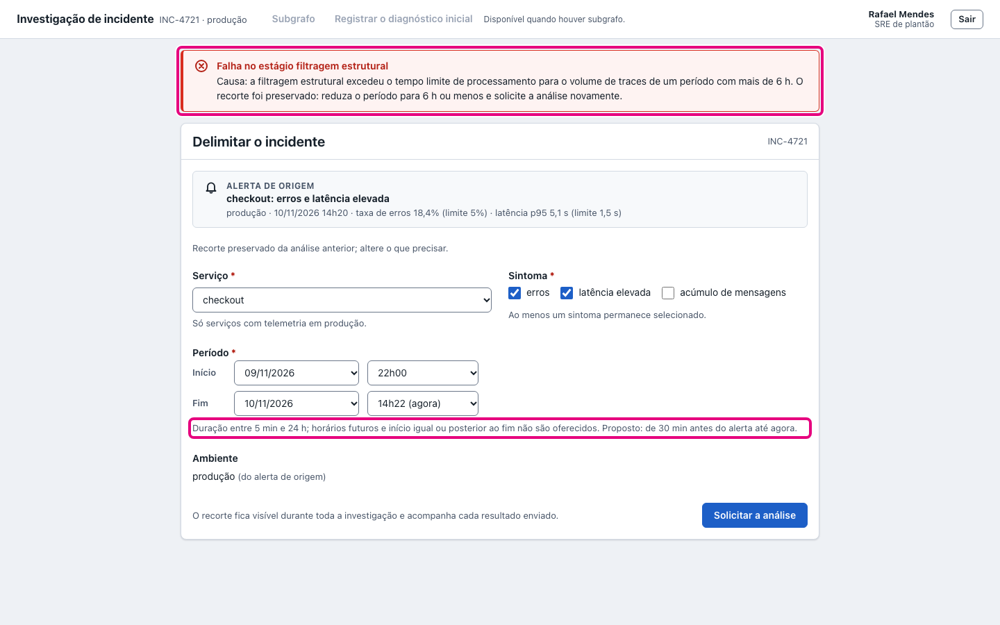

*Figura 3 — V03, F01E (Falha no estágio, recorte preservado) em M03: limite de 6 h na mensagem de falha e duração de até 24 h na ajuda do período. Fonte: elaboração do autor.*

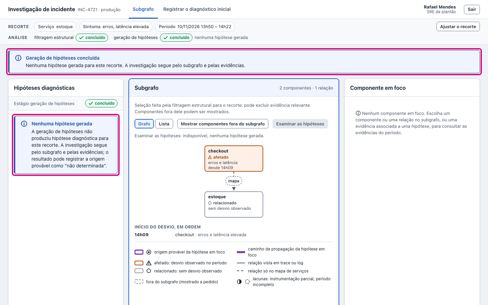

*Figura 4 — V04, F02V (Nenhuma hipótese gerada) em M03: mensagens de status sem a causa nem a ação de ajustar o recorte. Fonte: elaboração do autor.*

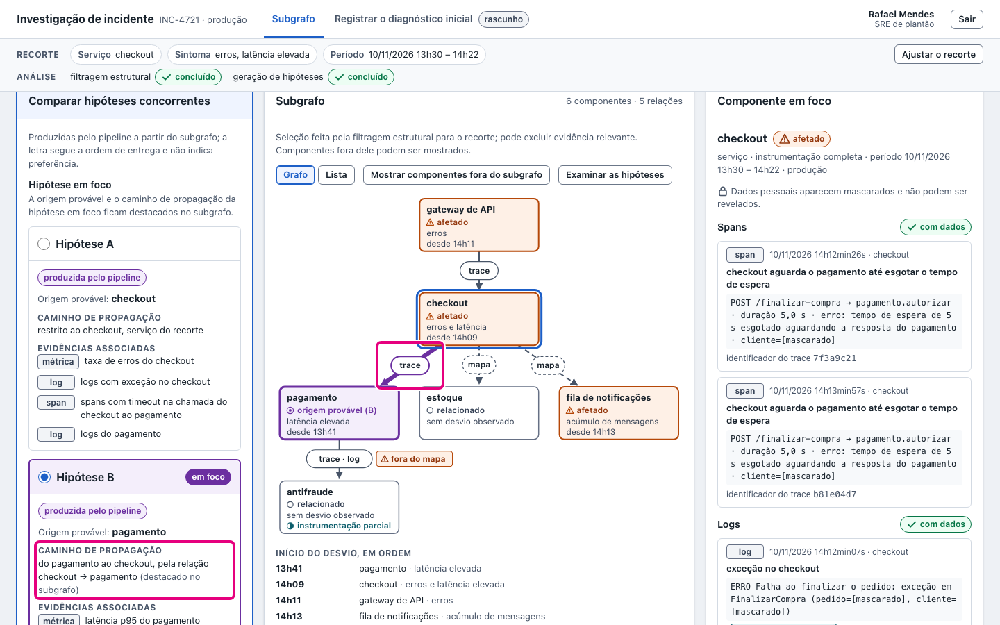

*Figura 5 — V05, F09 (Comparar hipóteses concorrentes) em M03: seta destacada do checkout ao pagamento e caminho de propagação da hipótese B descrito do pagamento ao checkout. Fonte: elaboração do autor.*

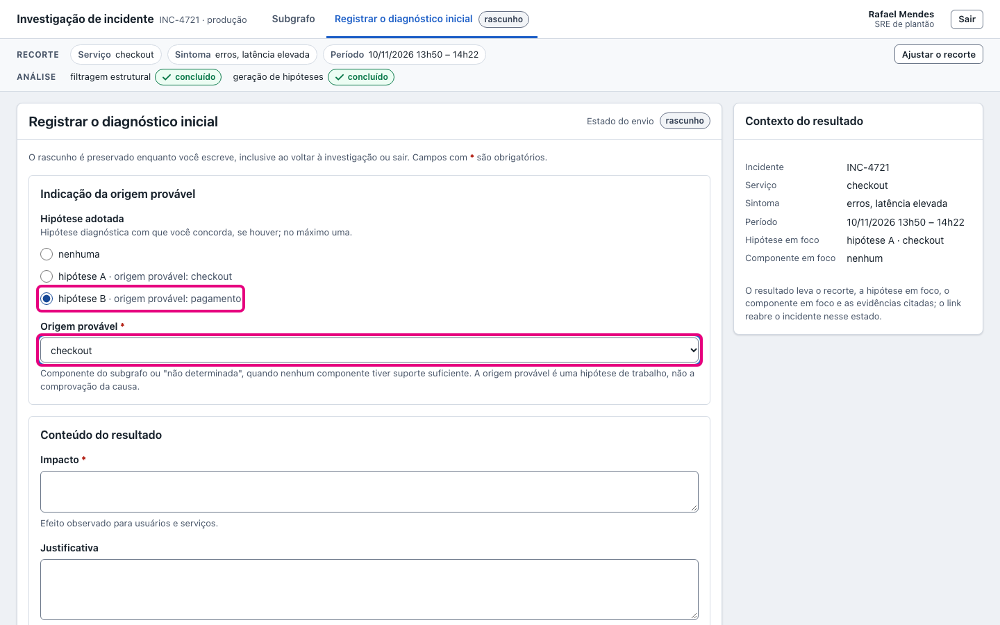

*Figura 6 — V06, F10 (Registrar o diagnóstico inicial) em M03: hipótese B adotada e origem provável checkout aceitas juntas. Fonte: elaboração do autor.*

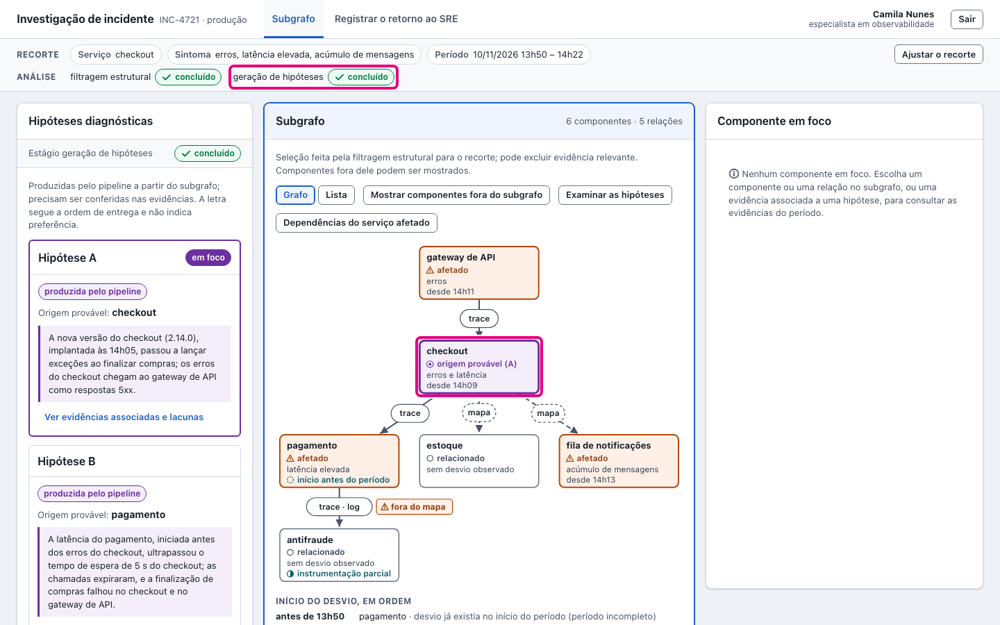

*Figura 7 — V07, F02 (Subgrafo) em M04, na volta de F14: etiqueta "concluído" da geração de hipóteses e nó do checkout já como origem provável (A), sem mensagem de fim do estágio no topo da unidade. Fonte: elaboração do autor.*

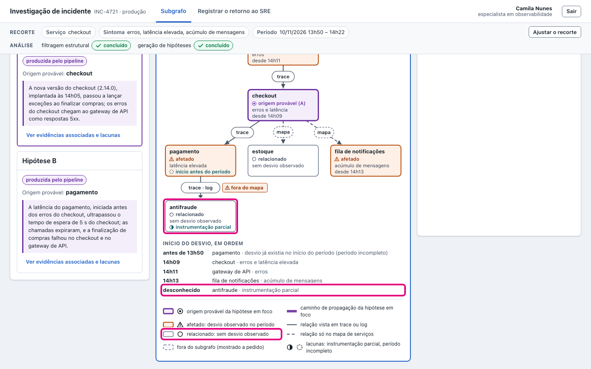

*Figura 8 — V08, F02 (Subgrafo) em M04: nó do antifraude "relacionado · sem desvio observado", linha "desconhecido" no fim da lista do início do desvio e item correspondente da legenda. Fonte: elaboração do autor.*

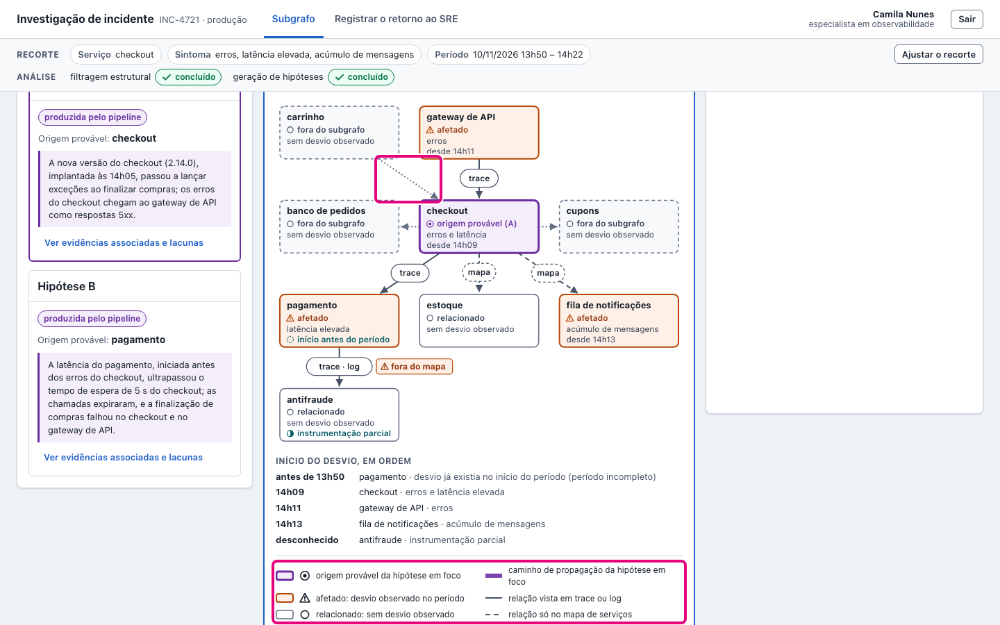

*Figura 9 — V09, F02D (Componentes fora do subgrafo mostrados) em M04: relação pontilhada do carrinho ao checkout, sem fonte da relação, e itens de relação da legenda, sem esse traço. Fonte: elaboração do autor.*

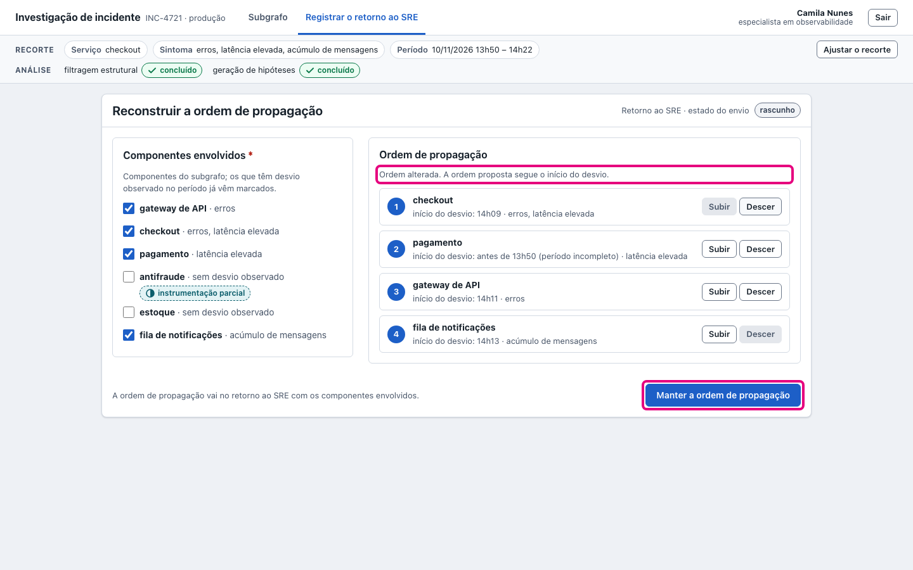

*Figura 10 — V10, F15 (Reconstruir a ordem de propagação) em M04: mensagem "Ordem alterada" sem opção de restaurar a ordem proposta e botão "Manter a ordem de propagação". Fonte: elaboração do autor.*

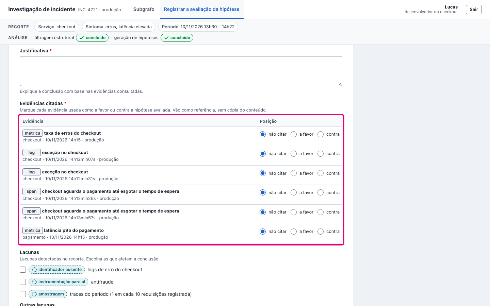

*Figura 11 — V11, F11 (Registrar a avaliação da hipótese) em M01: tabela de evidências citadas sem o conteúdo das evidências. Fonte: elaboração do autor.*

## 6. Boas práticas — heurísticas não violadas (atividade didática)

| Heurística sem violação | Exemplo no sistema | Evidência | Por que atende |
|---|---|---|---|
| H7 | Na tela de investigação com o subgrafo disponível e a geração de hipóteses em andamento, F02C (M03, M04), a mensagem "Filtragem estrutural concluída" informa que o subgrafo já pode ser inspecionado; os componentes podem ser consultados e o registro do resultado fica disponível na barra superior, e só "Examinar as hipóteses" fica indisponível, com o motivo escrito. | [F02C](../../assets/11_figma/f02c.png) | O processamento demorado não impede as outras atividades: o SRE e a especialista começam a inspecionar o subgrafo e a registrar o resultado enquanto a geração termina, o que encurta a tarefa de quem já sabe o que procurar, e quem usa pela primeira vez vê por que as hipóteses ainda não estão disponíveis. |
| H8 | O diálogo Confirmar os destinatários, F07A (M01; o mesmo diálogo em M02, M03 e M04), mostra só os destinatários, o tipo de resultado, a hipótese avaliada, a classificação da hipótese e o link do resultado. | [F07A](../../assets/11_figma/f07a.png) | O diálogo traz apenas o que a decisão de enviar exige, quem recebe e o que recebe; a justificativa e as evidências citadas ficam no painel ao lado, sem competir com a confirmação. |
