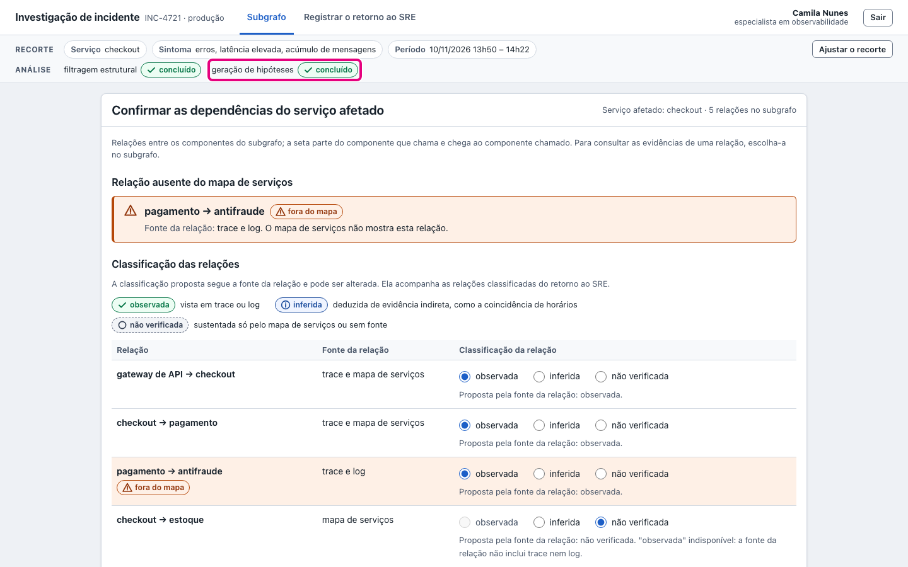
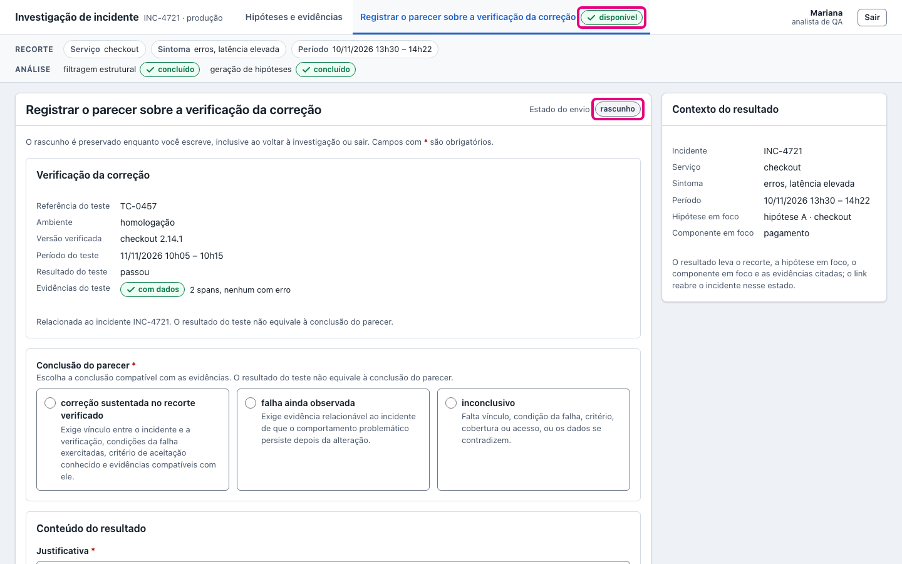
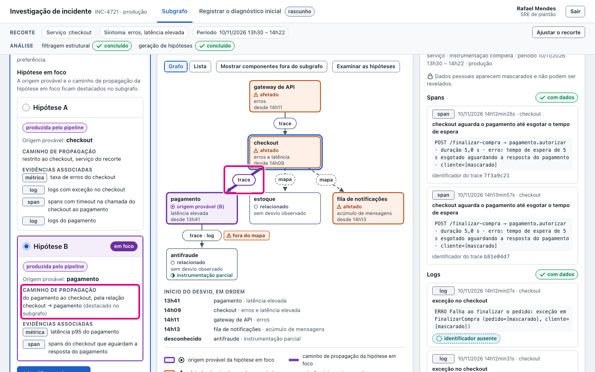
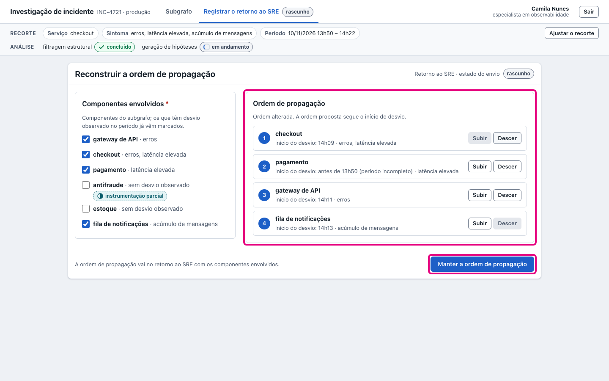
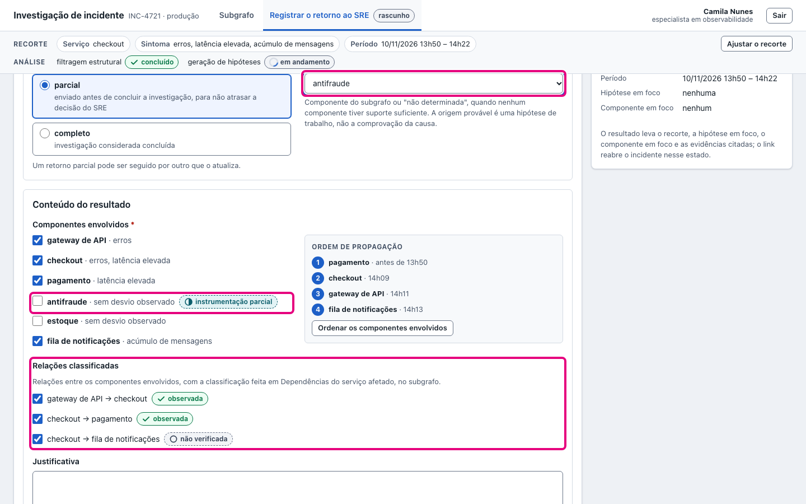
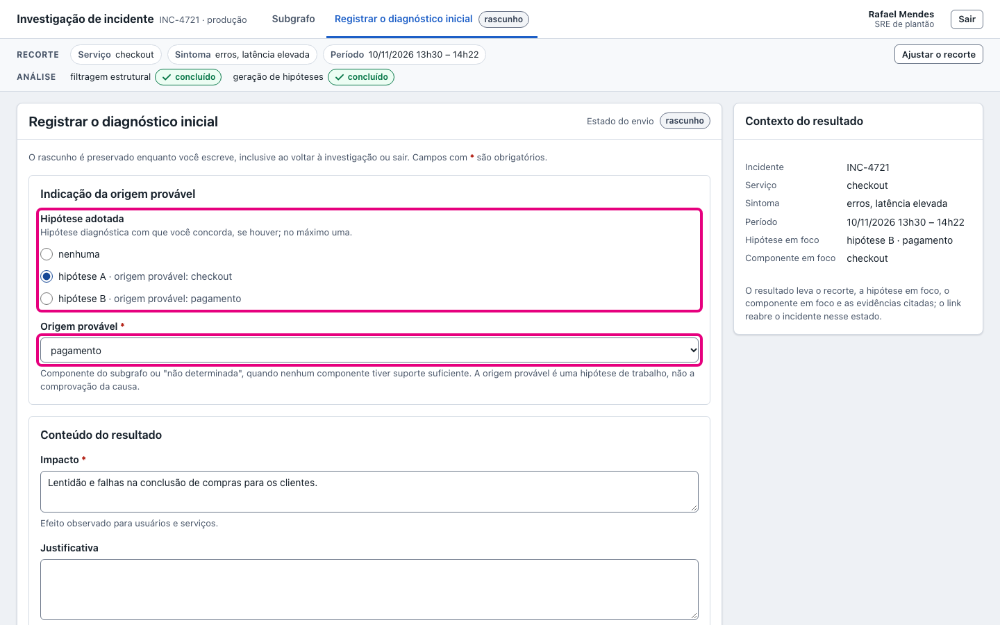
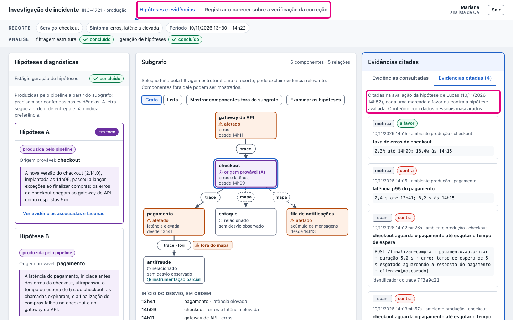
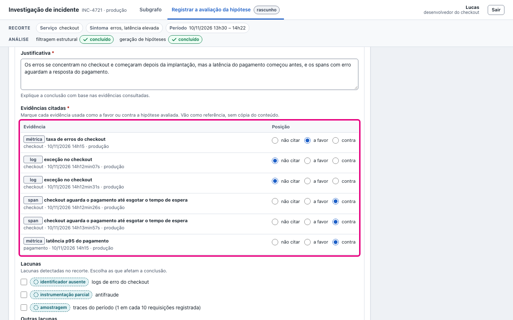
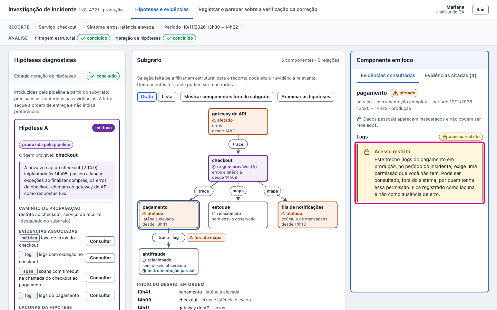
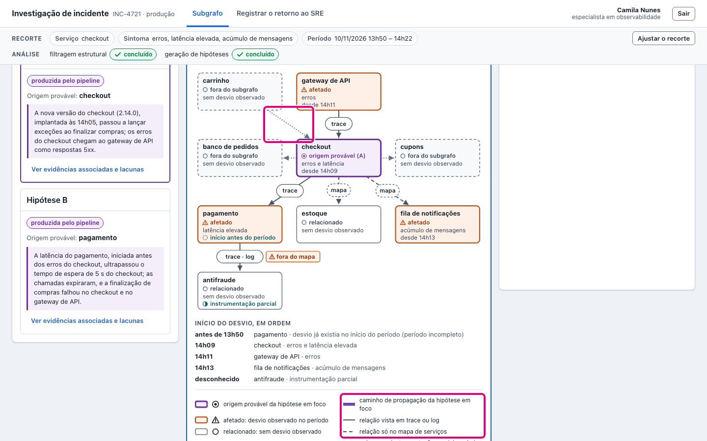

# Entrega 13 — Avaliador A02: Willian Verenka Oliveira Silva

[← Voltar à Entrega 13](../13_avaliacao_heuristica.md)

**Autor(a):** Willian Verenka Oliveira Silva — 22.124.081-5

**Data da inspeção:** 18/11/2026

## 4. Matriz de cobertura das 10 heurísticas

| Heurística | Telas/fluxos examinados | Houve violação? | IDs dos achados | Exemplo de boa prática se não violada |
|---|---|---|---|---|
| H1 | M03, M04, M01 e M02, nessa ordem: as 42 telas e estados, de F00A a F16D, com atenção a F05, F02C, F02V, F06C, F07C, F07S e F12C (QA15) e a F10, F11, F13 e F14 quando a geração de hipóteses ou o envio terminam | sim | V01, V02 | — |
| H2 | M03, M04, M01 e M02: as 42 telas e estados, com atenção a F02, F03, F04, F09, F10, F11, F13, F14 e F16 (QA16) | sim | V03 | — |
| H3 | M03, M04, M01 e M02: as 42 telas e estados, com atenção a F01A, F01X, F07A, F08, F13A, à volta ao subgrafo (QA18) e a F15 | sim | V04 | — |
| H4 | M03, M04, M01 e M02: as 42 telas e estados, com atenção a F03, F04, F09, F10, F11, F13, F14 e F16 (QA16) e às unidades comuns F02 a F08S nos quatro fluxos | não | — | Diálogo "Falha de disponibilização" de F07R com a mesma estrutura, os mesmos rótulos e o mesmo efeito nos quatro fluxos (F07R) |
| H5 | M03, M04, M01 e M02: as 42 telas e estados, com atenção a F01E, F02V, F06V, F06P, F06R, F06S, F07R, F12E, F12V e F13A (QA17) e a F10, F14 e F16 | sim | V05, V06 | — |
| H6 | M03, M04, M01 e M02: as 42 telas e estados, com atenção a F02, F02D, F03, F06, F09, F14, F15 e F16 (QA19) e a F03D, F04, F10, F11 e F13 | sim | V07, V08 | — |
| H7 | M03, M04, M01 e M02: as 42 telas e estados (QA20), com atenção a F02C, F03, F06C e aos registros F10, F11, F13 e F16 | não | — | Subgrafo inspecionável e registro acessível enquanto a geração de hipóteses está em andamento (F02C) |
| H8 | M03, M04, M01 e M02: as 42 telas e estados, com atenção a F02, F02D, F03, F06, F09, F14, F15 e F16 (QA19) e a F07 e F07A | não | — | Diálogo "Confirmar os destinatários" só com o que a decisão de enviar exige (F07A) |
| H9 | M03, M04, M01 e M02: as 42 telas e estados, com atenção a F01E, F02V, F06V, F06P, F06R, F06S, F07R, F12E, F12V e F13A (QA17) | sim | V09 | — |
| H10 | M03, M04, M01 e M02: as 42 telas e estados (QA20), com atenção aos textos de ajuda dos campos, à legenda do subgrafo em F02, F02C e F02D e à vista Lista | sim | V10 | — |

## 5. Declaração de violações

| ID | Heurística | Tela/estado | Problema observado | Evidência | Severidade | Justificativa da severidade | Recomendação |
|---|---|---|---|---|---:|---|---|
| V01 | H1 | F14 (M04): estado do estágio "geração de hipóteses" na barra do recorte; também F10 (M03) e a volta a F02 (M04) | Quando a geração de hipóteses termina com a pessoa fora do subgrafo, a etiqueta do estágio na barra do recorte passa de "em andamento" a "concluído". Isso ocorre em F14, que Camila abre durante a geração no caminho principal de M04, e em F10, que Rafael abre durante a geração no caminho principal de M03, quando ela termina antes da volta ao subgrafo; em F10, as opções de hipótese adotada aparecem no formulário sem aviso. A mensagem de status "Geração de hipóteses concluída", mostrada no topo de F02 quando a pessoa espera no subgrafo, não aparece nessas telas nem na volta a F02, onde as hipóteses A e B já estão no painel sem aviso. O fim do estágio, que libera o exame das hipóteses, pode passar despercebido. | [a02_v01.png](../../assets/13_heuristica/a02_v01.png) | 2 | Frequência: M03 e M04, os dois fluxos com análise, nos caminhos principais de UT03 e UT04. Impacto: atrasa, mas não impede a tarefa, porque a etiqueta mostra o estado; ainda assim, é uma resposta sutil para um evento infrequente e de consequência, o contrário da diretriz de visibilidade, e afeta MU03 (perceber qual estágio terminou e de onde vem cada resultado). Persistência: a cada análise solicitada em que a pessoa sai do subgrafo durante a geração. | Mostrar a mensagem de status "Geração de hipóteses concluída", com o número de hipóteses produzidas, no topo da unidade em que a pessoa está quando o estágio termina (F10, F14, F15, F16) ou, ao menos, na volta a F02, como já ocorre quando ela espera em F02C. |
| V02 | H1 | F13 (M02): etiqueta da aba "Registrar o parecer sobre a verificação da correção" e estado do envio do formulário; também F10 (M03) e F11 (M01) | Depois do envio disponível (F07S), ao acionar de novo o acesso ubíquo do registro, isto é, o controle da barra superior disponível em qualquer cena, a aba mostra a etiqueta "disponível" e o formulário abre só com o teste relacionado, com a conclusão e o conteúdo do resultado em branco e o estado do envio "rascunho", sem referência ao resultado enviado. O mesmo signo aparece com dois valores ao mesmo tempo, e nada informa se o parecer enviado continua disponível ou se um novo resultado começou. Mariana, ao voltar para conferir o que enviou, pode concluir que o parecer se perdeu ou preenchê-lo e enviá-lo de novo a Lucas e Rafael Mendes. | [a02_v02.png](../../assets/13_heuristica/a02_v02.png) | 2 | Frequência: M01, M02 e M03; em M04, o mesmo acesso leva a F16D, que explica a atualização do retorno anterior. Ocorre fora do caminho principal, depois do envio. Impacto: não desfaz a tarefa cumprida, mas gera dúvida sobre o fechamento da comunicação, que a Entrega 8 associa só ao estado "disponível", e pode levar a reenvio. Persistência: toda vez que o registro é reaberto depois do envio. | Depois do envio, abrir o registro com o resultado enviado em modo de leitura, com o estado "disponível", o horário do envio e o link do resultado, e oferecer à parte "Registrar novo resultado"; se um novo rascunho for aberto, informar no topo que o resultado anterior continua disponível, como F16D faz em M04. |
| V03 | H2 | F09 (M03): relação checkout → pagamento destacada como caminho de propagação da hipótese B; também F02 e F03 com a hipótese B em foco (M03) | Com a hipótese B em foco, o caminho de propagação é destacado em lilás sobre a relação checkout → pagamento, e a ponta da seta, que na relação indica o componente chamado, aponta do checkout para o pagamento. O texto da hipótese descreve o caminho "do pagamento ao checkout". O traço mais saliente do subgrafo sugere propagação do checkout para o pagamento, o sentido oposto ao da hipótese B, e coincide com a leitura que toma o checkout, que concentra os erros, como origem. Ao comparar as hipóteses, Rafael precisa conferir o rótulo do componente e o texto para desfazer a contradição. | [a02_v03.png](../../assets/13_heuristica/a02_v03.png) | 2 | Frequência: só M03, mas F09 está no caminho principal de UT03, e o destaque continua em F02 e F03 enquanto B está em foco. Impacto: o rótulo "origem provável (B)" no pagamento e o texto do caminho reduzem o risco de erro, de modo que o efeito esperado é dúvida e atraso; o conflito, porém, está na distinção entre origem e efeito que MU05 mede e que, mal feita, leva ao erro crítico de MU11 em UT03. Persistência: sempre que B está em foco. | Desenhar o caminho de propagação com marcação de sentido própria, da origem provável para o serviço do recorte, separada da seta de chamada da relação, e acrescentar à legenda que o traço lilás indica o sentido da propagação. |
| V04 | H3 | F15 (M04): bloco "Ordem de propagação" e botão "Manter a ordem de propagação" | Depois de subir ou descer um componente, a ordem alterada passa a valer de imediato. A tela mostra "Ordem alterada. A ordem proposta segue o início do desvio.", mas não oferece restaurar a ordem proposta nem descartar a alteração. A única saída da cena, "Manter a ordem de propagação", mantém a ordem alterada; voltar pela aba do registro também a mantém, e em F16 a ordem aparece sem indicação de que foi alterada. Depois de um clique errado em "Descer", Camila precisa reconstruir a ordem pelos horários de início do desvio de cada componente. | [a02_v04.png](../../assets/13_heuristica/a02_v04.png) | 2 | Frequência: só M04; F15 está no caminho principal de UT04. Impacto: a ordem proposta pelo início do desvio é um dos elementos do critério de MU10; a correção é possível, mas manual, componente a componente. Persistência: a cada alteração da ordem. | Acrescentar "Restaurar a ordem proposta" junto da mensagem "Ordem alterada" e uma opção de cancelar que volte a F16 sem aplicar as alterações; quando a ordem tiver sido alterada, indicar "ordem alterada" junto da ordem de propagação em F16. |
| V05 | H5 | F16 (M04): origem provável, componentes envolvidos e relações classificadas | Com o antifraude escolhido como origem provável, o retorno segue para F07 sem o antifraude entre os componentes envolvidos: ele vem desmarcado por não ter desvio observado, e a interface não aponta a incoerência. Sem ele, a relação pagamento → antifraude, a relação ausente do mapa que Camila confirmou em F14, sai das relações classificadas. O resumo de F07 mostra a origem provável "antifraude (hipótese de trabalho)", componentes envolvidos sem o antifraude e só três relações. Rafael receberia um retorno que aponta o antifraude sem a relação que o liga ao incidente. | [a02_v05.png](../../assets/13_heuristica/a02_v05.png) | 3 | Frequência: só M04, mas no caminho principal de UT04, e é o estado padrão que leva ao problema: quem não marca o antifraude em F16 ou em F15 envia sem ele. Impacto: o retorno perde a relação observada que sustenta a origem indicada e que MU09 verifica em F14, o achado de que o SRE depende para decidir se aciona a equipe do antifraude (cenário C04). Persistência: a cada retorno registrado. | Ao escolher a origem provável, incluir esse componente entre os componentes envolvidos, com as relações dele, e manter "Escolher os destinatários" indisponível, com o motivo escrito ao lado, enquanto a origem provável estiver fora dos componentes envolvidos. |
| V06 | H5 | F10 (M03): grupo "Hipótese adotada" e campo "Origem provável" | A hipótese adotada e a origem provável são escolhidas de forma independente. Adotar a hipótese B não preenche a origem provável, e a combinação "hipótese A · origem provável: checkout" com a origem provável "pagamento" é aceita sem aviso, segue para F07 e aparece assim no resumo do diagnóstico inicial. Um clique na opção vizinha leva a Lucas um diagnóstico que concorda com uma hipótese e aponta a origem de outra. | [a02_v06.png](../../assets/13_heuristica/a02_v06.png) | 2 | Frequência: só M03, no caminho principal de UT03, e depende de um deslize. Impacto: a contradição fica visível no resumo de F07, o que permite percebê-la antes do envio; se enviada, deixa o desenvolvedor sem saber que origem investigar (MU06, MU11). Persistência: a cada registro do diagnóstico inicial. | Ao adotar uma hipótese, propor a origem provável dela no campo "Origem provável"; se a pessoa escolher outra, informar junto ao campo que a origem difere da hipótese adotada e pedir que confirme a escolha ou mude a hipótese adotada para "nenhuma". |
| V07 | H6 | F03D (M02): barra superior com os acessos ubíquos e nota das evidências citadas; também F03, F12 e F13 (M02) e F02, F03 e F11 (M01). O acesso deveria estar na barra superior ou no painel "Contexto do resultado" | Os resultados do incidente, isto é, a avaliação da hipótese AV-1 e o diagnóstico inicial D-1, com classificação, justificativa e lacunas, só aparecem em F04. Depois de sair de F04, a barra superior oferece apenas "Hipóteses e evidências" e "Registrar o parecer sobre a verificação da correção", e a aba de evidências citadas de F03D traz as evidências com a marcação a favor ou contra, sem a classificação, a justificativa e as lacunas do resultado. Para rever a justificativa e a lacuna registradas por Lucas ("A causa da latência do pagamento não foi examinada"), Mariana precisa sair e reabrir o link no chamado ou lembrar o que leu no início, no momento em que escreve o parecer em F13. | [a02_v07.png](../../assets/13_heuristica/a02_v07.png) | 2 | Frequência: M01 e M02, nos caminhos principais de UT01 e UT02. Impacto: obriga a memorizar ou a um desvio longo, que passa pelo contexto simulado; pode levar a um parecer que omite uma lacuna já registrada (MU04, MU08). Persistência: durante toda a tarefa, depois de F04. | Manter "Resultados do incidente" acessível durante a investigação, como acesso na barra superior ou como aba ao lado de "Evidências citadas", e mostrar no painel "Contexto do resultado" de F11 e F13 o resultado aberto pelo link, com classificação, justificativa e lacunas. |
| V08 | H6 | F11 (M01): tabela "Evidências citadas"; também F10 (M03), F13 (M02) e F16 (M04) | Na tabela de evidências citadas dos quatro registros, cada evidência aparece só com tipo, título, componente, horário e ambiente, sem o conteúdo: valores da métrica, duração do span ou mensagem do log. Há pares de linhas que só diferem no horário, como as duas "exceção no checkout" (14h12min07s e 14h12min31s) e os dois spans "checkout aguarda o pagamento até esgotar o tempo de espera" (14h12min26s e 14h13min57s). Como o registro ocupa o lugar da tela de investigação, para marcar uma evidência como a favor ou contra Lucas precisa lembrar o que viu em F06, por exemplo que a latência p95 do pagamento subiu às 13h41, antes do checkout, ou voltar ao subgrafo e consultar a evidência de novo. | [a02_v08.png](../../assets/13_heuristica/a02_v08.png) | 2 | Frequência: os quatro fluxos, no caminho principal das quatro tarefas de avaliação. Impacto: o rascunho é preservado na volta ao subgrafo, então a tarefa não é impedida, mas a ida e volta atrasa (MU13), e a marcação feita de memória pode errar a evidência contraditória que MU07 exige. Persistência: em cada registro. | Mostrar em cada linha um resumo do conteúdo da evidência (valores, duração ou mensagem mascarada) e o identificador do trace, ou abrir esse conteúdo a pedido na própria linha, sem sair do registro. |
| V09 | H9 | F06P (M02): mensagem "Acesso restrito" no painel do componente em foco; também F06P em M01 e M04 | A mensagem informa que os logs do pagamento em produção exigem uma permissão que a pessoa não tem e que podem ser consultados, fora do sistema, "por quem tenha essa permissão", mas não diz quem a tem nem a quem pedir. Mariana tem acesso limitado à produção e não domina toda a infraestrutura (P03); fica sem saber a quem recorrer e, em F13, precisa indicar em "Quem pode esclarecer" a pessoa que resolveria essa lacuna. | [a02_v09.png](../../assets/13_heuristica/a02_v09.png) | 2 | Frequência: M01, M02 e M04; no caminho principal de UT02. Impacto: a lacuna é registrada corretamente, e o parecer não fica errado (MU02), mas a recuperação fora do sistema fica sem indicação concreta, e a escolha de quem pode esclarecer depende de suposição. Persistência: a cada consulta a evidências com acesso restrito. | Indicar na mensagem as pessoas com acesso ao incidente que têm a permissão (no INC-4721, Rafael Mendes, SRE de plantão) e propô-las em "Quem pode esclarecer" quando a lacuna "acesso restrito" for escolhida no parecer. |
| V10 | H10 | F02D (M04): ligações pontilhadas entre o checkout e carrinho, cupons e banco de pedidos, e legenda do subgrafo; também F02D em M01 e M03 | Ao mostrar os componentes fora do subgrafo, a interface os liga ao checkout por linhas pontilhadas, sem a etiqueta de fonte da relação (trace, log ou mapa) que todas as relações do subgrafo têm. A legenda explica a linha contínua (relação vista em trace ou log), a linha tracejada (relação só no mapa de serviços) e a borda tracejada do componente fora do subgrafo, mas não a linha pontilhada. Camila, que confere se a filtragem deixou de fora um vizinho relevante, não sabe de onde vem a ligação mostrada nem se pode tratá-la como relação observada. | [a02_v10.png](../../assets/13_heuristica/a02_v10.png) | 1 | Frequência: F02D aparece a pedido nos três fluxos com subgrafo e está no caminho principal de M04. Impacto: baixo, porque os três componentes estão marcados "sem desvio observado" e as relações fora do subgrafo não são classificadas em F14. Persistência: sempre que os componentes fora do subgrafo são mostrados. | Acrescentar à legenda o traço pontilhado, como relação com componente fora do subgrafo, e mostrar a fonte da relação também nessas ligações. |

*Figura 1 — V01, F14 (Confirmar as dependências do serviço afetado) em M04: estado do estágio "geração de hipóteses" na barra do recorte, única indicação do fim da geração. Fonte: elaboração do autor.*

*Figura 2 — V02, F13 (Registrar o parecer sobre a verificação da correção) em M02: etiqueta "disponível" na aba do registro e estado do envio "rascunho" no formulário reaberto sem a conclusão, depois do envio. Fonte: elaboração do autor.*

*Figura 3 — V03, F09 (Comparar hipóteses concorrentes) em M03: caminho de propagação da hipótese B destacado sobre a seta checkout → pagamento e texto "do pagamento ao checkout". Fonte: elaboração do autor.*

*Figura 4 — V04, F15 (Reconstruir a ordem de propagação) em M04: ordem alterada sem opção de restaurar a ordem proposta e botão "Manter a ordem de propagação". Fonte: elaboração do autor.*

*Figura 5 — V05, F16 (Registrar o retorno ao SRE) em M04: origem provável "antifraude", antifraude desmarcado entre os componentes envolvidos e relações classificadas sem pagamento → antifraude. Fonte: elaboração do autor.*

*Figura 6 — V06, F10 (Registrar o diagnóstico inicial) em M03: hipótese A adotada e origem provável "pagamento", aceitas sem aviso. Fonte: elaboração do autor.*

*Figura 7 — V07, F03D (Evidências citadas) em M02: acessos da barra superior, sem os resultados do incidente, e nota que remete à avaliação da hipótese de Lucas. Fonte: elaboração do autor.*

*Figura 8 — V08, F11 (Registrar a avaliação da hipótese) em M01: tabela de evidências citadas sem o conteúdo das evidências. Fonte: elaboração do autor.*

*Figura 9 — V09, F06P (Acesso restrito) em M02: mensagem de acesso restrito sem indicar quem tem a permissão. Fonte: elaboração do autor.*

*Figura 10 — V10, F02D (Componentes fora do subgrafo mostrados) em M04: ligação pontilhada carrinho → checkout e itens de relação da legenda, que não incluem o traço pontilhado. Fonte: elaboração do autor.*

## 6. Boas práticas — heurísticas não violadas (atividade didática)

| Heurística sem violação | Exemplo no sistema | Evidência | Por que atende |
|---|---|---|---|
| H4 | Diálogo "Falha de disponibilização" de F07R, em M02 e nos demais fluxos | [F07R](../../assets/11_figma/f07r.png) | O diálogo tem a mesma estrutura, os mesmos rótulos e o mesmo efeito nos quatro fluxos: causa da falha, estado do envio "falha de disponibilização", rascunho preservado, destinatários e as ações "Voltar ao registro" e "Repetir o envio"; mudam só o nome do resultado e os destinatários. "Voltar ao registro" tem o mesmo rótulo e o mesmo efeito em F07. Quem encontrou a falha num fluxo a reconhece nos outros. |
| H7 | Subgrafo disponível durante a geração de hipóteses, em F02C (M03; também M04) | [F02C](../../assets/11_figma/f02c.png) | Assim que a filtragem estrutural termina, o subgrafo pode ser inspecionado, os componentes podem ser postos em foco e o registro do resultado já está acessível na barra superior; só "Examinar as hipóteses" fica indisponível, com o motivo escrito ao lado. O processamento demorado não impede as outras atividades, e a pessoa pode adiantar a inspeção durante a espera. |
| H8 | Diálogo "Confirmar os destinatários" de F07A (M01) | [F07A](../../assets/11_figma/f07a.png) | O diálogo mostra só o que a decisão de enviar exige: os destinatários escolhidos, o tipo de resultado, a hipótese avaliada, a classificação e o link do resultado, sem repetir justificativa, evidências ou o formulário, que competiriam com a conferência de quem vai receber o resultado. |
