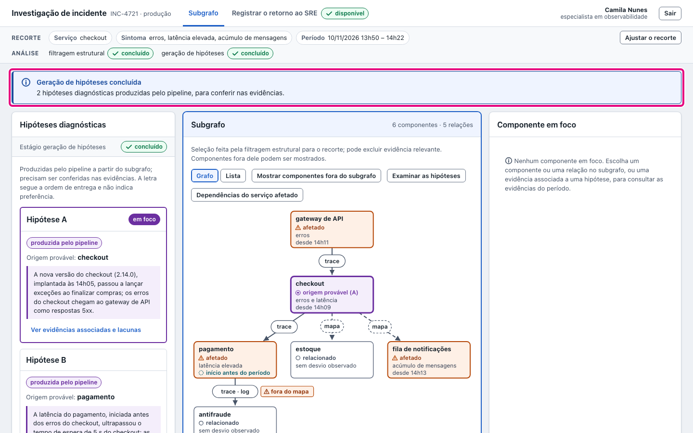
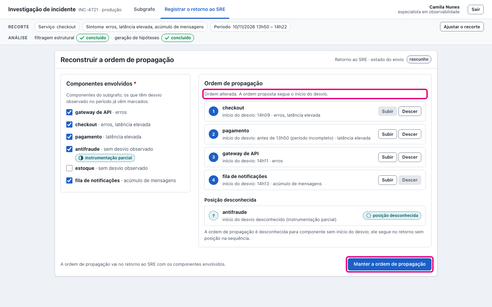
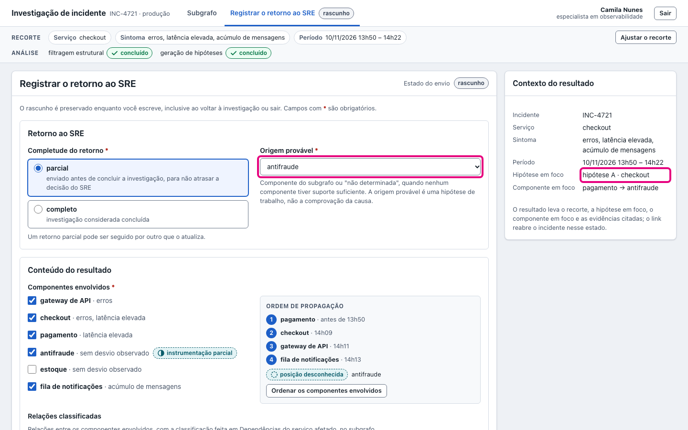
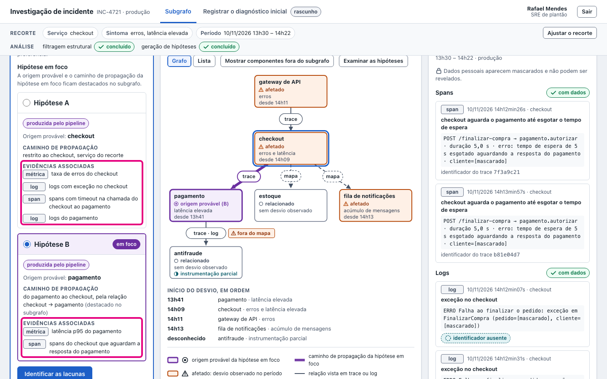
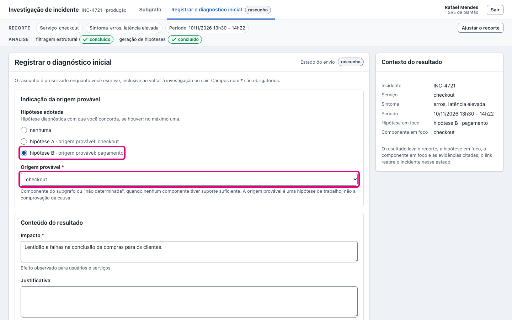
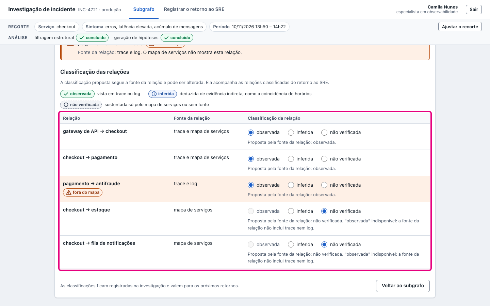

# Entrega 13 — Avaliador A03: Théo Zago Zimmermann

[← Voltar à Entrega 13](../13_avaliacao_heuristica.md)

**Autor(a):** Théo Zago Zimmermann — 22.123.035-2

**Data da inspeção:** 18/11/2026

## 4. Matriz de cobertura das 10 heurísticas

| Heurística | Telas/fluxos examinados | Houve violação? | IDs dos achados | Exemplo de boa prática se não violada |
|---|---|---|---|---|
| H1 | M04, M01, M02, M03: 42 telas e estados (F00A a F16D) | sim | V01 | — |
| H2 | M04, M01, M02, M03: 42 telas e estados (F00A a F16D) | sim | V02 | — |
| H3 | M04, M01, M02, M03: 42 telas e estados (F00A a F16D) | sim | V03 | — |
| H4 | M04, M01, M02, M03: 42 telas e estados (F00A a F16D) | sim | V04 | — |
| H5 | M04, M01, M02, M03: 42 telas e estados (F00A a F16D) | sim | V05 | — |
| H6 | M04, M01, M02, M03: 42 telas e estados (F00A a F16D) | sim | V06 | — |
| H7 | M04, M01, M02, M03: 42 telas e estados (F00A a F16D) | não | — | F02C (M03): subgrafo e registro do diagnóstico inicial disponíveis enquanto a geração de hipóteses está em andamento. |
| H8 | M04, M01, M02, M03: 42 telas e estados (F00A a F16D) | não | — | F07A (M01): confirmação só com os destinatários, os dados que identificam o resultado e o link do resultado. |
| H9 | M04, M01, M02, M03: 42 telas e estados (F00A a F16D) | não | — | F06R (M04): falha de consulta com tipo de evidência, causa, o que foi mantido e "Repetir a consulta". |
| H10 | M04, M01, M02, M03: 42 telas e estados (F00A a F16D) | não | — | F11 (M01): explicação de cada valor da classificação da hipótese e aviso de que "sustentada" não significa causa comprovada. |

## 5. Declaração de violações

| ID | Heurística | Tela/estado | Problema observado | Evidência | Severidade | Justificativa da severidade | Recomendação |
|---|---|---|---|---|---:|---|---|
| V01 | H1 | F07S (M04): mensagem de sucesso do envio, no topo da tela de investigação | Quando o retorno ao SRE fica disponível antes de a geração de hipóteses terminar, como no envio feito logo depois da filtragem estrutural, a mensagem "Retorno ao SRE disponível aos destinatários", com destinatários, horário do envio e link do resultado, é substituída poucos segundos depois por "Geração de hipóteses concluída", sem nenhuma ação de Camila. Resta só a etiqueta "disponível" no acesso ao registro; o horário do envio e o link do RS-1 deixam de aparecer na tela. Se Camila desviou o olhar nesse intervalo, não vê a confirmação de uma ação infrequente e de grande consequência nem o link que poderia repassar. | [a03_v01.png](../../assets/13_heuristica/a03_v01.png) | 2 | Frequência: no protótipo, exige enviar o retorno logo depois da filtragem estrutural, durante a geração de hipóteses, de duração fixa e curta (condição declarada na Entrega 12), fora do caminho principal de UT04; o problema pesa pelo uso real, em que a duração da geração é desconhecida (Entrega 8) e o retorno parcial pode sair antes do fim dela. Impacto: a etiqueta "disponível" continua visível, de modo que o estado do envio ainda pode ser reconhecido (critério de MU10), mas a confirmação detalhada some e o link do resultado se perde; atrasa e pode gerar dúvida, sem impedir a tarefa. Persistência: uma vez por envio. | Manter a mensagem de sucesso do envio até Camila fechá-la ou fazer outra ação no registro e mostrar a conclusão da geração de hipóteses em mensagem separada, abaixo dela, ou só no estado do estágio da barra do recorte; deixar o horário do envio e o link do resultado acessíveis depois, por exemplo a partir da etiqueta "disponível" do acesso ao registro. |
| V02 | H2 | F15 (M04): botão "Manter a ordem de propagação" depois de "Subir" ou "Descer" | Depois de Camila mudar a ordem com "Subir" ou "Descer", a tela informa "Ordem alterada. A ordem proposta segue o início do desvio.", mas a única saída continua rotulada "Manter a ordem de propagação". "Manter" sugere conservar a ordem proposta, e Camila não sabe se o botão guarda a ordem que ela montou ou volta à proposta; só ao retornar a F16 confere qual ordem vai no retorno ao SRE. | [a03_v02.png](../../assets/13_heuristica/a03_v02.png) | 1 | Frequência: só quando Camila altera a ordem proposta, alternativa de M04 fora do caminho principal de UT04. Impacto: hesitação desfeita em F16, que mostra a ordem de propagação que vai no retorno; não impede a tarefa nem leva a erro de interpretação. Persistência: uma vez por alteração da ordem. | Trocar o rótulo conforme o estado: "Manter a ordem proposta" enquanto a ordem não muda e "Usar esta ordem" depois de "Subir" ou "Descer", com a opção "Restaurar a ordem proposta" ao lado da mensagem "Ordem alterada". |
| V03 | H3 | F02, F03, F16, F16D (M04): selo "em foco" da hipótese A, estado "origem provável (A)" do checkout no subgrafo e linha "Hipótese em foco" do Contexto do resultado; o controle para trocar a hipótese em foco falta nos cartões de hipótese de F03 | Quando a geração de hipóteses termina, a hipótese A entra em foco sem escolha de Camila: o checkout passa a aparecer no subgrafo como "origem provável (A)", e o Contexto do resultado de F16 e F16D informa que o retorno leva "Hipótese em foco: hipótese A · checkout". Em M04 não há controle para trocar a hipótese em foco nem para retirá-la, porque a troca existe só em F09, exclusiva de M03; consultar uma evidência associada da hipótese B não muda o foco. Mesmo com a origem provável "antifraude" indicada por Camila, o link do retorno reabre o incidente para Rafael com o checkout destacado como origem provável. | [a03_v03.png](../../assets/13_heuristica/a03_v03.png) | 3 | Frequência: todo uso de M04 depois da geração de hipóteses, no caminho principal de UT04, e em cada retorno enviado (RS-1 e RS-2). Impacto: Camila não consegue superar o problema pela interface; o subgrafo destaca como origem provável o componente que concentra os erros, o mesmo que MU05 pede para não tomar como origem sem consultar a ordem dos eventos, e o retorno chega a Rafael com o conteúdo apontando o antifraude e o contexto apontando o checkout, o que pode levar a uma leitura errada na decisão de acionar equipes (C04; MU10). Persistência: em todas as telas da investigação e em todos os envios. | Em M04, não pôr hipótese em foco por padrão, mantendo no subgrafo os estados "afetado" e "relacionado" até Camila escolher; oferecer nos cartões de hipótese de F03 o mesmo controle de troca da hipótese em foco de F09, com a opção "nenhuma"; em F16 e F16D, permitir escolher a hipótese em foco que vai no retorno e mostrá-la também em F07A. |
| V04 | H4 | F09 (M03): listas "Evidências associadas" das hipóteses A e B | Em F09, as evidências associadas de A e B aparecem só como lista, sem o botão "Consultar" que a mesma lista tem em F03. Para ler uma delas durante a comparação, Rafael precisa escolher o componente no subgrafo, o que fecha a comparação: a tela passa a F06, e o painel da esquerda volta a "Hipóteses diagnósticas". Para continuar comparando A e B, ele precisa acionar "Comparar as hipóteses" de novo. | [a03_v04.png](../../assets/13_heuristica/a03_v04.png) | 2 | Frequência: M03, no caminho principal de UT03, em toda comparação de hipóteses. Impacto: não impede a tarefa, mas obriga a sair de F09 e voltar, interrompe o confronto entre a concentração dos erros e o início do desvio e alonga o tempo de UT03 (MU13, até 7 min). Persistência: a cada evidência que Rafael queira ler durante a comparação. | Em F09, oferecer "Consultar" ao lado de cada evidência associada, como em F03, com o resultado no painel do componente em foco e o painel de comparação mantido; ao escolher um componente no subgrafo durante a comparação, manter também o painel de comparação. |
| V05 | H5 | F10 (M03): grupo "Hipótese adotada" e campo "Origem provável" | Em F10, a hipótese adotada e a origem provável são escolhidas de forma independente: escolher a hipótese B não preenche a origem provável, e a combinação "hipótese B · origem provável: pagamento" com "Origem provável: checkout" é aceita sem aviso. Um deslize na lista leva Rafael a enviar a Lucas um diagnóstico inicial que adota uma hipótese e aponta outra origem; a contradição só aparece lado a lado no resumo de F07 e F07A. | [a03_v05.png](../../assets/13_heuristica/a03_v05.png) | 2 | Frequência: F10 está no caminho principal de UT03 (M03), mas o problema depende de um deslize na escolha da origem provável. Impacto: um diagnóstico contraditório pode levar Lucas a corrigir o serviço errado, o erro de maior consequência em C03 (MU06, MU11); o resumo de F07 e F07A mostra as duas linhas juntas, o que dá uma chance de perceber antes de confirmar. Persistência: uma vez por diagnóstico inicial. | Ao escolher uma hipótese adotada, preencher a origem provável com a origem dessa hipótese quando o campo estiver vazio; se Rafael escolher outra origem, mostrar junto ao campo um aviso de divergência, como "A origem provável difere da origem da hipótese B (pagamento)", sem impedir o envio, e repetir o aviso em F07A. |
| V06 | H6 | F14 (M04): tabela "Classificação das relações"; falta, em cada relação, o início do desvio dos componentes | Em F14, a tabela mostra relação, fonte da relação e classificação, e a legenda define "inferida" como "deduzida de evidência indireta, como a coincidência de horários". O início do desvio dos componentes não aparece na tela, e a própria tela orienta a escolher a relação no subgrafo para consultar suas evidências. Para classificar checkout → fila de notificações como inferida, Camila precisa lembrar os horários vistos no subgrafo (checkout às 14h09, fila de notificações às 14h13) ou sair de F14 e voltar. | [a03_v06.png](../../assets/13_heuristica/a03_v06.png) | 2 | Frequência: M04, com F14 aberta duas vezes no caminho principal de UT04. Impacto: a classificação proposta segue a fonte da relação, que está visível, e basta para MU09; a escolha de "inferida" depende de informação de outra tela, o que aumenta a carga de memória e o tempo sob o prazo de Rafael. Persistência: a cada relação reclassificada. | Mostrar em F14, em cada relação, o início do desvio dos dois componentes, por exemplo "checkout 14h09 → fila de notificações 14h13", e um "Consultar" que abra as evidências da relação sem sair da classificação. |

*Figura 1 — V01, F07S (Envio disponível) em M04: mensagem "Geração de hipóteses concluída" no lugar da mensagem de sucesso do envio do retorno ao SRE. Fonte: elaboração do autor.*

*Figura 2 — V02, F15 (Reconstruir a ordem de propagação) em M04: mensagem "Ordem alterada" e botão "Manter a ordem de propagação". Fonte: elaboração do autor.*

*Figura 3 — V03, F16 (Registrar o retorno ao SRE) em M04: origem provável "antifraude" e hipótese em foco "hipótese A · checkout" no Contexto do resultado. Fonte: elaboração do autor.*

*Figura 4 — V04, F09 (Comparar hipóteses concorrentes) em M03: listas de evidências associadas das hipóteses A e B, sem "Consultar". Fonte: elaboração do autor.*

*Figura 5 — V05, F10 (Registrar o diagnóstico inicial) em M03: hipótese adotada B e origem provável "checkout", aceitas sem aviso. Fonte: elaboração do autor.*

*Figura 6 — V06, F14 (Confirmar as dependências do serviço afetado) em M04: tabela de classificação das relações, sem o início do desvio dos componentes. Fonte: elaboração do autor.*

## 6. Boas práticas — heurísticas não violadas (atividade didática)

| Heurística sem violação | Exemplo no sistema | Evidência | Por que atende |
|---|---|---|---|
| H7 | Em F02C (M03), o subgrafo pode ser inspecionado e o acesso "Registrar o diagnóstico inicial" fica disponível enquanto a geração de hipóteses está em andamento; só "Examinar as hipóteses" fica indisponível, com o motivo escrito ao lado. | [F02C](../../assets/11_figma/f02c.png) | O processamento demorado não impede as outras atividades: Rafael adianta a inspeção do subgrafo e o rascunho do diagnóstico sem esperar o fim da análise, o que torna a tarefa mais eficiente para quem trabalha sob pressão de tempo. |
| H8 | Em F07A (M01), o diálogo "Confirmar os destinatários" mostra só os destinatários, o tipo de resultado, a hipótese avaliada, a classificação da hipótese e o link do resultado, com as ações "Alterar os destinatários" e "Confirmar". | [F07A](../../assets/11_figma/f07a.png) | O diálogo traz apenas o que é preciso para decidir o envio; justificativa e evidências citadas ficam no painel ao lado, e nada compete com a lista de destinatários, que é o objeto da confirmação. |
| H9 | Em F06R (M04), a falha na primeira consulta aos logs da relação pagamento → antifraude aparece no painel do componente em foco com o tipo de evidência, a causa ("a fonte de logs não respondeu em 10 s"), o que foi mantido (o recorte e o componente em foco) e o botão "Repetir a consulta"; os spans já obtidos continuam à vista. | [F06R](../../assets/11_figma/f06r.png) | A mensagem usa linguagem simples, sem código, diz exatamente o que falhou e oferece a ação que recupera a consulta sem perder o trabalho, como pede a pergunta de verificação da heurística. |
| H10 | Em F11 (M01), cada valor da classificação da hipótese tem a explicação no próprio cartão, e o texto do campo avisa que "sustentada" indica compatibilidade com as evidências consultadas e não significa causa comprovada. | [F11](../../assets/11_figma/f11.png) | A ajuda está no ponto da decisão, é curta, focada na tarefa de Lucas e trata a interpretação de maior risco nessa tarefa, tomar a hipótese diagnóstica por causa confirmada (MU01). |
