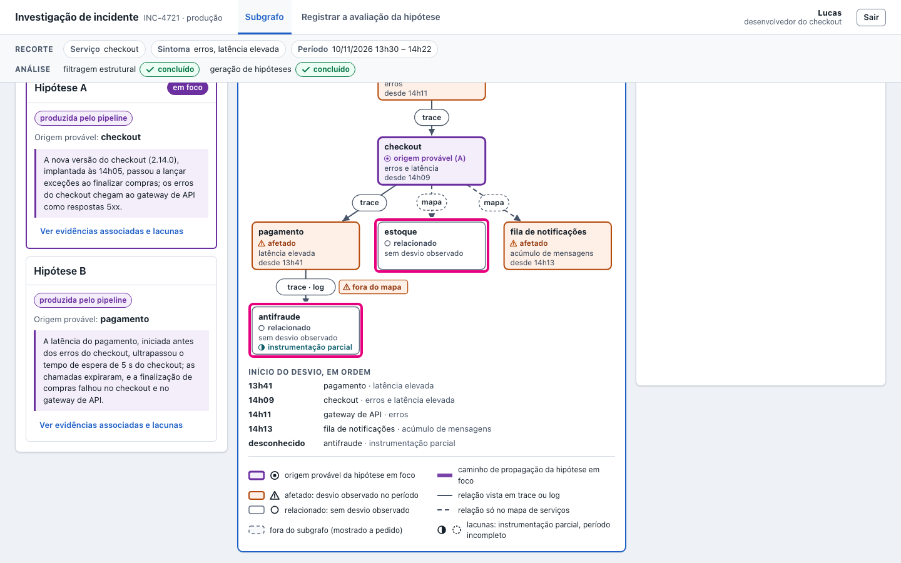
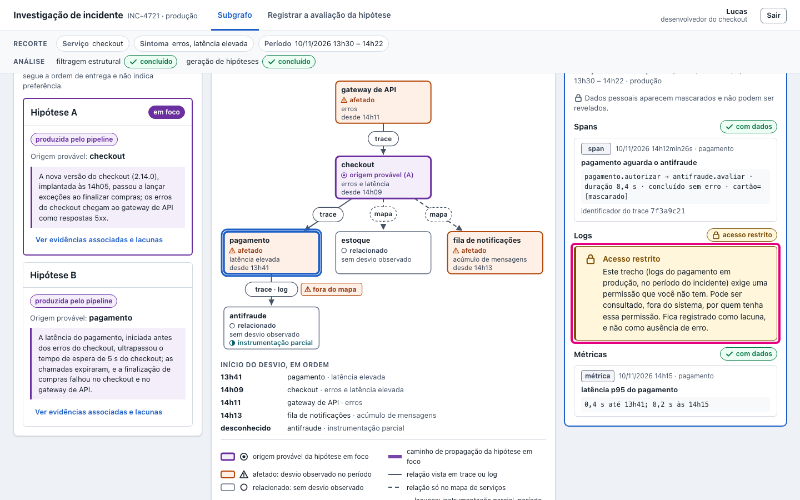
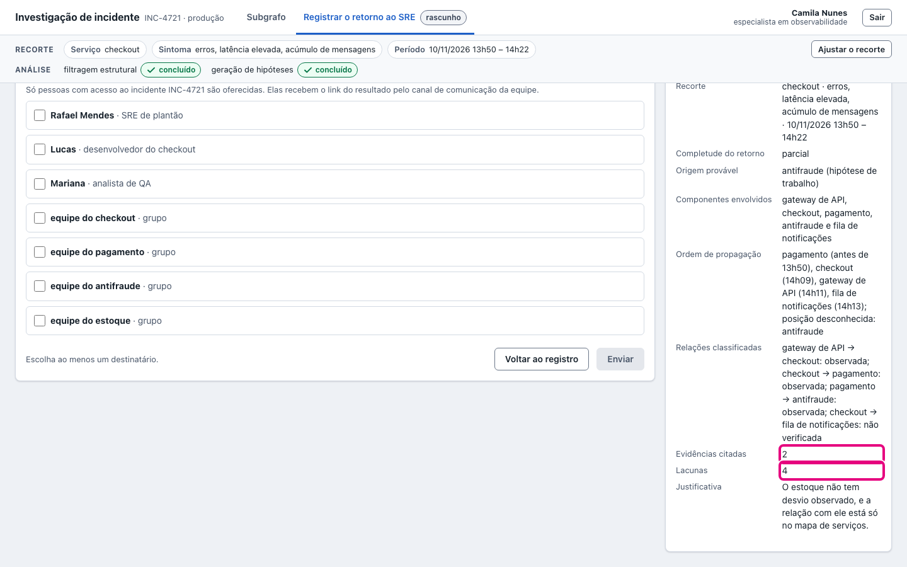
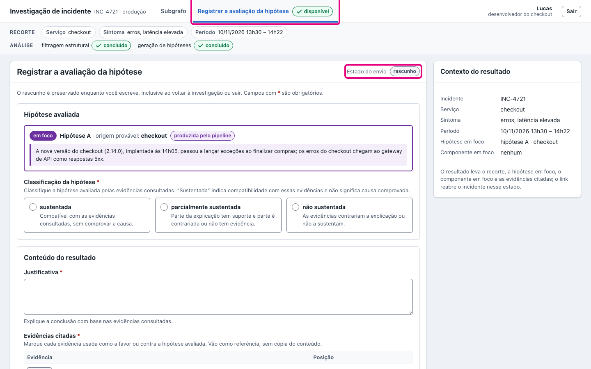
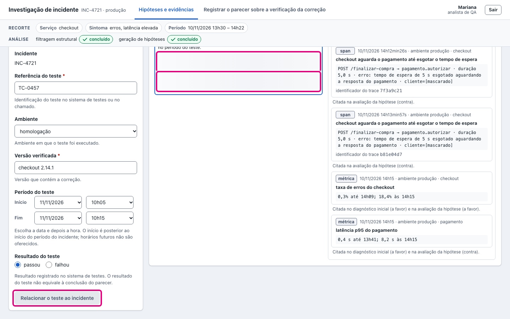
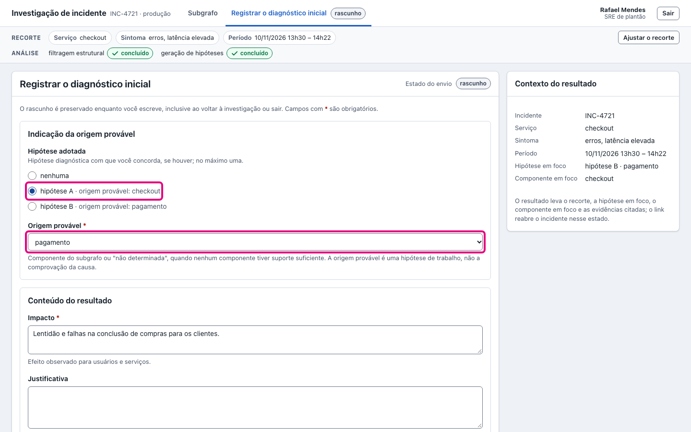
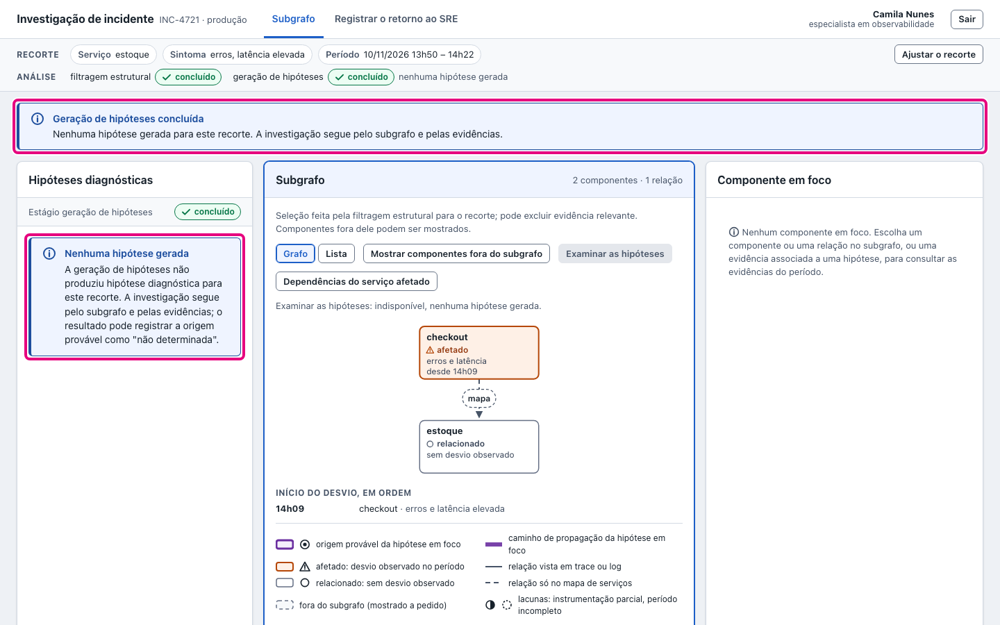
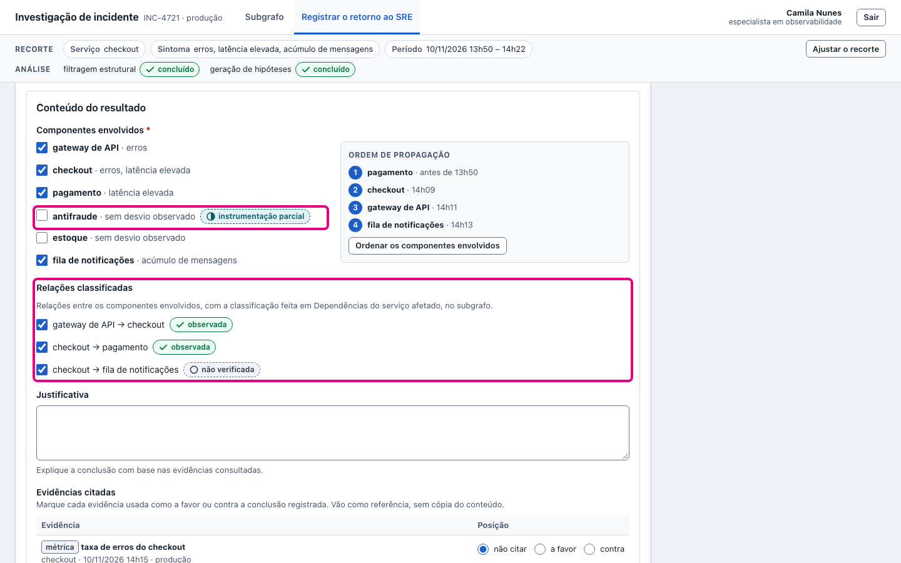
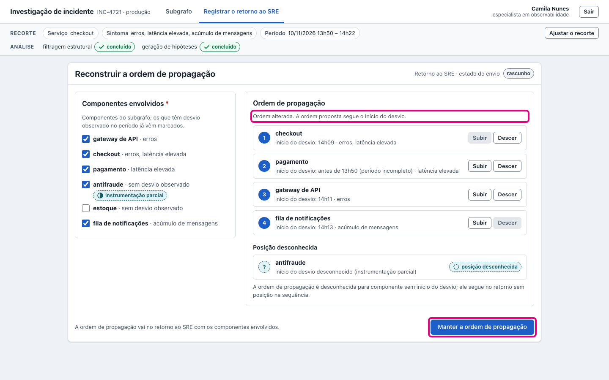

# Entrega 13 — Avaliador A04: João Sitta Giopatto

[← Voltar à Entrega 13](../13_avaliacao_heuristica.md)

**Autor(a):** João Sitta Giopatto — 22.123.054-3

**Data da inspeção:** 18/11/2026

## 4. Matriz de cobertura das 10 heurísticas

| Heurística | Telas/fluxos examinados | Houve violação? | IDs dos achados | Exemplo de boa prática se não violada |
|---|---|---|---|---|
| H1 | M01 → M02 → M03 → M04: 42 telas e estados, em especial F05, F02C, F02V, F06C, F07C, F07S e F12C (QA15) | sim | V04, V05 | — |
| H2 | M01 → M02 → M03 → M04: 42 telas e estados, em especial F03, F04, F09, F10, F11, F13, F14 e F16 (QA16) | sim | V01, V09 | — |
| H3 | M01 → M02 → M03 → M04: 42 telas e estados, em especial F01A, F01X, F07A, F08, F13A e a volta ao subgrafo (QA18) | não | — | F01A (M03, M04): "Cancelar o ajuste" volta ao subgrafo com o recorte e a análise anteriores. |
| H4 | M01 → M02 → M03 → M04: 42 telas e estados, em especial F03, F04, F09, F10, F11, F13, F14 e F16 (QA16) | não | — | F07A (M01–M04): mesma estrutura e mesmos rótulos, na mesma posição, nos quatro fluxos. |
| H5 | M01 → M02 → M03 → M04: 42 telas e estados, em especial F01E, F02V, F06V, F06P, F06R, F06S, F07R, F12E, F12V e F13A (QA17) | sim | V06 | — |
| H6 | M01 → M02 → M03 → M04: 42 telas e estados, em especial F02, F02D, F03, F06, F09, F14, F15 e F16 (QA19) | sim | V03, V08 | — |
| H7 | M01 → M02 → M03 → M04: 42 telas e estados (QA20) | não | — | F16D (M04): o conteúdo do retorno anterior volta ao rascunho do novo retorno. |
| H8 | M01 → M02 → M03 → M04: 42 telas e estados, em especial F02, F02D, F03, F06, F09, F14, F15 e F16 (QA19) | não | — | F05 (M03, M04): só os estágios, o estado de cada um e "Cancelar a análise". |
| H9 | M01 → M02 → M03 → M04: 42 telas e estados, em especial F01E, F02V, F06V, F06P, F06R, F06S, F07R, F12E, F12V e F13A (QA17) | sim | V02, V07 | — |
| H10 | M01 → M02 → M03 → M04: 42 telas e estados, inclusive textos de ajuda dos campos, legenda do subgrafo e vista Lista (QA20) | não | — | F14 (M04): significado de cada classificação da relação e motivo de "observada" indisponível, junto das opções. |

## 5. Declaração de violações

| ID | Heurística | Tela/estado | Problema observado | Evidência | Severidade | Justificativa da severidade | Recomendação |
|---|---|---|---|---|---:|---|---|
| V01 | H2 | F02 (M01, M03, M04), F03 (M01–M04) e os demais estados da tela de investigação; F15, F16 e F16D (M04): nó antifraude do subgrafo, linha antifraude da vista Lista e item antifraude dos componentes envolvidos | O antifraude, que só tem métrica de CPU, sem traces nem logs, aparece no subgrafo como "relacionado" e "sem desvio observado", com o mesmo estado, ícone e cor do estoque, que tem instrumentação completa e de fato não mostra desvio. Na vista Lista, "Desvio observado: nenhum" fica ao lado de "Início do desvio: desconhecido"; F15 e F16 repetem "sem desvio observado". A etiqueta "instrumentação parcial" acompanha o nó, mas o texto afirma ausência de desvio num componente sem sinais para observá-lo. [H] Quem lê o subgrafo pode tomar o antifraude por componente normal e deixá-lo de lado, embora ele seja a dependência ausente do mapa de serviços, tenha a instrumentação parcial entre as lacunas da hipótese B e seja a origem provável que Camila indica no retorno ao SRE. | [a04_v01.png](../../assets/13_heuristica/a04_v01.png) | 3 | Frequência: o nó está no caminho principal dos quatro fluxos (UT01–UT04) e em todos os estados da tela de investigação. Impacto: leva a tratar uma lacuna como normalidade, o que compromete MU02 e MU05 e, em UT04, pode afastar Camila da origem provável do retorno; a etiqueta de instrumentação parcial atenua o problema, e a mensagem de F06V, que o esclarece, só aparece depois da consulta. Persistência: repete-se no grafo, na Lista, em F15 e em F16, a cada uso. | Para componente com instrumentação parcial ou ausente e início do desvio desconhecido, trocar "sem desvio observado" e "nenhum" por "desvio desconhecido (instrumentação parcial)" no nó, na vista Lista e nas listas de componentes envolvidos de F15, F16 e F16D, e distinguir esse caso do estoque na legenda do subgrafo. |
| V02 | H9 | F06P (M01, M02, M04): mensagem "Acesso restrito" na seção Logs do painel do componente em foco | Ao consultar os logs do pagamento em produção, a mensagem informa que o trecho "pode ser consultado, fora do sistema, por quem tenha essa permissão", sem dizer quem tem a permissão. As pessoas com acesso ao incidente são conhecidas pelo sistema, e o SRE de plantão tem essa permissão (M03), mas a mensagem não o indica. [H] Lucas, Mariana e Camila precisam descobrir fora do sistema a quem pedir a consulta ou registram a lacuna sem tentar obter o trecho. | [a04_v02.png](../../assets/13_heuristica/a04_v02.png) | 2 | Frequência: três fluxos, no caminho principal de UT02 e em rupturas de UT01 e UT04. Impacto: não impede a tarefa, porque a mensagem já orienta a registrar o acesso restrito como lacuna (MU02 e critério de MU08), mas deixa a solução incompleta e acrescenta uma busca fora do sistema sob pressão de prazo. Persistência: a cada consulta ao trecho restrito. | Indicar na mensagem quem tem a permissão entre as pessoas com acesso ao incidente, com nome e papel (por exemplo, "Rafael Mendes, SRE de plantão"). |
| V03 | H6 | F07 e F07A (M01–M04): resumo do resultado ao lado dos destinatários e diálogo de confirmação | Na escolha dos destinatários, o resumo mostra só a quantidade de evidências citadas e de lacunas (em M04, "Evidências citadas 2" e "Lacunas 4"), enquanto recorte, componentes envolvidos, ordem de propagação e relações classificadas aparecem por extenso; F07A não mostra nem as quantidades. Para conferir quais evidências e quais lacunas vão para o destinatário, a pessoa precisa lembrar o que marcou no registro ou voltar a ele por "Voltar ao registro". [H] Uma lacuna esquecida ou marcada por engano passa despercebida na revisão antes do envio. | [a04_v03.png](../../assets/13_heuristica/a04_v03.png) | 2 | Frequência: os quatro fluxos passam por F07 e F07A no caminho principal (UT01–UT04). Impacto: não impede o envio, mas a conferência das limitações da conclusão, que MU01 e MU02 e os critérios de MU06 e MU10 pedem no resultado comunicado, depende de memória ou de um desvio ao registro. Persistência: a cada envio. | Listar no resumo de F07 as evidências citadas, com a posição (a favor ou contra), e as lacunas, com tipo e local, no lugar das quantidades, e incluir as lacunas no resumo de F07A. |
| V04 | H1 | F11 (M01), F13 (M02) e F10 (M03) abertos depois de F07S: etiqueta do acesso ubíquo do registro, na barra superior, e "Estado do envio" do formulário | Depois do envio disponível, o acesso ubíquo do registro continua com a etiqueta "disponível", mas, ao ser acionado, abre o formulário com os campos do resultado em branco (em F13, resta só o teste relacionado) e "Estado do envio: rascunho", sem informar que se trata de um novo resultado nem que o enviado continua disponível e onde consultá-lo. A mesma tela mostra dois estados do envio contraditórios, e o conteúdo enviado não aparece. Em M04, a situação equivalente é tratada em F16D, com a mensagem "Atualização de RS-1" e o aviso de que o RS-1 continua disponível. [H] Quem volta ao registro para conferir o que enviou pode achar que o resultado se perdeu ou enviar de novo um resultado duplicado. | [a04_v04.png](../../assets/13_heuristica/a04_v04.png) | 2 | Frequência: M01, M02 e M03, fora do caminho principal de UT01–UT03, que termina em F07S, mas no gesto comum de conferir o que foi enviado. Impacto: gera dúvida sobre o estado do envio, o signo que fecha a comunicação (a recuperação de MU12 termina com o reconhecimento do "disponível"), com risco de envio duplicado. Persistência: a cada envio nesses três fluxos. | Ao abrir o registro depois de um envio disponível, mostrar no topo do formulário uma mensagem como a de F16D (novo resultado; o resultado enviado, com identificador e horário, continua disponível) e fazer a etiqueta do acesso ubíquo acompanhar o estado do resultado em edição. |
| V05 | H1 | F12C (M02): painel "Evidências do teste" depois de "Relacionar o teste ao incidente"; mensagem de status de F12D | O botão "Relacionar o teste ao incidente" fica no fim do formulário, e a página precisa estar rolada para alcançá-lo. Com a página rolada, durante a consulta, o título do painel "Evidências do teste" e a etiqueta "carregando" ficam sob as barras fixas; o texto "Consultando as evidências dos componentes do subgrafo no ambiente e no período do teste" fica encoberto em parte ou aparece, conforme a rolagem, e, com a página no fim, só a última linha aparece, cortada logo abaixo da barra do recorte. Quando a consulta termina, a mensagem de status "Verificação da correção relacionada ao incidente" fica acima da janela. [H] Mariana vê só parte da explicação da espera e não vê a confirmação de que o teste foi relacionado ao incidente. | [a04_v05.png](../../assets/13_heuristica/a04_v05.png) | 2 | Frequência: só M02 (UT02), no caminho principal e a cada nova tentativa depois de F12E ou F12V. Impacto: o botão atenuado, os blocos de carregamento e, conforme a rolagem, o texto da consulta explicam a espera em parte, e o resultado da consulta aparece em parte na janela ao fim do processo; sem a etiqueta "carregando" e sem a mensagem de status, e com a duração real das consultas desconhecida (Entrega 8), a pessoa pode não saber se a consulta terminou nem se o teste foi relacionado ao incidente. Persistência: a cada vez que o teste é relacionado ao incidente. | Ao acionar "Relacionar o teste ao incidente", levar a janela ao topo do painel "Evidências do teste" ou mostrar o estado da consulta junto ao botão, e manter na janela a mensagem de status com o resultado. |
| V06 | H5 | F10 (M03): grupo "Indicação da origem provável" (hipótese adotada e origem provável); efeito em F07 e F07A | Escolher a hipótese adotada não preenche a origem provável, e o formulário aceita combinações contraditórias: com "hipótese A · origem provável: checkout" marcada e "pagamento" escolhido em Origem provável, os campos obrigatórios ficam preenchidos, e F07 e F07A mostram, lado a lado, "Origem provável: pagamento (hipótese de trabalho)" e "Hipótese adotada: hipótese A (origem provável: checkout)", sem aviso. [H] Um engano de Rafael no grupo de opções ou na lista de seleção chega a Lucas como diagnóstico incoerente, que pode orientar a correção para o componente errado. | [a04_v06.png](../../assets/13_heuristica/a04_v06.png) | 3 | Frequência: só M03, mas no registro do diagnóstico inicial, caminho principal de UT03, tarefa central da persona primária (MU06). Impacto: a incoerência segue para o destinatário e atinge a origem provável, conteúdo cujo erro tem a maior consequência em C01 e C03 (correção no serviço errado, erro que fundamenta MU11). Persistência: nada no caminho até o envio a detecta, a cada diagnóstico. | Ao escolher uma hipótese adotada, propor a origem provável dela no campo Origem provável; se a pessoa escolher outra origem, mostrar um aviso junto aos dois campos e destacar a divergência em F07A, antes da confirmação. |
| V07 | H9 | F02V (M03, M04): mensagem de status "Geração de hipóteses concluída" e mensagem "Nenhuma hipótese gerada" do painel de hipóteses | Com o estoque como serviço do recorte, as mensagens dizem que nenhuma hipótese foi gerada "para este recorte" e que a investigação segue pelo subgrafo, podendo registrar a origem provável como "não determinada", mas não dizem a causa, o serviço do recorte sem desvio observado no período, nem sugerem ajustar o recorte, embora o subgrafo mostre o checkout afetado e o estoque sem desvio. [H] Se o serviço foi escolhido por engano em F01, Rafael ou Camila seguem para um resultado com origem "não determinada" em vez de corrigir o recorte. | [a04_v07.png](../../assets/13_heuristica/a04_v07.png) | 2 | Frequência: M03 e M04, só na ruptura "nenhuma hipótese gerada", fora do caminho principal de UT03 e UT04. Impacto: pode levar a um resultado sem origem provável a partir de um recorte errado; o recorte visível ("Serviço estoque") e o subgrafo dão pistas para perceber o engano. Persistência: a cada análise sem hipótese. | Informar a causa na mensagem ("o estoque, serviço do recorte, não tem desvio observado no período") e oferecer "Ajustar o recorte" como saída, ao lado da continuação pelo subgrafo. |
| V08 | H6 | F16 (M04): grupo "Relações classificadas" e item antifraude dos componentes envolvidos | As relações classificadas incluem só relações entre componentes envolvidos, e o antifraude vem desmarcado, porque a lista parte dos componentes com desvio observado. Assim, pagamento → antifraude, a relação ausente do mapa que F14 destaca e para a qual propõe "observada", não aparece no registro, nem desmarcada; para levá-la ao SRE, Camila precisa lembrar a relação vista em F14 e deduzir que ela depende de incluir o antifraude entre os componentes envolvidos. [H] O retorno pode ir sem a relação que explica, em C04, o desvio da investigação. | [a04_v08.png](../../assets/13_heuristica/a04_v08.png) | 2 | Frequência: só M04, no caminho principal de UT04. Impacto: o retorno pode ser enviado sem a relação mais importante para a decisão do SRE; MU10 continua atendida com as demais relações, e o resumo de F07 lista as relações enviadas. Persistência: a cada retorno em que o antifraude não é incluído. | Mostrar pagamento → antifraude em "Relações classificadas", desmarcada, com a indicação de que marcá-la inclui o antifraude entre os componentes envolvidos. |
| V09 | H2 | F15 (M04): botão "Manter a ordem de propagação" depois de alterar a ordem | Depois de mudar a ordem com "Subir" ou "Descer", o texto do painel passa a "Ordem alterada. A ordem proposta segue o início do desvio.", mas a única saída continua a ser "Manter a ordem de propagação", que leva a ordem alterada ao registro. [H] Logo depois de uma frase sobre a ordem proposta, o rótulo pode ser lido como manter a ordem proposta, e quem quer desfazer a alteração envia a ordem alterada. | [a04_v09.png](../../assets/13_heuristica/a04_v09.png) | 1 | Frequência: só M04 e só quando a ordem é alterada, fora do caminho principal de UT04. Impacto: dúvida momentânea, que a ordem mostrada em F16 e no resumo de F07 permite resolver. Persistência: baixa. | Quando a ordem tiver sido alterada, trocar o rótulo por "Usar esta ordem" e oferecer "Restaurar a ordem proposta". |

*Figura 1 — V01, F02 (Subgrafo) em M01: nós do antifraude e do estoque, ambos "relacionado" e "sem desvio observado"; só o antifraude tem instrumentação parcial. Fonte: elaboração do autor.*

*Figura 2 — V02, F06P (Acesso restrito) em M01: mensagem de acesso restrito aos logs do pagamento em produção, sem indicação de quem tem a permissão. Fonte: elaboração do autor.*

*Figura 3 — V03, F07 (Escolher os destinatários) em M04: quantidades de evidências citadas e de lacunas no resumo do retorno ao SRE. Fonte: elaboração do autor.*

*Figura 4 — V04, F11 (Registrar a avaliação da hipótese) em M01, aberto depois de F07S: etiqueta "disponível" no acesso ubíquo do registro e "Estado do envio: rascunho" no formulário em branco. Fonte: elaboração do autor.*

*Figura 5 — V05, F12C (Consultando as evidências do teste) em M02, com a página rolada até o fim do formulário: botão "Relacionar o teste ao incidente" atenuado, blocos de carregamento do painel e só a última linha do texto da consulta, cortada logo abaixo da barra do recorte; o título do painel e a etiqueta "carregando" ficam sob as barras fixas. Fonte: elaboração do autor.*

*Figura 6 — V06, F10 (Registrar o diagnóstico inicial) em M03: hipótese adotada A, com origem provável checkout, e origem provável "pagamento" aceitas juntas. Fonte: elaboração do autor.*

*Figura 7 — V07, F02V (Nenhuma hipótese gerada) em M04: mensagem de status e mensagem do painel de hipóteses, sem a causa e sem a sugestão de ajustar o recorte. Fonte: elaboração do autor.*

*Figura 8 — V08, F16 (Registrar o retorno ao SRE) em M04: relações classificadas sem pagamento → antifraude e antifraude desmarcado entre os componentes envolvidos. Fonte: elaboração do autor.*

*Figura 9 — V09, F15 (Reconstruir a ordem de propagação) em M04: texto "Ordem alterada" e botão "Manter a ordem de propagação" depois de subir o checkout. Fonte: elaboração do autor.*

## 6. Boas práticas — heurísticas não violadas (atividade didática)

| Heurística sem violação | Exemplo no sistema | Evidência | Por que atende |
|---|---|---|---|
| H3 | Diálogo "Confirmar o ajuste do recorte", F01A (M03, M04) | [F01A](../../assets/11_figma/f01a.png) | Antes da nova análise, o diálogo mostra o recorte vigente e avisa que o subgrafo e as hipóteses diagnósticas serão substituídos e que o rascunho é preservado. "Cancelar o ajuste", ao lado de "Confirmar", devolve a pessoa ao subgrafo com o recorte e a análise anteriores, sem percorrer outro diálogo: quem acionou "Ajustar o recorte" por engano sai do estado indesejado em um passo. |
| H4 | Diálogo "Confirmar os destinatários", F07A (M01–M04) | [F07A](../../assets/11_figma/f07a.png) | Nos quatro fluxos, o diálogo tem o mesmo título, a mesma estrutura (destinatários, resumo do resultado e link do resultado) e os mesmos rótulos "Alterar os destinatários" e "Confirmar", na mesma posição. A mesma ação tem a mesma aparência e o mesmo efeito para Lucas, Mariana, Rafael e Camila. |
| H7 | Retorno que atualiza um retorno anterior, F16D (M04) | [F16D](../../assets/11_figma/f16d.png) | Ao registrar o retorno completo depois do parcial, o conteúdo do RS-1 volta ao rascunho, com a mensagem "Atualização de RS-1"; Camila altera só o que mudou, como a completude e a classificação de checkout → fila de notificações. O trabalho já feito é reaproveitado, e a segunda comunicação exige menos passos que a primeira. |
| H8 | Cena "Acompanhar a análise", F05 (M03, M04) | [F05](../../assets/11_figma/f05.png) | Durante a espera, a unidade mostra só os dois estágios, uma frase sobre cada um, o estado de cada estágio, quando o subgrafo ficará disponível e a única ação possível, "Cancelar a análise", sem informação que dispute a atenção com o andamento da análise. |
| H10 | Legenda da classificação das relações, F14 (M04) | [F14](../../assets/11_figma/f14.png) | A ajuda está onde a decisão é tomada: a cena explica o que significam "observada", "inferida" e "não verificada", que a classificação proposta segue a fonte da relação e, em cada relação sem trace nem log, por que "observada" está indisponível. É concisa e focada na tarefa de classificar as dependências (T05), sem documentação à parte. |
