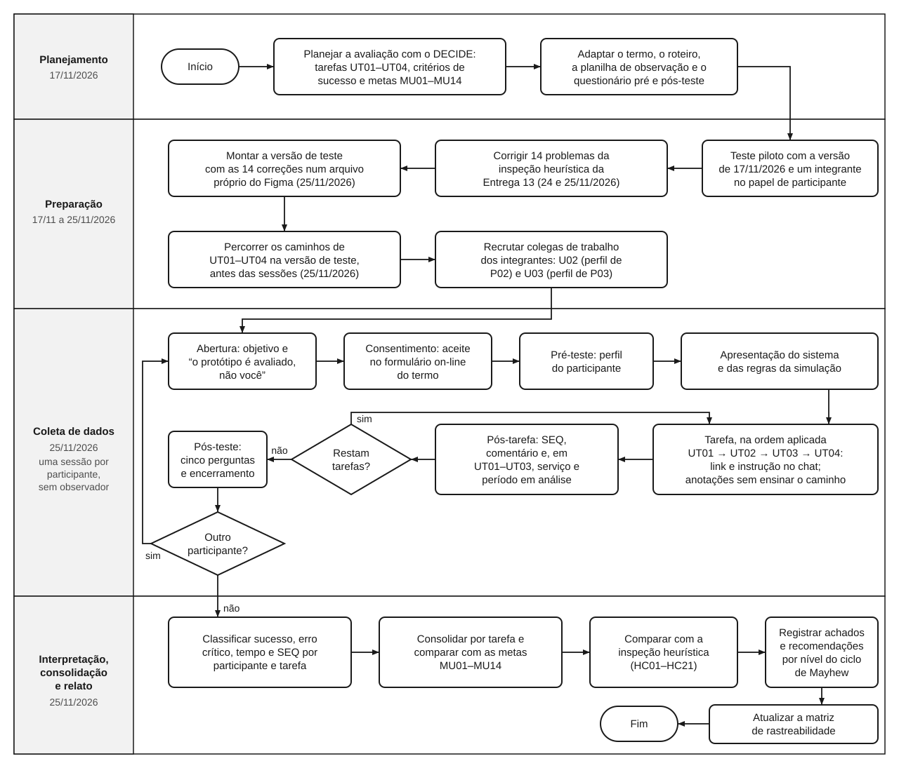

# Entrega 14 — Avaliação de usabilidade por observação de usuários

[← Início do projeto](../README.md) · [Entrega 13 — Avaliação heurística](13_avaliacao_heuristica.md)

**Data:** 25/11/2026

**Status:** 🟩 concluída

**Responsabilidade:** solução consolidada por equipe. O número de participantes finais observados deve ser igual ao número de integrantes, conforme o modelo da disciplina; recomenda-se que cada integrante seja responsável por conduzir/analisar ao menos um participante.

## Objetivo e entradas

Observar usuários representativos realizando tarefas reais ou realisticamente simuladas para identificar problemas de eficácia, eficiência, compreensão e satisfação que não podem ser inferidos apenas por inspeção.

O **teste de usabilidade com observação** é o método em que participantes representativos realizam tarefas com a interface enquanto um avaliador observa e registra o que acontece. Ele mostra problemas reais de uso e permite medir eficácia, eficiência e satisfação, como define a etapa C do DECIDE na [Entrega 12](12_planejamento_avaliacao.md#a-método-decide). Esta entrega executa o teste planejado naquela entrega e consolida os resultados pelas regras da [seção F](12_planejamento_avaliacao.md#f-plano-de-análise).

As entradas são as tarefas de avaliação UT01–UT04 e os critérios de sucesso da [Entrega 12, seção D](12_planejamento_avaliacao.md#d-lista-de-tarefas-de-avaliação), com os [instrumentos](../instrumentos/README.md) adaptados a ela; as metas MU01–MU14, os pesos de prioridade e o ciclo de Mayhew da [Entrega 8](08_engenharia_usabilidade.md); os problemas HC01–HC21 da [Entrega 13](13_avaliacao_heuristica.md), com as 14 correções aplicadas antes das sessões e os sete problemas mantidos na versão de teste ([seção 8](13_avaliacao_heuristica.md#8-síntese-e-plano-de-melhoria)); o protótipo da [Entrega 11](11_figma.md); e as personas P01–P04 da [Entrega 3](03_personas_contexto_jornada.md). Os resultados de cada tarefa estão na coluna "Tarefa no teste" das linhas R01–R04 da [matriz de rastreabilidade](../RASTREABILIDADE.md#3-rastreabilidade-entre-contribuição-técnica-necessidades-e-artefatos).

Os dois participantes finais, U02 e U03, não são integrantes da equipe. No teste piloto, um integrante fez o papel de participante, e os dados do piloto ficaram fora dos resultados (passo 4).

### Quando o usuário é um perfil profissional especializado

O público do projeto são profissionais que operam e mantêm sistemas distribuídos, representados pelas personas P01–P04. Foram observados dois participantes com relação real com as tarefas: U02, desenvolvedor de software há 14 anos, no perfil de P02, e U03, analista de QA há 6 anos, no perfil de P03 (passo 2). Não houve participante aproximado (*proxy*). Os perfis de P01 (SRE) e P04 (observabilidade) não foram recrutados, e U01 e U04 ficaram sem sessão, limitação discutida na seção G. Em cada tarefa, o participante assumiu o papel de uma persona; em UT01, o papel é o de U02, e, em UT02, o de U03.

O teste avaliou a interação com o protótipo, não o desempenho do pipeline do TCC. Como declara a Entrega 12, o incidente INC-4721 é fictício, e subgrafo, hipóteses diagnósticas, evidências, consultas e esperas são simulados e iguais para todos. Os critérios de sucesso verificam se a interpretação do participante é compatível com as evidências que o protótipo mostra.

## A. Fluxograma do processo — equipe

O processo seguiu as fases da avaliação dos slides de planejamento (preparação, coleta de dados, interpretação, consolidação e relato) e o [roteiro de teste](../instrumentos/roteiro_teste_usabilidade.md), como mostra a Figura 1. O planejamento e o piloto são de 17/11/2026. Entre o piloto e as sessões, a equipe corrigiu 14 problemas da inspeção heurística e montou a versão de teste num arquivo próprio do Figma, em 25/11/2026. As duas sessões aconteceram nesse mesmo dia, cada uma com um moderador e sem observador. Os laços do fluxograma são as quatro tarefas de cada sessão e os dois participantes.

*Figura 1 — Processo da avaliação por observação de usuários da Entrega 14, com as fases nas faixas e as datas de cada fase. Fonte: elaboração da equipe.*

## B. Procedimento de preparação e execução — equipe

### Passo 1 — Objetivos e versão avaliada

O objetivo é o da etapa D do DECIDE da Entrega 12: verificar se o protótipo atinge as metas MU01–MU14 nas tarefas de avaliação e identificar os problemas que impedem ou dificultam essas tarefas.

**Versão/commit/Figma:** protótipo da [Entrega 11](11_figma.md) com as 14 correções da [Entrega 13, seção 8](13_avaliacao_heuristica.md#8-síntese-e-plano-de-melhoria) (HC01–HC07, HC09, HC10, HC12, HC14, HC16, HC17 e HC19), montado em 25/11/2026 num arquivo próprio do Figma: [arquivo editável](https://www.figma.com/design/A4h5wkD5noOwkhIpQmXS80/Untitled) e [protótipo](https://www.figma.com/proto/A4h5wkD5noOwkhIpQmXS80/Untitled). Os sete problemas sem correção (HC08, HC11, HC13, HC15, HC18, HC20 e HC21) continuam nessa versão. As telas da versão de 17/11/2026 estão no [catálogo da Entrega 11](11_figma.md#catálogo-de-telasestados), e as correções, na tabela da seção 8 da Entrega 13. Os caminhos de UT01–UT04 foram percorridos na versão de teste em 25/11/2026, antes das sessões. Cada tarefa foi aberta pelo link do seu ponto de partida (F00B, F00C e F00A dos fluxos M03 e M04), sem a barra do Figma e sem a indicação de áreas clicáveis.

**Metas de usabilidade relacionadas:** MU01–MU14 da [Entrega 8](08_engenharia_usabilidade.md#3-metas-de-usabilidade). MU07 é medida em UT01; MU08 e MU12, em UT02; MU06, em UT03; MU09 e MU10, em UT04; MU11, MU13 e MU14, nas quatro tarefas; e MU01–MU05 pela evidência desejada, nas tarefas indicadas na Entrega 12, seção D.

### Passo 2 — Participantes

| ID | Perfil | Critérios que justificam participação | Integrante responsável |
|---|---|---|---|
| U02 | Desenvolvedor de software há 14 anos, no perfil de P02. Usa App Insights, Grafana, Datadog e Prometheus e participa de investigações de incidentes uma vez por semana ou mais. Colega de trabalho do moderador. | Critérios da Entrega 12, seção C: maior de 18 anos, pelo tempo no papel; no papel há mais de 6 meses; consulta logs, métricas e traces de sistemas com serviços distribuídos no trabalho; não integra a equipe, não tinha visto o projeto, o protótipo nem as entregas, não fez o piloto, não é subordinado ao moderador e aceitou o termo. Tela com menos de 1440 px, em sessão remota: critério não atendido (passo 6). | Willian Verenka Oliveira Silva (moderação e anotações) |
| U03 | Analista de QA há 6 anos, no perfil de P03. Usa o Grafana para observar logs e participa de investigações de incidentes de uma a três vezes por mês. Colega de trabalho do moderador. | Critérios da Entrega 12, seção C: maior de 18 anos, pelo tempo no papel; no papel há mais de 6 meses; trabalha com sistemas com serviços distribuídos; não integra a equipe, não tinha visto o projeto, o protótipo nem as entregas, não fez o piloto, não é subordinado ao moderador e aceitou o termo. Tela com menos de 1440 px, em sessão remota: critério não atendido (passo 6). Verificação de correções antes da liberação: PENDENTE. | João Sitta Giopatto (moderação e anotações) |

U01 (perfil de P01, SRE) e U04 (perfil de P04, observabilidade) não foram recrutados, e não houve participante aproximado para esses perfis.

### Passo 3 — Consentimento e privacidade

- Termo/registro de consentimento: [formulário on-line do termo](https://docs.google.com/forms/d/e/1FAIpQLSdbWwJnMbPQE92H6zSqs8PsDSZxGqxyxF736E1sl6CNlz-54A/viewform) (Google Forms), elaborado a partir do [modelo de termo](../instrumentos/termo_consentimento_modelo.md) e aberto sem login. O termo foi lido no início da sessão, e o participante marcou no formulário a única pergunta, obrigatória: "Declaro que recebi informações suficientes sobre a atividade e concordo em participar nos termos acima." O formulário não pede nome. Ele informa que não haverá gravação; que o participante pode pedir a exclusão dos dados até 04/12/2026 e, depois disso, a exclusão do termo e da relação entre o ID e o contato; e que a sessão dura cerca de 20 min, com 30 min reservados, por videoconferência, com um responsável conduzindo e outro acompanhando como observador. Nas duas sessões não houve observador (passo 6).
- Gravação de tela/áudio/vídeo: não. A sessão foi registrada só pelas anotações do moderador.
- Forma de anonimização: IDs `U02` e `U03`, os mesmos do perfil de persona na Entrega 12. As anotações e esta entrega não trazem nome, e as falas aparecem resumidas, sem identificação. O aceite no formulário não leva nome nem ID.
- Local e período de armazenamento: as respostas do formulário ficam na conta de Willian Verenka Oliveira Silva, fora do repositório, e são apagadas depois da avaliação final da disciplina, até 31/01/2027; a relação entre ID e contato fica só com o integrante que convidou o participante, fora do repositório, e é apagada ao fim da disciplina; o repositório recebe só dados anonimizados.

### Passo 4 — Teste piloto

**Data:** 17/11/2026

**O que foi validado:** roteiro, duração, entendimento das instruções e caminhos de UT01–UT04, na versão do protótipo de 17/11/2026, com os quatro integrantes conduzindo a atividade e um deles no papel de participante. Não havia gravação a validar. Os dados do piloto não entram nos resultados.

**Mudanças após piloto:** nenhuma. A versão das sessões é posterior ao piloto: recebeu as 14 correções da Entrega 13 e teve os caminhos de UT01–UT04 percorridos em 25/11/2026 (passo 1), sem novo piloto.

### Passo 5 — Tarefas

As tarefas, os critérios e os tempos-limite foram definidos na Entrega 12, seção D, em 17/11/2026, antes das sessões. A tabela resume os critérios; a versão completa está naquela seção.

| ID | Cenário/instrução apresentada | Critério de sucesso | Métricas | Ligação com modelo |
|---|---|---|---|---|
| UT01 | "Você é Lucas, desenvolvedor do checkout. Rafael Mendes, SRE de plantão, acabou de lhe mandar a mensagem que está na tela. Atenda ao pedido dele usando o sistema e faça sua resposta, com o motivo da sua decisão, chegar a Rafael. Avise quando considerar a tarefa concluída." | Avaliação da hipótese A enviada a Rafael Mendes, com o estado "disponível", classificada como "parcialmente sustentada" ou "não sustentada" e com, na justificativa dita em voz alta, ao menos uma evidência que contradiz a origem no checkout: spans do checkout aguardando o pagamento, latência p95 do pagamento ou início do desvio do pagamento (13h41), anterior ao do checkout (14h09) (MU07). | sucesso, tempo, erros, ajudas e SEQ; tempo-limite de 8 min | T01 · O04, O08, O05, O13, O16 · M01 · R01 · F00B a F07S |
| UT02 | "Você é Mariana, analista de QA. O chamado da correção que está na tela pede sua verificação antes da liberação do checkout 2.14.1, marcada para hoje. Você já executou um teste em homologação: referência TC-0457, versão checkout 2.14.1, em 11/11/2026, das 10h05 às 10h15, com resultado 'passou'. Use o sistema para decidir o que as evidências permitem afirmar sobre a correção e faça sua conclusão, com o que a sustenta, chegar a Lucas, responsável pela correção, e a Rafael Mendes, SRE de plantão. Quem participou da investigação não poderá responder a perguntas antes da liberação. Avise quando considerar a tarefa concluída." | Parecer enviado a Lucas e a Rafael Mendes, com a conclusão "inconclusivo" e ao menos uma informação faltante específica, como o acesso restrito aos logs do pagamento ou a demora acima de 5 s não exercitada no teste (MU08); diante da falha no primeiro envio, repete o envio sem reescrever o parecer e reconhece o estado "disponível" (MU12). | sucesso, tempo, erros, ajudas e SEQ; tempo-limite de 9 min | T02 · O04, O08, O10, O14, O16 · M02 · R02 · F00C a F07S, passando por F07R |
| UT03 | "Você é Rafael Mendes, SRE de plantão. A ferramenta de alertas acaba de disparar o alerta que está na tela. Investigue o incidente no sistema e comunique a Lucas, desenvolvedor do checkout, o que você conclui até agora sobre a origem e o impacto. A equipe precisa dessa primeira conclusão para decidir os próximos passos. Avise quando considerar a tarefa concluída." | Diagnóstico inicial enviado a Lucas, com o estado "disponível" reconhecido, contendo o sintoma, a origem provável escolhida ou "não determinada", o impacto, ao menos uma evidência a favor ou contra e ao menos uma limitação (MU06). | sucesso, tempo, erros, ajudas e SEQ; tempo-limite de 11 min | T03 · O02, O03, O05, O08, O09, O12, O16 · M03 · R03 · F00A a F07S |
| UT04 | "Você é Camila Nunes, especialista em observabilidade. Os alertas que estão na tela dispararam há pouco, e Rafael Mendes, SRE de plantão, pediu sua ajuda: ele precisa decidir em poucos minutos se aciona outras equipes. Use o sistema para descobrir quais serviços estão envolvidos, quais serviços o checkout chama direta ou indiretamente, em que ordem o problema se espalhou e qual seria a provável origem, indicando o grau de certeza de cada ligação entre os serviços. Faça chegar a Rafael o que tiver estabelecido assim que puder, mesmo sem ter terminado a investigação. Avise quando considerar a tarefa concluída." | Classificação das relações (F14) aberta, com pagamento → antifraude como "observada" e checkout → estoque como "não verificada" (MU09); retorno enviado a Rafael Mendes, com o estado "disponível", os serviços afetados, a ordem de propagação, cada relação com sua classificação e ao menos uma lacuna (MU10). | sucesso, tempo, erros, ajudas e SEQ; tempo-limite de 12 min | T04, T05 e T06 · O02, O03, O05, O06, O08, O15, O07, O16 · M04 · R04 · F00A ao primeiro F07S |

### Passo 6 — Protocolo do moderador

O protocolo aplicado foi o do [roteiro de teste](../instrumentos/roteiro_teste_usabilidade.md), com os desvios registrados abaixo. As sessões foram remotas, por videoconferência, com o participante no trabalho e a tela compartilhada. **Desvio:** nas duas sessões, a tela do participante tinha menos de 1440 px de largura, critério de inclusão da Entrega 12, seção C, que só admite tela menor na sessão presencial.

1. O moderador recebeu o participante e explicou que o protótipo estava sendo avaliado, não a pessoa.
2. O consentimento foi obtido pelo formulário on-line do termo, com o link enviado no chat, antes do pré-teste (passo 3).
3. O pré-teste teve as cinco perguntas do [questionário](../instrumentos/questionario_pre_pos_teste.md): papel atual, tempo no papel, ferramentas, frequência de investigações de incidentes e ajuste para a sessão (passo 2).
4. Em cada tarefa, o moderador enviou o link do ponto de partida, leu a instrução e a deixou no chat. **Desvio:** nas duas sessões, as tarefas foram aplicadas na ordem UT01, UT02, UT03 e UT04, por engano, e não na ordem UT03, UT04, UT01 e UT02 da Entrega 12. Com a troca, UT03 deixou de ser medida sem aprendizagem anterior, e UT03 e UT04 passaram a vir depois das aberturas de UT01 e UT02, que mostram o diagnóstico inicial D-1 e a avaliação da hipótese AV-1. U02 registrou que viu o D-1 da abertura de UT01 antes de fazer UT03.
5. O moderador observou sem ensinar o caminho, e não houve ajuda em nenhuma tarefa das duas sessões. **Desvios:** cada sessão teve só o moderador, que fez as anotações sozinho, sem observador; por isso não houve codificação independente por moderador e observador. Não houve gravação para conferir tempos e falas. A contagem de erros por tarefa não foi registrada. UT03 e UT04 de U03, encerradas nos caminhos sem saída do protótipo (AU01), não foram repetidas no fim da sessão, como a Entrega 12, seção A, prevê para a tarefa que não pode ser concluída por link morto.
6. O pensamento em voz alta e o texto dos campos livres dito em voz alta seguiram o roteiro (seção 2).
7. Depois de cada tarefa, o moderador perguntou a SEQ e o que tornou a tarefa fácil ou difícil e, ao fim de UT01, UT02 e UT03, o serviço e o período em análise. Para U03, a resposta sobre o recorte foi registrada uma vez, sem a indicação da tarefa.
8. O pós-teste teve as cinco perguntas do questionário (seção C).
9. O encerramento seguiu o roteiro (seção 7).

As quatro tarefas, com as perguntas pós-tarefa, ocuparam 18:24 na sessão de U02 (de 09:55:12 a 10:13:36) e cerca de 19:37 na de U03 (de 10:11:12 a 10:30:49).

## C. Resultados — por participante

**Classificação do sucesso.** A equipe classificou como sucesso parcial todas as tarefas com resultado enviado: as quatro de U02 e UT01 e UT02 de U03. O motivo é que o protótipo aceitou poucas opções para marcar e seguir e conduziu as escolhas. Em UT01, só "parcialmente sustentada" respondia para U02, e o envio só funcionou com a equipe do pagamento entre os destinatários; em UT02, "quem pode esclarecer" exigiu Lucas e Rafael Mendes; em UT03, "não determinada" não respondia, e U02 enviou a origem no pagamento com a hipótese B; em UT04, a origem aceita era o antifraude. Assim, não é possível saber se o conteúdo enviado é escolha do participante ou a única opção do protótipo. A definição da Entrega 12, seção F, não prevê esse caso: nela, o sucesso parcial depende de um elemento do critério ausente ou alcançado com ajuda. A classificação é decisão da equipe e vale para as metas de eficácia da seção D. UT03 e UT04 de U03 são falha pela definição da Entrega 12, porque o resultado não foi enviado: o participante ficou preso em caminhos sem saída do protótipo (AU01). Nenhuma tarefa teve erro crítico. Em UT03 e UT04, U03 não comunicou nada, e o erro crítico de MU11 é contado sobre o que foi comunicado.

**Erros, tempo e satisfação.** A contagem de erros por tarefa não foi registrada nas duas sessões; a coluna "Tipos de erro/dificuldade" resume as dificuldades das anotações. O tempo é a diferença entre os horários de início e de fim anotados pelo moderador; em UT03 e UT04 de U03, o início é aproximado. A satisfação é a SEQ, de 1 (muito difícil) a 7 (muito fácil).

### U02 — desenvolvedor de software há 14 anos, perfil de P02

| Tarefa | Grau de sucesso | Erros | Tipos de erro/dificuldade | Ajudas | Tempo | Satisfação | Evidência/observação |
|---|---|---:|---|---:|---|---|---|
| UT01 | parcial | não registrado | "Consultar" e "Ver o conteúdo" não abriram, e ele queria ler a exceção antes de classificar; só "parcialmente sustentada" respondia, e ele hesitou com "não sustentada"; "Enviar" parecia ativo só com Rafael Mendes, mas só funcionou depois de incluir a equipe do pagamento, que a tarefa não pedia; as lacunas não respondiam, e o resumo enviado trouxe "Lacunas: nenhuma". | 0 | 03:08 | SEQ 3 | Avaliação da hipótese A enviada como "parcialmente sustentada" a Rafael Mendes e à equipe do pagamento. Disse que a lista "Início do desvio, em ordem" mostrou na hora que o pagamento degradou antes da implantação, que o link da mensagem abre a investigação no estado em que foi enviada e que a confirmação e o selo "disponível" deixam claro que a resposta chegou. Sem erro crítico. |
| UT02 | parcial | não registrado | "Avaliar o teste da correção" fica escondido no fim da coluna de hipóteses; a lista de horários começa em 00h00 e avança de 5 em 5 min; os campos só foram liberados depois de marcar evidências numa ordem que a tela não explica; "quem pode esclarecer" exigiu Rafael Mendes, quando ele queria a equipe do pagamento; Rafael Mendes só pôde ser marcado como destinatário depois de Lucas. | 0 | 05:08 | SEQ 4 | Chamou a comparação lado a lado de "o melhor momento das quatro tarefas": no teste, o pagamento respondeu em 0,6 s, e a falha só acontece acima de 5 s. O aviso "Nenhum teste relacionado" indicou o caminho. Na falha de envio, o rascunho foi preservado e "Repetir o envio" funcionou. Parecer enviado a Lucas e a Rafael Mendes; a conclusão escolhida não está nas anotações. Sem erro crítico. |
| UT03 | parcial | não registrado | Não conseguiu ampliar o período: nenhum horário respondia, e a lista não fechava; "Ajustar o recorte" pediu confirmação com os mesmos valores, sem permitir edição; "não determinada" não respondia, e o protótipo o levou a escolher o pagamento e adotar a hipótese B. Notou que o D-1 aberto em UT01 diz "origem não determinada, nenhuma hipótese adotada" e que o D-1 enviado em UT03 tem o mesmo link e o mesmo horário (14h31), mas diz "pagamento, hipótese B". | 0 | 03:21 | SEQ 4 | Disse que o caminho alerta → recorte → análise é linear e que o aviso "início antes do período" no pagamento foi o sinal mais útil. Diagnóstico inicial enviado com origem no pagamento e hipótese B, com o recorte de 13h50 a 14h22. Sem erro crítico. |
| UT04 | parcial | não registrado | Passar por "Ordenar os componentes" e "Manter a ordem" apagou a origem provável, num vaivém; reclassificou checkout → fila de notificações como "inferida", mas o envio saiu como "não verificada"; a lista de origem às vezes aceitava só o antifraude, às vezes todas as opções, e, ao escolher o pagamento, ele caiu num estado sem saída; as evidências decisivas ("pagamento espera até 30 s pelo antifraude" e o timeout ao chamá-lo) só aparecem no fim do formulário, depois de ele já ter decidido a origem. | 0 | 05:32 | SEQ 6 | Disse que "Dependências do serviço afetado" (F14) responde quase sozinha ao que a tarefa pede, porque classifica cada ligação como observada, inferida ou não verificada e mostra a relação que falta no mapa de serviços, e que o antifraude com "posição desconhecida" é "honesto". Retorno enviado, com checkout → fila de notificações como "não verificada". Sem erro crítico. |

**Serviço e período informados ao fim de UT01, UT02 e UT03:** checkout, com erros e latência elevada, de 10/11/2026 13h50 a 14h22, nas três tarefas.

**Dificuldades que U02 disse se repetirem:** botões que parecem ativos, mas só respondem depois de um passo que a tela não indica (UT01, UT02 e UT04); a página volta ao topo a cada clique no formulário; escolhas feitas fora do caminho previsto somem do resumo enviado; as listas de horário são longas e não têm saída.

**Link da gravação (se autorizado):** não houve gravação.

**Resposta pós-teste:** (1) De onde vêm as hipóteses: disse não saber, porque a interface não explica como a hipótese é gerada, e supôs um sistema de AIOps com geração automática, como o Datadog; o que deveria sustentá-las são logs e métricas de desempenho. (2) Maiores dificuldades: os muitos elementos do protótipo que não respondiam, tomar decisões sem conhecer o conteúdo das evidências e dados já preenchidos que foram apagados. (3) O que mudaria: além dos problemas de prototipação, clicar numa evidência, num componente ou numa relação deveria abrir o conteúdo no painel da direita. (4) Comparação com as ferramentas que usa: o grafo e a dependência de propagação do erro são fáceis e interessantes de explorar, mas a falta de funcionalidade do protótipo não permite a exploração e o faz preferir as ferramentas que já usa. (5) Comentário final: nenhum.

### U03 — analista de QA há 6 anos, perfil de P03

| Tarefa | Grau de sucesso | Erros | Tipos de erro/dificuldade | Ajudas | Tempo | Satisfação | Evidência/observação |
|---|---|---:|---|---:|---|---|---|
| UT01 | parcial | não registrado | A aba "Registrar a avaliação" só respondeu depois de umas cinco tentativas, porque a área clicável fica colada no topo; "Consultar" e "Ver o conteúdo" não responderam; a tela voltava ao topo a cada ação; lacunas e destinatários não respondiam; "Enviar" parecia ativo, mas só funcionou depois de marcar também a equipe do pagamento, que ele não escolheria sozinho. | 0 | 03:35 | SEQ 4 | Hipótese A avaliada como "parcialmente sustentada". Disse que a linha "início do desvio, em ordem", com o pagamento às 13h41, antes da implantação do checkout às 14h05, "decidiu tudo em segundos" e que as definições ao lado de cada classificação, o selo "rascunho" e a confirmação antes do envio ajudam. Sem erro crítico. |
| UT02 | parcial | não registrado | "Avaliar o teste da correção" fica fora da tela, abaixo da hipótese B; a lista de horários começa em 00h00, longe do horário necessário; as evidências precisam ser marcadas numa ordem fixa, que ele só descobriu pelo realce de áreas clicáveis do Figma; o protótipo exigiu Lucas e Rafael Mendes em "quem pode esclarecer", embora a tarefa diga que quem participou da investigação não responde antes da liberação. | 0 | 06:00 | SEQ 5 | Parecer "inconclusivo". O aviso "Nenhum teste relacionado ao incidente" o levou a relacionar o teste antes de concluir; a comparação lado a lado, com o pagamento a 0,6 s em homologação e cerca de 8 s no incidente, deixou claro que o teste não reproduziu a falha. Citou como úteis o lembrete de que o resultado do teste não equivale à conclusão e a tela de falha no envio, com o rascunho preservado e a opção de repetir. Sem erro crítico. |
| UT03 | falha (resultado não enviado) | não registrado | "Registrar o diagnóstico inicial", aberto direto do subgrafo, levou a uma tela sem nenhum clique ligado, nem nas abas; pelo caminho do nó checkout até "Registrar", só a justificativa respondeu, e depois nada; o rodapé pede origem, impacto e evidência, mas nenhum desses campos respondia. | 0 | cerca de 04:23 | SEQ 7 | O selo "início antes do período" no pagamento o levou a ampliar o recorte para 13h30, "que era a minha intenção desde o começo". Disse que enviaria a Lucas: origem não determinada, hipóteses A e B a conferir e impacto nas compras desde 14h09, com efeito no gateway de API e na fila de notificações. Sem comunicação, sem erro crítico. |
| UT04 | falha (resultado não enviado) | não registrado | Mudou checkout → fila de notificações para "inferida", e a relação voltou a "não verificada" depois de "Manter a ordem"; a origem e a hipótese escolhidas se apagavam, num laço (escolher a origem, ordenar, manter, e tudo volta vazio); só o antifraude era aceito como origem, e ele teria escolhido o pagamento num primeiro retorno. | 0 | cerca de 04:19 | SEQ 7 | Chamou "Dependências do serviço afetado" (F14) de "ponto alto do protótipo", porque classifica cada ligação e destaca a relação pagamento → antifraude, fora do mapa de serviços; disse que o formulário de retorno parcial encaixa no pedido da tarefa. Disse que mandaria a Rafael Mendes os serviços, as chamadas diretas e indiretas, a ordem, a origem no antifraude com certeza baixa e a sugestão de acionar as equipes de pagamento e de antifraude. Sem comunicação, sem erro crítico. |

**Serviço e período informados:** checkout, com erros e latência elevada, de 10/11/2026 13h30 a 14h22; a resposta foi registrada uma vez, sem a indicação da tarefa.

**Link da gravação (se autorizado):** não houve gravação.

**Resposta pós-teste:** (1) De onde vêm as hipóteses: "Elas são geradas automaticamente pelo sistema, não por pessoas"; cada uma tem o selo "produzida pelo pipeline", e a interface avisa que não são conclusões de pessoas e precisam ser conferidas; a tela "Acompanhar a análise" mostra duas etapas, a filtragem e a geração de hipóteses. (2) Maiores dificuldades: cliques sem resposta, inclusive em controles que pareciam ativos, como "Enviar" e "Escolher os destinatários", o que o fez não saber "se o problema era meu ou da tela" e procurar as áreas clicáveis por tentativa; caminhos sem saída em UT03 e UT04, que impediram os dois envios; ordem fixa dos campos, com escolhas perdidas fora dela; escolhas impostas (a equipe do pagamento em UT01, Lucas e Rafael Mendes em "quem pode esclarecer" em UT02 e o antifraude como origem em UT04); esforço de navegação, com listas de horário desde 00h00, a tela voltando ao topo e a aba "Registrar" difícil de acertar; e "Avaliar o teste da correção" fora da área visível, embora o aviso do formulário mande usá-lo. (3) O que mudaria (a pergunta veio sem número nas anotações): abrir as listas de horário no valor atual ou permitir digitar a hora; manter a posição da tela depois de cada marcação; deixar visíveis as ações citadas em avisos, ou transformar o aviso num link para elas; aceitar os campos em qualquer ordem e preservar as escolhas ao ir e voltar entre telas; deixar o botão de envio desabilitado enquanto faltar algo e dizer o que falta, como o rodapé já faz ("preencha: origem provável"); e destacar no subgrafo o componente que começou a desviar antes do recorte, com o ajuste do período ali mesmo. (4) Comparação com as ferramentas que usa: disse não usar ferramentas semelhantes no trabalho. (5) Comentário final: nenhum.

## D. Consolidação por tarefa

Com dois dos quatro participantes previstos, as metas são calculadas sobre os participantes avaliados, como a Entrega 12 prevê quando uma tarefa não é avaliada, e a limitação é declarada: as taxas aparecem como "x de 2", e o limiar de 3 de 4 corresponde a 2 de 2. As taxas de eficácia contam só o sucesso total no critério de cada meta, pela classificação da seção C. O tempo típico é a mediana dos dois tempos. Pela regra da Entrega 12, seção F, uma tarefa encerrada sem conclusão entra na mediana com o tempo-limite, para que a falha não reduza a mediana; por isso, UT03 e UT04 de U03 entram com 11:00 e 12:00, no lugar dos tempos anotados.

| Tarefa | Taxa de sucesso | Tempo típico | Erros recorrentes | Satisfação | Meta atendida? | Problemas prioritários |
|---|---:|---|---|---|---|---|
| UT01 | total 0 de 2; parcial 2 de 2 | mediana 03:21,5 (03:08 e 03:35) | contagem não registrada; nos dois: "Consultar" e "Ver o conteúdo" sem resposta, lacunas sem resposta, "Enviar" que parecia ativo e equipe do pagamento exigida como destinatária | SEQ mediana 3,5 (3 e 4) | MU07: não; MU11: sim; MU13: sim; MU14: não | AU02, AU03, AU04, AU05 |
| UT02 | total 0 de 2; parcial 2 de 2 | mediana 05:34 (05:08 e 06:00) | contagem não registrada; nos dois: "Avaliar o teste da correção" fora da área visível, lista de horários desde 00h00, ordem de marcação não explicada e "quem pode esclarecer" imposto | SEQ mediana 4,5 (4 e 5) | MU08: não; MU12: não; MU11: sim; MU13: sim; MU14: não | AU05, AU06, AU07 |
| UT03 | total 0 de 2; parcial 1 de 2; falha 1 de 2 | mediana 07:10,5 (03:21 e 11:00, tempo-limite no lugar de cerca de 04:23) | contagem não registrada; U02 não conseguiu ampliar o período, e "não determinada" não respondia; U03 ficou num registro sem campos ligados | SEQ mediana 5,5 (4 e 7) | MU06: não; MU11: sim; MU13: não; MU14: sim | AU01, AU02, AU04 |
| UT04 | total 0 de 2; parcial 1 de 2; falha 1 de 2 | mediana 08:46 (05:32 e 12:00, tempo-limite no lugar de cerca de 04:19) | contagem não registrada; nos dois: laço entre ordenar e manter a ordem que apaga as escolhas, "inferida" trocada por "não verificada" e origem restrita ao antifraude | SEQ mediana 6,5 (6 e 7) | MU09: não; MU10: não; MU11: sim; MU13: não; MU14: sim | AU01, AU02, AU08 |

Comparação com as metas da Entrega 8, pelas regras da Entrega 12, seção F. MU01–MU05 são descritas por participante pela evidência desejada (observada, parcial ou não observada). Para cada meta não atingida, a coluna "Resultado" indica o achado de origem e o nível do ciclo de Mayhew a que leva (seção E).

| Meta | Valor da Entrega 8 | Resultado | Atingida? |
|---|---|---|---|
| MU01 | evidência em 3 de 4 | U02, parcial: tentou consultar o conteúdo das evidências antes de classificar em UT01, mas "Consultar" e "Ver o conteúdo" não abriram; no pós-teste, disse não saber como a hipótese é gerada, supôs geração automática e citou logs e métricas como o que deveria sustentá-la. U03, parcial: no pós-teste, disse que as hipóteses são geradas pelo sistema, "não por pessoas", e precisam ser conferidas; indicou limitações ("a conferir", "certeza baixa") só no que diria em UT03 e UT04, que não foram enviados. Evidência completa: 0 de 2. Origem: AU04 e AU01, nível 2. | não |
| MU02 | evidência em 3 de 4 | U02, parcial: não tomou o teste que passou como correção sustentada (UT02) e chamou de "honesto" o antifraude com "posição desconhecida" (UT04), mas não conseguiu marcar lacunas em UT01. U03, parcial: enviou "inconclusivo" porque o teste não reproduziu a falha e citou o lembrete de que o resultado do teste não equivale à conclusão (UT02). A diferença entre "sem dados" e "sem erro" não aparece nas anotações de nenhum dos dois. Evidência completa: 0 de 2. Origem: AU04, nível 2. | não |
| MU03 | evidência em 3 de 4 | U02, não observada: as anotações não tratam da espera da análise. U03, parcial: no pós-teste, descreveu as duas etapas da tela "Acompanhar a análise"; o comportamento durante a espera não foi registrado. Evidência completa: 0 de 2. Origem: PENDENTE, sem registro da espera. | não |
| MU04 | evidência em 3 de 4 | U02, parcial: informou checkout, erros e latência elevada e o período de 13h50 a 14h22 nas três tarefas; o período coincide com o recorte de partida de UT03, que ele não conseguiu ampliar, e difere do recorte reaberto pelo link em UT01 e UT02, de 13h30 a 14h22 (AU11). U03, parcial: informou checkout, erros e latência elevada, de 13h30 a 14h22, igual ao recorte de UT01 e UT02 e ao de UT03 depois da ampliação para 13h30; a resposta foi registrada uma vez, sem a tarefa. Para os dois, voltas à delimitação e recorte e link no conteúdo enviado não foram registrados. Evidência completa: 0 de 2. Origem: AU11 (PENDENTE) e AU04, nível 2. | não |
| MU05 | evidência em 3 de 4 | U02, observada: usou a lista "Início do desvio, em ordem" para ver que o pagamento degradou antes da implantação, não tomou o checkout como origem e apontou a relação que falta no mapa e o antifraude em "posição desconhecida". U03, observada: usou a mesma lista ("o pagamento às 13h41, antes do deploy do checkout às 14h05"), destacou a relação pagamento → antifraude fora do mapa e descreveu o efeito no gateway de API e na fila de notificações. 2 de 2. | sim, nos dois participantes observados |
| MU06 | ≥ 3 de 4 | 0 de 2. U02 enviou o diagnóstico com origem no pagamento e hipótese B depois de "não determinada" não responder (AU02); U03 não enviou (AU01). Nível 2. | não |
| MU07 | ≥ 3 de 4 | 0 de 2. Os dois classificaram a hipótese A como "parcialmente sustentada" e citaram o início do desvio do pagamento antes da implantação do checkout, mas, para U02, era a única classificação que respondia (AU02). Nível 2. | não |
| MU08 | ≥ 3 de 4 | 0 de 2. U03 enviou "inconclusivo", dizendo que o teste não reproduziu a falha; a conclusão de U02 não está nas anotações, e ele disse que no teste o pagamento respondeu em 0,6 s e que a falha só acontece acima de 5 s; "quem pode esclarecer" foi imposto aos dois (AU05). Nível 2. | não |
| MU09 | ≥ 3 de 4 | 0 de 2. Os dois abriram F14 e mudaram checkout → fila de notificações para "inferida", que voltou a "não verificada" (AU02); a classificação de pagamento → antifraude e de checkout → estoque no envio não está nas anotações; U03 não enviou (AU01). Nível 2. | não |
| MU10 | ≥ 3 de 4 | 0 de 2. U02 enviou o retorno, com checkout → fila de notificações como "não verificada", e as lacunas e a ordem enviadas não estão nas anotações; U03 não enviou (AU01) e disse o que mandaria (seção C). Nível 2. | não |
| MU11 | 0 de 4 em cada tarefa | UT01: 0 de 2; UT02: 0 de 2; UT03: 0 de 2; UT04: 0 de 2. Em UT03 e UT04, só U02 comunicou. | sim |
| MU12 | ≥ 3 de 4 | 0 de 2. Os dois repetiram o envio com o rascunho preservado; o reconhecimento do estado "disponível" em UT02 não está nas anotações, e a tarefa foi classificada como parcial (AU02, AU05). Nível 2. | não |
| MU13 | UT01 ≤ 5 min; UT02 ≤ 6 min; UT03 ≤ 7 min; UT04 ≤ 8 min | UT01: 03:21,5; UT02: 05:34; UT03: 07:10,5; UT04: 08:46. Em UT03 e UT04, a falha de U03 entra com o tempo-limite; com os tempos anotados, as medianas seriam 03:52 e 04:55,5. Origem em UT03 e UT04: AU01, nível 2. | UT01 e UT02: sim; UT03 e UT04: não |
| MU14 | SEQ mediana ≥ 5 em cada tarefa | UT01: 3,5; UT02: 4,5; UT03: 5,5; UT04: 6,5. U03 deu 7 a UT03 e UT04, que falharam. Em UT01 e UT02, as dificuldades citadas depois da SEQ são as de AU02–AU07, AU09 e AU10, de nível 2. | UT03 e UT04: sim; UT01 e UT02: não |

## E. Achados e recomendações

Cada achado indica se decorre de **limitação do protótipo no Figma**, isto é, do comportamento do arquivo de teste, que só responde no caminho gravado, ou de **problema do desenho**, que continuaria na interface projetada. A severidade segue a escala do teste da Entrega 12, seção F: 4 quando causa erro crítico ou falha em dois ou mais participantes; 3 quando causa falha ou ajuda em um participante ou erro em dois ou mais; 2 quando causa erro ou dúvida resolvidos sem ajuda; 1 quando é comentário sem efeito na tarefa. Como a contagem de erros não foi registrada, a severidade usa as falhas, as ajudas e as dificuldades das anotações. Achados de mesma severidade seguem o peso da meta afetada ([Entrega 8, seção 3.3](08_engenharia_usabilidade.md#33-priorização-das-metas-se-exigida-na-disciplina)), e o nível do ciclo de Mayhew segue a [Entrega 8, seção 4](08_engenharia_usabilidade.md#4-como-o-ciclo-será-iterado).

| ID | Achado | Evidência (quant. + qual.) | Impacto | Recomendação | Artefatos a revisar |
|---|---|---|---|---|---|
| AU01 | **Limitação do protótipo.** Caminhos sem saída na versão de teste. Em UT03, "Registrar o diagnóstico inicial" aberto pelo subgrafo leva ao registro (F10) sem nenhum clique ligado, nem nas abas, e, pelo nó checkout, só a justificativa responde. Em UT04, a passagem do registro do retorno (F16) por "Ordenar os componentes" e "Manter a ordem" (F15) volta com origem, hipótese e classificação apagadas, em laço, e escolher o pagamento como origem leva a um estado sem saída. | Falha em 1 de 2, em duas tarefas: U03 não enviou em UT03 nem em UT04. Em UT04, 2 de 2 entraram no laço: U02 ficou "num vaivém" e caiu num estado sem saída, mas enviou. U03: em UT04, "o fluxo voltava sempre ao mesmo ponto, com as minhas escolhas apagadas". | Impediu o envio em duas tarefas, deixou MU06, MU09 e MU10 sem resultado de U03 e, pela regra do tempo-limite, levou MU13 de UT03 e UT04 acima do limite. Severidade 3: causou falha em um participante, em duas tarefas, e afetou os dois em UT04; não chega a 4 porque só um participante falhou. | Ligar no arquivo de teste as saídas de F10 por todas as entradas e preservar origem, hipótese em foco e classificação das relações na volta de F15 a F16; na verificação dos caminhos antes das sessões, percorrer também essas entradas e voltas. Nível 2 (protótipo de padrões de tela). | Entrega 11: F10, F15 e F16 na versão de teste. |
| AU02 | **Limitação do protótipo.** Só as opções do caminho gravado respondem, e escolhas fora dele somem ou são trocadas no resumo enviado. Em UT01, só "parcialmente sustentada" respondia; em UT03, "não determinada" não respondia, e U02 enviou a origem no pagamento com a hipótese B; em UT04, a origem aceita era o antifraude, e checkout → fila de notificações, mudada para "inferida", voltou a "não verificada". | 2 de 2 em UT04; 1 de 2 em UT01 e UT03 (U02). U02 disse que escolhas feitas fora do caminho previsto somem do resumo e que dados já preenchidos foram apagados; U03: "Só 'antifraude' é aceito como origem. Eu teria escolhido 'pagamento' num primeiro retorno". | O conteúdo enviado pode não ser a escolha do participante. Por isso a equipe classificou como parciais todas as tarefas com envio, e MU06–MU10 e MU12 ficaram sem sucesso total. Severidade 2: causou hesitação e escolhas trocadas, sem ajuda e sem falha atribuída a ele; a Entrega 12 trata a divergência entre a tela e a escolha como limitação do protótipo, não como erro. | Ligar no arquivo de teste as opções de classificação da hipótese, de origem provável (inclusive "não determinada") e de classificação das relações que o desenho da Entrega 11 oferece, e fazer o resumo do envio mostrar a escolha feita. Nível 2. | Entrega 11: F10, F11, F14, F16 e F07. |
| AU03 | **Problema do desenho.** O botão que leva ao envio parece ativo enquanto falta um passo. Nos registros, o rodapé diz o que falta ("preencha: origem provável"), mas "Escolher os destinatários" parece disponível; em UT01, "Enviar" parecia ativo só com Rafael Mendes marcado. | 2 de 2. U02 citou o mesmo padrão em UT01, UT02 e UT04; U03 citou "Enviar" e "Escolher os destinatários" e disse que não sabia "se o problema era meu ou da tela". | Cliques repetidos e dúvida sobre a causa no passo que encerra as quatro tarefas (MU06, MU10, MU12). Severidade 2: dúvida resolvida sem ajuda nos dois participantes, sem falha. | Mostrar o botão como indisponível enquanto faltar algo e dizer junto dele o que falta, como sugeriu U03. Nível 2 (estado não percebido). | Entrega 11: rodapé dos registros F10, F11, F13 e F16 e F07. |
| AU04 | **Limitação do protótipo.** Controles fora do caminho gravado não respondem: "Consultar" e "Ver o conteúdo" (UT01), as lacunas (UT01), a lista de horários e "Ajustar o recorte" (UT03) e a aba "Registrar a avaliação", que respondeu depois de umas cinco tentativas (UT01). | 2 de 2, em todas as tarefas. U02 queria "ler a exceção antes de classificar" e citou, no pós-teste, decidir sem conhecer o conteúdo das evidências; U03 passou a procurar as áreas clicáveis por tentativa. | Impediu ler o conteúdo das evidências antes de concluir (MU01, MU07), marcar lacunas (o resumo de U02 saiu com "Lacunas: nenhuma"; MU02) e ampliar o período em UT03, em que U02 ficou com 13h50–14h22 (MU04). Severidade 2: dúvidas e tentativas sem ajuda nos dois participantes; sozinho, não causou falha. | Ligar no arquivo de teste a consulta às evidências ("Consultar" e "Ver o conteúdo", este da correção de HC14), a marcação de lacunas e o ajuste do período, que estão no desenho da Entrega 11. Nível 2. | Entrega 11: F01, F01A, F03, F06 e F11. |
| AU05 | **Problema do desenho.** O caminho principal dos fluxos impõe destinatários e "quem pode esclarecer" que a instrução da tarefa não pede ou contraria. Em UT01, exige a equipe do pagamento além de Rafael Mendes; em UT02, exige Lucas e Rafael Mendes em "quem pode esclarecer", embora a instrução diga que quem participou da investigação não poderá responder antes da liberação. Os valores vêm dos cenários de interação CI01 e CI02. | 2 de 2 em UT01 e em UT02. U03 marcou a equipe do pagamento, "que eu não escolheria sozinho"; U02 queria a equipe do pagamento em "quem pode esclarecer". | O parecer enviado aponta como quem pode esclarecer pessoas que, no cenário, não responderão antes da liberação, e destinatários e parecer refletem o caminho, não a decisão do participante (MU07, MU08). Severidade 2: hesitação resolvida sem ajuda nos dois participantes; destinatários a mais não mudam a classificação (Entrega 12, seção F). | Aceitar Rafael Mendes como único destinatário em UT01 e, em "quem pode esclarecer", outras pessoas com acesso ao incidente, alinhando o caminho de M01 e M02 às instruções de UT01 e UT02. Nível 2. | Entrega 11: F07 (M01) e F13 (M02). |
| AU06 | **Problema do desenho** (HC15). "Avaliar o teste da correção", entrada da verificação da correção, fica no fim da coluna de hipóteses, abaixo da hipótese B e fora da área visível, embora o aviso "Nenhum teste relacionado ao incidente" mande usá-lo. | 2 de 2 em UT02. U02: "fica escondido no fim da coluna de hipóteses"; U03: "fica fora da tela, abaixo da hipótese B". UT02 levou 05:08 e 06:00. | Busca pelo controle no caminho de MU08 e MU12, sem impedir o envio. Severidade 2: dúvida resolvida sem ajuda nos dois participantes, a mesma severidade da inspeção. | Deixar a ação visível junto do aviso ou transformar o aviso num link para ela, como sugeriu U03. Nível 2 (controle não encontrado). | Entrega 11: F03, F03D, F04, F06P e F13 (M02). |
| AU07 | **Problema do desenho.** A tela não indica a ordem em que os campos são liberados. Em UT02, os campos do parecer só respondem depois de marcar as evidências numa ordem fixa, e Rafael Mendes só pôde ser marcado como destinatário depois de Lucas. | 2 de 2 em UT02. U03 descobriu a ordem "pelo realce de áreas clicáveis do Figma" e, no pós-teste, disse que escolhas feitas fora dela se perdiam. | Tentativas por ensaio e erro no registro do parecer (MU08). Severidade 2: dúvida resolvida sem ajuda nos dois participantes. | Aceitar os campos em qualquer ordem e preservar as escolhas ao ir e voltar entre telas, como sugeriu U03; enquanto houver dependência entre campos, indicar o próximo passo. Nível 2. | Entrega 11: F13 e F07 (M02). |
| AU08 | **Problema do desenho.** No registro do retorno ao SRE, as evidências decisivas para a origem ("pagamento espera até 30 s pelo antifraude" e o timeout ao chamá-lo) só aparecem no fim do formulário, depois do campo de origem provável. | 1 de 2 (U02, UT04): as evidências aparecem "depois de eu já ter decidido a origem". | A origem é escolhida antes de ver as evidências que a sustentam ou contradizem (MU10; MU01). Severidade 2: dificuldade resolvida sem ajuda em um participante. | Mostrar as evidências das relações antes da escolha da origem provável ou ao lado dela. Nível 2. | Entrega 11: F16. |
| AU09 | **Limitação do protótipo.** A página volta ao topo a cada clique no formulário. | 2 de 2. U02 citou o problema entre os que se repetem; U03, em UT01 e no pós-teste. | Rolagem repetida para voltar ao campo nos registros longos (MU13). Severidade 2: esforço sem ajuda nos dois participantes. | Manter a posição da tela depois de cada marcação, como sugeriu U03. Nível 2. | Entrega 11: F10, F11, F13 e F16 na versão de teste. |
| AU10 | **Limitação do protótipo.** As listas de horário começam em 00h00 e avançam de 5 em 5 min, e é preciso rolar até o horário desejado; em UT03, a lista de U02 não respondeu nem fechou. | 2 de 2 em UT02; U02 também em UT03. | Esforço para chegar ao horário (MU13); junto com AU04, impediu U02 de ampliar o período em UT03 (MU04). Severidade 2: esforço sem ajuda nos dois participantes. | Abrir a lista no valor atual ou permitir digitar a hora, como sugeriu U03. Nível 2. | Entrega 11: F01, F01A e F12. |
| AU11 | **Origem não localizada.** U02 informou o período de 13h50 a 14h22 ao fim de UT01 e de UT02, em que o recorte reaberto pelo link vai de 13h30 a 14h22. | 1 de 2 (U02, em duas tarefas); U03 informou 13h30–14h22. | O período informado por quem recebe o resultado difere do recorte (MU04). Severidade 2: erro de interpretação em um participante, sem ajuda. | As anotações não mostram onde U02 leu o período, e não há gravação; a origem e o nível do ciclo ficam PENDENTE. Na próxima sessão, perguntar ao participante onde leu o período. | PENDENTE |
| AU12 | **Limitação do protótipo** (conteúdo simulado). O diagnóstico D-1 mostrado na abertura de UT01 ("origem não determinada, nenhuma hipótese adotada") e o D-1 enviado em UT03 ("pagamento, hipótese B") têm o mesmo link e o mesmo horário (14h31), com conteúdos diferentes. | 1 de 2 (U02), que comparou os dois resultados. | U02 apontou a inconsistência, sem efeito registrado na tarefa. Severidade 1: comentário sem efeito na tarefa. | Dar ao resultado enviado em UT03 identificador e horário próprios ou alinhar o D-1 da abertura de M01 ao caminho de M03. Nível 3 (ajuste de conteúdo). | Entrega 11: F00B e F04 (M01) e F07S (M03). |

## F. Comparação com a avaliação heurística

A inspeção da Entrega 13 examinou a versão de 17/11/2026, e o teste usou a versão de 25/11/2026, com 14 correções. Entram na tabela os sete problemas mantidos na versão de teste, os problemas corrigidos que têm relação com o que os participantes fizeram ou disseram e os problemas que só os participantes encontraram.

| Problema | Detectado na heurística? | Detectado por usuários? | O que aprendemos |
|---|---|---|---|
| HC15 — entrada "Avaliar o teste da correção" fora da área visível (H6, severidade 2; sem correção) | sim (A01) | sim: U02 e U03, em UT02 | O teste confirmou o problema com os dois participantes e com a mesma severidade (AU06). |
| HC08 — andamento da verificação da correção encoberto com a página rolada (H1, 2; sem correção) | sim (A04) | não | Não aparece nas anotações de UT02; o teste não traz evidência sobre ele. |
| HC11 — evidências das hipóteses em F09 sem "Consultar" (H4, 2; sem correção) | sim (A03) | não | Não aparece nas anotações de UT03; o teste não traz evidência sobre ele. |
| HC13 — limite de 6 h do período conhecido só pela falha (H5, 2; sem correção) | sim (A01) | não | U03 ampliou o período para 13h30, dentro do limite, e U02 não conseguiu abrir a lista (AU04, AU10); a falha do estágio não ocorreu. |
| HC18 — F14 sem o início do desvio dos componentes (H6, 2; sem correção) | sim (A03) | não | Os dois elogiaram F14 ("responde quase sozinha ao que a tarefa pede"; "ponto alto do protótipo") e não mencionaram a falta do horário. |
| HC20 — acesso restrito sem quem tem a permissão (H9, 2; sem correção) | sim (A02, A04) | não | O acesso restrito não aparece nas anotações de UT01, UT02 e UT04. |
| HC21 — traço pontilhado sem legenda em F02D (H10, 1; sem correção) | sim (A01, A02) | não | Não aparece nas anotações. |
| HC14 — evidências citadas sem o conteúdo (H6, 2; corrigido com "Ver o conteúdo") | sim (A01, A02) | sim, como necessidade: U02 e U03 tentaram "Consultar" e "Ver o conteúdo" em UT01 | A necessidade de ler o conteúdo antes de decidir apareceu nos dois participantes, mas o controle da correção não respondeu no arquivo de teste (AU04), e a correção não pôde ser avaliada. |
| HC17 — resumo do envio só com quantidades (H6, 2; corrigido) | sim (A04) | não | Com a lista de lacunas no resumo, U02 leu "Lacunas: nenhuma" e percebeu que a lacuna que queria marcar não estava lá. |
| HC01 — lacuna do antifraude com aparência de normalidade (H2, 3; corrigido) | sim (A01, A04) | não | Depois da correção, U02 leu o antifraude com "posição desconhecida" como lacuna ("honesto"), e U03 indicaria a origem no antifraude com certeza baixa. |
| HC03 e HC04 — hipótese em foco e origem provável no retorno ao SRE (H3 e H5, 3; corrigidos) | sim (A03; A02, A04) | não | A escolha de hipótese e de origem no registro do retorno se apagou no laço entre F16 e F15 (AU01), e só o antifraude era aceito como origem (AU02); o teste não permite avaliar as correções. |
| HC09 — ordem alterada sem restauração em F15 (H3, 2; corrigido) | sim (A01–A04) | não | Os participantes usaram "Manter a ordem" sem alterar a ordem; a perda das escolhas na volta a F16 é limitação do protótipo (AU01). |
| HC12 — hipótese adotada e origem provável independentes (H5, 2; corrigido) | sim (A01–A04) | não | U02 enviou a hipótese B com origem no pagamento, combinação coerente, mas era a única aceita (AU02). |
| AU03 — botão que leva ao envio parece ativo enquanto falta um passo | não; a inspeção registrou "Escolher os destinatários" como indisponível enquanto faltam campos obrigatórios (Entrega 13, cobertura especial) | sim: U02 e U03 | O estado indisponível que a inspeção tomou como sinalizado pareceu ativo aos dois participantes. |
| AU05 — destinatários e "quem pode esclarecer" impostos pelo caminho principal | não | sim: U02 e U03, em UT01 e UT02 | Os avaliadores percorreram os fluxos pelo caminho principal, que contém esses valores; o conflito com a instrução de UT02 apareceu com quem não conhecia o caminho. |
| AU07 — ordem de liberação dos campos não indicada | não | sim: U02 e U03, em UT02 | A ordem fixa só aparece para quem tenta outra sequência, e os avaliadores seguiram o caminho principal. |
| AU08 — evidências decisivas no fim do registro do retorno | não | sim: U02, em UT04 | A inspeção não o registrou em F16; ele apareceu quando o participante escolheu a origem antes de chegar ao fim do formulário. |
| AU11 — período informado diferente do recorte | não | sim: U02, em UT01 e UT02 | Só a pergunta pós-tarefa sobre o recorte podia mostrar a divergência; a inspeção não a mede. |
| AU01, AU02, AU04, AU09, AU10 e AU12 — limitações do protótipo no Figma | não: a inspeção usou a versão de 17/11/2026 e não registrou como violação as áreas sem resposta fora dos caminhos modelados, condição declarada da simulação | sim: U02 e U03 | Foram as dificuldades mais citadas pelos dois participantes e explicam as duas falhas de U03 e a classificação parcial das tarefas com envio. |

Dos sete problemas mantidos na versão de teste, HC15 segue a recomendação de AU06. Os outros seis (HC08, HC11, HC13, HC18, HC20 e HC21) ficam sem correção nesta iteração, porque o teste não trouxe evidência sobre eles.

## G. Conclusão

1. **Metas atingidas.** Sobre os dois participantes observados, foram atingidas MU05 (2 de 2), MU11 (nenhum erro crítico nas quatro tarefas; em UT03 e UT04, só U02 comunicou), MU13 em UT01 (03:21,5) e UT02 (05:34) e MU14 em UT03 (5,5) e UT04 (6,5). Não foram atingidas MU06–MU10 e MU12 (0 de 2 com sucesso total, pela classificação da equipe), MU13 em UT03 e UT04 (pela regra do tempo-limite, com as falhas de U03), MU14 em UT01 (3,5) e UT02 (4,5) e MU01–MU04, com evidência parcial nos dois participantes. Como prevê a Entrega 12, as metas atingidas indicam que o estudo não revelou problemas naquele escopo, e não que a interface tem alta qualidade de uso.
2. **Problemas recorrentes.** Nos dois perfis, de P02 e de P03, e em todas as tarefas, apareceram os controles sem resposta fora do caminho gravado (AU04), as opções restritas ao caminho, com escolhas que somem (AU02), a página que volta ao topo (AU09) e as listas de horário longas (AU10). Em UT01, os dois encontraram o botão de envio que parece ativo (AU03) e o destinatário imposto (AU05); em UT02, "quem pode esclarecer" imposto (AU05), a entrada da verificação fora da área visível (AU06) e a ordem de preenchimento não indicada (AU07). Os caminhos sem saída (AU01) causaram as duas falhas de U03, no perfil de P03, em UT03 e UT04 e atingiram U02, no perfil de P02, em UT04. Nas tarefas do próprio papel, U02 em UT01 e U03 em UT02, o resultado foi sucesso parcial.
3. **O que surpreendeu.** A SEQ não acompanhou o resultado: U03 deu 7 a UT03 e UT04, que falharam, e 4 e 5 às tarefas que concluiu. Os dois apontaram como pontos altos a classificação das relações em "Dependências do serviço afetado" (F14) e a comparação lado a lado do teste com o incidente em UT02, que U02 chamou de "o melhor momento das quatro tarefas"; U03 disse que a lista do início do desvio decidiu UT01 "em segundos". E o botão indisponível, que a inspeção tomou como sinalizado, pareceu ativo aos dois participantes (AU03).
4. **Mudanças prioritárias.** Pela severidade e pelo peso das metas, a primeira mudança é ligar no arquivo de teste os caminhos sem saída de F10 e da volta de F15 a F16 (AU01, severidade 3). Em seguida vêm aceitar as opções do desenho e mostrar no resumo a escolha feita (AU02), indicar o estado indisponível do envio e o que falta (AU03), ligar a consulta às evidências, as lacunas e o ajuste do período (AU04) e alinhar destinatários e "quem pode esclarecer" às instruções das tarefas (AU05). São mudanças de nível 2, no protótipo da Entrega 11, e AU02 e AU05 são as que levaram a equipe a não contar sucesso total em MU06–MU10 e MU12. AU06–AU10 seguem no mesmo nível, AU12 vai ao nível 3, e a origem de AU11 fica PENDENTE.
5. **Limitações.** Foram observados só dois dos quatro participantes previstos, nos perfis de P02 e P03, sem P01 e P04 e sem participante aproximado; as metas foram calculadas sobre os dois. As tarefas foram aplicadas na ordem UT01, UT02, UT03 e UT04, por engano, e UT03 e UT04 vieram depois das aberturas que mostram o D-1 e a AV-1; U02 viu o D-1 antes de fazer UT03, e MU06, MU09, MU10 e os tempos de UT03 e UT04 devem ser lidos com essa ressalva. Cada sessão teve só o moderador, sem observador, sem codificação independente e sem gravação: os erros não foram contados, os inícios de UT03 e UT04 de U03 são aproximados, e a resposta de U03 sobre o recorte não indica a tarefa. A versão de teste só responde nos caminhos gravados no Figma, o que levou à classificação parcial das tarefas com envio, decisão da equipe diferente da definição da Entrega 12, seção F, e às duas falhas de U03. As duas sessões usaram tela com menos de 1440 px, abaixo do critério de inclusão, UT03 e UT04 de U03 não foram repetidas no fim da sessão (passo 6), e o critério de verificação de correções de U03 não foi registrado (passo 2). Com esses dados, não é possível sustentar nem refutar H01–H06, que seguem abertas: MU01, MU02, MU04, MU07 e MU08, ligadas a H03–H06 na Entrega 8, ficaram parciais ou sem sucesso total medido, e MU05, ligada a H01 e H02, foi observada em dois participantes sem os perfis de SRE e de observabilidade. Os resultados indicam tendências de problemas, não a certeza de que ocorrerão no uso.

## Checklist

- [ ] Número de participantes finais atende ao enunciado.
- [ ] Participantes são representativos do público e não são membros da equipe.
- [x] Se foram usados participantes proxy, a justificativa e a limitação estão explícitas.
- [x] O teste avalia a interação; não confunde usabilidade do protótipo com desempenho técnico do TCC.
- [x] Tarefas administrativas/analíticas usadas no teste são rastreáveis a objetivos e cenários.
- [x] Há consentimento e anonimização.
- [x] Foi realizado teste piloto.
- [x] Tarefas têm critérios de sucesso definidos antes do teste.
- [x] Moderadores não ensinaram o caminho durante a tarefa.
- [x] Resultados estão separados por usuário e por tarefa.
- [ ] Foram registrados sucesso, erros, ajudas, tempo e satisfação quando aplicáveis.
- [x] Conclusão combina evidência quantitativa e qualitativa.
- [x] Achados geram recomendações e atualização da rastreabilidade.

## Referências

- **CC8122 — Planejamento da avaliação de IHC.** Material de aula disponibilizado na disciplina, baseado em Barbosa e Silva (2010), consultado em 25/11/2026. Métodos de observação, orientações para a sessão de observação, consolidação intersujeito e relato dos resultados.
- BARBOSA, Simone D. J.; SILVA, Bruno S. **Interação Humano-Computador**. Rio de Janeiro: Elsevier/Campus, 2010.
- MAYHEW, Deborah J. **The Usability Engineering Lifecycle: A Practitioner's Handbook for User Interface Design**. San Francisco: Morgan Kaufmann, 1999.
- SAURO, Jeff; DUMAS, Joseph S. Comparison of three one-question, post-task usability questionnaires. In: **Proceedings of the SIGCHI Conference on Human Factors in Computing Systems (CHI '09)**. ACM, 2009. p. 1599–1608. DOI: [10.1145/1518701.1518946](https://doi.org/10.1145/1518701.1518946).
- Documentos do projeto: [Entrega 3](03_personas_contexto_jornada.md), [Entrega 8](08_engenharia_usabilidade.md), [Entrega 11](11_figma.md), [Entrega 12](12_planejamento_avaliacao.md), [Entrega 13](13_avaliacao_heuristica.md), [instrumentos](../instrumentos/README.md) e [matriz de rastreabilidade](../RASTREABILIDADE.md).
